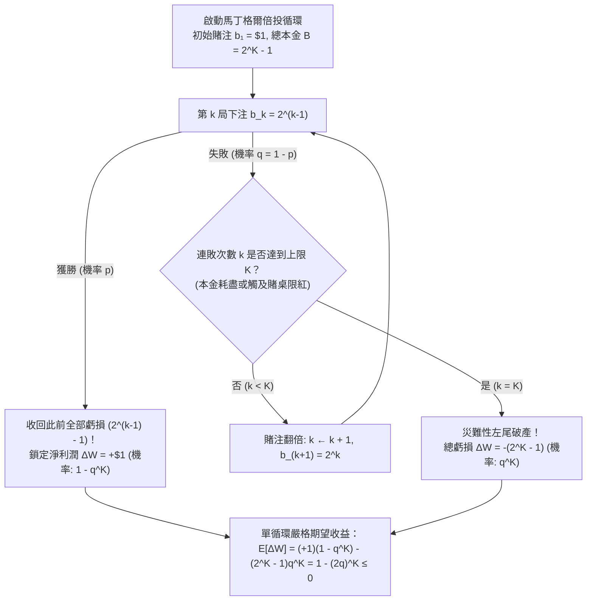
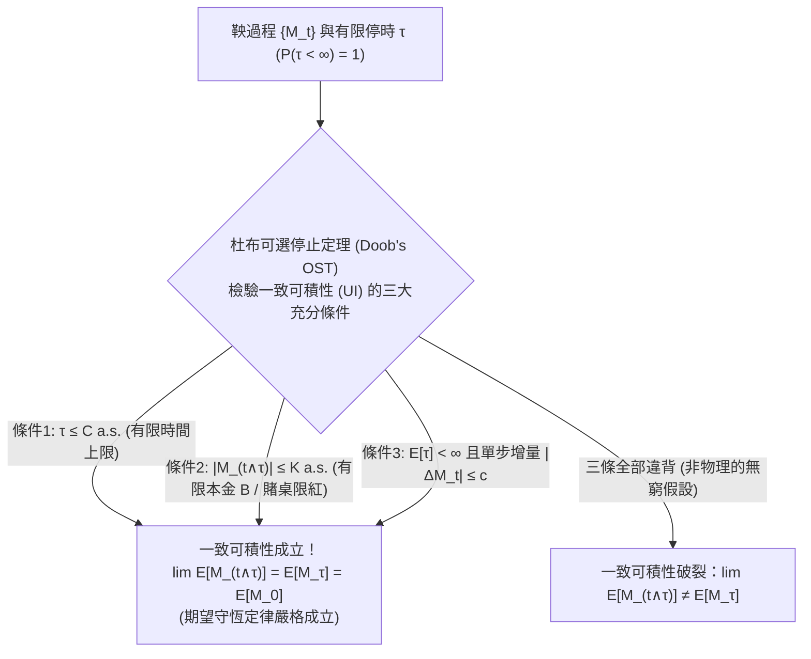

## 引言：18世紀賭場的誘人神話——「只要一直翻倍就絕不會輸」？

1754年的威尼斯，傳奇冒險家與作家<strong>賈科莫·卡薩諾瓦（Giacomo Casanova）</strong>在回憶錄《我的一生》中記述了他在賭場玩「法羅（Faro）」紙牌時的慘痛經歷。他典當了情人的鑽石籌集巨資，採用當時歐洲貴族秘密流傳的「必勝法則」——<strong>馬丁格爾倍投策略（Martingale Doubling Strategy）</strong>：每輸一局就將賭注翻倍。最初幾天他贏取了大量金幣，然而在一個災難性的下午，一連串罕見的連敗擊穿了他的全部資金，使他在幾小時內輸光了5000金幣。1891年夏天，英國投機客<strong>查爾斯·威爾斯（Charles Wells）</strong>在蒙地卡羅輪盤賭桌上同樣使用激進的倍投法，11小時內12次贏光賭桌儲備金（被稱為「攻破蒙地卡羅銀行的人」）；但當他次年重返賭場時，大數法則無情地收回了一切，他最終輸光全部家產，於1922年在巴黎貧病交加地死去。

為什麼幾百年來無數賭徒、知識分子乃至現代量化外匯（FX）交易員與避險基金都對「倍投法」深信不疑，最終卻無一例外地走向毀滅？

原因在於其<strong>初等算術上看似無懈可擊的完美性</strong>。考慮一個賠率為 $1:1$ 的二元博弈（如擲硬幣或輪盤賭押紅黑），單局獲勝機率為 $p \in (0, 1)$，失敗機率為 $q = 1 - p$。賭徒執行如下演算法：
1. 第 $1$ 局下注 $\$1$；若獲勝則淨賺 $+\$1$ 並結束本輪循環。
2. 若第 $1$ 局失敗，第 $2$ 局將賭注翻倍至 $\$2$。
3. 此後每輸一局都將賭注翻倍：第 $3$ 局 $\$4$，第 $4$ 局 $\$8$，……，第 $k$ 局下注 $\$2^{k-1}$。
4. <strong>一旦在第 $k$ 局首次獲勝，立即停止本輪循環</strong>，下一輪重新從 $\$1$ 開始。

假設賭徒在經歷了前 $k-1$ 局連敗後，終於在第 $k$ 局迎來首次獲勝。前 $k-1$ 局的累計虧損總額為等比數列之和：

$$L_{k-1} = \sum_{j=0}^{k-2} 2^j = 2^{k-1} - 1$$

而第 $k$ 局獲勝贏得的獎金為 $+2^{k-1}$。因此，在首次獲勝的第 $k$ 局結束瞬間，賭徒在整個循環中的<strong>累計淨利潤 $\Delta W$</strong> 恆為：

$$\Delta W = 2^{k-1} - \sum_{j=0}^{k-2} 2^j = 2^{k-1} - (2^{k-1} - 1) = +\$1$$

無論你是在第 $1$ 局就贏（$k=1$），還是連輸 $10$ 局後在第 $11$ 局才贏（$k=11$），抑或連輸 $100$ 局後在第 $101$ 局獲勝，<strong>只要贏下哪怕一次，此前所有的累計虧損都會被一筆勾銷，並穩賺 $+\$1$ 的淨利潤！</strong>
而且，永遠連輸下去的機率是多少？由於單局失敗機率 $q < 1$，連輸 $k$ 局的機率為 $q^k$。當 $k \to \infty$ 時：

$$\lim_{k \to \infty} q^k = 0 \implies \mathbb{P}(\tau < \infty) = 1 - 0 = 1$$

也就是說，首次獲勝的時刻 $\tau$ 幾乎必然（以 $100\%$ 的機率）是有限的！既然每個循環都以機率 $1$ 淨賺 $+\$1$，為什麼這個「永動機」在現實中會徹底破產？

---

## 第一章：馬丁格爾倍投陷阱的數學解剖——有限本金與塔勒布的「壓路機」

### 1.1 指數級爆炸的本金需求與賭場限紅（Table Limit）

「以機率 $1$ 穩賺 $+\$1$」的論證暗中偷換了兩個不可能存在於現實物理世界的<strong>無窮大假設</strong>：賭徒擁有無限本金（$B = \infty$），且賭場允許無限大的下注額（$b_k \to \infty$）。

在現實中，任何個人或基金的本金都是有限的，而且全球所有賭場都設有嚴格的<strong>賭桌投注上限（限紅，Table Limit）</strong>。假設賭徒的本金（或賭桌限紅）最多只能支撐 <strong>$K$ 次連續下注</strong>。為了在連輸 $K-1$ 次後還能擺出第 $K$ 局的賭注 $2^{K-1}$，賭徒必須擁有的<strong>初始總本金 $B_K$</strong> 為：

$$B_K = \sum_{j=0}^{K-1} 2^j = 2^K - 1$$

下表展示了隨著連敗局數 $k$ 的增加，所需賭注與累計本金如何呈指數級爆炸（對比公平硬幣 $q = 0.5$ 與歐洲單零輪盤賭 $p = 18/37 \approx 0.4865, q = 19/37 \approx 0.5135$）：

| 連敗局數 $k$ | 第 $k$ 局賭注 $b_k = 2^{k-1}$ | 所需累計總本金 $B_k = 2^k - 1$ | 獲勝時淨利潤 | 連輸 $k$ 局機率 $q^k$（公平硬幣 $q=0.5$） | 連輸 $k$ 局機率 $q^k$（歐洲輪盤 $q=19/37$） |
| :--- | :--- | :--- | :--- | :--- | :--- |
| $k = 1$ | $\$1$ | $\$1$ | $+\$1$ | $50.000\%$ | $51.351\%$ |
| $k = 5$ | $\$16$ | $\$31$ | $+\$1$ | $3.125\%$ | $3.570\%$ |
| $k = 10$ | $\$512$ | $\$1,023$ | $+\$1$ | $0.0977\%$（每 $1,024$ 輪 $1$ 次） | $0.1276\%$（每 $784$ 輪 $1$ 次） |
| $k = 15$ | $\$16,384$ | $\$32,767$ | $+\$1$ | $0.00305\%$ | $0.00456\%$ |
| $k = 20$ | $\$524,288$ | $\$1,048,575$ | $+\$1$ | $0.000095\%$ | $0.000163\%$（每 $61$ 萬輪 $1$ 次） |
| $k = 30$ | $\$536,870,912$ | $\$1,073,741,823$ | $+\$1$ | $9.31 \times 10^{-10}$ | $2.09 \times 10^{-9}$ |

### 1.2 有限本金容量 $K$ 下的單循環嚴格數學期望值

當最大承受連敗次數為 $K$（本金 $B = 2^K - 1$）時，單輪馬丁格爾循環只有兩種互斥結局：
1. <strong>成功（在前 $K$ 局內至少贏一次）</strong>：發生機率為 $1 - q^K$，淨收益為 $+\$1$。
2. <strong>災難性爆倉（連續 $K$ 局全部失敗）</strong>：發生機率為 $q^K$，淨虧損為 $-\$(2^K - 1)$。

因此，單輪循環財富變化量 $\Delta W$ 的嚴格數學期望值為：

$$\mathbb{E}[\Delta W] = (+1) \cdot (1 - q^K) - (2^K - 1) q^K = 1 - q^K - 2^K q^K + q^K = 1 - (2q)^K \le 0 \quad \left(\text{當 } q \ge \frac{1}{2}\right)$$

這一核心公式揭示了三大鐵律：
- <strong>公平博弈（$p = q = 1/2$）</strong>：此時 $2q = 1$，故 $\mathbb{E}[\Delta W] = 1 - 1^K = 0$。無論你的本金有多雄厚（無論 $K = 10$ 還是 $K = 100$），高機率的 $+\$1$ 微利與極小機率的 $-\$(2^K - 1)$ 巨額爆倉精確抵消，<strong>期望收益恆等於零</strong>！而且若不設上限（$K \to \infty$），為了贏取 $\$1$ 所需投入的期望最終賭注為無窮大：$\mathbb{E}[2^{\tau-1}] = \sum_{k=1}^\infty 2^{k-1}(1/2)^k = +\infty$。
- <strong>賭場優勢博弈（$p < 1/2 \implies q > 1/2$）</strong>：此時 $2q > 1$，故 $\mathbb{E}[\Delta W] = 1 - (2q)^K < 0$。更可怕的是，<strong>你準備的本金 $K$ 越雄厚，單輪循環的期望虧損反而呈指數級惡化！</strong> 因為單輪期望總流水為 $\mathbb{E}[S_K] = \sum_{j=0}^{K-1} (2q)^j = \frac{(2q)^K - 1}{2q - 1}$，賭場對每一美元流水徵收 $(2q - 1)$ 的賭場優勢稅。

正如《黑天鵝效應》作者<strong>納西姆·尼古拉斯·塔勒布（Nassim Nicholas Taleb）</strong>所指出的，馬丁格爾策略並未改變隨機漫步的期望漂移，而是對收益分佈實施了極端的<strong>負偏度（Negative Skewness）扭曲</strong>——把原本對稱的隨機漫步變成了<strong>「在壓路機前撿硬幣（Picking up pennies in front of a steamroller）」</strong>的尾部風險炸彈。1995年搞垮霸菱銀行的尼克·李森（Nick Leeson）和1998年破產的長期資本管理公司（LTCM），皆死於這一數學結構。

---

## 第二章：惠更斯與帕斯卡的「賭徒破產問題（1657）」——吸收壁隨機漫步與精確解

如果賭徒放棄危險的倍投法，改為每次只老老實實下注固定的 $\$1$ 單位（平注法，Flat Betting），結果又會如何？
這就是1656年帕斯卡向費馬提出、並由<strong>克里斯蒂安·惠更斯（Christiaan Huygens）</strong>在1657年著作《論賭博中的計算》中正式發表的經典<strong>「賭徒破產問題（Gambler's Ruin Problem）」</strong>。

設賭徒初始本金為 $X_0 = k$ 單位，對手（賭場）擁有 $N - k$ 單位，系統總資金固定為 $N$（在 $0$ 和 $N$ 處設有兩個<strong>吸收壁 / Absorbing Barriers</strong>）。每步賭徒以機率 $p$ 贏 $+1$，以機率 $q = 1 - p$ 輸 $-1$，直至停時 $\tau = \inf\{t \ge 0 : X_t \in \{0, N\}\}$ 遊戲結束。

記 $P_k = \mathbb{P}(X_\tau = N \mid X_0 = k)$ 為從本金 $k$ 出發、在破產歸零前成功達到目標金額 $N$ 的獲勝機率。由全機率公式與馬可夫性（第一步分析法），$P_k$ 滿足<strong>二階常係數齊次線性差分方程</strong>：

$$P_k = p P_{k+1} + q P_{k-1} \quad (1 \le k \le N - 1), \qquad P_0 = 0, \quad P_N = 1$$

將左端寫為 $(p + q) P_k$ 並移項整理，可得相鄰差分滿足等比關係：

$$p(P_{k+1} - P_k) = q(P_k - P_{k-1}) \implies P_{j+1} - P_j = \left(\frac{q}{p}\right)^j (P_1 - P_0) = \left(\frac{q}{p}\right)^j P_1$$

對 $j = 0, 1, \dots, k-1$ 進行裂項求和（望遠鏡求和），並代入上邊界條件 $P_N = 1$，即可導出完整的精確閉合解：

$$P_k = \begin{cases} \dfrac{k}{N} & \text{若 } p = q = \dfrac{1}{2} \;\text{（公平博弈 / Fair Game）} \\[12pt] \dfrac{1 - (q/p)^k}{1 - (q/p)^N} & \text{若 } p \ne q \;\text{（有偏博弈 / Biased Game）} \end{cases}$$

### 精確解揭示的兩大震撼推論：
1. <strong>面對無限富有的賭場（$N \to \infty$），即便在 $100\%$ 公平的博弈中也必將破產！</strong>
   在公平博弈（$p = q = 1/2$）中令賭場資金 $N \to \infty$（或者賭徒不設停利上限一直賭下去）：

   $$\lim_{N \to \infty} P_k = \lim_{N \to \infty} \frac{k}{N} = 0 \implies \lim_{N \to \infty} R_k = \lim_{N \to \infty} \left(1 - \frac{k}{N}\right) = 1 \quad (100\%\text{ 必然破產！})$$

   由於一維對稱簡單隨機漫步具有<strong>零常返性（Null Recurrence）</strong>，其軌道振幅無界，必然會在某個有限時刻觸碰下吸收壁 $X = 0$。僅僅是「有限本金對抗無限市場」這一邊界不對稱性，就足以保證 $100\%$ 的破產率！
2. <strong>微小的賭場優勢構築的指數級高牆（輪盤賭翻倍失敗率高達 $99.997\%$）</strong>：
   假設你帶著 $k = \$100$ 走進賭場，希望翻倍到 $N = \$200$ 就離場。若採取一把全押（<strong>大膽博弈 / Bold Play</strong>），在歐洲輪盤（$p = 18/37$）中成功率高達 <strong>$48.65\%$</strong>。
   但若你每次謹慎地下注 $\$1$（<strong>保守博弈 / Timid Play</strong>，$k = 100, N = 200$），成功機率變為 $P_{100} = \frac{1}{1 + (q/p)^{100}}$：
   - 在<strong>歐洲輪盤</strong>（$p = 18/37, q/p = 19/18 \approx 1.0556$）中，$(19/18)^{100} \approx 222.26$，成功率僅為 <strong>$0.448\%$</strong>（破產率 <strong>$99.552\%$</strong>；若每次押 $\$0.50$ 即 $k=200, N=400$，破產率高達 <strong>$99.998\%$</strong>）！
   - 在<strong>美式輪盤</strong>（$p = 18/38, q/p = 10/9 \approx 1.1111$）中，$(10/9)^{100} \approx 37,648.6$，成功率僅為 <strong>$0.00266\%$</strong>，<strong>破產機率高達驚人的 $99.9973\%$</strong>！這正是著名的<strong>杜賓斯-薩維奇定理（Dubins-Savage Theorem, 1965）</strong>：在負期望博弈中，分割賭注會啟動大數法則，使你必死無疑；唯有盡量減少博弈次數的「大膽全押」才是最優策略。

---

## 第三章：保羅·萊維與約瑟夫·杜布的現代鞅論與可選停止定理（OST）

為了從根本上證明<strong>任何動態調整賭注的策略都無法戰勝公平博弈</strong>，20世紀數學家<strong>保羅·萊維（Paul Lévy）</strong>與<strong>約瑟夫·杜布（Joseph Leo Doob）</strong>建立了現代測度論機率論的核心——<strong>鞅論（Martingale Theory）</strong>。

設 $(\Omega, \mathcal{F}, \{\mathcal{F}_t\}_{t \ge 0}, \mathbb{P})$ 為帶資訊流（Filtration）的機率空間，其中 $\mathcal{F}_t$ 代表截至時刻 $t$ 的全部歷史資訊。適應過程 $\{M_t\}_{t \ge 0}$ 若滿足可積性 $\mathbb{E}[|M_t|] < \infty$，則稱為：
- <strong>鞅（Martingale，公平博弈）</strong>：$\mathbb{E}[M_{t+1} \mid \mathcal{F}_t] = M_t$ a.s.
- <strong>下鞅（Submartingale，有利博弈）</strong>：$\mathbb{E}[M_{t+1} \mid \mathcal{F}_t] \ge M_t$ a.s.
- <strong>上鞅（Supermartingale，不利博弈）</strong>：$\mathbb{E}[M_{t+1} \mid \mathcal{F}_t] \le M_t$ a.s.

任何不具備預知未來能力的下注策略 $\{H_k\}$ 都必須是<strong>可預測過程（Predictable Process）</strong>，即第 $k$ 局的賭注只依賴於前 $k-1$ 局的歷史資訊（$H_k \in \mathcal{F}_{k-1}$）。賭徒在時刻 $n$ 的累計財富由<strong>離散隨機積分（鞅變換 / Martingale Transform）</strong>給出：

$$W_n = W_0 + (H \cdot M)_n = W_0 + \sum_{k=1}^n H_k (M_k - M_{k-1})$$

由於 $\mathbb{E}[H_n (M_n - M_{n-1}) \mid \mathcal{F}_{n-1}] = H_n \mathbb{E}[M_n - M_{n-1} \mid \mathcal{F}_{n-1}] = 0$，<strong>鞅變換仍然是鞅</strong>，在任意確定性時刻 $n$ 恆有 $\mathbb{E}[W_n] = W_0 = 0$！

那麼，為什麼在隨機停時 $\tau = \inf\{n \ge 1 : W_n = +1\}$ 處會出現 $\mathbb{E}[W_\tau] = +1 \ne 0 = \mathbb{E}[W_0]$ 的悖論？
<strong>杜布可選停止定理（Doob's Optional Stopping Theorem, OST）</strong>給出了終極解答：對於有限停時 $\tau$（$\mathbb{P}(\tau < \infty) = 1$），等式 $\mathbb{E}[M_\tau] = \mathbb{E}[M_0]$ 成立<strong>當且僅當</strong>停止過程族 $\{M_{t \wedge \tau}\}_{t \ge 0}$ <strong>一致可積（Uniformly Integrable, UI）</strong>，這在滿足以下<strong>三個充分條件中的任意一條</strong>時必然成立：
1. <strong>停時有界</strong>：存在常數 $C < \infty$ 使得 $\mathbb{P}(\tau \le C) = 1$；或
2. <strong>停止過程有界</strong>：存在常數 $K < \infty$ 使得對所有 $t$ 有 $|M_{t \wedge \tau}| \le K$ a.s.（對應現實中的有限本金與限紅！）；或
3. <strong>停時期望有限且條件增量有界</strong>：$\mathbb{E}[\tau] < \infty$ 且存在常數 $c < \infty$ 使得 $\mathbb{E}[|M_{t+1} - M_t| \mid \mathcal{F}_t] \le c$ a.s.

在無限制馬丁格爾倍投中，雖然 $\mathbb{E}[\tau] = 2 < \infty$，但單步增量 $|W_{t+1} - W_t| = 2^t \to \infty$ 破壞了全部三條條件；一旦回到現實世界，有限本金立即觸發<strong>條件2</strong>，將期望收益無情地拉回 $\mathbb{E}[W_{\tau \wedge K}] = 0$！

### 利用瓦爾德恆等式（Wald's Identity）與二次鞅秒解破產期望時間 $\mathbb{E}[\tau]$
在賭徒破產問題中，藉助三個經典鞅與杜布可選停止定理，無需解差分方程即可瞬間導出全部結論：
1. <strong>線性鞅 $M_t^{(1)} = X_t$（當 $p=1/2$）</strong>：由 $\mathbb{E}[X_\tau] = N P_k = k \implies P_k = k/N$。
2. <strong>棣莫弗指數鞅 $M_t^{(2)} = (q/p)^{X_t}$（當 $p \ne q$）</strong>：由 $\mathbb{E}[(q/p)^{X_\tau}] = P_k (q/p)^N + (1 - P_k) = (q/p)^k \implies P_k = \frac{1 - (q/p)^k}{1 - (q/p)^N}$。
3. <strong>二次補償鞅 $M_t^{(3)} = X_t^2 - t$（當 $p=1/2$）</strong>：由於 $\mathbb{E}[X_{t+1}^2 - (t+1) \mid \mathcal{F}_t] = X_t^2 + 1 - t - 1 = X_t^2 - t$，由可選停止定理得：

   $$\mathbb{E}[X_\tau^2 - \tau] = k^2 \implies \mathbb{E}[\tau] = N^2 \left(\frac{k}{N}\right) - k^2 = k(N - k)$$

   當賭場資金無限（$N \to \infty$）時，$\lim_{N \to \infty} \mathbb{E}[\tau] = \infty$：<strong>儘管破產以 $100\%$ 的機率發生（$\mathbb{P}(\tau < \infty) = 1$），但直到破產為止的期望時間卻是無窮大（$\mathbb{E}[\tau] = \infty$，因此違背了條件3）！</strong> 而在有偏博弈（$p \ne q$）中，由<strong>瓦爾德恆等式</strong> $\mathbb{E}[X_\tau - k] = (p - q)\mathbb{E}[\tau]$ 可得 $\mathbb{E}[\tau] = \frac{k - N P_k}{q - p}$（當 $N \to \infty, q > p$ 時為 $\frac{k}{q - p}$）。在現代金融數學中，唯有當擁有正期望優勢（$p > 1/2$）並採用按本金比例下注的<strong>凱利公式（Kelly Criterion, $f^* = p - q$）</strong>時，才能在實現零破產機率的同時最大化長期對數成長率。
