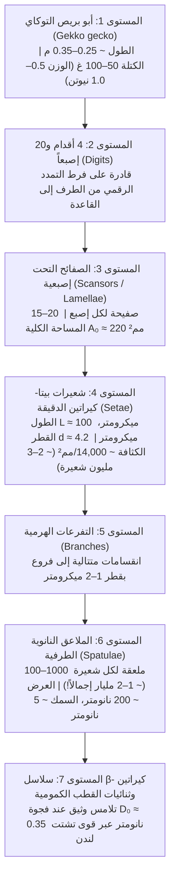
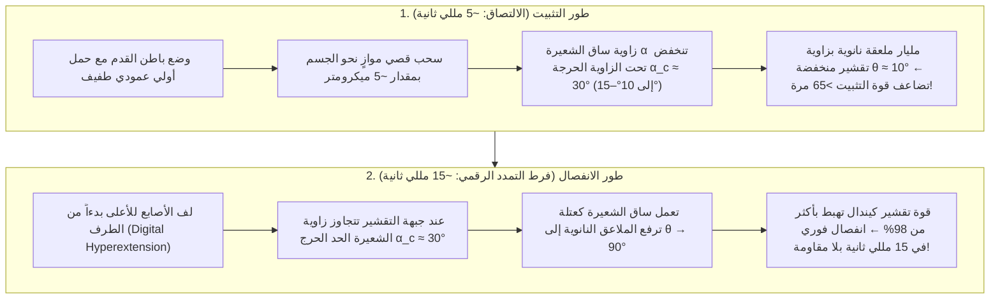

## 1. مقدمة: دهشة أرسطو ولغز الميكانيكا الحيوية الذي دام 2300 عام

في القرن الرابع قبل الميلاد، سجّل الفيلسوف وعالم الطبيعة اليوناني أرسطو (Aristotle, 384–322 قبل الميلاد) في كتابه الشهير «تاريخ الحيوان» (*Historia Animalium*، الكتاب التاسع، الفصل التاسع) ملاحظة مذهلة حول سحلية متوسطية صغيرة تُعرف باسم أبو بريص أو الوزغ (*Askalaros* أو *Ascalabotes*):

> «يستطيع أبو بريص أن يركض صعوداًوهبوطاً على جذع الشجرة بأي طريقة كانت، <strong>حتى ورأسه متجه إلى الأسفل</strong>».
> — أرسطو، *تاريخ الحيوان* (نحو 350 ق.م)

بعد مرور أكثر من ألفي عام، يظل هذا التحدي الظاهري للجاذبية أحد أعظم روائع الفيزياء الحيوية وميكانيكا التلامس. يصل طول <strong>أبو بريص التوكاي (*Gekko gecko*)</strong> المنتشر في جنوب شرق آسيا إلى $25\text{–}35\,\text{cm}$ ويتراوح وزنه بين $50\text{ و}100\,\text{g}$ (وقد يصل إلى $300\,\text{g}$). وعلى الرغم من كتلته الكبيرة مقارنة بالحشرات، فإنه يستطيع العدو بسرعة تتجاوز $1\,\text{m/s}$ صعوداً على جدار زجاجي عمودي فائق النعومة أو السير مقلوباً على سقف زجاجي بزاوية $180^\circ$. وبمعدل $15\text{ خطوة في الثانية}$، يثبّت قدمه خلال $5\,\text{ms}$ وينزعها في غضون <strong>$15\,\text{ms}$ ($0.015\text{ ثانية}$)</strong> بقوة فصل تقترب من الصفر.

والأكثر إذهالاً أن أبو بريص <strong>لا يترك أي أثر لمخاط أو دهون أو صمغ كيميائي</strong> على الزجاج. فعلى عكس النمل والخنافس وضفادع الأشجار التي تفرز سوائل لاصقة («الالتصاق الرطب»)، تخلو وسائد أصابع أبو بريص تماماً من أي غدد إفرازية؛ إنه <strong>التصاق جاف (Dry Adhesion)</strong> يتكون حصرياً من بروتين <strong>بيتا-كيراتين ($\beta$-keratin)</strong> الكاره للماء. ولو عملت جميع الشعيرات المجهرية (*setae*) البالغ عددها نحو $2\text{ مليون}$ شعيرة في أقدامه الأربع معاً بأقصى طاقتها، لأمكنها نظرياً حمل وزن يتراوح بين <strong>$80\text{ و}130\,\text{kg}$ — أي أكثر من $1000$ ضعف وزن جسمه!</strong>

---

## 2. الفرضيات التاريخية السبع التي دحضتها التجارب الحاسمة (Autumn et al., 2000 & 2002)

منذ القرن التاسع عشر وحتى مطلع القرن الحادي والعشرين، طُرحت سبع فرضيات فيزيائية وتشريحية. وبفضل التجارب الرائدة التي أجراها <strong>فولف-ديتريش ديليت (Wolf-Dietrich Dellit, 1934)</strong>، والمجهر الإلكتروني لـ <strong>رويبال وإرنست (Ruibal & Ernst, 1965)</strong>، والأبحاث الحاسمة لفريق <strong>كيلار أوتوم (Kellar Autumn) وروبرت فول (Robert J. Full) وتوماس كيني (Thomas W. Kenny) ورونالد فيرينغ (Ronald Fearing) وجيكوب إسرائيل أشفيلي (Jacob N. Israelachvili)</strong> في مجلتي *Nature* (2000) و*PNAS* (2002)، تم دحض ست فرضيات منها نهائياً:

1. <strong>فرضية الممصات الهوائية / الشفط (Suction, Simmermacher 1884)</strong>:
   - <strong>التفنيد التجريبي</strong>: وضع ديليت (1934) حيوانات أبو بريص حية داخل غرفة مفرغة من الهواء ($P_{\text{atm}} \to 0$)، فظلت أقدامها ملتصقة في الفراغ بنفس القوة كما في الهواء! علاوة على ذلك، فإن الحد الأقصى النظري لشفط الضغط الجوي عند مستوى سطح البحر هو $1\,\text{atm} \approx 101.3\,\text{kPa}$، بينما تولّد شعيرة واحدة من قدم أبو بريص إجهاد التصاق يبلغ <strong>$1000\,\text{kPa}$ ($1\,\text{MPa} \approx 10\,\text{atm}$، Autumn et al., 2000)</strong>.
2. <strong>فرضية الصمغ الكيميائي أو الإفرازات المخاطية (Wagler 1830)</strong>:
   - <strong>التفنيد التجريبي</strong>: تتكون بشرة القدم من $\beta$-كيراتين نقي <strong>بلا أي غدد إفرازية</strong>، ولا تترك أي بقايا، كما أنها تنظف نفسها ذاتياً (Hansen & Autumn, 2005).
3. <strong>الاحتكاك الكولومي المحض (Pure Friction)</strong>:
   - <strong>التفنيد التجريبي</strong>: يتطلب احتكاك كولوم الكلاسيكي $F_f = \mu N$ قوة عمودية ضاغطة موجبة $N > 0$، وينهار تماماً على السقف المقلوب ($N = -mg < 0$) ما لم توجد قوة التصاق شد عمودية.
4. <strong>التشابك الميكانيكي المجهري (الخطاطيف المجهرية، Hora 1923; Mahendra 1941)</strong>:
   - <strong>التفنيد التجريبي</strong>: يلتصق أبو بريص بأقصى قوة ممكنة على <strong>بلورات الميكا المشطورة الملساء ذرياً (خشونة $\text{RMS} < 0.1\,\text{nm}$)</strong> ورقائق السيليكون المصقولة (Autumn et al., 2000).
5. <strong>التجاذب الكهروسكوني (الشحن بالاحتكاك، Schmidt 1904)</strong>:
   - <strong>التفنيد التجريبي</strong>: قام ديليت (1934) بتأيين الهواء المحيط بالأقدام باستخدام <strong>الأشعة السينية وإشعاعات الراديوم</strong> لتفريغ أي شحنة كهربائية ساكنة، فلم يتأثر الالتصاق إطلاقاً.
6. <strong>الجسور الشعرية المائية (ضغط لابلاس، Stork 1980) مقابل قوى فان دير فالس (Autumn et al., 2002)</strong>:
   لو كانت جسور الماء الدقيقة هي المسؤولة عبر القوة الشعرية $F_{\text{cap}} = 4\pi R\gamma_L \cos\theta_c$، لانهار الالتصاق على الأسطح الكارهة للماء بشدة ($\theta_c > 90^\circ \implies \cos\theta_c < 0$).
   - <strong>التجربة الحاسمة في *PNAS* (Autumn et al., 2002)</strong>: قاس الفريق قوة الالتصاق على شبه موصل <strong>زرنيخيد الغاليوم الكاره للماء بشدة ($\text{GaAs}$، زاوية تلامس الماء $\theta_c \approx 110^\circ$)</strong> مقارنة بـ <strong>ثاني أكسيد السيليكون المحب للماء بشدة ($\text{SiO}_2$، $\theta_c < 5^\circ$)</strong>. ونظراً لأن كلا السطحين يتمتعان بقابلية استقطاب عازلة عالية، فقد أظهر أبو بريص الحي والشعيرات المنفردة <strong>نفس قوة الالتصاق القصي تماماً ($\sim 200\,\text{kPa}$) على $\text{GaAs}$ الكاره للماء وعلى $\text{SiO}_2$ المحب للماء</strong>! وهذا أثبت بشكل قاطع أن الآلية الأساسية هي <strong>قوى تشتت فان دير فالس (لندن) الكمومية</strong>.

| الرقم | الفرضية التاريخية | أبرز المؤيدين | الآلية الفيزيائية | التفنيد التجريبي الحاسم |
| :--- | :--- | :--- | :--- | :--- |
| <strong>1</strong> | <strong>الشفط / الممصات</strong> | Simmermacher (1884) | فرق الضغط الجوي $P_{\text{atm}} \approx 101\,\text{kPa}$ | <strong>يعمل بكفاءة كاملة في الفراغ العالي ($P \to 0$)</strong> (Dellit 1934)؛ الإجهاد ($1\,\text{MPa}$) يفوق الضغط الجوي بـ 10 مرات. |
| <strong>2</strong> | <strong>الصمغ / المخاط</strong> | Wagler (1830) | إفرازات غدية لزجة | $\beta$-كيراتين نقي <strong>خالٍ تماماً من الغدد (التصاق جاف 100%)</strong>، بلا بقايا وذاتي التنظيف. |
| <strong>3</strong> | <strong>الاحتكاك المحض</strong> | علم الاحتكاك الكلاسيكي | معامل احتكاك مرتفع $\mu$ | يفشل على الأسقف المقلوبة ($N = -mg < 0$) بدون قوة شد عمودية. |
| <strong>4</strong> | <strong>الخطاطيف المجهرية</strong> | Hora (1923) | التشابك الميكانيكي مع النتوءات | <strong>أقصى التصاق يحدث على سطح الميكا الأملس ذرياً ($\text{RMS} < 0.1\,\text{nm}$)</strong> (Autumn 2000). |
| <strong>5</strong> | <strong>الكهرباء الساكنة</strong> | Schmidt (1904) | شحنات احتكاكية $\sigma_q^2/(2\varepsilon_0)$ | <strong>تأيين الهواء بالأشعة السينية لتفريغ الشحنات لا يضعف الالتصاق</strong> (Dellit 1934). |
| <strong>6</strong> | <strong>الخاصية الشعرية المائية</strong> | Stork (1980) | جسور الماء $4\pi R\gamma_L\cos\theta_c$ | <strong>التصاق متطابق ($\sim 200\,\text{kPa}$) على $\text{GaAs}$ الكاره للماء ($\theta_c = 110^\circ$) و$\text{SiO}_2$ المحب للماء</strong> (Autumn 2002). |
| <strong>7</strong> | <strong>قوى فان دير فالس</strong> | Hiller (1968), Autumn (2000, 2002) | التقلبات الكمومية لنقطة الصفر (تشتت لندن) | <strong>مؤكد بجميع التجارب</strong>: يتناسب مع ثابت هاماكر $A_H$ ويعمل في الفراغ وعند $-190^\circ\text{C}$. |

---

## 3. الهيكل الهرمي ذو المستويات السبعة ومعيار دالكويست (Dahlquist Criterion)

لا تعمل قوى فان دير فالس إلا عبر فجوات ذرية ضيقة للغاية ($D_0 \approx 0.3\text{–}0.4\,\text{nm}$). وللتغلب على خشونة الأسطح من مقياس الملليمتر إلى النانومتر، طوّر أبو بريص بنية هرمية من 7 مستويات:

### 3.1 ميكانيكا عوارض أويلر-برنولي ومعيار دالكويست للالتصاق

إن مادة $\beta$-كيراتين الصلبة تمتلك معامل يونغ مرتفعاً جداً يبلغ $E_{\text{bulk}} \approx 2.0\,\text{GPa}$. غير أنه وفقاً لـ <strong>معيار دالكويست (Carl A. Dahlquist, 1966)</strong>، يجب أن يكون <strong>معامل المرونة الفعال للمادة اللاصقة $E_{\text{eff}} \le 100\text{–}300\,\text{kPa}$</strong> كي تتكيف تلقائياً مع خشونة السطح.

ومن خلال تشكيل الكيراتين الصلب في صورة عوارض كابولية مائلة بزاوية $\alpha_0 \approx 45^\circ$ ($L \approx 100\,\mu\text{m}$، نصف القطر $r \approx 2.1\,\mu\text{m}$، المسافة البينية $s \approx 8.5\,\mu\text{m}$، عزم القصور الذاتي $I = \frac{\pi r^4}{4}$) ذات صلابة انحناء $k_\perp = \frac{3 E_{\text{bulk}} I}{L^3 \sin^2\alpha_0}$، ينخفض المعامل الفعال بمقدار أربع رتب أسية:

$$E_{\text{eff}} = \frac{k_\perp L \sin\alpha_0}{s^2} = \frac{3\pi}{4 \sin\alpha_0} E_{\text{bulk}} \left(\frac{r}{L}\right)^2 \left(\frac{r}{s}\right)^2 \approx 80\text{–}100\,\text{kPa}$$

تولّد كل ملعقة نانوية قوة $\sim 10\,\text{nN}$ (Huber et al., 2005)، وتتحمل كل شعيرة من $40\,\mu\text{N}$ إلى $194 \pm 25\,\mu\text{N}$ (Autumn et al., 2000)، مما يمنح الأقدام الأربع قدرة نظرية إجمالية تصل إلى $80\text{–}130\,\text{kg}$!

---

## 4. الديناميكا الكهربائية الكمومية لقوى فان دير فالس وتشتت لندن ونظرية كازيمير-ليفشيتز

يُعطى جهد فان دير فالس بين جزيئين متعادلين تفصل بينهما مسافة $r$ بالعلاقة:

$$U_{\text{vdW}}(r) = -\frac{C_{\text{Keesom}} + C_{\text{Debye}} + C_{\text{London}}}{r^6}$$

وفي مادة $\beta$-كيراتين غير القطبية، تهيمن <strong>قوة تشتت لندن (Fritz London, 1930)</strong> الناتجة عن التقلبات الكمومية لنقطة الصفر للمذبذبات التوافقية ثلاثية الأبعاد (التردد $\omega_0$، قابليات الاستقطاب $\alpha_1, \alpha_2$):

$$U_{\text{London}}(r) = -\frac{3}{4} \frac{\hbar \omega_0 \alpha_1 \alpha_2}{(4\pi\varepsilon_0)^2 r^6}$$

وبإجراء التكامل الحجمي لطرف ملعقة كروي نصف قطره $R \approx 100\,\text{nm}$ على مسافة $D_0 \approx 0.35\,\text{nm}$ من سطح مستوٍ وفقاً لـ <strong>هوغو هاماكر (Hugo C. Hamaker, 1937)</strong> و<strong>يفغيني ليفشيتز (Evgeny Lifshitz, 1956)</strong> (مع ثابت هاماكر $A_H = \pi^2 C \rho_1 \rho_2 \approx 10^{-19}\,\text{J}$)، نحصل على:

$$F_{\text{vdW}}(D_0) = \frac{A_H R}{6 D_0^2} \approx 13.6\,\text{nN}$$

وتفسر نظرية ليفشيتز سبب انزلاق أبو بريص على <strong>متعدد رباعي فلورو الإيثيلين (PTFE / التيفلون)</strong>؛ إذ إن السالبية الكهربائية العالية لذرات الفلور في روابط $\text{C–F}$ تقلل معامل الانكسار إلى أدنى حد ($n_{\text{PTFE}} \approx 1.35$)، مما يخفض ثابت هاماكر $A_H$ إلى أقل من النصف!

---

## 5. مبدأ تقسيم التلامس ("Contact Splitting") عبر ميكانيكا التلامس JKR

وفقاً لـ <strong>نظرية جونسون-كيندال-روبرتس (JKR, 1971)</strong>، فإن نصف قطر التلامس $a$ وقوة النزع (*pull-off force*) $F_{\text{JKR}}^{(1)}$ لنصف كرة مرنة نصف قطرها $R$ وشغل التصاقها $W_{\text{ad}} = \Delta\gamma$ هما:

$$a^3 = \frac{3 R}{4 E^*} \left( P + 3\pi W_{\text{ad}} R + \sqrt{6\pi W_{\text{ad}} R P + (3\pi W_{\text{ad}} R)^2} \right) \implies F_{\text{JKR}}^{(1)} = \frac{3}{2}\pi W_{\text{ad}} R$$

ولأن قوة النزع <strong>تتناسب طردياً مع نصف القطر الخطي $R$ (وليس المساحة $\pi R^2$!)</strong>، أثبت <strong>أرتز وغورب وسبوليناك (Arzt, Gorb, & Spolenak, 2003, *PNAS*)</strong> أن تقسيم مساحة ظاهرية $\pi R_0^2$ إلى $N$ تلامسات فرعية نصف قطر كل منها $r_N = R_0 / \sqrt{N}$ يضاعف قوة الالتصاق الكلية بمقدار $\sqrt{N}$:

$$\boxed{F_{\text{total}}(N) = N \cdot \frac{3}{2}\pi W_{\text{ad}} \left(\frac{R_0}{\sqrt{N}}\right) = \sqrt{N} \, F_{\text{JKR}}^{(1)}}$$

<strong>إن تقسيم التلامس إلى $N = 10^9$ ملعقة نانوية يضاعف قوة الالتصاق الإجمالية بمقدار $\sqrt{10^9} \approx 31,623$ مرة (أكثر من 30 ألف ضعف)!</strong> وهذا يفسر قانون التدرج التطوري لكثافة الشعيرات $\rho_A \propto m^{2/3}$ من الذباب إلى أبو بريص، وكذلك انعدام الحساسية للعيوب تحت نصف القطر الحرج لـ غاو وياو (Gao & Yao, 2004) $r_{\text{crit}} = \frac{8 E^* W_{\text{ad}}}{\pi \sigma_{\text{th}}^2} \approx 170\,\text{nm}$.

---

## 6. مفارقة الانفصال السهل في 15 مللي ثانية: معادلة كيندال للتقشير وفرط التمدد الرقمي

كيف ينزع أبو بريص قدمه في $15\,\text{ms}$ دون جهد؟ تُعطى <strong>معادلة تقشير الشريط المرن لكيفن كيندال (Kendall, 1971)</strong> (العرض $b$، السمك $d$، المعامل $E$) عند زاوية تقشير $\theta$ بالعلاقة:

$$\left(\frac{F_{\text{peel}}}{b}\right)^2 \frac{1}{2 d E} + \frac{F_{\text{peel}}}{b}(1 - \cos\theta) = W_{\text{ad}} \implies F_{\text{peel}}(\theta) \approx \frac{b W_{\text{ad}}}{1 - \cos\theta}$$

عند السحب الموازي ($\theta \approx 10^\circ, \alpha < 30^\circ$)، يعطي المعامل $1 - \cos 10^\circ \approx 0.0152$ قوة تثبيت هائلة ($F_{\text{peel}}(10^\circ) \approx 65.8\,b W_{\text{ad}}$). وعند الانفصال عبر <strong>فرط التمدد الرقمي</strong> (لف الأصابع للأعلى من أطرافها)، تتجاوز زاوية الشعيرة الحد الحرج $\alpha_c \approx 30^\circ$ (Autumn et al., 2006)، فترتفع الملاعق إلى $\theta \approx 90^\circ$ ($1 - \cos 90^\circ = 1$) وتنخفض قوة النزع المطلوبة بنحو مئة مرة!

---

## 7. التنظيف الذاتي الجاف والتطبيقات الهندسية الحيوية (ملاقط الفضاء في NASA JPL)

1. <strong>التنظيف الذاتي بالتلامس (Hansen & Autumn, 2005 *PNAS*)</strong>: تتعرض ذرة الغبار التي يبلغ نصف قطرها $R_p \approx 2.5\,\mu\text{m}$ لقوة جذب فان دير فالس نحو الجدار المستوي $F_{\text{particle-wall}} \propto R_p$ أكبر بكثير من مجموع قوى الجذب $F_{\text{particle-setae}} \propto n R_s$ نحو الملاعق النانوية القليلة ($R_s \approx 100\,\text{nm}$) الملامسة لها. وخلال $4\text{ إلى }8\text{ خطوات}$ فقط، ينتقل الغبار إلى الجدار وتستعيد القدم $80\%$ من قوتها.
2. <strong>المحاكاة الحيوية وملاقط الحطام الفضائي في NASA JPL (Parness, Jiang et al., 2017 *Science Robotics*)</strong>: من الأعمدة البوليمرية الدقيقة لأندريه غيم (2003)، والأوتاد الدقيقة الموجهة في جامعة ستانفورد التي مكّنت إنساناً وزنه $70\,\text{kg}$ من تسلق واجهة زجاجية (Hawkes et al., 2014)، وسجاد أنابيب الكربون النانوية ($100\,\text{N/cm}^2$، Qu et al., 2008)، وصولاً إلى <strong>ملاقط الحطام الفضائي وروبوتات *Astrobee* في محطة الفضاء الدولية التابعة لـ NASA JPL</strong>، يعمل التصاق فان دير فالس الجاف بكفاءة تامة في فراغ الفضاء وعند درجة حرارة $-190^\circ\text{C}$.
