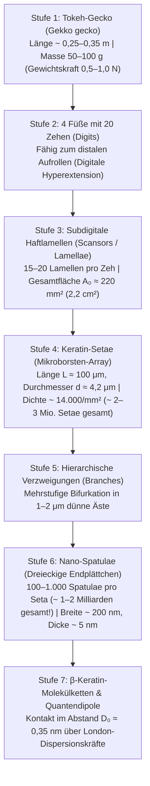
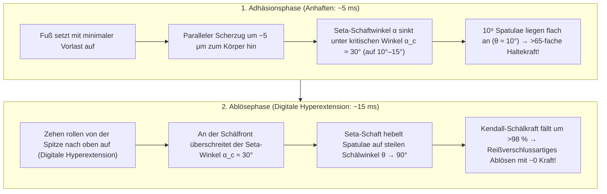

## 1. Einleitung: Das Staunen des Aristoteles und ein 2.300 Jahre altes Rätsel der Biomechanik

Im vierten Jahrhundert v. Chr. notierte der griechische Philosoph und Naturforscher Aristoteles (384–322 v. Chr.) im 9. Buch, Kapitel 9 seiner *Historia Animalium* (*Tierkunde*) eine faszinierende Beobachtung über eine kleine mediterrane Echse – den Gecko (altgriechisch *Askalaros* oder *Ascalabotes*):

> „Der Gecko kann einen Baumstamm auf jede Weise hinauf- und hinablaufen, <strong>selbst mit dem Kopf nach unten</strong>.“
> — Aristoteles, *Historia Animalium* (um 350 v. Chr.)

Mehr als zwei Jahrtausende später ist diese scheinbar mühelose Überwindung der Schwerkraft eines der berühmtesten Paradebeispiele für das Zusammenspiel von Quantenphysik, Kontaktmechanik und Evolutionsbiologie. Der südostasiatische <strong>Tokeh-Gecko (*Gekko gecko*)</strong> erreicht eine Körperlänge von $25\text{–}35\,\text{cm}$ und ein Körpergewicht von $50\text{–}100\,\text{g}$ (bei großen Exemplaren bis zu $300\,\text{g}$). Trotz dieser für kletternde Tiere enormen Masse sprintet der Tokeh-Gecko mit über $1\,\text{m/s}$ senkrechte, molekular glatte Quarzglasfenster hinauf oder hängt kopfüber an einer horizontalen Glasdecke ($180^\circ$ Überhang). Dabei bewegt er seine Beine mit einer Schrittfrequenz von $15\,\text{Hz}$, stellt den vollen Adhäsionskontakt in nur $5\,\text{ms}$ her und löst jeden Fuß in <strong>nur $15\,\text{ms}$ ($0{,}015\,\text{s}$)</strong> nahezu ohne messbaren Kraftaufwand wieder vom Glas ab.

Noch erstaunlicher ist die Tatsache, dass der Gecko auf hochreinen Spiegeln oder Siliziumwafern <strong>keinerlei Spuren von Schleim, Lipiden oder chemischem Klebstoff</strong> hinterlässt. Im Gegensatz zu Ameisen, Käfern (*Gastrophysa viridula*), Fliegen oder Laubfröschen, die über epidermale Drüsen Flüssigkeitsfilme absondern („nasse Adhäsion“), besitzt die Fußsohle des Geckos keinerlei Drüsengewebe. Seine Haftung beruht auf einer rein <strong>trockenen Adhäsion (Dry Adhesion)</strong> aus hydrophobem <strong>$\beta$-Keratin</strong>. Würden alle rund $2\text{ Millionen}$ Mikrohärchen (Setae) an den vier Füßen eines Geckos gleichzeitig ihre maximale Haftkraft entfalten, könnten sie theoretisch eine Last von <strong>$80\text{ bis }130\,\text{kg}$ tragen – mehr als das $1.000$-Fache des eigenen Körpergewichts!</strong>

---

## 2. Die sieben historischen Hypothesen und ihre experimentelle Widerlegung (Autumn et al., 2000 & 2002)

Zwischen 1830 und 2002 wurden sieben physikalische Hypothesen aufgestellt. Durch die Pionierversuche des deutschen Zoologen <strong>Wolf-Dietrich Dellit (1934)</strong>, die Elektronenmikroskopie von <strong>Ruibal & Ernst (1965)</strong> sowie die bahnbrechenden Arbeiten von <strong>Kellar Autumn, Robert J. Full, Thomas W. Kenny, Ronald Fearing und Jacob N. Israelachvili</strong> in *Nature* (2000) und *PNAS* (2002) wurden sechs davon endgültig widerlegt:

1. <strong>Saugnapf-Hypothese (Atmosphärischer Unterdruck, Simmermacher 1884)</strong>:
   - <strong>Widerlegung</strong>: Dellit (1934) setzte lebende Geckos einer Hochvakuumkammer aus ($P_{\text{atm}} \to 0$) – die Füße hafteten im Vakuum genauso stark wie an der Luft! Zudem liegt die theoretische Grenze eines Vakuumsaugnapfes bei $1\,\text{atm} \approx 101{,}3\,\text{kPa}$, während eine einzelne Gecko-Seta nach Autumn et al. (2000) eine reale Haftspannung von <strong>$\sigma_{\text{ad}} \approx 1.000\,\text{kPa}$ ($1\,\text{MPa} \approx 10\,\text{atm}$)</strong> erzeugt.
2. <strong>Klebstoff- oder Sekret-Hypothese (Wagler 1830)</strong>:
   - <strong>Widerlegung</strong>: Gecko-Zehenpolster bestehen aus reinem verhorntem $\beta$-Keratin ohne jegliche Drüsen, hinterlassen keine Rückstände und reinigen sich trocken von selbst (Hansen & Autumn, 2005).
3. <strong>Reine Coulomb-Reibung</strong>:
   - <strong>Widerlegung</strong>: Klassische Reibung $F_f = \mu N$ erfordert eine kompressive Normalkraft $N > 0$. An einer Glasdecke zieht die Schwerkraft nach unten ($N = -mg < 0$), sodass ohne echte Zugadhäsion sofortiges Herabfallen eintreten müsste.
4. <strong>Mikromechanisches Verhaken (Mikro-Steigeisen, Hora 1923; Mahendra 1941)</strong>:
   - <strong>Widerlegung</strong>: Geckos haften mit maximaler Kraft an <strong>atomar glattem gespaltenem Glimmer (Muskovit-Mica, Rauheit $\text{RMS} < 0{,}1\,\text{nm}$)</strong> und polierten Einkristall-Siliziumwafern (Autumn et al., 2000).
5. <strong>Elektrostatische Anziehung (Kontaktaufladung, Schmidt 1904)</strong>:
   - <strong>Widerlegung</strong>: Dellit (1934) ionisierte die Luft um die Geckofüße mittels <strong>Röntgenstrahlen und Radium-Präparaten</strong>, um sämtliche Oberflächenladungen kurzzuschließen – die Haftkraft blieb unverändert.
6. <strong>Kapillare Wasserbrücken (Laplace-Druck, Stork 1980) vs. Van-der-Waals-Dispersionskräfte (Autumn et al., 2002)</strong>:
   Würden dünne adsorbierte Wassermenisken über die Kapillarkraft $F_{\text{cap}} = 4\pi R\gamma_L \cos\theta_c$ dominieren, müsste die Haftung auf stark wasserabweisenden (hydrophoben) Oberflächen mit Kontaktwinkel $\theta_c > 90^\circ$ ($\cos\theta_c < 0$) zusammenbrechen.
   - <strong>Das entscheidende *PNAS*-Experiment (Autumn et al., 2002)</strong>: Das Team testete lebende Geckos und isolierte einzelne Setae auf <strong>stark hydrophobem Galliumarsenid ($\text{GaAs}$, Wasserkontaktwinkel $\theta_c \approx 110^\circ$)</strong> im Vergleich zu <strong>stark hydrophilem Siliziumdioxid-Glas ($\text{SiO}_2$, $\theta_c < 5^\circ$)</strong>. Da beide Halbleiter-/Dielektrikum-Substrate eine hohe elektronische Polarisierbarkeit besitzen, zeigten sowohl lebende Zehen als auch einzelne Setae auf hydrophobem $\text{GaAs}$ und hydrophilem $\text{SiO}_2$ <strong>exakt dieselbe hohe Haftspannung ($\sim 200\,\text{kPa}$)</strong>! Damit war bewiesen: Der primäre Mechanismus sind quantenmechanische <strong>Van-der-Waals-Dispersionskräfte</strong>.

| Nr. | Historische Hypothese | Vertreter | Physikalischer Mechanismus | Experimentelle Widerlegung |
| :--- | :--- | :--- | :--- | :--- |
| <strong>1</strong> | <strong>Saugnapf-Effekt</strong> | Simmermacher (1884) | Luftdruckdifferenz $P_{\text{atm}} \approx 101\,\text{kPa}$ | <strong>Volle Haftung im Hochvakuum ($P \to 0$)</strong> (Dellit 1934); Seta-Spannung ($1\,\text{MPa}$) ist $10\times$ höher als $1\,\text{atm}$. |
| <strong>2</strong> | <strong>Klebstoff / Schleim</strong> | Wagler (1830) | Drüsensekretion klebriger Flüssigkeiten | Reines $\beta$-Keratin <strong>ohne Drüsen (100 % trocken)</strong>, rückstandsfrei und selbstreinigend. |
| <strong>3</strong> | <strong>Reine Reibung</strong> | Klassische Tribologie | Hoher Reibungskoeffizient $\mu$ | Versagt an Überhängen/Decken ($N = -mg < 0$) ohne Zugadhäsion. |
| <strong>4</strong> | <strong>Mikro-Verhakung</strong> | Hora (1923) | Verhaken in Oberflächenrauheiten | <strong>Maximale Haftung auf atomar glattem Glimmer ($\text{RMS} < 0{,}1\,\text{nm}$)</strong> (Autumn 2000). |
| <strong>5</strong> | <strong>Elektrostatik</strong> | Schmidt (1904) | Triboelektrische Coulomb-Anziehung | <strong>Luftionisation durch Röntgenstrahlung löst den Gecko nicht ab</strong> (Dellit 1934). |
| <strong>6</strong> | <strong>Kapillarkräfte</strong> | Stork (1980) | Laplace-Druck von Wassermenisken $4\pi R\gamma_L\cos\theta_c$ | <strong>Identische Haftkraft ($\sim 200\,\text{kPa}$) auf stark hydrophobem $\text{GaAs}$ ($\theta_c = 110^\circ$) und hydrophilem $\text{SiO}_2$</strong> (Autumn 2002). |
| <strong>7</strong> | <strong>Van-der-Waals-Kräfte</strong> | Hiller (1968), Autumn (2000, 2002) | Quanten-Nullpunktsfluktuationen (London-Dispersion) | <strong>Durch alle Experimente bestätigt</strong>: skaliert mit Hamaker-Konstante $A_H$, wirkt im Vakuum und bei $-196^\circ\text{C}$. |

---

## 3. Die 7-stufige hierarchische Architektur und das Dahlquist-Kriterium

Da Van-der-Waals-Kräfte nur über Abstände von $D_0 \approx 0{,}3\text{–}0{,}4\,\text{nm}$ wirken, verhindert die natürliche Oberflächenrauheit bei einer menschlichen Hand fast jeden molekularen Kontakt. Der Gecko überwindet diese Barriere durch eine 7-stufige Hierarchie:

### 3.1 Euler-Bernoulli-Balkenmechanik und das Dahlquist-Kriterium für Klebrigkeit

Festes $\beta$-Keratin besitzt einen sehr hohen Elastizitätsmodul von $E_{\text{bulk}} \approx 2{,}0\,\text{GPa}$ (wie Hartplastik). Nach dem <strong>Dahlquist-Kriterium (Carl A. Dahlquist, 1966)</strong> darf ein Haftmaterial jedoch höchstens einen <strong>effektiven Elastizitätsmodul von $E_{\text{eff}} \le 100\text{–}300\,\text{kPa}$</strong> aufweisen, um sich spontan an raue Oberflächen anzuschmiegen.

Indem der Gecko das $2\,\text{GPa}$ harte Keratin in schräg angestellte ($\alpha_0 \approx 45^\circ$), schlanke Mikrobalken ($L \approx 100\,\mu\text{m}$, Radius $r \approx 2{,}1\,\mu\text{m}$, Gitterabstand $s \approx 8{,}5\,\mu\text{m}$, Flächenträgheitsmoment $I = \frac{\pi r^4}{4}$) mit Biegesteifigkeit $k_\perp = \frac{3 E_{\text{bulk}} I}{L^3 \sin^2\alpha_0}$ formt, sinkt der effektive Modul des Seta-Arrays um vier Größenordnungen auf:

$$E_{\text{eff}} = \frac{k_\perp L \sin\alpha_0}{s^2} = \frac{3\pi}{4 \sin\alpha_0} E_{\text{bulk}} \left(\frac{r}{L}\right)^2 \left(\frac{r}{s}\right)^2 \approx 80\text{–}100\,\text{kPa}$$

So erfüllt der Gecko das Dahlquist-Kriterium ($E_{\text{eff}} \approx 100\,\text{kPa}$), ohne dass die Härchen wie bei weichen Gelen untereinander verkleben (Self-matting). Eine einzelne Seta trägt durchschnittlich $F_{\text{seta}} \approx 40\,\mu\text{N}$ und maximal $194 \pm 25\,\mu\text{N}$ (Autumn et al., 2000), was über $2 \times 10^6$ Setae hinweg einer theoretischen Tragkraft von $80\text{ bis }130\,\text{kg}$ entspricht ($10\,\text{nN}$ pro einzelner Spatula, Huber et al., 2005).

---

## 4. Quantenelektrodynamik der Van-der-Waals- und London-Dispersionskräfte

Zwischen zwei neutralen Molekülen im Abstand $r$ setzt sich das Van-der-Waals-Potenzial zusammen aus Keesom-, Debye- und London-Term:

$$U_{\text{vdW}}(r) = -\frac{C_{\text{Keesom}} + C_{\text{Debye}} + C_{\text{London}}}{r^6}$$

Für unpolares $\beta$-Keratin dominiert die 1930 von <strong>Fritz London</strong> über quantenmechanische Störungstheorie 2. Ordnung hergeleitete <strong>London-Dispersionskraft</strong>, die aus korrelierten Quanten-Nullpunktsfluktuationen ($\langle 0 | \hat{\mathbf{p}}^2 | 0 \rangle \neq 0$) zweier harmonischer Oszillatoren (Anregungsfrequenz $\omega_0$, Polarisierbarkeiten $\alpha_1, \alpha_2$) entspringt:

$$U_{\text{London}}(r) = -\frac{3}{4} \frac{\hbar \omega_0 \alpha_1 \alpha_2}{(4\pi\varepsilon_0)^2 r^6}$$

Integriert man dieses $r^{-6}$-Paarpotenzial nach <strong>Hugo C. Hamaker (1937)</strong> und <strong>Evgeny Lifshitz (1956)</strong> mit der Hamaker-Konstante $A_H = \pi^2 C \rho_1 \rho_2 \approx 10^{-19}\,\text{J}$ über eine sphärische Spatula-Spitze vom Radius $R \approx 100\,\text{nm}$ im Abstand $D_0 \approx 0{,}35\,\text{nm}$ vor einer ebenen Wand, erhält man:

$$F_{\text{vdW}}(D_0) = \frac{A_H R}{6 D_0^2} \approx 13{,}6\,\text{nN}$$

Nach der Lifshitz-Theorie skaliert $A_H$ im optisch-ultravioletten Bereich mit $\frac{(n_1^2 - 1)(n_2^2 - 1)}{(n_1^2 + 1)(n_2^2 + 1)}$. Deshalb <strong>rutschen Geckos auf trockenem Polytetrafluorethylen (PTFE / Teflon)</strong> aus: Die extrem elektronegative $\text{C–F}$-Bindung bewirkt einen ungewöhnlich niedrigen Brechungsindex ($n_{\text{PTFE}} \approx 1{,}35$), wodurch $A_H$ drastisch einbricht!

---

## 5. Das Prinzip der Kontaktaufspaltung („Contact Splitting“) nach der JKR-Kontaktmechanik

Nach der <strong>Johnson-Kendall-Roberts-Theorie (JKR, 1971)</strong> gilt für den Kontaktradius $a$ und die Abreißkraft (Pull-off force) $F_{\text{JKR}}^{(1)}$ einer elastischen Halbkugel vom Radius $R$ mit Adhäsionsarbeit $W_{\text{ad}} = \Delta\gamma$:

$$a^3 = \frac{3 R}{4 E^*} \left( P + 3\pi W_{\text{ad}} R + \sqrt{6\pi W_{\text{ad}} R P + (3\pi W_{\text{ad}} R)^2} \right) \implies F_{\text{JKR}}^{(1)} = \frac{3}{2}\pi W_{\text{ad}} R$$

Da die Abreißkraft <strong>proportional zum linearen Radius $R$ (und nicht zur Fläche $\pi R^2$!)</strong> ist, zeigten <strong>Eduard Arzt, Stanislav Gorb und Ralph Spolenak (2003, *PNAS*)</strong>: Teilt man eine Gesamtfläche $\pi R_0^2$ in $N$ kleinere Unterkontakte mit Radius $r_N = R_0 / \sqrt{N}$ auf, vervielfacht sich die Gesamthaftkraft um den Faktor $\sqrt{N}$:

$$\boxed{F_{\text{total}}(N) = N \cdot \frac{3}{2}\pi W_{\text{ad}} \left(\frac{R_0}{\sqrt{N}}\right) = \sqrt{N} \, F_{\text{JKR}}^{(1)}}$$

<strong>Bei $N = 10^9$ Nano-Spatulae verstärkt diese Kontaktaufspaltung die Gesamthaftkraft um das $\sqrt{10^9} \approx 31.623$-Fache!</strong> Damit schwere Tiere ($m \propto L^3$, Fußfläche $A_0 \propto L^2$) ihr Gewicht halten können, muss die Flächendichte der Härchen im Tierreich mit $\rho_A \propto m^{2/3}$ zunehmen (von Fliegen und Käfern über Spinnen bis zum Gecko), wobei die Spatula-Breite ($200\,\text{nm}$) unterhalb des kritischen Riss-Radius $r_{\text{crit}} = \frac{8 E^* W_{\text{ad}}}{\pi \sigma_{\text{th}}^2} \approx 170\,\text{nm}$ für <strong>Defektunempfindlichkeit (Flaw Insensitivity, Gao & Yao 2004)</strong> liegt.

---

## 6. Müheloses Ablösen in 15 Millisekunden: Kendalls Schälmechanik & Digitale Hyperextension

Wie löst der Gecko seinen Fuß in $15\,\text{ms}$ ohne Kraftaufwand ab? <strong>Kevin Kendall (1971)</strong> leitete die Schälkraft $F_{\text{peel}}$ eines elastischen Streifens (Breite $b$, Dicke $d$, Modul $E$) unter dem Schälwinkel $\theta$ her:

$$\left(\frac{F_{\text{peel}}}{b}\right)^2 \frac{1}{2 d E} + \frac{F_{\text{peel}}}{b}(1 - \cos\theta) = W_{\text{ad}} \implies F_{\text{peel}}(\theta) \approx \frac{b W_{\text{ad}}}{1 - \cos\theta}$$

Beim Anhaften zieht der Gecko parallel ($\theta \approx 10^\circ, \alpha < 30^\circ$), was eine enorme Haltekraft $F_{\text{peel}}(10^\circ) \approx 65{,}8 \, b W_{\text{ad}}$ erzeugt (Reibungsadhäsion $F_{\perp,\text{pull}} \le F_\parallel \tan 30^\circ$, Autumn et al., 2006). Zum Ablösen rollt er die Zehen von der Spitze her nach oben auf (<strong>Digitale Hyperextension</strong>): Überschreitet der Seta-Winkel $\alpha_c \approx 30^\circ$, kippen die Spatulae auf $\theta \approx 90^\circ$ ($1 - \cos 90^\circ = 1$), und die Ablösekraft fällt auf ein Hundertstel ab!

---

## 7. Trockene Selbstreinigung und Biomimetik (Von Stickybot bis zu NASA-Weltraumgreifern)

1. <strong>Trockene Kontakt-Selbstreinigung (Hansen & Autumn, 2005 *PNAS*)</strong>: Für ein Staubkorn vom Radius $R_p \approx 2{,}5\,\mu\text{m}$ ist die Van-der-Waals-Anziehung zur flachen Wand ($F_{\text{particle-wall}} \propto R_p$) wesentlich größer als die Summe der Kräfte zu den wenigen berührenden Spatulae ($F_{\text{particle-setae}} \propto n R_s$ mit $R_s \approx 100\,\text{nm}$). Nach nur $4\text{–}8$ Schritten auf sauberem Glas bleibt der Schmutz an der Wand zurück.
2. <strong>Synthetisches Gecko-Tape & NASA JPL Weltraumschrott-Greifer (Parness, Jiang et al., 2017 *Science Robotics*)</strong>: Von Andre Geims Polymer-Mikrosäulen (2003), Stanfords gerichteten PDMS-Mikrokeilen für menschliches Fassadenklettern ($70\,\text{kg}$, Hawkes et al., 2014) und Kohlenstoffnanoröhren-Teppichen ($100\,\text{N/cm}^2$, Qu et al., 2008) bis zu den <strong>Gecko-Greifern des NASA Jet Propulsion Laboratory (JPL)</strong> für das Einfangen von Weltraumschrott und die *Astrobee*-Roboter auf der ISS – trockene Van-der-Waals-Adhäsion funktioniert im Hochvakuum, bei $-190^\circ\text{C}$ und ohne abstoßende Vorlast.
