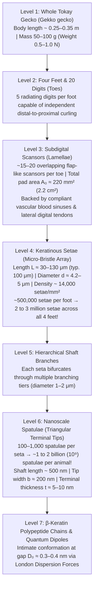
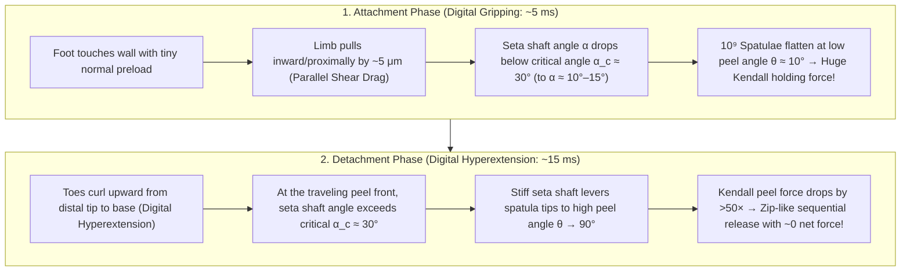

## 1. Introduction: Aristotle's Marvel and a 2,300-Year-Old Biomechanical Enigma

In the fourth century BCE, the Greek philosopher and naturalist Aristotle (384–322 BCE) recorded a striking observation in Book IX, Chapter 9 of his *Historia Animalium* (*History of Animals*) regarding a small Mediterranean lizard—the gecko (known in ancient Greek as *Askalaros* or *Ascalabotes*):

> "The gecko can run up and down a tree in any way, <strong>even with its head downwards</strong>."
> — Aristotle, *Historia Animalium* (c. 350 BCE)

More than two millennia later, this seemingly effortless defiance of gravity remains one of the most celebrated triumphs of evolutionary biomechanics and condensed-matter physics. Consider the <strong>Tokay gecko (*Gekko gecko*)</strong>, a large nocturnal lizard native to Southeast Asia and the Indo-Australian archipelago. An adult Tokay gecko reaches $25\text{–}35\,\text{cm}$ in length and weighs $50\text{–}100\,\text{g}$ (with large specimens approaching $300\,\text{g}$). Despite its substantial body mass compared to insects or spiders, a Tokay gecko can sprint vertically up a molecularly smooth, freshly cleaned fused-silica glass window—or hang inverted from an overhanging glass ceiling at an inclination of $180^\circ$—at speeds exceeding $1\,\text{m/s}$. While running, the gecko cycles its limbs at $15\text{ steps per second}$, establishing full adhesive lock within $5\,\text{ms}$ and detaching each foot in a mere <strong>$15\,\text{ms}$ ($0.015\,\text{s}$)</strong> with practically zero measurable detachment force.

Even more remarkably, when a gecko sprints across a pristine optical mirror or semiconductor wafer, surface-sensitive spectroscopy and microscopy reveal <strong>zero chemical residue, zero mucus, and zero lipid footprints</strong>. Unlike ants, beetles (*Gastrophysa viridula*), blowflies, or tree frogs (*Litoria caerulea*)—all of which rely on epidermal secretory glands to inject liquid menisci into the contact zone ("wet adhesion")—the subdigital toe pads of geckos are completely devoid of glandular tissue. Their attachment is a purely <strong>dry adhesion</strong> phenomenon built entirely out of dead, hydrophobic $\beta$-keratin protein. Yet if all four feet of a $50\,\text{g}$ Tokay gecko simultaneously engaged their micro-hairs at full capacity, they could theoretically support a tensile or shear load of <strong>$80\text{ to }130\,\text{kg}$—more than $1,000\times$ the animal's own body weight!</strong>

How can a vertebrate animal generate over $1,000\,\text{N}$ of adhesive force on smooth glass without glue or suction cups, never foul its feet on dusty bark, and yet peel its toes off in $15\,\text{ms}$ without getting permanently stuck to the wall like an insect on flypaper? Resolving this <strong>Paradox of Strong Attachment and Effortless Detachment</strong> required uniting quantum electrodynamics, fracture mechanics, elastic contact theory, and evolutionary allometry across seven orders of magnitude in length scale.

---

## 2. The Seven Historical Hypotheses Ruled Out by Decisive Experiments (Autumn et al., 2000 & 2002)

Between the early 19th century and the dawn of the 21st century, naturalists, anatomists, and physicists proposed <strong>seven distinct physical mechanisms</strong> to explain gecko adhesion. Through a series of ingenious experiments—beginning with Wolf-Dietrich Dellit's landmark 1934 physiological experiments in Germany, continuing with Rodolfo Ruibal and Vera Ernst's 1965 electron microscopy of lizard setae, and culminating in the breakthrough studies led by <strong>Kellar Autumn</strong> (Lewis & Clark College), <strong>Robert J. Full</strong> (UC Berkeley), <strong>Thomas W. Kenny</strong> (Stanford University), <strong>Ronald Fearing</strong> (UC Berkeley), and <strong>Jacob N. Israelachvili</strong> (UC Santa Barbara) in *Nature* (2000) and *Proceedings of the National Academy of Sciences* (*PNAS*, 2002)—six of these hypotheses were definitively falsified, leaving only one universal quantum-mechanical interaction standing.

### 2.1 Experimental Refutation of Six Classical Mechanisms and the Capillary vs. Van der Waals Showdown

Let us examine each historical hypothesis, its underlying physical scaling, and the critical experiment that ruled it out:

1. <strong>Hypothesis 1: Atmospheric Suction (Micro-Vacuum Cups)</strong>
   In 1884, the German zoologist Georg Simmermacher proposed that the overlapping subdigital lamellae (scansors) on a gecko's toe act like miniature rubber suction cups, evacuating air from beneath the pad so that ambient atmospheric pressure $P_{\text{atm}}$ pushes the foot against the wall.
   - <strong>Experimental Falsification</strong>: In 1934, Wolf-Dietrich Dellit placed live geckos inside a vacuum chamber and evacuated the air ($P_{\text{atm}} \to 0$). If suction were responsible, the toes would detach immediately as the pressure differential vanished. Instead, <strong>gecko feet adhered in a hard vacuum with the exact same strength as at standard atmospheric pressure</strong>. Furthermore, suction is bounded by a strict thermodynamic ceiling: even a perfect vacuum cup at sea level cannot generate a tensile stress greater than $1\,\text{atm} = 101.3\,\text{kPa}$. In 2000, Autumn et al. directly measured the adhesive stress of isolated gecko setae and found values of <strong>$\sigma_{\text{ad}} \approx 1,000\,\text{kPa}$ ($1\,\text{MPa} \approx 10\,\text{atm}$)</strong>—ten times higher than the theoretical limit of atmospheric suction!

2. <strong>Hypothesis 2: Chemical Glue or Mucus Secretions (Wet Secretory Adhesion)</strong>
   In 1830, Johann Georg Wagler suggested that geckos secrete a sticky fluid or mucus from their toes, analogous to insects and amphibians.
   - <strong>Experimental Falsification</strong>: Histological and anatomical studies proved that reptilian epidermis in geckos consists entirely of cornified <strong>$\beta$-keratin</strong> and possesses <strong>zero secretory glands</strong> on the feet. No liquid or polymeric footprints are deposited during locomotion, and unlike sticky tapes or hydrogels that rapidly foul when exposed to dust, gecko setae are self-cleaning (Hansen & Autumn, 2005).

3. <strong>Hypothesis 3: Pure Coulomb Friction</strong>
   Early mechanical models argued that the dense array of microscopic bristles merely increases the coefficient of friction $\mu$ against the substrate.
   - <strong>Experimental Falsification</strong>: Classical Amontons–Coulomb friction $F_f = \mu N$ requires a positive compressive normal load ($N > 0$) pressing the surfaces together. On a vertical wall ($N = 0$) or an overhanging glass ceiling ($\theta = 180^\circ$, where gravity exerts a tensile normal pull $N = -mg < 0$), pure friction without intrinsic tensile adhesion ($F_{\text{ad}} > 0$) yields zero holding capacity.

4. <strong>Hypothesis 4: Micro-Mechanical Interlocking (Micro-Hooks / Crampons)</strong>
   In 1923, Sunder Lal Hora and later Beni Charan Mahendra (1941) proposed that the microscopic hairs on gecko toes act like miniature climbing crampons or Velcro hooks that mechanically interlock with microscopic ledges, cracks, and asperities on rough walls.
   - <strong>Experimental Falsification</strong>: Dellit (1934) and Autumn et al. (2000) tested geckos on <strong>atomically flat cleaved muscovite mica</strong> (root-mean-square roughness $R_q < 0.1\,\text{nm}$) and ultra-polished single-crystal silicon wafers ($R_q < 0.5\,\text{nm}$), where surface irregularities are hundreds of times smaller than a single spatula tip ($\sim 200\,\text{nm}$). Rather than slipping, geckos generated their <strong>highest possible adhesive forces on molecularly smooth surfaces</strong>!

5. <strong>Hypothesis 5: Electrostatic Attraction (Contact / Triboelectric Charging)</strong>
   In 1904, Hermann Schmidt hypothesized that rubbing the keratinous toe pads against dielectric walls generates opposite triboelectric surface charges $\pm\sigma_q$, binding the foot via long-range Coulomb electrostatic attraction $P_{\text{elec}} = \frac{\sigma_q^2}{2\varepsilon_0}$.
   - <strong>Experimental Falsification</strong>: Dellit (1934) bombarded the air surrounding a clinging gecko's feet with <strong>ionizing X-rays and radioactive radium emissions</strong>, flooding the boundary layer with free ions that instantly neutralized any electrostatic surface charges. The gecko's adhesion remained completely unaffected. Moreover, geckos adhere strongly to electrically grounded metal plates, conductive doped semiconductors, and even submerged hydrophobic substrates in ion-rich water.

6. <strong>Hypothesis 6: Capillary Wet Adhesion (Laplace Meniscus Bridges of Adsorbed Water)</strong>
   Once suction, glue, friction, interlocking, and electrostatics were eliminated, a fierce scientific debate remained between two nanoscale mechanisms: <strong>Capillary wet adhesion</strong> (championed by Nigel E. Stork, 1980, and explored by Huber et al., 2005) versus <strong>Van der Waals intermolecular dispersion forces</strong> (proposed by Uwe Hiller, 1968, and championed by Autumn et al., 2000, 2002).
   Under ambient humidity, hydrophilic surfaces adsorb a sub-nanometer film of water molecules from the air. If a concave liquid meniscus of radius of curvature $r_K$ (the Kelvin radius) forms between a spherical tip of radius $R$ and a flat substrate with contact angles $\theta_1, \theta_2$, the surface tension of water ($\gamma_L = 72.8\,\text{mN/m}$ at $20^\circ\text{C}$) creates a negative Laplace pressure $\Delta P_{\text{Laplace}} = -\gamma_L / r_K$, yielding a capillary pull-off force:
   $$F_{\text{cap}} = 2\pi R \gamma_L (\cos\theta_1 + \cos\theta_2) \quad (\text{or } 4\pi R \gamma_L \cos\theta_c \text{ for symmetric wetting})$$
   - <strong>The Definitive 2002 *PNAS* Experiment (Autumn et al., 2002)</strong>:
     To decisively distinguish capillary Laplace forces from van der Waals dispersion forces, Kellar Autumn, Metin Sitti, Jacob Israelachvili, Robert Full, and colleagues designed a crucial test based on surface hydrophobicity versus dielectric polarizability.
     If capillary water bridges dominate, then on a <strong>strongly hydrophobic substrate</strong> where the water contact angle exceeds $90^\circ$ ($\theta_2 \approx 110^\circ \implies \cos\theta_2 < 0$), concave wetting menisci cannot form and adhesion must collapse. Conversely, if van der Waals (London dispersion) forces dominate, adhesion depends only on the electronic polarizability (refractive index $n$ and dielectric permittivity $\varepsilon$, i.e., the Hamaker constant $A_H$) of the substrate, completely independent of whether the surface is hydrophobic or hydrophilic!
     Autumn et al. measured both whole-animal toe adhesion and single isolated seta pull-off forces on two semiconductor wafers with high dielectric polarizability:
     - <strong>Strongly hydrophobic gallium arsenide ($\text{GaAs}$)</strong>: water contact angle $\theta_c \approx 110^\circ$ (water beads up and rolls off), high refractive index $n \approx 3.5$.
     - <strong>Strongly hydrophilic silicon dioxide ($\text{SiO}_2$ glass/silica)</strong>: water contact angle $\theta_c < 5^\circ$ (completely wetted by water), refractive index $n \approx 1.46$.
     The experimental result was unequivocal: both live Tokay geckos and isolated single setae generated <strong>statistically indistinguishable shear adhesion ($\sim 200\,\text{kPa}$) on strongly hydrophobic $\text{GaAs}$ and strongly hydrophilic $\text{SiO}_2$</strong>! Meanwhile, on low-polarizability fluorocarbon/hydrocarbon monolayers, adhesion dropped exactly as predicted by van der Waals theory.

Thus, while trace ambient humidity can secondarily soften $\beta$-keratin (lowering its elastic modulus and increasing viscoelastic compliance) or add a minor capillary contribution on highly hydrophilic surfaces at high relative humidity (Huber et al., 2005), the primary, universal physical engine of gecko attachment is <strong>quantum-mechanical van der Waals dispersion attraction</strong>.

| # | Historical Hypothesis | Key Proponents | Proposed Physical Mechanism | Decisive Experimental Falsification |
| :--- | :--- | :--- | :--- | :--- |
| <strong>1</strong> | <strong>Atmospheric Suction</strong> | Simmermacher (1884) | Subdigital lamellae act as vacuum cups pushed by $P_{\text{atm}} \approx 101\,\text{kPa}$ | <strong>Works undiminished in hard vacuum ($P \to 0$)</strong> (Dellit 1934); seta stress ($1\,\text{MPa}$) is $10\times$ higher than $1\,\text{atm}$ theoretical limit (Autumn 2000). |
| <strong>2</strong> | <strong>Sticky Glue / Mucus Secretion</strong> | Wagler (1830) | Epidermal glands secrete adhesive mucus or lipid fluids | Reptilian $\beta$-keratin toe pads have <strong>zero secretory glands (100% dry adhesion)</strong>, leave zero chemical footprints, and self-clean (Hansen & Autumn 2005). |
| <strong>3</strong> | <strong>Pure Coulomb Friction</strong> | Classical Tribology | High friction coefficient $\mu$ of micro-bristles | Coulomb friction $F_f = \mu N$ requires compressive load $N > 0$ and <strong>fails completely on inverted ceilings ($N = -mg < 0$)</strong> without tensile adhesion. |
| <strong>4</strong> | <strong>Micro-Mechanical Interlocking</strong> | Hora (1923), Mahendra (1941) | Setae act like micro-crampons hooking onto surface roughness | Geckos adhere strongest to <strong>atomically smooth cleaved muscovite mica ($R_q < 0.1\,\text{nm}$) and polished silicon wafers</strong> (Autumn 2000). |
| <strong>5</strong> | <strong>Electrostatic Attraction</strong> | Schmidt (1904) | Contact/triboelectric charging creates Coulomb attraction $\sigma_q^2/(2\varepsilon_0)$ | <strong>Ionizing surrounding air with X-rays or radium to bleed off all static charge does not reduce adhesion</strong> (Dellit 1934); works on grounded metals. |
| <strong>6</strong> | <strong>Capillary Meniscus Bridges</strong> | Stork (1980) | Adsorbed water menisci pull via Laplace pressure $4\pi R\gamma_L\cos\theta_c$ | <strong>Adheres equally strongly ($\sim 200\,\text{kPa}$) to strongly hydrophobic $\text{GaAs}$ ($\theta_c = 110^\circ$) and hydrophilic $\text{SiO}_2$ ($\theta_c < 5^\circ$)</strong> (Autumn et al. 2002). |
| <strong>7</strong> | <strong>Van der Waals Dispersion Forces</strong> | Hiller (1968), Autumn et al. (2000, 2002) | Quantum zero-point dipole fluctuations (London dispersion) across $10^9$ nano-spatulae | <strong>Confirmed by all experiments</strong>: scales with substrate polarizability (Hamaker constant $A_H$) and operates in vacuum, underwater, and at $-190^\circ\text{C}$. |

---

## 3. The Seven-Level Hierarchical Architecture of Tokay Gecko Toe Pads

If van der Waals forces act universally between any two atoms brought within a nanometer of one another, an obvious question arises: <strong>why can't a human press their bare palm—or a flat block of rubber—against a glass window and hang from it like a gecko?</strong>

The answer lies in the extreme short range of van der Waals interactions, which decay as $r^{-6}$ between molecules and $D_0^{-3}$ between flat surfaces, becoming negligible beyond a separation gap of $D_0 \approx 0.3\text{–}1.0\,\text{nm}$ ($3\text{–}10\,\text{\AA}$, just two to three atomic diameters). Macroscopically smooth human skin, rubber, and typical building walls possess multi-scale surface roughness with root-mean-square heights of micrometers to tens of micrometers. When a stiff or moderately compliant solid block is pressed against a wall, it touches only at the summits of the three highest asperity peaks; the <strong>real area of molecular contact ($D_0 < 1\,\text{nm}$)</strong> is less than $0.001\%\text{ to }0.01\%$ of the apparent geometric area!

To overcome this "roughness barrier" across every length scale from millimeters down to atomic dimensions, the Tokay gecko (*Gekko gecko*) evolved an extraordinary <strong>seven-level hierarchical mechanical architecture</strong> spanning seven orders of magnitude in size ($10^{-1}\,\text{m}$ down to $10^{-9}\,\text{m}$).

### 3.1 Anatomical Hierarchy: Scansors $\to$ Setae $\to$ Branches $\to$ Spatulae

Tracing the hierarchy from macroscopic anatomy to nanoscale ultrastructure reveals how each tier addresses a specific band of the surface roughness spectrum (Ruibal & Ernst, 1965; Russell, 1975; Autumn et al., 2000):

1. <strong>Subdigital Scansors / Lamellae ($\sim 1\text{–}10\,\text{mm}$)</strong>:
   Each of the gecko's four feet bears five digits, and the ventral surface of each digit is covered by a series of $15\text{ to }20$ imbricated (overlapping, shingle-like) soft ridges called <strong>scansors</strong> or <strong>lamellae</strong>. Across all 20 toes, the total projected pad area of an adult Tokay gecko is $A_0 \approx 220\,\text{mm}^2$ ($2.2\,\text{cm}^2$, roughly the area of a small coin). Beneath the scansors lies a compliant hydraulic cushion—the <strong>vascular blood sinus network</strong>—coupled to a specialized <strong>lateral digital tendon system</strong>. By inflating the blood sinus and tensioning the tendons, the pad conforms to millimeter- and centimeter-scale undulations while distributing shear loads uniformly across the toe.
2. <strong>Setae ($\sim 30\text{–}130\,\mu\text{m}$ long, $4.2\text{–}5\,\mu\text{m}$ diameter)</strong>:
   Scanning electron microscopy (SEM) of the scansor epidermis reveals dense, uniform rows of hair-like projections called <strong>setae</strong> (singular: *seta*), composed primarily of disulfide-crosslinked $\beta$-keratin ($\sim 13\text{–}15\,\text{kDa}$ beta-pleated sheet proteins) with a minor $\alpha$-keratin component.
   - Each seta has a length of $L_s \approx 100\,\mu\text{m}$ and a shaft diameter of $d_s \approx 4.2\,\mu\text{m}$ (roughly one-twentieth the diameter of a human hair).
   - Setae are packed in regular quadrate grids at an areal density of $\rho_{\text{seta}} \approx 14,000\,\text{setae/mm}^2$.
   - Multiplying by the pad area yields <strong>$\sim 500,000\text{ to }650,000$ setae per foot, or $2 \times 10^6\text{ to }3 \times 10^6$ setae across all four feet</strong>.
3. <strong>Branches and Nanoscale Spatulae ($\sim 200\,\text{nm}$ wide, $5\,\text{nm}$ thick)</strong>:
   At its distal end, each seta shaft bifurcates repeatedly into several levels of finer branches ($1\text{–}2\,\mu\text{m}$ in diameter), terminating in a dense brush of <strong>$100\text{ to }1,000$ nanoscale pads called spatulae</strong> (singular: *spatula*, named after their resemblance to a tiny kitchen spatula).
   - Each spatula consists of a slender stalk ($\sim 500\,\text{nm}$ long, $\sim 100\,\text{nm}$ diameter) flaring into a triangular, cup-shaped terminal platelet with a width of $b_s \approx 150\text{–}200\,\text{nm}$ (smaller than the wavelength of visible light!) and an apex thickness of only <strong>$t_s \approx 5\text{–}10\,\text{nm}$</strong>.
   - Across all four feet, a single Tokay gecko deploys between <strong>$2 \times 10^8$ and $2 \times 10^9$ (up to two billion) independent nanoscale spatula tips</strong>!

### 3.2 Solving the Material Paradox: Euler-Bernoulli Cantilever Mechanics and the Dahlquist Criterion for Tack

From the standpoint of polymer science and adhesion engineering, the gecko's choice of structural material presents a striking paradox. Bulk reptilian $\beta$-keratin is a stiff, glassy, hydrophobic structural polymer with a Young's elastic modulus of:

$$E_{\text{bulk}} \approx 1.5\text{–}2.5\,\text{GPa} \quad (\text{typical value: } E_{\text{bulk}} \approx 2.0\,\text{GPa})$$

This is comparable to rigid engineering thermoplastics such as polycarbonate, nylon, or fingernail keratin. If you press a flat block of $2\,\text{GPa}$ hard plastic against a glass wall, it exhibits zero tack and falls immediately.

In pressure-sensitive adhesive (PSA) science, 3M physicist <strong>Carl A. Dahlquist (1966)</strong> established the universal <strong>Dahlquist Criterion for Tack</strong>:

> <strong>The Dahlquist Criterion for Tack (1966)</strong>:
> For an adhesive material to deform spontaneously under negligible contact pressure, overcome elastic stored energy penalties on micro-rough surfaces, and establish intimate molecular contact within a fraction of a second, its <strong>effective elastic modulus (or storage modulus at $1\,\text{Hz}$) must satisfy</strong>:
> $$E_{\text{eff}} \le 100\text{–}300\,\text{kPa} \quad (0.1\text{–}0.3\,\text{MPa})$$

Commercial Scotch tape and soft hydrogels meet the Dahlquist criterion by using intrinsically soft, low-glass-transition-temperature ($T_g$) viscoelastic elastomers with bulk modulus $E_{\text{bulk}} \sim 100\,\text{kPa}$. However, if nature grew $100\,\mu\text{m}$-long, high-aspect-ratio nano-hairs out of a soft $100\,\text{kPa}$ rubbery gel, two catastrophic failures would occur immediately:
1. <strong>Lateral Self-Matting (Bunching / Collapse)</strong>: High-aspect-ratio soft fibers spontaneously stick to their neighbors via van der Waals attraction, collapsing into useless tangled clumps (the Sitti–Fearing / Jagota–Bennison fiber condensation limit).
2. <strong>Irreversible Fouling and Wear</strong>: Soft tacky polymers permanently trap dust particles, tear under high shear stress, and degrade rapidly in the environment.

How does the gecko achieve an effective modulus of $E_{\text{eff}} \le 100\,\text{kPa}$ while building its hairs out of a clean, wear-resistant, non-fouling $2\,\text{GPa}$ stiff polymer? By exploiting <strong>Euler–Bernoulli Cantilever Beam Mechanics of Angled High-Aspect-Ratio Setae</strong>!

Let us derive the effective continuum elastic modulus $E_{\text{eff}}$ of the seta array from first principles. Model a single seta as a cylindrical cantilever beam of length $L \approx 100\,\mu\text{m}$, radius $r \approx 2.1\,\mu\text{m}$, cross-sectional area $A_c = \pi r^2$, and area moment of inertia $I = \frac{\pi r^4}{4}$, made of bulk $\beta$-keratin with Young's modulus $E_{\text{bulk}} \approx 2.0\,\text{GPa}$. Crucially, the setae do not grow perpendicular ($90^\circ$) to the scansor surface; if they were vertical ($\alpha_0 = 90^\circ$), normal compression would load them axially with an enormous buckling/compression stiffness $k_{\text{axial}} = \frac{E_{\text{bulk}}\pi r^2}{L}$. Instead, unloaded gecko setae are inclined at a rest angle $\alpha_0 \approx 45^\circ$ (and curve distally near their tips).

When a normal displacement $\Delta z$ is applied perpendicular to the substrate, the force $F_N$ bends the tilted cantilever beam transversely (moment arm $L\sin\alpha_0$, transverse deflection $\delta_\perp = \Delta z \sin\alpha_0$). By Euler–Bernoulli beam theory, the normal spring stiffness $k_\perp = F_N / \Delta z$ of a single inclined seta is:

$$k_\perp = \frac{3 E_{\text{bulk}} I}{L^3 \sin^2\alpha_0} = \frac{3\pi E_{\text{bulk}} r^4}{4 L^3 \sin^2\alpha_0}$$

Now consider an array of setae spaced on a square lattice with center-to-center spacing $s \approx 8.5\,\mu\text{m}$ (corresponding to areal density $\rho_s = 1/s^2 \approx 14,000\,\text{setae/mm}^2$). Treating the seta layer of thickness $h_0 = L\sin\alpha_0$ as an effective continuum medium of area $s^2$ per seta, the effective normal Young's modulus $E_{\text{eff}}$ is:

$$E_{\text{eff}} = \frac{\sigma_N}{\varepsilon_N} = \frac{F_N / s^2}{\Delta z / (L\sin\alpha_0)} = \frac{k_\perp L \sin\alpha_0}{s^2} = \frac{3\pi}{4 \sin\alpha_0} E_{\text{bulk}} \left(\frac{r}{L}\right)^2 \left(\frac{r}{s}\right)^2$$

Substituting the anatomical parameters of *Gekko gecko* ($E_{\text{bulk}} = 2.0 \times 10^9\,\text{Pa}$, $r = 2.1\,\mu\text{m}$, $L = 100\,\mu\text{m}$, $s = 8.5\,\mu\text{m}$, $\alpha_0 = 45^\circ$):

$$E_{\text{eff}} \approx \frac{3\pi}{4 \times 0.7071} (2.0 \times 10^9\,\text{Pa}) \left(\frac{2.1}{100}\right)^2 \left(\frac{2.1}{8.5}\right)^2 \approx 3.332 \times (2.0 \times 10^9) \times (4.41 \times 10^{-4}) \times (0.0611) \approx 179\,\text{kPa}$$

When the additional compliance of the curved distal hook, the intermediate branches, and the $5\,\text{nm}$-thin spatula shafts is included in a hierarchical series-spring model ($1/k_{\text{total}} = 1/k_{\text{seta}} + 1/k_{\text{branch}} + 1/k_{\text{spatula}}$), direct micromechanical measurements by Autumn et al. (2006, *J. Exp. Biol.*) demonstrated that the effective elastic modulus of the gecko seta array is:

$$E_{\text{eff, measured}} \approx 80\text{–}100\,\text{kPa}$$

Through pure geometric architecture—specifically the fourth-power slenderness scaling $(r/L)^2 (r/s)^2 \sim 2.7 \times 10^{-5}$ and the tilted cantilever angle $\alpha_0$—evolution reduced the stiffness of rigid $2\,\text{GPa}$ $\beta$-keratin by <strong>more than four orders of magnitude ($20,000\times$ reduction)</strong>, landing squarely inside the <strong>Dahlquist Tack Criterion ($E_{\text{eff}} \le 100\,\text{kPa}$)</strong> without sacrificing the cleanliness, strength, or anti-matting stability of a hard hydrophobic polymer!

### 3.3 Quantitative Force Budget: From a Single Spatula ($10\,\text{nN}$) and Single Seta ($40\text{–}200\,\mu\text{N}$) to Whole-Animal Overcapacity

In their landmark 2000 *Nature* paper (*"Adhesive force of a single gecko foot-hair"*, *Nature* 405:681–685), Autumn, Liang, Hsieh, Zesch, Chan, Kenny, Fearing, and Full used a microfabricated dual-axis piezoresistive silicon MEMS cantilever sensor to measure the forces generated by a single isolated Tokay gecko seta:

1. <strong>Single Spatula Pull-Off Force ($F_{\text{spatula}}$)</strong>:
   Measured via Atomic Force Microscopy (AFM) by Huber et al. (2005, *PNAS*):
   $$F_{\text{spatula}} \approx 10\,\text{nN} \quad (10^{-8}\,\text{N})$$
2. <strong>Single Seta Adhesive & Shear Force ($F_{\text{seta}}$)</strong>:
   - Under standard contact conditions, a single seta (bearing $100\text{–}1,000$ spatulae) produces an average pull-off/adhesive force of:
     $$F_{\text{seta, avg}} \approx 20\text{–}40\,\mu\text{N}$$
   - When given a tiny normal preload ($\sim 5\,\mu\text{N}$) followed by a $5\,\mu\text{m}$ proximal shear drag parallel to the substrate to align all spatulae flat against the surface, a single seta generates a peak shear force of:
     $$F_{\parallel,\text{seta, max}} = 194 \pm 25\,\mu\text{N} \approx 200\,\mu\text{N} \quad (\text{supporting } 20\,\text{mg, or } 2,000\times \text{ the mass of the seta itself!})$$
     Dividing $200\,\mu\text{N}$ by the seta's footprint area ($\sim 200\,\mu\text{m}^2$) yields a local shear stress of $\tau_{\text{seta}} \approx 1,000\,\text{kPa} = 1.0\,\text{MPa}$ ($10\,\text{atm}$).
3. <strong>Whole-Animal Theoretical Maximum Capacity ($2 \times 10^6\text{ to }3 \times 10^6$ Setae)</strong>:
   - Using the conservative value $F_{\text{seta}} = 40\,\mu\text{N}$ across $2 \times 10^6$ setae ($500,000\text{ setae/foot} \times 4\text{ feet}$):
     $$F_{\text{total, conservative}} = (2 \times 10^6) \times (40 \times 10^{-6}\,\text{N}) = 80\,\text{N} \quad (\approx 8.2\,\text{kgf})$$
   - Using the peak single-seta capacity $F_{\parallel,\text{seta, max}} = 200\,\mu\text{N}$ across all $2 \times 10^6\text{ to }6.5 \times 10^6$ setae on four feet ($A_0 = 220\,\text{mm}^2 \times 14,000\,\text{setae/mm}^2 \approx 3.08 \times 10^6$ setae):
     $$F_{\text{total, theoretical max}} \approx 400\,\text{N}\text{ to }1,280\,\text{N} \quad (\text{capable of supporting } 40\text{ to }130\,\text{kg!})$$
   - In vivo whole-animal clinging tests (Irschick et al., 1996; Autumn et al., 2000) show that a live Tokay gecko with a pad area of $220\,\text{mm}^2$ generates an actual whole-animal shear force of $F_{\text{vivo}} \approx 20\,\text{N}$ ($2\,\text{kgf}$) on its two front feet and $\sim 40\,\text{N}$ ($4\,\text{kgf}$) across all four feet.
   - Because a $50\text{–}100\,\text{g}$ gecko weighs only $mg \approx 0.5\text{–}1.0\,\text{N}$, <strong>simultaneous attachment of less than $0.04\%\text{ to }2\%$ of its setae is sufficient to support the entire weight of its body on an inverted ceiling!</strong> This massive biomechanical safety factor ($40\times$ in vivo, $>1,000\times$ theoretical) ensures that even when sprinting across rough, dusty, wet, or crumbling bark where $98\%$ of setae fail to find a flat foothold, the gecko never falls.

---

## 4. Quantum Electrodynamics of Van der Waals Forces, London Dispersion, and Casimir-Lifshitz Theory

To understand how $10\,\text{nN}$ of force emerges at a single spatula tip without chemical bonds or electrostatic charges, we must derive the intermolecular potential from quantum mechanics and integrate it across macroscopic geometries.

### 4.1 The Three Components of Van der Waals Interactions (Keesom, Debye, and London)

In 1873, Johannes Diderik van der Waals (Nobel Prize in Physics, 1910) modified the ideal gas law to $\left(P + \frac{a}{V_m^2}\right)(V_m - b) = RT$, introducing the parameter $a$ to account for universal attractive forces between electrically neutral molecules. By the 1930s, Willem Hendrik Keesom (1915/1921), Peter Debye (1920), and Fritz London (1930) proved that at sub-retardation separations ($r \ll \lambda_0 \approx 100\,\text{nm}$), the total attractive pair potential $U_{\text{vdW}}(r)$ between two neutral molecules separated by center-to-center distance $r$ is the sum of three distinct $r^{-6}$ contributions:

$$U_{\text{vdW}}(r) = -\frac{C_{\text{total}}}{r^6} = -\frac{C_{\text{Keesom}} + C_{\text{Debye}} + C_{\text{London}}}{r^6}$$

1. <strong>Keesom Orientation Interaction (Permanent Dipole – Permanent Dipole, 1915)</strong>:
   Between two polar molecules possessing permanent electric dipole moments $p_1$ and $p_2$, thermal rotational averaging over the Boltzmann distribution $\exp(-U(\theta,\phi)/k_B T)$ favors attractive head-to-tail alignments over repulsive alignments, yielding:
   $$U_{\text{Keesom}}(r) = -\frac{2}{3 k_B T} \frac{p_1^2 p_2^2}{(4\pi\varepsilon_0)^2 r^6} \implies C_{\text{Keesom}} = \frac{2 p_1^2 p_2^2}{3 (4\pi\varepsilon_0)^2 k_B T}$$
2. <strong>Debye Induction Interaction (Permanent Dipole – Induced Dipole, 1920)</strong>:
   A molecule with permanent dipole $p_1$ generates an electric field $E \propto p_1 / (4\pi\varepsilon_0 r^3)$ that polarizes a neighboring molecule of electronic polarizability $\alpha_2$ (and vice versa):
   $$U_{\text{Debye}}(r) = -\frac{p_1^2 \alpha_2 + p_2^2 \alpha_1}{(4\pi\varepsilon_0)^2 r^6} \implies C_{\text{Debye}} = \frac{p_1^2 \alpha_2 + p_2^2 \alpha_1}{(4\pi\varepsilon_0)^2}$$
3. <strong>London Dispersion Interaction (Instantaneous Quantum Dipole – Induced Dipole, 1930)</strong>:
   The exterior surface of a gecko spatula consists of hydrophobic $\beta$-keratin rich in non-polar hydrocarbon side chains ($p_1 \approx 0$). When adhering to non-polar substrates such as silicon, gallium arsenide, diamond, or polymers ($p_2 = 0$), both the Keesom and Debye terms vanish identically ($C_{\text{Keesom}} = C_{\text{Debye}} = 0$). Under classical physics, two non-polar atoms have zero multipole moments and cannot attract each other at all!
   In 1930, <strong>Fritz London</strong> (*Zeitschrift für Physik* 63:245–279, *"Zur Theorie und Systematik der Molekularkräfte"*) solved this puzzle using second-order quantum-mechanical perturbation theory, discovering the <strong>London dispersion force</strong>.

### 4.2 Quantum-Mechanical Derivation of the London Dispersion Formula (1930)

Consider two neutral, spherically symmetric atoms or molecules $1$ and $2$ separated by distance $r$ along the $z$-axis ($r \gg a_0$, where $a_0$ is the Bohr radius so that electronic wavefunctions do not overlap). Following London's Drude oscillator model, represent the valence electron cloud of each molecule (effective charge $-e$, mass $m_e$) as a three-dimensional isotropic quantum harmonic oscillator with displacement $\hat{\mathbf{u}}_i = (\hat{x}_i, \hat{y}_i, \hat{z}_i)$, momentum $\hat{\mathbf{p}}_i$, and characteristic resonance frequency $\omega_i$ (where $\hbar\omega_i \approx I_i$ corresponds to the first ionization potential, typically $10\text{–}15\,\text{eV}$).

In a static electric field $\mathbf{E}$, the classical restoring force $m_e \omega_i^2 \mathbf{u}_i = e\mathbf{E}$ induces a dipole moment $\mathbf{d}_i = e\mathbf{u}_i = \frac{e^2}{m_e \omega_i^2}\mathbf{E}$, so the static electronic polarizability $\alpha_i$ (in SI units where $\mathbf{d}_i = \alpha_i \mathbf{E}$) is:

$$\alpha_i = \frac{e^2}{m_e \omega_i^2}$$

The unperturbed Hamiltonian $\hat{H}_0$ of the two non-interacting oscillators is:

$$\hat{H}_0 = \sum_{i=1,2} \left( \frac{\hat{\mathbf{p}}_i^2}{2 m_e} + \frac{1}{2} m_e \omega_i^2 \hat{\mathbf{u}}_i^2 \right)$$

Its ground state $|0,0\rangle = |0_x, 0_y, 0_z\rangle_1 \otimes |0_x, 0_y, 0_z\rangle_2$ has total zero-point energy $E_{0,0}^{(0)} = \frac{3}{2}\hbar(\omega_1 + \omega_2)$.
In the ground state, the expectation value of the electric dipole operator $\hat{\mathbf{d}}_i = e\hat{\mathbf{u}}_i$ is strictly zero because the ground-state Gaussian wavefunction is parity-even:

$$\langle 0 | \hat{\mathbf{d}}_i | 0 \rangle = \mathbf{0}$$

However, by <strong>Heisenberg's Uncertainty Principle ($\Delta x_i \Delta p_{x,i} \ge \hbar / 2$)</strong>, the electron cloud cannot sit motionless at the nucleus! It undergoes perpetual <strong>quantum zero-point fluctuations</strong>, giving a non-vanishing ground-state dipole variance:

$$\langle 0 | \hat{\mathbf{d}}_i^2 | 0 \rangle = e^2 \langle 0 | \hat{x}_i^2 + \hat{y}_i^2 + \hat{z}_i^2 | 0 \rangle = 3 e^2 \left(\frac{\hbar}{2 m_e \omega_i}\right) = \frac{3}{2} \hbar \omega_i \alpha_i \neq 0$$

At any instant, this fluctuating <strong>instantaneous dipole</strong> $\hat{\mathbf{d}}_1$ on molecule 1 radiates an electric field $\mathbf{E}_{1\to 2}$ at molecule 2, inducing a correlated in-phase dipole $\hat{\mathbf{d}}_2$. The electrostatic dipole–dipole perturbation Hamiltonian $\hat{V}_{\text{dd}}$ along the $z$-axis is:

$$\hat{V}_{\text{dd}} = \frac{\hat{\mathbf{d}}_1 \cdot \hat{\mathbf{d}}_2 - 3(\hat{\mathbf{d}}_1 \cdot \hat{\mathbf{z}})(\hat{\mathbf{d}}_2 \cdot \hat{\mathbf{z}})}{4\pi\varepsilon_0 r^3} = \frac{e^2}{4\pi\varepsilon_0 r^3} \left( \hat{x}_1 \hat{x}_2 + \hat{y}_1 \hat{y}_2 - 2\hat{z}_1 \hat{z}_2 \right)$$

Let us apply Rayleigh–Schrödinger perturbation theory:
- <strong>First-order energy shift $\Delta E^{(1)}$</strong>:
  $$\Delta E^{(1)} = \langle 0, 0 | \hat{V}_{\text{dd}} | 0, 0 \rangle = 0$$
  since $\langle 0 | \hat{x}_i | 0 \rangle = \langle 0 | \hat{y}_i | 0 \rangle = \langle 0 | \hat{z}_i | 0 \rangle = 0$.
- <strong>Second-order energy shift $\Delta E^{(2)}$</strong>:
  $$\Delta E^{(2)} = -\sum_{(n_1, n_2) \neq (0,0)} \frac{|\langle n_1, n_2 | \hat{V}_{\text{dd}} | 0, 0 \rangle|^2}{E_{n_1, n_2}^{(0)} - E_{0,0}^{(0)}}$$
  Because the creation operator in $\hat{x}_i = \sqrt{\frac{\hbar}{2 m_e \omega_i}}(\hat{a}_{x,i} + \hat{a}_{x,i}^\dagger)$ couples the ground state $|0\rangle$ exclusively to the first excited state $|1\rangle$ with matrix element $\langle 1 | \hat{x}_i | 0 \rangle = \sqrt{\frac{\hbar}{2 m_e \omega_i}}$ and excitation denominator $E_{1,1}^{(0)} - E_{0,0}^{(0)} = \hbar(\omega_1 + \omega_2)$, only the three doubly excited intermediate states $|1_x, 1_x\rangle$, $|1_y, 1_y\rangle$, and $|1_z, 1_z\rangle$ contribute! Summing the directional coefficients $1^2 + 1^2 + (-2)^2 = 1 + 1 + 4 = 6$:

  $$U_{\text{London}}(r) = \Delta E^{(2)} = -\frac{6 e^4}{(4\pi\varepsilon_0)^2 r^6} \left(\frac{\hbar}{2 m_e \omega_1}\right) \left(\frac{\hbar}{2 m_e \omega_2}\right) \frac{1}{\hbar(\omega_1 + \omega_2)}$$

  Substituting $\frac{e^2}{m_e \omega_i} = \alpha_i \omega_i$ yields <strong>Fritz London's 1930 Dispersion Potential</strong>:

  $$U_{\text{London}}(r) = -\frac{3}{2} \frac{\hbar \omega_1 \omega_2}{\omega_1 + \omega_2} \frac{\alpha_1 \alpha_2}{(4\pi\varepsilon_0)^2 r^6}$$

  When the two interacting species have comparable characteristic UV absorption/ionization frequencies ($\omega_1 \approx \omega_2 = \omega_0$), this simplifies to the canonical form:

  $$\boxed{U_{\text{London}}(r) = -\frac{3}{4} \frac{\hbar \omega_0 \alpha_1 \alpha_2}{(4\pi\varepsilon_0)^2 r^6} \implies C_{\text{London}} = \frac{3}{4} \frac{\hbar \omega_0 \alpha_1 \alpha_2}{(4\pi\varepsilon_0)^2}}$$

Notice the profound physical consequences of this equation:
1. It is directly proportional to Planck's reduced constant $\hbar$: <strong>gecko adhesion is fundamentally a macroscopic manifestation of quantum zero-point fluctuations</strong>.
2. Unlike Keesom orientation forces ($\propto 1/T$), the London dispersion force is <strong>completely independent of temperature $T$</strong>, explaining why synthetic gecko adhesives continue to function in liquid nitrogen ($77\,\text{K} = -196^\circ\text{C}$) and deep space!
3. Because every atom and molecule in the universe possesses polarizable electrons ($\alpha > 0$), London dispersion forces are <strong>strictly attractive and omnidirectional across all materials</strong>.

### 4.3 Macroscopic Integration: Hugo C. Hamaker (1937) and the Sphere-Plane Force Law

While an isolated pair of molecules experiences a rapidly decaying $r^{-6}$ potential, condensed matter contains $\rho_1, \rho_2 \approx 3 \times 10^{28}\,\text{molecules/m}^3$. In 1937, Dutch physicist <strong>Hugo C. Hamaker</strong> (*Physica* 4:1058–1072) integrated the pairwise potential $U(r) = -C / r^6$ over the macroscopic volumes of a spherical tip of radius $R$ (modeling a gecko spatula tip, number density $\rho_1$) separated by a minimum gap $D_0 \ll R$ from a semi-infinite flat substrate (number density $\rho_2$).

Let us perform the exact two-step volume integration:
1. <strong>Step 1: Single Molecule at Distance $z$ Above a Semi-Infinite Flat Half-Space</strong>
   Using cylindrical coordinates $(\rho_{\text{cyl}}, \phi, z')$ with $z' \in [z, \infty)$ and $\rho_{\text{cyl}} \in [0, \infty)$, the distance from the molecule at $(0,0,0)$ to a volume element $dV = 2\pi \rho_{\text{cyl}}\,d\rho_{\text{cyl}}\,dz'$ inside the substrate is $r = \sqrt{\rho_{\text{cyl}}^2 + z'^2}$:
   $$U_{\text{mol-plane}}(z) = -\int_{z}^{\infty} dz' \int_{0}^{\infty} \frac{C \rho_2}{\left(\rho_{\text{cyl}}^2 + z'^2\right)^3} \, 2\pi \rho_{\text{cyl}}\,d\rho_{\text{cyl}} = -\pi C \rho_2 \int_{z}^{\infty} \left[ -\frac{1}{2(\rho_{\text{cyl}}^2 + z'^2)^2} \right]_0^\infty dz' = -\frac{\pi C \rho_2}{2} \int_{z}^{\infty} \frac{dz'}{z'^4} = -\frac{\pi C \rho_2}{6 z^3}$$

2. <strong>Step 2: Sphere of Radius $R$ at Gap $D_0 \ll R$ Above the Flat Half-Space (Derjaguin Chord Approximation)</strong>
   Slice the sphere of radius $R$ into thin circular disks parallel to the substrate at height $z = D_0 + h$ above the surface ($0 \le h \le 2R$). By the Pythagorean theorem, the radius $a(h)$ of a slice at depth $h$ from the bottom of the sphere satisfies $a^2(h) = R^2 - (R - h)^2 = 2Rh - h^2 \approx 2Rh$ for $h \ll R$. Thus, the volume of a slice of thickness $dh$ is $dV(h) = \pi a^2(h)\,dh \approx 2\pi R h\,dh$. Integrating over $h \in [0, \infty)$:
   $$U_{\text{sphere-plane}}(D_0) = -\int_{0}^{\infty} \frac{\pi C \rho_2}{6 (D_0 + h)^3} \rho_1 (2\pi R h\,dh) = -\frac{\pi^2 C \rho_1 \rho_2 R}{3} \int_{0}^{\infty} \frac{h\,dh}{(D_0 + h)^3} = -\frac{\pi^2 C \rho_1 \rho_2 R}{6 D_0}$$

   Defining the <strong>Hamaker Constant $A_H$</strong>:
   $$A_H \equiv \pi^2 C \rho_1 \rho_2 \approx 10^{-19}\,\text{J} \quad (100\,\text{zJ})$$
   we obtain the interaction energy $U_{\text{sphere-plane}}(D_0) = -\frac{A_H R}{6 D_0}$. Differentiating with respect to gap $D_0$ yields the <strong>Macroscopic Van der Waals Force for a Spherical Tip</strong>:

   $$\boxed{F_{\text{vdW}}(D_0) = -\frac{\partial U_{\text{sphere-plane}}}{\partial D_0} = \frac{A_H R}{6 D_0^2}}$$

   Similarly, for two flat parallel plates separated by gap $D_0$, the van der Waals attractive pressure (stress per unit area) and thermodynamic work of adhesion $W_{\text{ad}}$ are:
   $$P_{\text{vdW}}(D_0) = \frac{A_H}{6\pi D_0^3}, \qquad W_{\text{ad}} = \int_{D_0}^{\infty} P_{\text{vdW}}(D)\,dD = \frac{A_H}{12\pi D_0^2}$$

<strong>Numerical Verification for a Single Gecko Spatula</strong>:
Substituting $A_H \approx 1.0 \times 10^{-19}\,\text{J}$, effective spatula tip radius of curvature $R \approx 100\,\text{nm} = 10^{-7}\,\text{m}$, and atomic contact equilibrium spacing $D_0 \approx 0.35\,\text{nm} = 3.5 \times 10^{-10}\,\text{m}$:

$$F_{\text{vdW, spatula}} = \frac{(1.0 \times 10^{-19}\,\text{J})(1.0 \times 10^{-7}\,\text{m})}{6 \times (3.5 \times 10^{-10}\,\text{m})^2} \approx 1.36 \times 10^{-8}\,\text{N} = 13.6\,\text{nN}$$

This theoretical value ($13.6\,\text{nN}$) matches the direct AFM pull-off measurement of a single gecko spatula by Huber et al. (2005, *PNAS*, $F_{\text{spatula}} \approx 10\,\text{nN}$) with remarkable precision!

### 4.4 Evgeny Lifshitz's Quantum Field Theory of Macroscopic Bodies (1956)

Hamaker's pairwise summation neglects many-body electromagnetic screening: in a dense solid, the fluctuating field of atom $A$ polarizes intermediate atom $B$, which modifies the field reaching atom $C$. In 1956, Soviet physicist <strong>Evgeny M. Lifshitz</strong> (*Sov. Phys. JETP* 2:73–83) generalized Hendrik Casimir's 1948 quantum vacuum radiation pressure theory into a full quantum field theory of fluctuational electrodynamics. In the Casimir–Lifshitz framework, the Hamaker constant $A_{132}$ between material 1 ($\beta$-keratin) and material 2 (substrate) across medium 3 (air or water) is determined by the frequency-dependent dielectric permittivities $\varepsilon_k(i\xi)$ evaluated along the imaginary Matsubara frequency axis. Using Jacob Israelachvili's analytical absorption-frequency approximation (with main UV electronic absorption frequency $\omega_e \approx 3 \times 10^{16}\,\text{rad/s}$ and optical refractive indices $n_k$):

$$A_{132} \approx \frac{3}{4} k_B T \left(\frac{\varepsilon_1 - \varepsilon_3}{\varepsilon_1 + \varepsilon_3}\right)\left(\frac{\varepsilon_2 - \varepsilon_3}{\varepsilon_2 + \varepsilon_3}\right) + \frac{3\hbar \omega_e}{8\sqrt{2}} \frac{(n_1^2 - n_3^2)(n_2^2 - n_3^2)}{\sqrt{n_1^2 + n_3^2}\sqrt{n_2^2 + n_3^2}\left(\sqrt{n_1^2 + n_3^2} + \sqrt{n_2^2 + n_3^2}\right)}$$

Because the UV quantum dispersion integral (the second term, proportional to $\hbar\omega_e$) accounts for over $90\text{–}95\%$ of $A_{132}$ for non-polar $\beta$-keratin ($n_1 \approx 1.55$) in air ($n_3 = 1.0$), Lifshitz theory immediately explains why:
- <strong>Geckos stick strongly to hydrophobic $\text{GaAs}$ ($n_2 \approx 3.5$) and hydrophilic $\text{SiO}_2$ ($n_2 \approx 1.46$)</strong>: both have large positive $(n_2^2 - 1)$, giving $A_{132} \sim (0.7\text{–}1.5)\times 10^{-19}\,\text{J}$.
- <strong>Geckos slip on dry Polytetrafluoroethylene (PTFE / Teflon)</strong>: fluorine's extreme electronegativity tightly locks valence electrons in $\text{C–F}$ bonds, giving PTFE one of the lowest refractive indices of any solid polymer ($n_{\text{PTFE}} \approx 1.35$). The factor $(n_2^2 - 1)$ drops to $0.82$, slashing the Hamaker constant $A_{132}$ by more than half!

---

## 5. The Principle of Contact Splitting ("Finer is Stickier") via JKR Contact Mechanics

We now arrive at the central geometric theorem of biological adhesion:
<strong>Why does a gecko divide its $220\,\text{mm}^2$ toe pad into $N \approx 10^9$ nanoscale spatulae instead of having a single continuous pad of the same total area?</strong>

If pull-off force were proportional to contact area $A = \pi R^2$, subdividing an area $A_0$ into $N$ smaller contacts of area $A_0 / N$ would yield zero gain: $N \times (A_0/N) = A_0$. In 2003, <strong>Eduard Arzt, Stanislav N. Gorb, and Ralph Spolenak</strong> at the Max Planck Institute for Metals Research published a seminal paper in *PNAS* (*"From micro to nano contacts in biological attachment devices"*, *PNAS* 100:10603–10606) demonstrating via <strong>Johnson–Kendall–Roberts (JKR) Contact Mechanics</strong> that subdividing a contact into $N$ sub-contacts multiplies the total pull-off force by <strong>$\sqrt{N}$</strong>!

### 5.1 Derivation of the JKR Pull-Off Force (Johnson, Kendall, & Roberts, 1971)

In classical Hertzian contact mechanics (Heinrich Hertz, 1882), two elastic spheres pressed together by a load $P$ form a circular contact of radius $a_{\text{Hertz}} = \left(\frac{3 R P}{4 E^*}\right)^{1/3}$, with zero tensile adhesion ($P_{\text{pull-off}} = 0$).

In 1971, <strong>Kenneth L. Johnson, Kevin Kendall, and Alan D. Roberts</strong> (*Proc. R. Soc. Lond. A* 324:301–313, *"Surface energy and the contact of elastic solids"*) incorporated the thermodynamic work of adhesion $W_{\text{ad}} = \gamma_1 + \gamma_2 - \gamma_{12}$ into elastic contact theory. For a sphere of radius $R$ and effective modulus $E^* = \left(\frac{1-\nu_1^2}{E_1} + \frac{1-\nu_2^2}{E_2}\right)^{-1}$ in adhesive contact of radius $a$ with a flat substrate under normal load $P$:
- The stored elastic strain energy is $U_E(a, P)$,
- The mechanical potential energy of the load is $U_M(a, P)$,
- The interfacial surface energy gained by forming contact area $\pi a^2$ is $U_S(a) = -\pi a^2 W_{\text{ad}}$.

Minimizing the total free energy $U_{\text{total}} = U_E + U_M + U_S$ with respect to contact radius $a$ ($\frac{\partial U_{\text{total}}}{\partial a} = 0$, equivalent to Griffith's fracture criterion at the contact perimeter) yields the <strong>JKR Equilibrium Contact Equation</strong>:

$$a^3 = \frac{3 R}{4 E^*} \left( P + 3\pi W_{\text{ad}} R + \sqrt{6\pi W_{\text{ad}} R P + (3\pi W_{\text{ad}} R)^2} \right)$$

Notice that at zero applied load ($P = 0$), surface energy spontaneously pulls the sphere into a finite contact radius $a_0 = \left(\frac{9\pi W_{\text{ad}} R^2}{2 E^*}\right)^{1/3} > 0$.
When a tensile (negative) load $P < 0$ is applied to pull the sphere off the surface, the contact radius $a$ shrinks until the discriminant inside the square root reaches zero ($\frac{\partial P}{\partial a} = 0$), at which point the contact becomes mechanically unstable and detaches catastrophically:

$$6\pi W_{\text{ad}} R P_{\text{crit}} + (3\pi W_{\text{ad}} R)^2 = 0 \implies P_{\text{crit}} = -\frac{3}{2}\pi W_{\text{ad}} R$$

Thus, the <strong>JKR Pull-Off Force $F_{\text{JKR}}^{(1)}$ of a single hemispherical contact of radius $R$</strong> is:

$$\boxed{F_{\text{JKR}}^{(1)} = \frac{3}{2}\pi W_{\text{ad}} R}$$

*(Note: In the alternative Derjaguin–Muller–Toporov [DMT, 1975] limit applicable to stiffer, smaller-radius tips where the Tabor parameter $\mu_T = \left(\frac{R W_{\text{ad}}^2}{E^{*2} D_0^3}\right)^{1/3} \ll 1$, the pull-off force is $F_{\text{DMT}}^{(1)} = 2\pi W_{\text{ad}} R$. Crucially, in <strong>both</strong> JKR and DMT contact mechanics, the pull-off force scales <strong>linearly with the radius $R$ ($F \propto R^1$, perimeter scaling)</strong> rather than with the contact area $\pi R^2$, and is independent of elastic modulus $E^*$!)*

### 5.2 Proof of the Contact Splitting $\sqrt{N}$ Amplification Law (Arzt, Gorb, & Spolenak, 2003)

Consider a single macroscopic hemispherical pad of apparent radius $R_0$ and projected area $A_0 = \pi R_0^2$. Its JKR pull-off force is:

$$F_{\text{JKR}}^{(1)} = \frac{3}{2}\pi W_{\text{ad}} R_0$$

Now, let us split this single contact of apparent area $A_0 = \pi R_0^2$ into <strong>$N$ smaller, self-similar hemispherical sub-contacts</strong> (setae or spatulae), each of radius of curvature $r_N$, such that the total projected area is conserved (or occupies a constant areal packing fraction $\phi$):

$$N \cdot \pi r_N^2 = \pi R_0^2 \implies r_N = \frac{R_0}{\sqrt{N}}$$

By the JKR equation, the pull-off force $f_i$ of a single sub-contact of radius $r_N$ is reduced by $1/\sqrt{N}$:

$$f_i = \frac{3}{2}\pi W_{\text{ad}} r_N = \frac{3}{2}\pi W_{\text{ad}} \left(\frac{R_0}{\sqrt{N}}\right) = \frac{1}{\sqrt{N}} F_{\text{JKR}}^{(1)}$$

However, because there are $N$ such sub-contacts acting in parallel across the pad, the <strong>total pull-off force $F_{\text{total}}(N)$ of the entire subdivided array</strong> is:

$$F_{\text{total}}(N) = N \cdot f_i = N \cdot \frac{3}{2}\pi W_{\text{ad}} \left(\frac{R_0}{\sqrt{N}}\right) = \sqrt{N} \left(\frac{3}{2}\pi W_{\text{ad}} R_0\right)$$

$$\boxed{F_{\text{total}}(N) = \sqrt{N} \, F_{\text{JKR}}^{(1)}}$$

Let us appreciate the breathtaking power of this $\sqrt{N}$ scaling law:
- Splitting a contact pad into $N = 10^9$ (one billion) nanoscale spatulae—without changing the apparent pad area $A_0$ or the intrinsic surface chemistry $W_{\text{ad}}$—<strong>multiplies the total adhesive pull-off force by $\sqrt{10^9} \approx 31,623\times$ (over thirty-thousand-fold amplification)!</strong>
- Physically, why does contact splitting amplify force? Because JKR detachment is governed by perimeter crack propagation ($\propto R$), subdividing an area $\pi R_0^2$ into $N$ circles of radius $R_0/\sqrt{N}$ increases the <strong>total contact perimeter length</strong> from $2\pi R_0$ to $N \cdot 2\pi(R_0/\sqrt{N}) = \sqrt{N} \cdot 2\pi R_0$.

### 5.3 Evolutionary Allometry Across 300 Animal Species and Nanoscale Flaw Insensitivity (Gao & Yao, 2004)

Arzt, Gorb, and Spolenak (2003) used the contact splitting equation to explain why heavier climbing animals evolve progressively finer and denser adhesive hairs. Under isometric geometric scaling with characteristic body length $L$:
- Animal body mass (and weight) scales with volume: $m \propto L^3$.
- Pad area scales with surface area: $A_0 \propto R_0^2 \propto L^2 \propto m^{2/3}$ (so $R_0 \propto L \propto m^{1/3}$).

Thus, the weight-to-pad-area ratio grows as $m / A_0 \propto m^{1/3}$. For the total JKR pull-off force $F_{\text{total}}(N) \propto \sqrt{N} R_0$ to keep pace with body weight $m$:

$$\sqrt{N} R_0 \propto m \implies \sqrt{N} \propto \frac{m}{R_0} \propto \frac{m}{m^{1/3}} = m^{2/3} \implies N \propto m^{4/3}$$

Dividing by the pad area $A_0 \propto m^{2/3}$ gives the required <strong>areal density of terminal adhesive contacts $\rho_A = N / A_0$</strong> as a function of body mass $m$:

$$\boxed{\rho_A = \frac{N}{A_0} \propto \frac{m^{4/3}}{m^{2/3}} = m^{2/3}, \qquad d_{\text{tip}} \propto \rho_A^{-1/2} \propto m^{-1/3}}$$

Across 5 orders of magnitude in body mass—from $1\,\text{mg}$ fruit flies and $10\,\text{mg}$ beetles to $50\,\text{mg}$ spiders, $5\,\text{g}$ anole lizards, and $100\,\text{g}$ Tokay geckos—comparative electron microscopy of over 300 species confirmed this exact $\rho_A \propto m^{2/3}$ scaling law!

| Taxonomic Group (Representative Species) | Body Mass $m$ | Terminal Tip Diameter $d_{\text{tip}}$ | Areal Density $\rho_A$ ($\text{tips per } 100\,\mu\text{m}^2$) | Primary Adhesion Mechanism |
| :--- | :--- | :--- | :--- | :--- |
| <strong>Diptera: Flies</strong> (*Drosophila* / *Calliphora*) | $1\text{–}20\,\text{mg}$ ($10^{-6}\text{–}10^{-5}\,\text{kg}$) | $1,500\text{–}3,000\,\text{nm}$ ($1.5\text{–}3\,\mu\text{m}$) | $\sim 5\text{–}20$ | Wet (Lipid/ Mucus Capillary + Viscous) |
| <strong>Coleoptera: Beetles</strong> (*Gastrophysa viridula*) | $10\text{–}100\,\text{mg}$ ($10^{-5}\text{–}10^{-4}\,\text{kg}$) | $1,000\text{–}2,000\,\text{nm}$ ($1\text{–}2\,\mu\text{m}$) | $\sim 10\text{–}50$ | Wet (Lipid Emulsion Secretions) |
| <strong>Araneae: Jumping Spiders</strong> (*Evarcha arcuata*) | $15\text{–}100\,\text{mg}$ ($10^{-5}\text{–}10^{-4}\,\text{kg}$) | $300\text{–}600\,\text{nm}$ | $\sim 150\text{–}300$ | <strong>Dry (Van der Waals Setules)</strong> |
| <strong>Polychrotidae: Anole Lizards</strong> (*Anolis carolinensis*) | $2\text{–}6\,\text{g}$ ($2\text{–}6 \times 10^{-3}\,\text{kg}$) | $300\text{–}400\,\text{nm}$ | $\sim 400\text{–}600$ | <strong>Dry (Van der Waals Spatulae)</strong> |
| <strong>Gekkonidae: Tokay Gecko</strong> (*Gekko gecko*) | <strong>$50\text{–}100\,\text{g}$ ($0.05\text{–}0.1\,\text{kg}$)</strong> | <strong>$100\text{–}200\,\text{nm}$ ($5\,\text{nm}$ apex)</strong> | <strong>$\sim 1,000\text{–}2,000$ (Highest in Nature!)</strong> | <strong>Dry (Van der Waals Spatulae)</strong> |

Why does contact splitting stop around $d_{\text{tip}} \approx 100\text{–}200\,\text{nm}$ in the heaviest geckos? In 2004, <strong>Huajian Gao and Haimin Yao</strong> (*PNAS* 101:7851–7856, *"Shape insensitive optimal adhesion of nanoscale fibrillar structures"*) proved that when the contact radius $r$ of a fiber falls below a critical fracture-mechanics length scale:

$$r_{\text{crit}} = \frac{8}{\pi} \frac{E^* W_{\text{ad}}}{\sigma_{\text{th}}^2} \approx 100\text{–}200\,\text{nm}$$

(where $\sigma_{\text{th}} \approx W_{\text{ad}}/D_0 \approx 20\text{–}60\,\text{MPa}$ is the theoretical van der Waals cohesive strength), Griffith stress concentration at the contact edge disappears completely! Below $r_{\text{crit}}$, the interfacial tensile stress becomes uniform across the entire tip area (<strong>flaw insensitivity</strong>), reaching the theoretical molecular strength limit $\sigma_{\text{th}}$ without crack nucleation. Evolution tuned the gecko spatula width ($200\,\text{nm}$) to the exact nanoscale threshold where fracture mechanics transitions from crack-controlled failure to theoretical molecular strength!

---

## 6. The Paradox of Effortless Detachment: Unsticking in $15\,\text{ms}$ via Kendall Peeling & Digital Hyperextension

Having explained how a gecko generates over $1,000\times$ its body weight in adhesion, we must now solve the inverse problem:
<strong>If a gecko's feet cling so tenaciously, how does it detach each foot in $15\,\text{ms}$ while running at $15\text{ steps/s}$, expending virtually zero metabolic energy and zero measurable vertical pull-off force?</strong>

The secret lies in combining <strong>Kevin Kendall's (1971) Elastic Tape Peeling Theory</strong>, <strong>Kellar Autumn's (2006) Frictional Adhesion Law</strong>, and the gecko's unique distal-to-proximal toe-uncurling kinematics known as <strong>Digital Hyperextension</strong>.

### 6.1 Derivation of Kenneth Kendall's (1971) Elastic Tape Peeling Equation

In 1971, <strong>Kevin Kendall</strong> (*J. Phys. D: Appl. Phys.* 4:1191–1197, *"Thin-film peeling—the elastic term"*) modeled the detachment of a flexible ribbon or spatula paddle (width $b$, thickness $d$, Young's modulus $E$) being peeled from a rigid substrate at a <strong>peel angle $\theta$</strong> by a tensile force $F_{\text{peel}}$ directed along the detached strip.

Suppose the peel front advances by an infinitesimal distance $\Delta x$:
1. <strong>Surface Energy Consumed ($\Delta U_{\text{surf}}$)</strong>:
   Creating new free area $b \Delta x$ requires thermodynamic work of adhesion:
   $$\Delta U_{\text{surf}} = b W_{\text{ad}} \Delta x$$
2. <strong>Elastic Strain Energy Stored in the Newly Peeled Element ($\Delta U_{\text{el}}$)</strong>:
   Once detached from the rigid substrate, the segment $\Delta x$ experiences uniaxial tensile stress $\sigma = \frac{F_{\text{peel}}}{bd}$ and longitudinal strain $\varepsilon = \frac{F_{\text{peel}}}{bdE}$. The elastic strain energy stored in volume $bd\Delta x$ is:
   $$\Delta U_{\text{el}} = \frac{1}{2} (b d \Delta x) E \varepsilon^2 = \frac{F_{\text{peel}}^2}{2 b d E} \Delta x$$
3. <strong>Mechanical Work Done by the External Force ($\Delta W_{\text{ext}}$)</strong>:
   As $\Delta x$ peels off and stretches by $(1 + \varepsilon)$, the point of application of $F_{\text{peel}}$ moves along the force direction by $\Delta s = \Delta x (1 - \cos\theta) + \varepsilon \Delta x = \Delta x \left[(1 - \cos\theta) + \frac{F_{\text{peel}}}{bdE}\right]$. Thus, the external work done is:
   $$\Delta W_{\text{ext}} = F_{\text{peel}} \Delta s = F_{\text{peel}} \Delta x (1 - \cos\theta) + \frac{F_{\text{peel}}^2}{b d E} \Delta x$$

Applying Griffith's energy conservation balance ($\Delta W_{\text{ext}} - \Delta U_{\text{el}} = \Delta U_{\text{surf}}$) and dividing through by $b \Delta x$ yields <strong>Kendall's Exact Elastic Peel Equation</strong>:

$$\boxed{\left(\frac{F_{\text{peel}}}{b}\right)^2 \frac{1}{2 d E} + \frac{F_{\text{peel}}}{b}(1 - \cos\theta) = W_{\text{ad}}}$$

Let us examine the two asymptotic limits of Kendall's equation as a function of peel angle $\theta$:
- <strong>Regime 1: Low-Angle Shear Drag ($\theta \to 0^\circ\text{–}10^\circ$, Attachment Mode)</strong>
  When the gecko pulls its foot parallel to the wall ($\theta \to 0^\circ$), the geometric term $(1 - \cos\theta) \approx \frac{\theta^2}{2} \to 0$ vanishes! The first term (elastic stretching) dominates:
  $$F_{\text{peel}}(\theta \to 0^\circ) = b \sqrt{2 d E W_{\text{ad}}}$$
  Because $\beta$-keratin has a high bulk modulus $E \approx 2\,\text{GPa}$, $\sqrt{2 d E W_{\text{ad}}}$ is enormous! Even at $\theta = 10^\circ$ in the inextensible limit:
  $$F_{\text{peel}}(\theta) \approx \frac{b W_{\text{ad}}}{1 - \cos\theta} \implies F_{\text{peel}}(10^\circ) = \frac{b W_{\text{ad}}}{1 - 0.9848} \approx 65.8 \, b W_{\text{ad}} \quad (\text{and } 262 \, b W_{\text{ad}} \text{ at } \theta = 5^\circ!)$$
- <strong>Regime 2: High-Angle Normal Peeling ($\theta \to 90^\circ\text{–}135^\circ$, Detachment Mode)</strong>
  When the spatula shaft is tilted perpendicular to the substrate ($\theta = 90^\circ$), $1 - \cos 90^\circ = 1$, and the elastic term becomes negligible:
  $$F_{\text{peel}}(90^\circ) \approx b W_{\text{ad}}$$
  Thus, simply rotating the peel angle from $\theta \approx 5^\circ\text{–}10^\circ$ to $\theta = 90^\circ$ <strong>reduces the detachment force by a factor of $65\times\text{ to }260\times$ (roughly two orders of magnitude)!</strong>

### 6.2 Frictional Adhesion, Critical Shaft Angle $\alpha_c \approx 30^\circ$, and Digital Hyperextension

In 2006, Autumn et al. (*J. Exp. Biol.* 209:3569–3579, *"Frictional adhesion: a new angle on gecko attachment"*) discovered that at the scale of a whole seta, this angle-dependent switching is governed by a strict geometric threshold called the <strong>Critical Detachment Shaft Angle $\alpha_c \approx 30^\circ$</strong>:

$$F_{\perp,\text{pull}} \le F_\parallel \tan\alpha_c \approx \frac{F_\parallel}{\sqrt{3}} \quad (\text{for shaft angle } \alpha \le \alpha_c \approx 30^\circ)$$

1. <strong>How the Gecko Locks On ($5\,\text{ms}$)</strong>:
   Upon placing its foot on the wall, the gecko uncurls its toes, applies a slight normal preload, and pulls the limb inward by just $\sim 5\,\mu\text{m}$. This shear tension bends the curved seta shafts downward to a low angle $\alpha \approx 10^\circ\text{–}15^\circ < 30^\circ$, sliding the spatulae flat against the substrate ($\theta \to 10^\circ$). As long as inward shear tension $F_\parallel$ is maintained (naturally provided by gravity on a vertical wall or by opposing limb pairs pulling inward toward the body center on an inverted ceiling), the seta sustains huge normal and shear loads.
2. <strong>How the Gecko Releases in $15\,\text{ms}$ (Digital Hyperextension)</strong>:
   When a human walks, we lift our heel first and push off with our toes. A gecko does the exact opposite: it initiates detachment via <strong>distal-to-proximal Digital Hyperextension</strong>—curling its toes upward and backward starting from the very tip of the toe, exactly like peeling a strip of Scotch tape from its edge!
   As the hyperextension wave travels proximally down the toe:
   - Only a narrow line of setae along the moving peel front is rotated at any given microsecond (avoiding pulling all $500,000$ setae at once!).
   - As each row of setae rotates past the critical shaft angle $\alpha > \alpha_c \approx 30^\circ$, bending stiffness at the seta tip acts like a miniature crowbar, levering the spatulae up to $\theta \approx 90^\circ$ and popping them off spontaneously with <strong>near-zero net force ($< 0.1\,\text{mN}$)</strong>!

---

## 7. Contact Self-Cleaning and Biomimetic Engineering (From Stickybot to NASA Space Grippers)

### 7.1 Dry Contact Self-Cleaning Without Water or Soap (Hansen & Autumn, 2005)

If you drop a strip of pressure-sensitive Scotch tape onto a dusty floor, micron-sized dirt particles coat the surface and permanently destroy its tack. How do geckos sprint across dusty tree bark, sand, and soil every night without clogging their two billion nano-spatulae?

In 2005, <strong>Walter R. Hansen and Kellar Autumn</strong> (*PNAS* 102:385–389, *"Evidence for self-cleaning in gecko setae"*) clogged the feet of live geckos (and isolated seta arrays) with $2.5\,\mu\text{m}$-radius silica microspheres until their adhesion dropped to nearly zero, and then had the geckos walk across clean glass. Remarkably, <strong>after just $4\text{ to }8\text{ steps}$ on clean glass, the gecko's feet shed the dirt particles onto the glass and recovered $70\text{–}80\%$ of their original adhesive force!</strong>

Why do dirt particles spontaneously transfer from the gecko's foot to the wall? The answer follows directly from Hamaker's sphere-plane equation $F_{\text{vdW}} = \frac{A_H R}{6 D_0^2}$:
- A spherical dust particle of radius $R_p \approx 2,500\,\text{nm}$ ($2.5\,\mu\text{m}$) is $25\times$ larger than the radius of curvature of a single spatula tip ($R_s \approx 100\,\text{nm}$).
- When the dust particle touches the flat macroscopic wall, its attraction to the wall scales with its large radius $R_p$:
  $$F_{\text{particle-wall}} = \frac{A_{H,\text{pw}} R_p}{6 D_{\text{pw}}^2}$$
- Conversely, because the dust particle is highly curved on the micron scale, only a small number ($n \approx 10\text{–}25$) of nanoscale spatulae can simultaneously touch the back of the particle, each with a tiny effective reduced radius $R_{\text{eff}} = \frac{R_p R_s}{R_p + R_s} \approx R_s \ll R_p$:
  $$F_{\text{particle-setae}} = n \cdot \frac{A_{H,\text{ps}} R_s}{6 D_{\text{ps}}^2}$$
- So long as $n R_s A_{H,\text{ps}} < R_p A_{H,\text{pw}}$ (which holds for almost all micron-sized dust particles on flat substrates), <strong>the wall pulls harder on the dirt particle than the spatulae do ($F_{\text{particle-wall}} > F_{\text{particle-setae}}$)</strong>! Combined with the rolling and pivoting motion during digital hyperextension, every step strips contaminants off the setae and deposits them onto the substrate.

### 7.2 Synthetic Gecko Adhesives, Human Wall-Climbing, and NASA JPL Orbital Debris Grippers

Unlocking the physics of gecko adhesion has inspired a global revolution in biomimetic engineering:

1. <strong>Microfabricated Polymer Pillars (Andre Geim et al., 2003, *Nature Materials*)</strong>:
   Seven years before winning the 2010 Nobel Prize in Physics for graphene, Andre Geim and colleagues at the University of Manchester used electron-beam lithography and oxygen plasma dry etching to fabricate dense arrays of sub-micron polyimide pillars, demonstrating a $1\,\text{cm}^2$ patch supporting a toy Spider-Man on a horizontal glass ceiling.
2. <strong>Directional PDMS Microwedges, *Stickybot*, and Human Glass-Wall Climbing (Mark Cutkosky, Elliot Hawkes et al., Stanford University, 2006–2014)</strong>:
   To replicate the gecko's directional frictional adhesion ($\alpha_c \approx 30^\circ$), Stanford's Biomimetics and Dexterous Manipulation Lab molded polydimethylsiloxane (PDMS) elastomer into slanted, asymmetric micro-wedges. Under zero shear load, the wedges do not stick at all; when pulled downward in shear, the wedges bend over, flatten their faces against the glass, and support high normal and shear loads; when shear load is relaxed, they spring back and detach with zero force. In 2014 (under DARPA's Z-Man program), <strong>a $70\,\text{kg}$ human test subject successfully climbed a vertical glass building wall using a pair of hand-held directional gecko-adhesive paddles</strong> (Hawkes et al., 2014, *J. R. Soc. Interface*)!
3. <strong>Vertically Aligned Carbon Nanotube (VACNT) Hierarchical Carpets (Qu, Dai et al., 2008, *Science*)</strong>:
   By growing dense forests of vertically aligned multi-walled carbon nanotubes (MWCNTs, diameter $\sim 10\,\text{nm}$) with curly, entangled non-aligned top tips mimicking the seta-spatula hierarchy, Liming Dai, Zhong Lin Wang, and colleagues achieved a macroscopic shear adhesion stress of <strong>$100\,\text{N/cm}^2$ ($1.0\,\text{MPa}$—ten times stronger than a real Tokay gecko!)</strong> while retaining easy normal peel-off and thermal stability from $-190^\circ\text{C}$ to $+1,000^\circ\text{C}$.
4. <strong>NASA Jet Propulsion Laboratory (JPL) Space Debris Grippers & ISS *Astrobee* (Aaron Parness, Hao Jiang et al., 2017, *Science Robotics*)</strong>:
   Orbital space is the ultimate proving ground for van der Waals dry adhesives. In the hard vacuum ($10^{-10}\,\text{Torr}$) and extreme thermal swings ($-150^\circ\text{C}$ to $+120^\circ\text{C}$) of Low Earth Orbit:
   - Suction cups fail completely ($P_{\text{atm}} = 0$),
   - Chemical glues outgas, contaminate optical sensors, or freeze into brittle glass below $-50^\circ\text{C}$,
   - Electromagnets cannot grip non-magnetic aluminum spacecraft hulls, carbon-fiber composites, or silicon solar panels, and
   - Mechanical claws require a compressive pushing preload that would knock an uncooperative, tumbling defunct satellite or piece of orbital debris spinning away in microgravity.
   NASA JPL's <strong>Gecko Adhesive Grippers</strong> use opposing pads of directional silicone micro-wedges that touch a target with <strong>nearly zero normal preload</strong>, tension against each other in shear to lock on via pure van der Waals dispersion forces, and release on command over $30,000$ cycles. These grippers have been tested in microgravity and deployed aboard the International Space Station (ISS) to allow free-flying *Astrobee* robots to perch on interior walls.

---

## 8. Synthesis: Nature's Grand Unification of Quantum Physics and Contact Mechanics

The humble gecko scampering across a tropical ceiling is a living textbook of theoretical and applied physics:

1. <strong>Quantum Electrodynamics</strong>: Heisenberg zero-point dipole fluctuations in $\beta$-keratin and substrate atoms generate universal <strong>London dispersion attraction</strong> ($U_{\text{London}} \propto -r^{-6}$), integrating over a spatula tip of radius $R \approx 100\,\text{nm}$ at gap $D_0 \approx 0.35\,\text{nm}$ to yield $F_{\text{vdW}} = \frac{A_H R}{6 D_0^2} \approx 10\,\text{nN}$ per spatula.
2. <strong>Structural Mechanics & The Dahlquist Criterion</strong>: Tilting stiff, hydrophobic, non-fouling $\beta$-keratin ($E_{\text{bulk}} \approx 2\,\text{GPa}$) into high-aspect-ratio cantilevers ($L \approx 100\,\mu\text{m}, d \approx 4.2\,\mu\text{m}$) reduces the effective array modulus by four orders of magnitude to $E_{\text{eff}} \approx 100\,\text{kPa}$, satisfying Dahlquist's tack criterion to conform intimately to fractal surface roughness.
3. <strong>JKR Contact Splitting & Fracture Mechanics</strong>: Subdividing the $220\,\text{mm}^2$ toe pad into $N \approx 10^9$ nanoscale spatulae multiplies total pull-off force by $\sqrt{N} \approx 30,000\times$ ($F_{\text{total}}(N) = \sqrt{N} F_{\text{JKR}}^{(1)}$) while shrinking tip dimensions below the Gao–Yao critical crack size ($r_{\text{crit}} \approx 170\,\text{nm}$) to achieve flaw-insensitive theoretical cohesive strength.
4. <strong>Kendall Peeling & Locomotor Kinematics</strong>: By switching the spatula peel angle from $\theta \approx 10^\circ$ during inward shear gripping to $\theta \approx 90^\circ$ via distal-to-proximal <strong>digital hyperextension</strong> past the critical shaft angle $\alpha_c \approx 30^\circ$, the gecko slashes its required peel force $F_{\text{peel}}(\theta) \approx \frac{b W_{\text{ad}}}{1 - \cos\theta}$ by two orders of magnitude, detaching its foot in $15\,\text{ms}$ while simultaneously shedding dust particles onto the wall.

---

## References

1. Aristotle (c. 350 BCE). *Historia Animalium* (*History of Animals*), Book IX, Part 9.
2. Dellit, W.-D. (1934). "Zur Anatomie und Physiologie der Geckozehe." *Jenaische Zeitschrift für Naturwissenschaft*, 68, 613–656.
3. Ruibal, R., & Ernst, V. (1965). "The structure of the digital setae of lizards." *Journal of Morphology*, 117(3), 271–293.
4. London, F. (1930). "Zur Theorie und Systematik der Molekularkräfte." *Zeitschrift für Physik*, 63(3–4), 245–279.
5. Hamaker, H. C. (1937). "The London–van der Waals attraction between spherical particles." *Physica*, 4(10), 1058–1072.
6. Lifshitz, E. M. (1956). "The theory of molecular attractive forces between solids." *Soviet Physics JETP*, 2(1), 73–83.
7. Dahlquist, C. A. (1966). "Tack." In *Adhesion: Fundamentals and Practice* (pp. 143–151). McLaren and Sons, London.
8. Johnson, K. L., Kendall, K., & Roberts, A. D. (1971). "Surface energy and the contact of elastic solids." *Proceedings of the Royal Society of London. A. Mathematical and Physical Sciences*, 324(1558), 301–313.
9. Kendall, K. (1971). "Thin-film peeling—the elastic term." *Journal of Physics D: Applied Physics*, 4(8), 1186–1195.
10. Autumn, K., Liang, Y. A., Hsieh, S. T., Zesch, W., Chan, W. P., Kenny, T. W., Fearing, R., & Full, R. J. (2000). "Adhesive force of a single gecko foot-hair." *Nature*, 405(6787), 681–685.
11. Autumn, K., Sitti, M., Liang, Y. A., Peattie, A. M., Hansen, W. R., Sponberg, S., Kenny, T. W., Fearing, R., Israelachvili, J. N., & Full, R. J. (2002). "Evidence for van der Waals adhesion in gecko setae." *Proceedings of the National Academy of Sciences (PNAS)*, 99(19), 12252–12256.
12. Arzt, E., Gorb, S., & Spolenak, R. (2003). "From micro to nano contacts in biological attachment devices." *Proceedings of the National Academy of Sciences (PNAS)*, 100(19), 10603–10606.
13. Geim, A. K., Dubonos, S. V., Grigorieva, I. V., Novoselov, K. S., Zhukov, A. A., & Shapoval, S. Y. (2003). "Microfabricated adhesive mimicking gecko foot-hair." *Nature Materials*, 2(7), 461–463.
14. Gao, H., & Yao, H. (2004). "Shape insensitive optimal adhesion of nanoscale fibrillar structures." *Proceedings of the National Academy of Sciences (PNAS)*, 101(21), 7851–7856.
15. Hansen, W. R., & Autumn, K. (2005). "Evidence for self-cleaning in gecko setae." *Proceedings of the National Academy of Sciences (PNAS)*, 102(2), 385–389.
16. Huber, G., Mantz, H., Spolenak, R., Mecke, K., Jacobs, K., Gorb, S. N., & Arzt, E. (2005). "Evidence for capillarity contributions to gecko adhesion from single spatula nanomechanical measurements." *Proceedings of the National Academy of Sciences (PNAS)*, 102(45), 16293–16296.
17. Autumn, K., Dittmore, A., Santos, D., Spenko, M., & Cutkosky, M. (2006). "Frictional adhesion: a new angle on gecko attachment." *Journal of Experimental Biology*, 209(18), 3569–3579.
18. Qu, L., Dai, L., Stone, M., Xia, Z., & Wang, Z. L. (2008). "Carbon nanotube arrays with strong shear binding-on and easy normal lifting-off." *Science*, 322(5899), 238–242.
19. Hawkes, E. W., Eason, E. V., Christensen, D. L., & Cutkosky, M. R. (2014). "Human climbing with efficiently scaled gecko-inspired dry adhesives." *Journal of the Royal Society Interface*, 12(102), 20140675.
20. Jiang, H., Hawkes, E. W., Fuller, C., Estrada, M. A., Suresh, S. A., Abcouwer, N., Han, A. K., Wang, S., Ploch, C. J., Parness, A., & Cutkosky, M. R. (2017). "Actuation-controlled gecko adhesive grippers for robotic manipulation on orbital debris." *Science Robotics*, 2(7), eaan4545.
