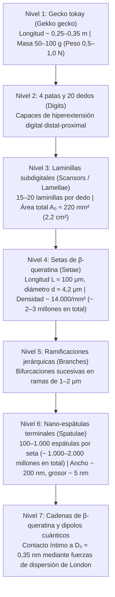
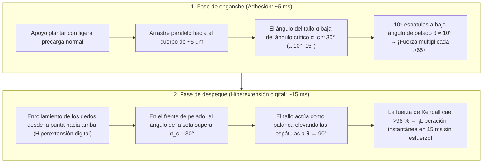

## 1. Introducción: El asombro de Aristóteles y un enigma biomecánico de 2.300 años

En el siglo IV a. C., el filósofo y naturalista griego Aristóteles (384–322 a. C.) registró en su *Historia de los animales* (*Historia Animalium*, Libro IX, Capítulo 9) una observación fascinante sobre un pequeño reptil mediterráneo —el gecko (*Askalaros* o *Ascalabotes*)—:

> «El gecko puede correr hacia arriba y hacia abajo por un árbol de cualquier manera, <strong>incluso con la cabeza hacia abajo</strong>».
> — Aristóteles, *Historia Animalium* (c. 350 a. C.)

Más de dos milenios después, este aparente desafío a la gravedad sigue siendo una de las mayores maravillas de la biofísica y la mecánica de contacto. El <strong>gecko tokay (*Gekko gecko*)</strong> del sudeste asiático alcanza entre $25\text{ y }35\,\text{cm}$ de longitud y pesa entre $50\text{ y }100\,\text{g}$ (hasta $300\,\text{g}$). A pesar de su gran masa corporal en comparación con los insectos, puede correr a más de $1\,\text{m/s}$ por una pared vertical de vidrio de sílice pulido a escala molecular o colgar invertido de un techo de cristal ($180^\circ$). Dando $15\text{ pasos por segundo}$, fija cada pata en $5\,\text{ms}$ y la despega en tan solo <strong>$15\,\text{ms}$ ($0{,}015\,\text{s}$)</strong> con una fuerza de desprendimiento prácticamente nula.

Más sorprendente aún: el gecko no deja <strong>ningún rastro de moco, lípidos ni pegamento químico</strong> sobre el vidrio. A diferencia de las hormigas, los escarabajos o las ranas arbóreas que segregan fluidos («adhesión húmeda»), las almohadillas subdigitales del gecko carecen por completo de glándulas secretoras. Se trata de una <strong>adhesión seca (Dry Adhesion)</strong> formada exclusivamente por <strong>$\beta$-queratina</strong> hidrofóbica. Si los cerca de $2\text{ millones}$ de micro-pelos (setas / *setae*) de sus cuatro patas actuaran simultáneamente a plena capacidad, podrían sostener teóricamente entre <strong>$80\text{ y }130\,\text{kg}$ —¡más de $1.000$ veces el peso de su propio cuerpo!</strong>

---

## 2. Las siete hipótesis históricas refutadas por experimentos decisivos (Autumn et al., 2000 & 2002)

Desde el siglo XIX hasta principios del siglo XXI se propusieron siete mecanismos clásicos. Gracias a los experimentos pioneros de <strong>Wolf-Dietrich Dellit (1934)</strong>, la microscopía electrónica de <strong>Ruibal & Ernst (1965)</strong> y los estudios definitivos de <strong>Kellar Autumn, Robert J. Full, Thomas W. Kenny, Ronald Fearing y Jacob N. Israelachvili</strong> en *Nature* (2000) y *PNAS* (2002), seis de estas hipótesis quedaron refutadas:

1. <strong>Succión (ventosas por presión atmosférica, Simmermacher 1884)</strong>:
   - <strong>Refutación</strong>: Dellit (1934) introdujo geckos vivos en una cámara de alto vacío ($P_{\text{atm}} \to 0$): ¡sus patas se adhirieron en el vacío con la misma fuerza que en el aire! Además, la succión atmosférica tiene un límite teórico de $1\,\text{atm} \approx 101{,}3\,\text{kPa}$, mientras que una sola seta de gecko genera un esfuerzo adhesivo de <strong>$1.000\,\text{kPa}$ ($1\,\text{MPa} \approx 10\,\text{atm}$, Autumn et al., 2000)</strong>.
2. <strong>Pegamento químico o secreción mucosa (Wagler 1830)</strong>:
   - <strong>Refutación</strong>: La epidermis de $\beta$-queratina <strong>no posee glándulas secretoras</strong>, no deja huellas químicas y se autolimpia en seco (Hansen & Autumn, 2005).
3. <strong>Fricción pura de Coulomb</strong>:
   - <strong>Refutación</strong>: La fricción clásica $F_f = \mu N$ requiere una carga normal compresiva $N > 0$ y cae a cero en un techo invertido ($N = -mg < 0$) sin adhesión tensil.
4. <strong>Engranaje micromecánico (micro-garfios, Hora 1923; Mahendra 1941)</strong>:
   - <strong>Refutación</strong>: Los geckos se adhieren con máxima fuerza a la <strong>mica moscovita exfoliada atómicamente plana (rugosidad $\text{RMS} < 0{,}1\,\text{nm}$)</strong> y a obleas de silicio pulidas (Autumn et al., 2000).
5. <strong>Atracción electrostática (carga triboeléctrica, Schmidt 1904)</strong>:
   - <strong>Refutación</strong>: Dellit (1934) ionizó el aire alrededor de las patas con <strong>rayos X y emisiones de radio</strong> para eliminar toda carga electrostática sin que el gecko cayera.
6. <strong>Puentes capilares de agua (presión de Laplace, Stork 1980) vs. Fuerzas de van der Waals (Autumn et al., 2002)</strong>:
   Si los meniscos de agua produjeran una atracción capilar $F_{\text{cap}} = 4\pi R\gamma_L \cos\theta_c$, la adhesión colapsaría en superficies fuertemente hidrofóbicas ($\theta_c > 90^\circ \implies \cos\theta_c < 0$).
   - <strong>El experimento definitivo de *PNAS* (Autumn et al., 2002)</strong>: El equipo midió la adhesión en <strong>arseniuro de galio fuertemente hidrofóbico ($\text{GaAs}$, ángulo de contacto con el agua $\theta_c \approx 110^\circ$)</strong> frente a <strong>dióxido de silicio fuertemente hidrofílico ($\text{SiO}_2$, $\theta_c < 5^\circ$)</strong>. Como ambos sustratos tienen alta polarizabilidad dieléctrica, tanto los geckos vivos como las setas aisladas generaron <strong>exactamente la misma adhesión ($\sim 200\,\text{kPa}$) en $\text{GaAs}$ hidrofóbico y en $\text{SiO}_2$ hidrofílico</strong>. Esto demostró que el mecanismo universal son las <strong>fuerzas cuánticas de dispersión de van der Waals (London)</strong>.

| N.º | Hipótesis histórica | Autores | Mecanismo físico | Refutación experimental decisiva |
| :--- | :--- | :--- | :--- | :--- |
| <strong>1</strong> | <strong>Succión / Ventosas</strong> | Simmermacher (1884) | Presión atmosférica $P_{\text{atm}} \approx 101\,\text{kPa}$ | <strong>Funciona intacto en alto vacío ($P \to 0$)</strong> (Dellit 1934); tensión ($1\,\text{MPa}$) $10\times$ superior a $1\,\text{atm}$. |
| <strong>2</strong> | <strong>Pegamento / Moco</strong> | Wagler (1830) | Secreciones glandulares adhesivas | $\beta$-queratina pura <strong>sin glándulas (100 % seca)</strong>, sin residuos y autolimpiable. |
| <strong>3</strong> | <strong>Fricción pura</strong> | Tribología clásica | Alto coeficiente de fricción $\mu$ | Falla en techos invertidos ($N = -mg < 0$) sin fuerza de tracción. |
| <strong>4</strong> | <strong>Micro-garfios</strong> | Hora (1923) | Enganche mecánico en asperezas | <strong>Adhesión máxima en mica atómicamente lisa ($\text{RMS} < 0{,}1\,\text{nm}$)</strong> (Autumn 2000). |
| <strong>5</strong> | <strong>Electrostática</strong> | Schmidt (1904) | Cargas triboeléctricas $\sigma_q^2/(2\varepsilon_0)$ | <strong>Ionizar el aire con rayos X no reduce la adhesión</strong> (Dellit 1934). |
| <strong>6</strong> | <strong>Capilaridad (agua)</strong> | Stork (1980) | Meniscos de agua $4\pi R\gamma_L\cos\theta_c$ | <strong>Adhesión idéntica ($\sim 200\,\text{kPa}$) en $\text{GaAs}$ hidrofóbico ($\theta_c = 110^\circ$) y $\text{SiO}_2$ hidrofílico</strong> (Autumn 2002). |
| <strong>7</strong> | <strong>Fuerzas de van der Waals</strong> | Hiller (1968), Autumn (2000, 2002) | Fluctuaciones cuánticas de dipolos (dispersión de London) | <strong>Confirmado por todos los experimentos</strong>: escala con la constante de Hamaker $A_H$. |

---

## 3. Arquitectura jerárquica de 7 niveles y el criterio de Dahlquist

Las fuerzas de van der Waals solo actúan a distancias de $D_0 \approx 0{,}3\text{–}0{,}4\,\text{nm}$. Para adaptarse a la rugosidad superficial desde milímetros hasta nanómetros, el gecko evolucionó una jerarquía de 7 niveles:

### 3.1 Mecánica de vigas de Euler-Bernoulli y el criterio de pegajosidad de Dahlquist

La $\beta$-queratina en bloque es un polímero rígido con módulo de Young $E_{\text{bulk}} \approx 2{,}0\,\text{GPa}$. Sin embargo, según el <strong>criterio de Dahlquist (Carl A. Dahlquist, 1966)</strong>, un adhesivo sensible a la presión necesita un <strong>módulo elástico efectivo $E_{\text{eff}} \le 100\text{–}300\,\text{kPa}$</strong> para conformarse espontáneamente a superficies rugosas.

Al esculpir la queratina rígida en micro-vigas en voladizo inclinadas a $\alpha_0 \approx 45^\circ$ ($L \approx 100\,\mu\text{m}$, radio $r \approx 2{,}1\,\mu\text{m}$, espaciado $s \approx 8{,}5\,\mu\text{m}$, momento de inercia $I = \frac{\pi r^4}{4}$) con rigidez de flexión $k_\perp = \frac{3 E_{\text{bulk}} I}{L^3 \sin^2\alpha_0}$, el módulo efectivo cae cuatro órdenes de magnitud:

$$E_{\text{eff}} = \frac{k_\perp L \sin\alpha_0}{s^2} = \frac{3\pi}{4 \sin\alpha_0} E_{\text{bulk}} \left(\frac{r}{L}\right)^2 \left(\frac{r}{s}\right)^2 \approx 80\text{–}100\,\text{kPa}$$

Cada espátula aporta $\sim 10\,\text{nN}$ (Huber et al., 2005) y cada seta soporta de $40\,\mu\text{N}$ a $194 \pm 25\,\mu\text{N}$ (Autumn et al., 2000), sumando una capacidad teórica total de $80\text{ a }130\,\text{kg}$ en las cuatro patas.

---

## 4. Electrodinámica cuántica de las fuerzas de van der Waals, London y Casimir-Lifshitz

El potencial intermolecular de van der Waals entre dos moléculas neutras a distancia $r$ es:

$$U_{\text{vdW}}(r) = -\frac{C_{\text{Keesom}} + C_{\text{Debye}} + C_{\text{London}}}{r^6}$$

En la $\beta$-queratina apolar domina la <strong>fuerza de dispersión de London (Fritz London, 1930)</strong>, originada por las fluctuaciones cuánticas de punto cero de osciladores armónicos 3D (frecuencia $\omega_0$, polarizabilidades $\alpha_1, \alpha_2$):

$$U_{\text{London}}(r) = -\frac{3}{4} \frac{\hbar \omega_0 \alpha_1 \alpha_2}{(4\pi\varepsilon_0)^2 r^6}$$

Integrando este potencial sobre una punta esférica de radio $R \approx 100\,\text{nm}$ a una distancia $D_0 \approx 0{,}35\,\text{nm}$ de un plano según <strong>Hugo C. Hamaker (1937)</strong> y <strong>Evgeny Lifshitz (1956)</strong> (con la constante de Hamaker $A_H = \pi^2 C \rho_1 \rho_2 \approx 10^{-19}\,\text{J}$), resulta:

$$F_{\text{vdW}}(D_0) = \frac{A_H R}{6 D_0^2} \approx 13{,}6\,\text{nN}$$

La teoría de Lifshitz demuestra que $A_H$ depende del factor óptico UV $\frac{(n_1^2 - 1)(n_2^2 - 1)}{(n_1^2 + 1)(n_2^2 + 1)}$, explicando por qué el gecko resbala sobre el <strong>politetrafluoroetileno (PTFE / Teflón)</strong>, cuyos enlaces $\text{C–F}$ tienen una polarizabilidad muy baja y un índice de refracción mínimo ($n_{\text{PTFE}} \approx 1{,}35$).

---

## 5. El principio de división del contacto («Contact Splitting») mediante la mecánica JKR

Según la <strong>teoría de Johnson-Kendall-Roberts (JKR, 1971)</strong>, el radio de contacto $a$ y la fuerza de desprendimiento $F_{\text{JKR}}^{(1)}$ de una semiesfera elástica de radio $R$ y trabajo de adhesión $W_{\text{ad}} = \Delta\gamma$ son:

$$a^3 = \frac{3 R}{4 E^*} \left( P + 3\pi W_{\text{ad}} R + \sqrt{6\pi W_{\text{ad}} R P + (3\pi W_{\text{ad}} R)^2} \right) \implies F_{\text{JKR}}^{(1)} = \frac{3}{2}\pi W_{\text{ad}} R$$

Dado que la fuerza de desprendimiento es <strong>proporcional al radio lineal $R$ (¡y no al área $\pi R^2$!)</strong>, <strong>Arzt, Gorb y Spolenak (2003, *PNAS*)</strong> demostraron que al dividir un área aparente $\pi R_0^2$ en $N$ sub-contactos de radio $r_N = R_0 / \sqrt{N}$, la fuerza adhesiva total se multiplica por $\sqrt{N}$:

$$\boxed{F_{\text{total}}(N) = N \cdot \frac{3}{2}\pi W_{\text{ad}} \left(\frac{R_0}{\sqrt{N}}\right) = \sqrt{N} \, F_{\text{JKR}}^{(1)}}$$

<strong>¡Dividir el contacto en $N = 10^9$ nano-espátulas multiplica la fuerza total de adhesión por $\sqrt{10^9} \approx 31.623$ (más de 30.000 veces)!</strong> Esto explica la ley alométrica $\rho_A \propto m^{2/3}$ desde las moscas hasta los geckos, así como la insensibilidad a los defectos por debajo del radio crítico de Gao & Yao (2004) $r_{\text{crit}} = \frac{8 E^* W_{\text{ad}}}{\pi \sigma_{\text{th}}^2} \approx 170\,\text{nm}$.

---

## 6. La paradoja del desprendimiento en 15 ms: Ecuación de pelado de Kendall e hiperextensión digital

¿Cómo despega el gecko su pata en $15\,\text{ms}$ sin esfuerzo? La <strong>ecuación de pelado elástico de Kevin Kendall (1971)</strong> para una cinta (ancho $b$, espesor $d$, módulo $E$) en un ángulo de pelado $\theta$ es:

$$\left(\frac{F_{\text{peel}}}{b}\right)^2 \frac{1}{2 d E} + \frac{F_{\text{peel}}}{b}(1 - \cos\theta) = W_{\text{ad}} \implies F_{\text{peel}}(\theta) \approx \frac{b W_{\text{ad}}}{1 - \cos\theta}$$

Al arrastrar paralelamente ($\theta \approx 10^\circ, \alpha < 30^\circ$), $1 - \cos 10^\circ \approx 0{,}0152$ produce una fuerza enorme ($F_{\text{peel}}(10^\circ) \approx 65{,}8\,b W_{\text{ad}}$). Para despegar, la <strong>hiperextensión digital</strong> hace que las setas superen el ángulo crítico $\alpha_c \approx 30^\circ$ (Autumn et al., 2006), elevando las espátulas a $\theta \approx 90^\circ$ ($1 - \cos 90^\circ = 1$) y reduciendo la fuerza de pelado casi cien veces.

---

## 7. Autolimpieza en seco y aplicaciones biomiméticas (Pinzas espaciales de NASA JPL)

1. <strong>Autolimpieza por contacto (Hansen & Autumn, 2005 *PNAS*)</strong>: Una partícula de polvo ($R_p \approx 2{,}5\,\mu\text{m}$) experimenta una atracción de van der Waals $F_{\text{particle-wall}} \propto R_p$ hacia la pared plana mucho mayor que la suma de atracciones $F_{\text{particle-setae}} \propto n R_s$ hacia las pocas espátulas ($R_s \approx 100\,\text{nm}$) que la tocan. En $4\text{ a }8\text{ pasos}$, el polvo pasa a la pared.
2. <strong>Ingeniería biomimética y pinzas espaciales de NASA JPL (Parness, Jiang et al., 2017 *Science Robotics*)</strong>: Desde los micropilares de Andre Geim (2003), las microcuñas direccionales de PDMS de Stanford con las que un humano de $70\,\text{kg}$ escaló un edificio de cristal (Hawkes et al., 2014) y las alfombras de nanotubos de carbono ($100\,\text{N/cm}^2$, Qu et al., 2008), hasta las <strong>pinzas capturadoras de basura espacial y los robots *Astrobee* de la ISS del NASA JPL</strong>, la adhesión seca de van der Waals opera en el vacío espacial y a $-190^\circ\text{C}$ sin precarga repulsiva.
