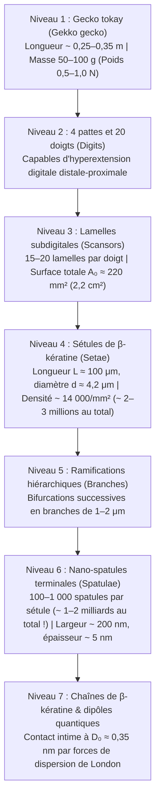
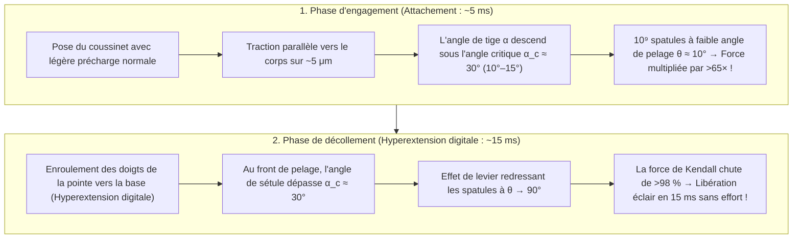

## 1. Introduction : L'émerveillement d'Aristote et une énigme biomécanique de 2 300 ans

Au IVe siècle avant notre ère, le philosophe et naturaliste grec Aristote (384–322 av. J.-C.) consignait dans son *Histoire des animaux* (*Historia Animalium*, Livre IX, Chapitre 9) une observation fascinante au sujet d'un petit reptile méditerranéen — le gecko (*Askalaros* ou *Ascalabotes*) :

> « Le gecko peut courir le long d'un arbre dans n'importe quel sens, <strong>même la tête en bas</strong>. »
> — Aristote, *Histoire des animaux* (vers 350 av. J.-C.)

Plus de deux millénaires plus tard, ce défi apparent à la gravité demeure l'un des chefs-d'œuvre les plus spectaculaires de la biophysique et de la mécanique du contact. Le <strong>gecko tokay (*Gekko gecko*)</strong> d'Asie du Sud-Est mesure de $25\text{ à }35\,\text{cm}$ et pèse de $50\text{ à }100\,\text{g}$ (jusqu'à $300\,\text{g}$). Malgré cette masse imposante pour un animal grimpeur, il peut sprinter à plus de $1\,\text{m/s}$ sur une paroi verticale en verre de silice poli à l'échelle moléculaire ou traverser un plafond de verre inversé ($180^\circ$). À raison de $15\text{ pas par seconde}$, il verrouille l'adhésion de sa patte en $5\,\text{ms}$ et la détache en seulement <strong>$15\,\text{ms}$ ($0,015\,\text{s}$)</strong> avec une force de décollement quasi nulle.

Plus remarquable encore : le gecko ne laisse <strong>aucune trace de mucus, de lipides ni de colle chimique</strong> sur son passage. Contrairement aux insectes (fourmis, coléoptères) ou aux rainettes qui sécrètent des fluides capillaires (« adhésion humide »), les coussinets subdigitaux du gecko sont totalement dépourvus de glandes sécrétrices. Il s'agit d'une <strong>adhésion sèche (Dry Adhesion)</strong> constituée exclusivement de <strong>$\beta$-kératine</strong> hydrophobe. Si les quelque $2\text{ millions}$ de micro-poils (sétules / *setae*) de ses quatre pattes agissaient simultanément à pleine capacité, ils pourraient théoriquement soutenir une charge de <strong>$80\text{ à }130\,\text{kg}$ — soit plus de $1\,000$ fois le poids de l'animal !</strong>

---

## 2. Les sept hypothèses historiques réfutées par l'expérience (Autumn et al., 2000 & 2002)

Du XIXe siècle au début du XXIe siècle, sept mécanismes classiques ont été proposés. Grâce aux expériences pionnières de <strong>Wolf-Dietrich Dellit (1934)</strong>, à la microscopie électronique de <strong>Ruibal & Ernst (1965)</strong> et aux travaux décisifs de <strong>Kellar Autumn, Robert J. Full, Thomas W. Kenny, Ronald Fearing et Jacob N. Israelachvili</strong> dans *Nature* (2000) et *PNAS* (2002), six de ces hypothèses ont été formellement réfutées :

1. <strong>La succion (ventouses sous pression atmosphérique, Simmermacher 1884)</strong> :
   - <strong>Réfutation</strong> : Dellit (1934) a placé des geckos vivants dans une chambre à vide ($P_{\text{atm}} \to 0$) : leurs pattes adhéraient tout aussi fortement dans le vide ! De plus, une ventouse parfaite au niveau de la mer est limitée à $1\,\text{atm} \approx 101,3\,\text{kPa}$, alors qu'une seule sétule de gecko développe une contrainte adhésive de <strong>$1\,000\,\text{kPa}$ ($1\,\text{MPa} \approx 10\,\text{atm}$, Autumn et al., 2000)</strong>.
2. <strong>Sécrétion de colle ou de mucus (Wagler 1830)</strong> :
   - <strong>Réfutation</strong> : L'épiderme de $\beta$-kératine ne possède <strong>aucune glande sécrétrice</strong>, ne laisse aucun résidu et s'auto-nettoie à sec (Hansen & Autumn, 2005).
3. <strong>Friction de Coulomb pure</strong> :
   - <strong>Réfutation</strong> : La loi de Coulomb $F_f = \mu N$ exige une charge normale compressive $N > 0$ et s'annule sur un plafond inversé ($N = -mg < 0$) sans adhésion en traction.
4. <strong>Engrènement micromécanique (micro-crochets, Hora 1923 ; Mahendra 1941)</strong> :
   - <strong>Réfutation</strong> : Les geckos adhèrent avec une force maximale sur du <strong>mica muscovite clivé atomiquement lisse (rugosité $\text{RMS} < 0,1\,\text{nm}$)</strong> et des wafers de silicium polis (Autumn et al., 2000).
5. <strong>Attraction électrostatique (triboélectricité, Schmidt 1904)</strong> :
   - <strong>Réfutation</strong> : En ionisant l'air autour des pattes avec des <strong>rayons X et du radium</strong> pour dissiper toute charge statique (Dellit, 1934), l'adhésion reste intacte.
6. <strong>Ponts capillaires d'eau (pression de Laplace, Stork 1980) vs. Forces de van der Waals (Autumn et al., 2002)</strong> :
   Si des ménisques d'eau produisaient une force capillaire $F_{\text{cap}} = 4\pi R\gamma_L \cos\theta_c$, l'adhésion devrait s'effondrer sur un substrat fortement hydrophobe ($\theta_c > 90^\circ \implies \cos\theta_c < 0$).
   - <strong>L'expérience décisive de *PNAS* (Autumn et al., 2002)</strong> : L'équipe a mesuré l'adhésion d'animaux vivants et de sétules isolées sur de l'<strong>arséniure de gallium fortement hydrophobe ($\text{GaAs}$, angle de contact de l'eau $\theta_c \approx 110^\circ$)</strong> et sur du <strong>dioxyde de silicium fortement hydrophile ($\text{SiO}_2$, $\theta_c < 5^\circ$)</strong>. Parce que ces deux substrats ont une polarisabilité diélectrique élevée, le gecko et ses sétules ont développé <strong>exactement la même contrainte d'adhésion ($\sim 200\,\text{kPa}$) sur le $\text{GaAs}$ hydrophobe et sur le $\text{SiO}_2$ hydrophile</strong> ! Cela prouve que le moteur universel est la <strong>force de dispersion quantique de van der Waals (London)</strong>.

| N° | Hypothèse historique | Auteurs | Mécanisme physique | Réfutation expérimentale décisive |
| :--- | :--- | :--- | :--- | :--- |
| <strong>1</strong> | <strong>Succion / Ventouses</strong> | Simmermacher (1884) | Pression atmosphérique $P_{\text{atm}} \approx 101\,\text{kPa}$ | <strong>Adhère parfaitement sous vide poussé ($P \to 0$)</strong> (Dellit 1934) ; contrainte ($1\,\text{MPa}$) $10\times$ supérieure à $1\,\text{atm}$. |
| <strong>2</strong> | <strong>Colle / Mucus</strong> | Wagler (1830) | Sécrétions glandulaires adhésives | $\beta$-kératine pure <strong>sans aucune glande (100 % sèche)</strong>, sans résidu et auto-nettoyante. |
| <strong>3</strong> | <strong>Friction pure</strong> | Tribologie classique | Fort coefficient de frottement $\mu$ | Échoue sur un plafond inversé ($N = -mg < 0$) sans force de traction. |
| <strong>4</strong> | <strong>Micro-crochets</strong> | Hora (1923) | Accrochage mécanique aux aspérités | <strong>Adhésion maximale sur du mica clivé atomiquement lisse ($\text{RMS} < 0,1\,\text{nm}$)</strong> (Autumn 2000). |
| <strong>5</strong> | <strong>Électrostatique</strong> | Schmidt (1904) | Charges triboélectriques $\sigma_q^2/(2\varepsilon_0)$ | <strong>L'ionisation de l'air par rayons X ne réduit pas l'adhésion</strong> (Dellit 1934). |
| <strong>6</strong> | <strong>Capillarité (eau)</strong> | Stork (1980) | Ménisques d'eau $4\pi R\gamma_L\cos\theta_c$ | <strong>Adhésion identique ($\sim 200\,\text{kPa}$) sur $\text{GaAs}$ hydrophobe ($\theta_c = 110^\circ$) et $\text{SiO}_2$ hydrophile</strong> (Autumn 2002). |
| <strong>7</strong> | <strong>Forces de van der Waals</strong> | Hiller (1968), Autumn (2000, 2002) | Fluctuations quantiques de dipôles (dispersion de London) | <strong>Confirmé par toutes les expériences</strong> : proportionnel à la constante de Hamaker $A_H$. |

---

## 3. Architecture hiérarchique à 7 niveaux et critère de Dahlquist

Les forces de van der Waals n'agissent qu'à une distance de $D_0 \approx 0,3\text{–}0,4\,\text{nm}$. Pour épouser les rugosités de toute surface jusqu'à l'échelle atomique, le gecko déploie une architecture hiérarchique sur 7 ordres de grandeur :

### 3.1 Mécanique des poutres d'Euler-Bernoulli et critère de pégosité de Dahlquist

La $\beta$-kératine massive est un polymère rigide de module d'Young $E_{\text{bulk}} \approx 2,0\,\text{GPa}$. Or, selon le <strong>critère de Dahlquist (Carl A. Dahlquist, 1966)</strong>, un adhésif sensible à la pression doit avoir un <strong>module élastique effectif $E_{\text{eff}} \le 100\text{–}300\,\text{kPa}$</strong> pour se conformer spontanément aux rugosités.

En façonnant la kératine rigide en micro-poutres consoles inclinées à $\alpha_0 \approx 45^\circ$ ($L \approx 100\,\mu\text{m}$, rayon $r \approx 2,1\,\mu\text{m}$, espacement $s \approx 8,5\,\mu\text{m}$, moment quadratique $I = \frac{\pi r^4}{4}$) de raideur en flexion $k_\perp = \frac{3 E_{\text{bulk}} I}{L^3 \sin^2\alpha_0}$, le module effectif du tapis de sétules chute de quatre ordres de grandeur :

$$E_{\text{eff}} = \frac{k_\perp L \sin\alpha_0}{s^2} = \frac{3\pi}{4 \sin\alpha_0} E_{\text{bulk}} \left(\frac{r}{L}\right)^2 \left(\frac{r}{s}\right)^2 \approx 80\text{–}100\,\text{kPa}$$

Chaque spatule génère $\sim 10\,\text{nN}$ (Huber et al., 2005) et chaque sétule génère de $40\,\mu\text{N}$ à $194 \pm 25\,\mu\text{N}$ (Autumn et al., 2000), soit une capacité théorique totale de $80\text{ à }130\,\text{kg}$ sur quatre pattes !

---

## 4. Électrodynamique quantique des forces de van der Waals, de London et de Casimir-Lifshitz

Le potentiel de van der Waals entre deux molécules neutres séparées par $r$ s'écrit :

$$U_{\text{vdW}}(r) = -\frac{C_{\text{Keesom}} + C_{\text{Debye}} + C_{\text{London}}}{r^6}$$

Pour la $\beta$-kératine non polaire, la <strong>force de dispersion de London (Fritz London, 1930)</strong> issue des fluctuations quantiques du point zéro d'oscillateurs harmoniques 3D (fréquence $\omega_0$, polarisabilités $\alpha_1, \alpha_2$) domine :

$$U_{\text{London}}(r) = -\frac{3}{4} \frac{\hbar \omega_0 \alpha_1 \alpha_2}{(4\pi\varepsilon_0)^2 r^6}$$

En intégrant cette interaction sur une extrémité sphérique de rayon $R \approx 100\,\text{nm}$ à une distance $D_0 \approx 0,35\,\text{nm}$ d'une surface plane selon <strong>Hugo C. Hamaker (1937)</strong> et <strong>Evgeny Lifshitz (1956)</strong> (constante de Hamaker $A_H = \pi^2 C \rho_1 \rho_2 \approx 10^{-19}\,\text{J}$), on obtient :

$$F_{\text{vdW}}(D_0) = \frac{A_H R}{6 D_0^2} \approx 13,6\,\text{nN}$$

La théorie de Lifshitz montre que $A_H$ dépend principalement du terme optique UV $\frac{(n_1^2 - 1)(n_2^2 - 1)}{(n_1^2 + 1)(n_2^2 + 1)}$, ce qui explique pourquoi le gecko glisse sur le <strong>polytétrafluoroéthylène (PTFE / Téflon)</strong> dont les liaisons $\text{C–F}$ très peu polarisables donnent un indice de réfraction exceptionnellement bas ($n_{\text{PTFE}} \approx 1,35$).

---

## 5. Le principe de division du contact (« Contact Splitting ») via la mécanique JKR

Selon la <strong>théorie de Johnson-Kendall-Roberts (JKR, 1971)</strong>, le rayon de contact $a$ et la force d'arrachement $F_{\text{JKR}}^{(1)}$ d'un hémisphère élastique de rayon $R$ et de travail d'adhésion $W_{\text{ad}} = \Delta\gamma$ sont :

$$a^3 = \frac{3 R}{4 E^*} \left( P + 3\pi W_{\text{ad}} R + \sqrt{6\pi W_{\text{ad}} R P + (3\pi W_{\text{ad}} R)^2} \right) \implies F_{\text{JKR}}^{(1)} = \frac{3}{2}\pi W_{\text{ad}} R$$

Comme la force d'arrachement est <strong>proportionnelle au rayon linéaire $R$ (et non à l'aire $\pi R^2$ !)</strong>, <strong>Arzt, Gorb et Spolenak (2003, *PNAS*)</strong> ont démontré qu'en divisant une surface apparente $\pi R_0^2$ en $N$ sous-contacts de rayon $r_N = R_0 / \sqrt{N}$, la force totale d'adhésion est multipliée par $\sqrt{N}$ :

$$\boxed{F_{\text{total}}(N) = N \cdot \frac{3}{2}\pi W_{\text{ad}} \left(\frac{R_0}{\sqrt{N}}\right) = \sqrt{N} \, F_{\text{JKR}}^{(1)}}$$

<strong>En divisant le contact en $N = 10^9$ nano-spatules, le gecko amplifie sa force d'adhésion d'un facteur $\sqrt{10^9} \approx 31\,623$ (plus de 30 000 fois) !</strong> Cela explique la loi d'échelle évolutive $\rho_A \propto m^{2/3}$ des mouches aux geckos, ainsi que l'insensibilité aux défauts de fracture sous le rayon critique de Gao & Yao (2004) $r_{\text{crit}} = \frac{8 E^* W_{\text{ad}}}{\pi \sigma_{\text{th}}^2} \approx 170\,\text{nm}$.

---

## 6. Le paradoxe du décollement en 15 ms : Équation de pelage de Kendall et hyperextension digitale

Comment le gecko détache-t-il sa patte en $15\,\text{ms}$ sans effort ? L'<strong>équation de pelage élastique de Kevin Kendall (1971)</strong> relie la force de pelage $F_{\text{peel}}$ d'un ruban (largeur $b$, épaisseur $d$, module $E$) à l'angle de pelage $\theta$ :

$$\left(\frac{F_{\text{peel}}}{b}\right)^2 \frac{1}{2 d E} + \frac{F_{\text{peel}}}{b}(1 - \cos\theta) = W_{\text{ad}} \implies F_{\text{peel}}(\theta) \approx \frac{b W_{\text{ad}}}{1 - \cos\theta}$$

En tirant parallèlement ($\theta \approx 10^\circ, \alpha < 30^\circ$), $1 - \cos 10^\circ \approx 0,0152$ génère une force énorme ($F_{\text{peel}}(10^\circ) \approx 65,8\,b W_{\text{ad}}$). Pour décoller, l'<strong>hyperextension digitale</strong> fait dépasser aux sétules l'angle critique $\alpha_c \approx 30^\circ$ (Autumn et al., 2006), redressant les spatules à $\theta \approx 90^\circ$ ($1 - \cos 90^\circ = 1$) et divisant par près de $100$ la force requise !

---

## 7. Auto-nettoyage à sec et applications biomimétiques (Robotique spatiale NASA JPL)

1. <strong>Auto-nettoyage par contact (Hansen & Autumn, 2005 *PNAS*)</strong> : Une particule de poussière ($R_p \approx 2,5\,\mu\text{m}$) subit une force de van der Waals $F_{\text{particle-wall}} \propto R_p$ vers le mur plat supérieure à la somme des forces $F_{\text{particle-setae}} \propto n R_s$ des quelques spatules ($R_s \approx 100\,\text{nm}$) qui la touchent. En $4\text{ à }8\text{ pas}$, la poussière est transférée au mur.
2. <strong>Ingénierie biomimétique & Préhenseurs spatiaux NASA JPL (Parness, Jiang et al., 2017 *Science Robotics*)</strong> : Des micro-piliers d'Andre Geim (2003) aux micro-coins directionnels en PDMS de Stanford permettant à un humain de $70\,\text{kg}$ d'escalader un mur de verre (Hawkes et al., 2014), aux tapis de nanotubes de carbone ($100\,\text{N/cm}^2$, Qu et al., 2008), jusqu'aux <strong>préhenseurs de débris orbitaux et robots *Astrobee* de l'ISS développés par le NASA JPL</strong>, l'adhésion sèche de van der Waals fonctionne dans le vide spatial et à $-190^\circ\text{C}$ sans précharge répulsive.
