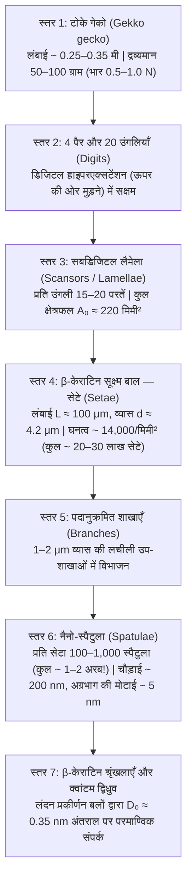
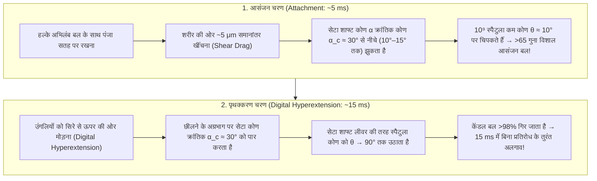

## 1. प्रस्तावना: अरस्तू का विस्मय और 2,300 वर्ष पुरानी जैव-यांत्रिकी पहेली

चौथी शताब्दी ईसा पूर्व में, प्राचीन यूनानी दार्शनिक और प्रकृतिवादी अरस्तू (Aristotle, 384–322 BCE) ने अपनी प्रसिद्ध कृति *हिस्तोरिया एनिमेलियम* (*Historia Animalium*, पुस्तक IX, अध्याय 9) में भूमध्यसागरीय क्षेत्र की एक छोटी सरीसृप—छिपकली या गेको (प्राचीन यूनानी में *Askalaros* या *Ascalabotes*)—की अद्भुत क्षमता का वर्णन किया था:

> "छिपकली पेड़ के तने पर किसी भी तरह से ऊपर और नीचे दौड़ सकती है, <strong>यहाँ तक कि सिर नीचे करके उल्टी अवस्था में भी</strong>।"
> — अरस्तू, *Historia Animalium* (लगभग 350 ईसा पूर्व)

दो हजार तीन सौ वर्षों के बाद भी, गुरुत्वाकर्षण को चुनौती देने वाली यह घटना जैव-भौतिकी (Biophysics) और संपर्क यांत्रिकी (Contact Mechanics) के सबसे अद्भुत चमत्कारों में से एक है। दक्षिण-पूर्व एशिया और भारत में पाई जाने वाली विशाल <strong>टोके गेको (Tokay gecko, वैज्ञानिक नाम: *Gekko gecko*)</strong> की लंबाई $25\text{–}35\,\text{cm}$ और वजन $50\text{–}100\,\text{g}$ (बड़े जीवों में $300\,\text{g}$ तक) होता है। कीड़ों की तुलना में इतना अधिक वजन होने के बावजूद, टोके गेको आणविक रूप से चिकनी ऊर्ध्वाधर क्वार्ट्ज कांच की दीवार पर या $180^\circ$ उल्टी कांच की छत पर $1\,\text{m/s}$ से अधिक की गति से दौड़ सकती है। प्रति सेकंड $15\text{ कदम}$ रखते हुए, यह मात्र $5\,\text{ms}$ में अपना पैर चिपका लेती है और अगला कदम बढ़ाने के लिए केवल <strong>$15\,\text{ms}$ ($0.015\text{ सेकंड}$)</strong> में लगभग शून्य बल के साथ पैर को कांच से छुड़ा लेती है।

इससे भी अधिक आश्चर्यजनक बात यह है कि गेको के दौड़ने के बाद कांच की सतह पर <strong>बलगम (mucus), वसा या किसी रासायनिक गोंद का कोई निशान नहीं बचता</strong>। चींटियों, भृंगों (beetles) या वृक्ष मेंढकों के विपरीत, जो ग्रंथियों से तरल स्रावित करते हैं ("आर्द्र आसंजन"), गेको के पंजों में कोई स्रावी ग्रंथि नहीं होती। यह विशुद्ध रूप से जल-विरोधी (hydrophobic) <strong>$\beta$-केराटिन ($\beta$-keratin)</strong> प्रोटीन से बना <strong>शुष्क आसंजन (Dry Adhesion)</strong> है। यदि गेको के चारों पैरों के लगभग $20\text{ लाख}$ सूक्ष्म बाल (सेटे / *setae*) एक साथ अपनी अधिकतम क्षमता पर काम करें, तो वे सैद्धांतिक रूप से <strong>$80\text{ से }130\,\text{kg}$ का भार उठा सकते हैं — जो उसके अपने शरीर के वजन से $1,000$ गुना अधिक है!</strong>

---

## 2. निर्णायक प्रयोगों द्वारा खारिज की गईं सात ऐतिहासिक परिकल्पनाएँ (Autumn et al., 2000 & 2002)

19वीं शताब्दी से 21वीं शताब्दी की शुरुआत तक सात प्रमुख भौतिक परिकल्पनाएँ प्रस्तुत की गईं। <strong>वोल्फ-डिट्रिच डेलिट (Wolf-Dietrich Dellit, 1934)</strong> के अग्रणी प्रयोगों, <strong>रुइबाल और अर्न्स्ट (Ruibal & Ernst, 1965)</strong> के इलेक्ट्रॉन माइक्रोस्कोपी और <strong>केलर ऑटम (Kellar Autumn), रॉबर्ट फुल (Robert J. Full), थॉमस केनी (Thomas W. Kenny), रोनाल्ड फियरिंग (Ronald Fearing) तथा जैकब इज़राइलअश्विली (Jacob N. Israelachvili)</strong> द्वारा *Nature* (2000) और *PNAS* (2002) में प्रकाशित निर्णायक प्रयोगों ने इनमें से छह परिकल्पनाओं को पूरी तरह गलत साबित कर दिया:

1. <strong>चूषण कप / वैक्यूम परिकल्पना (Suction, Simmermacher 1884)</strong>:
   - <strong>प्रायोगिक खंडन</strong>: डेलिट (1934) ने जीवित गेको को उच्च निर्वात कक्ष (vacuum chamber, $P_{\text{atm}} \to 0$) में रखा—निर्वात में भी उसके पैर उतनी ही मजबूती से चिपके रहे! इसके अलावा, समुद्र तल पर वायुमंडलीय चूषण की अधिकतम सीमा $1\,\text{atm} \approx 101.3\,\text{kPa}$ है, जबकि गेको का एक अकेला सेटा <strong>$1,000\,\text{kPa}$ ($1\,\text{MPa} \approx 10\,\text{atm}$, Autumn et al., 2000)</strong> का आसंजन प्रतिबल उत्पन्न करता है।
2. <strong>रासायनिक गोंद या श्लेष्म स्राव (Wagler 1830)</strong>:
   - <strong>प्रायोगिक खंडन</strong>: $\beta$-केराटिन त्वचा में <strong>कोई स्रावी ग्रंथि नहीं होती</strong>, यह कोई अवशेष नहीं छोड़ती और इसमें शुष्क स्व-सफाई (self-cleaning) क्षमता होती है (Hansen & Autumn, 2005)।
3. <strong>शुद्ध कूलॉम घर्षण (Pure Coulomb Friction)</strong>:
   - <strong>प्रायोगिक खंडन</strong>: घर्षण $F_f = \mu N$ के लिए धनात्मक अभिलंब बल $N > 0$ आवश्यक है; उल्टी छत ($N = -mg < 0$) पर बिना तन्य आसंजन के यह शून्य हो जाता है।
4. <strong>सूक्ष्म-यांत्रिक इंटरलॉकिंग (सूक्ष्म हुक, Hora 1923; Mahendra 1941)</strong>:
   - <strong>प्रायोगिक खंडन</strong>: गेको <strong>परमाण्विक रूप से समतल अभ्रक (Cleaved Mica, खुरदरापन $\text{RMS} < 0.1\,\text{nm}$)</strong> और पॉलिश किए गए सिलिकॉन वेफर्स पर सबसे अधिक मजबूती से चिपकती है (Autumn et al., 2000)।
5. <strong>स्थिरवैद्युत आकर्षण (Electrostatic Attraction, Schmidt 1904)</strong>:
   - <strong>प्रायोगिक खंडन</strong>: डेलिट (1934) ने <strong>एक्स-रे (X-rays) और रेडियम विकिरण</strong> से हवा को आयनित कर सभी स्थिर आवेशों को समाप्त कर दिया, फिर भी गेको नहीं गिरी।
6. <strong>केशिका जल सेतु (Capillary Water Bridges, Stork 1980) बनाम वान डर वाल्स बल (Autumn et al., 2002)</strong>:
   यदि जल मेनिस्कस द्वारा केशिका बल $F_{\text{cap}} = 4\pi R\gamma_L \cos\theta_c$ मुख्य कारण होता, तो अत्यधिक जल-विरोधी (hydrophobic, $\theta_c > 90^\circ \implies \cos\theta_c < 0$) सतहों पर आसंजन समाप्त हो जाता।
   - <strong>*PNAS* (2002) का निर्णायक प्रयोग</strong>: ऑटम की टीम ने <strong>अत्यधिक जल-विरोधी गैलियम आर्सेनाइड ($\text{GaAs}$, जल संपर्क कोण $\theta_c \approx 110^\circ$)</strong> और <strong>अत्यधिक जल-स्नेही सिलिकॉन डाइऑक्साइड ($\text{SiO}_2$ कांच, $\theta_c < 5^\circ$)</strong> पर जीवित गेको और एकल सेटा का परीक्षण किया। चूंकि दोनों पदार्थों की परावैद्युत ध्रुवणीयता (dielectric polarizability) उच्च है, इसलिए गेको ने <strong>जल-विरोधी $\text{GaAs}$ और जल-स्नेही $\text{SiO}_2$ दोनों पर बिल्कुल समान आसंजन प्रतिबल ($\sim 200\,\text{kPa}$)</strong> उत्पन्न किया! इससे सिद्ध हो गया कि वास्तविक तंत्र क्वांटम-यांत्रिक <strong>वान डर वाल्स प्रकीर्णन बल (London Dispersion Force)</strong> है।

| क्र. | ऐतिहासिक परिकल्पना | प्रस्तावक | भौतिक तंत्र | निर्णायक प्रायोगिक खंडन |
| :--- | :--- | :--- | :--- | :--- |
| <strong>1</strong> | <strong>चूषण (Suction)</strong> | Simmermacher (1884) | वायुमंडलीय दाब $P_{\text{atm}} \approx 101\,\text{kPa}$ | <strong>निर्वात ($P \to 0$) में भी पूर्ण आसंजन</strong> (Dellit 1934); प्रतिबल ($1\,\text{MPa}$) वायुमंडलीय सीमा से $10\times$ अधिक। |
| <strong>2</strong> | <strong>गोंद / श्लेष्म स्राव</strong> | Wagler (1830) | ग्रंथियों से चिपचिपा तरल | शुद्ध $\beta$-केराटिन, <strong>कोई ग्रंथि नहीं (100% शुष्क)</strong>, अवशेष-रहित और स्व-सफाई युक्त। |
| <strong>3</strong> | <strong>शुद्ध घर्षण</strong> | शास्त्रीय ट्राइबोलॉजी | उच्च घर्षण गुणांक $\mu$ | बिना तन्य आसंजन के उल्टी छत ($N = -mg < 0$) पर विफल। |
| <strong>4</strong> | <strong>सूक्ष्म हुक</strong> | Hora (1923) | सतह के खुरदरेपन में फँसना | <strong>परमाण्विक रूप से चिकने अभ्रक ($\text{RMS} < 0.1\,\text{nm}$)</strong> पर अधिकतम आसंजन (Autumn 2000)। |
| <strong>5</strong> | <strong>स्थिरवैद्युत बल</strong> | Schmidt (1904) | घर्षण आवेश $\sigma_q^2/(2\varepsilon_0)$ | <strong>एक्स-रे द्वारा हवा को आयनित करने पर भी आसंजन कम नहीं होता</strong> (Dellit 1934)। |
| <strong>6</strong> | <strong>केशिका जल सेतु</strong> | Stork (1980) | जल पृष्ठ तनाव $4\pi R\gamma_L\cos\theta_c$ | <strong>जल-विरोधी $\text{GaAs}$ ($\theta_c = 110^\circ$) और जल-स्नेही $\text{SiO}_2$ पर समान आसंजन ($\sim 200\,\text{kPa}$)</strong> (Autumn 2002)। |
| <strong>7</strong> | <strong>वान डर वाल्स बल</strong> | Hiller (1968), Autumn (2000, 2002) | क्वांटम शून्य-बिंदु द्विध्रुव उतार-चढ़ाव (लंदन बल) | <strong>सभी प्रयोगों द्वारा पुष्ट</strong>: हैमेकर स्थिरांक $A_H$ के समानुपाती, निर्वात व $-190^\circ\text{C}$ पर भी सक्रिय। |

---

## 3. 7-स्तरीय पदानुक्रमित संरचना और डालक्विस्ट मानदंड (Dahlquist Criterion)

वान डर वाल्स बल केवल $D_0 \approx 0.3\text{–}0.4\,\text{nm}$ की अत्यंत सूक्ष्म दूरी पर कार्य करते हैं। मिलीमीटर से नैनोमीटर तक की सतह की खुरदराहट के साथ पूर्ण संपर्क बनाने के लिए गेको ने 7-स्तरीय पदानुक्रमित संरचना विकसित की है:

### 3.1 यूलर-बर्नौली कैंटिलीवर यांत्रिकी और डालक्विस्ट आसंजन मानदंड

ठोस $\beta$-केराटिन का यंग मापांक $E_{\text{bulk}} \approx 2.0\,\text{GPa}$ होता है। परंतु <strong>डालक्विस्ट मानदंड (Carl A. Dahlquist, 1966)</strong> के अनुसार, खुरदरी सतह से स्वतः चिपकने के लिए सामग्री का <strong>प्रभावी प्रत्यास्थ मापांक $E_{\text{eff}} \le 100\text{–}300\,\text{kPa}$</strong> होना चाहिए।

कठोर केराटिन को $\alpha_0 \approx 45^\circ$ पर झुके हुए सूक्ष्म कैंटिलीवर बीम ($L \approx 100\,\mu\text{m}$, त्रिज्या $r \approx 2.1\,\mu\text{m}$, अंतराल $s \approx 8.5\,\mu\text{m}$, जड़त्व आघूर्ण $I = \frac{\pi r^4}{4}$, नमन कठोरता $k_\perp = \frac{3 E_{\text{bulk}} I}{L^3 \sin^2\alpha_0}$) में ढालकर गेको प्रभावी मापांक को चार परिमाण कोटि तक घटा देती है:

$$E_{\text{eff}} = \frac{k_\perp L \sin\alpha_0}{s^2} = \frac{3\pi}{4 \sin\alpha_0} E_{\text{bulk}} \left(\frac{r}{L}\right)^2 \left(\frac{r}{s}\right)^2 \approx 80\text{–}100\,\text{kPa}$$

प्रत्येक स्पैटुला $\sim 10\,\text{nN}$ बल देता है (Huber et al., 2005) और प्रत्येक सेटा $40\,\mu\text{N}$ से $194 \pm 25\,\mu\text{N}$ बल सहन करता है (Autumn et al., 2000), जिससे चारों पैरों की कुल क्षमता $80\text{ से }130\,\text{kg}$ तक पहुँच जाती है!

---

## 4. वान डर वाल्स बल, लंदन प्रकीर्णन और कैसिमिर-लिफशिट्ज क्वांटम इलेक्ट्रोडायनामिक्स

$r$ दूरी पर स्थित दो उदासीन अणुओं के बीच वान डर वाल्स विभव है:

$$U_{\text{vdW}}(r) = -\frac{C_{\text{Keesom}} + C_{\text{Debye}} + C_{\text{London}}}{r^6}$$

अध्रुवीय $\beta$-केराटिन के लिए, <strong>फ्रिट्ज लंदन (Fritz London, 1930)</strong> द्वारा क्वांटम यांत्रिकी के द्वितीय-कोटि विक्षोभ सिद्धांत (3D आवर्ती दोलक, आवृत्ति $\omega_0$, ध्रुवणीयता $\alpha_1, \alpha_2$) से व्युत्पन्न <strong>लंदन प्रकीर्णन बल</strong> प्रमुख होता है:

$$U_{\text{London}}(r) = -\frac{3}{4} \frac{\hbar \omega_0 \alpha_1 \alpha_2}{(4\pi\varepsilon_0)^2 r^6}$$

<strong>ह्यूगो हैमेकर (Hugo C. Hamaker, 1937)</strong> और <strong>एवगेनी लिफशिट्ज (Evgeny Lifshitz, 1956)</strong> के अनुसार $R \approx 100\,\text{nm}$ त्रिज्या के गोलाकार स्पैटुला टिप और $D_0 \approx 0.35\,\text{nm}$ दूरी पर समतल सतह के बीच समाकलन (हैमेकर स्थिरांक $A_H = \pi^2 C \rho_1 \rho_2 \approx 10^{-19}\,\text{J}$) करने पर:

$$F_{\text{vdW}}(D_0) = \frac{A_H R}{6 D_0^2} \approx 13.6\,\text{nN}$$

लिफशिट्ज का सिद्धांत स्पष्ट करता है कि गेको <strong>टेफ्लॉन (PTFE)</strong> पर क्यों फिसलती है: $\text{C–F}$ बंध में फ्लोरीन की उच्च विद्युत-ऋणात्मकता के कारण PTFE का अपवर्तनांक अत्यंत कम ($n_{\text{PTFE}} \approx 1.35$) होता है, जिससे $A_H$ आधे से भी कम रह जाता है!

---

## 5. JKR संपर्क यांत्रिकी और 'संपर्क विभाजन का सिद्धांत' (Contact Splitting Principle)

<strong>जॉनसन-केंडल-रॉबर्ट्स (JKR, 1971) सिद्धांत</strong> के अनुसार, $R$ त्रिज्या और $W_{\text{ad}} = \Delta\gamma$ आसंजन कार्य वाले अर्धगोलाकार संपर्क की त्रिज्या $a$ और पृथक्करण बल (pull-off force) $F_{\text{JKR}}^{(1)}$ हैं:

$$a^3 = \frac{3 R}{4 E^*} \left( P + 3\pi W_{\text{ad}} R + \sqrt{6\pi W_{\text{ad}} R P + (3\pi W_{\text{ad}} R)^2} \right) \implies F_{\text{JKR}}^{(1)} = \frac{3}{2}\pi W_{\text{ad}} R$$

चूँकि पृथक्करण बल क्षेत्रफल $\pi R^2$ के बजाय <strong>रेखीय त्रिज्या $R$ के समानुपाती</strong> होता है, इसलिए <strong>आर्त्ज़, गोर्ब और स्पोलेनाक (Arzt, Gorb, & Spolenak, 2003, *PNAS*)</strong> ने सिद्ध किया कि $\pi R_0^2$ क्षेत्रफल को $r_N = R_0 / \sqrt{N}$ त्रिज्या के $N$ उप-संपर्कों में विभाजित करने पर कुल आसंजन बल $\sqrt{N}$ गुना बढ़ जाता है:

$$\boxed{F_{\text{total}}(N) = N \cdot \frac{3}{2}\pi W_{\text{ad}} \left(\frac{R_0}{\sqrt{N}}\right) = \sqrt{N} \, F_{\text{JKR}}^{(1)}}$$

<strong>संपर्क को $N = 10^9$ नैनो-स्पैटुला में विभाजित करने से कुल आसंजन बल $\sqrt{10^9} \approx 31,623$ गुना (30,000 गुना से अधिक!) बढ़ जाता है!</strong> यही कारण है कि मक्खियों से लेकर गेको तक शरीर का द्रव्यमान बढ़ने के साथ स्पैटुला घनत्व $\rho_A \propto m^{2/3}$ के अनुसार बढ़ता है और गाओ तथा याओ (Gao & Yao, 2004) की क्रांतिक त्रिज्या $r_{\text{crit}} = \frac{8 E^* W_{\text{ad}}}{\pi \sigma_{\text{th}}^2} \approx 170\,\text{nm}$ के नीचे दोष-असंवेदनशीलता (flaw insensitivity) प्राप्त होती है।

---

## 6. 15 मिलीसेकंड में बिना प्रयास के पैर छुड़ाने का विरोधाभास: केंडल का समीकरण और डिजिटल हाइपरएक्सटेंशन

गेको $15\,\text{ms}$ में बिना किसी प्रयास के अपना पैर कैसे छुड़ा लेती है? <strong>केविन केंडल (Kevin Kendall, 1971) का प्रत्यास्थ टेप छीलने का समीकरण</strong> (चौड़ाई $b$, मोटाई $d$, मापांक $E$, कोण $\theta$) है:

$$\left(\frac{F_{\text{peel}}}{b}\right)^2 \frac{1}{2 d E} + \frac{F_{\text{peel}}}{b}(1 - \cos\theta) = W_{\text{ad}} \implies F_{\text{peel}}(\theta) \approx \frac{b W_{\text{ad}}}{1 - \cos\theta}$$

समानांतर खींचने पर ($\theta \approx 10^\circ, \alpha < 30^\circ$), $1 - \cos 10^\circ \approx 0.0152$ के कारण विशाल बल ($F_{\text{peel}}(10^\circ) \approx 65.8\,b W_{\text{ad}}$) मिलता है। पैर छुड़ाते समय <strong>डिजिटल हाइपरएक्सटेंशन</strong> (उंगलियों को सिरे से ऊपर मोड़ना) द्वारा सेटा कोण क्रांतिक सीमा $\alpha_c \approx 30^\circ$ (Autumn et al., 2006) को पार कर जाता है, जिससे $\theta \approx 90^\circ$ ($1 - \cos 90^\circ = 1$) हो जाता है और आवश्यक बल सौ गुना कम हो जाता है!

---

## 7. शुष्क स्व-सफाई (Self-Cleaning) और बायोमिमेटिक अनुप्रयोग (NASA JPL अंतरिक्ष ग्रिपर)

1. <strong>संपर्क द्वारा शुष्क स्व-सफाई (Hansen & Autumn, 2005 *PNAS*)</strong>: $R_p \approx 2.5\,\mu\text{m}$ त्रिज्या के धूल कण और समतल दीवार के बीच वान डर वाल्स आकर्षण $F_{\text{particle-wall}} \propto R_p$, कुछ स्पैटुला ($R_s \approx 100\,\text{nm}$) के कुल आकर्षण $F_{\text{particle-setae}} \propto n R_s$ से कहीं अधिक होता है। केवल $4\text{–}8\text{ कदम}$ चलने पर धूल दीवार पर स्थानांतरित हो जाती है।
2. <strong>बायोमिमेटिक इंजीनियरिंग और NASA JPL अंतरिक्ष ग्रिपर (Parness, Jiang et al., 2017 *Science Robotics*)</strong>: आंद्रे गीम (2003) के सूक्ष्म स्तंभों, स्टैनफोर्ड के PDMS माइक्रो-वेज पैडल जिनसे $70\,\text{kg}$ का मनुष्य कांच की इमारत पर चढ़ गया (Hawkes et al., 2014), और कार्बन नैनोट्यूब कालीनों ($100\,\text{N/cm}^2$, Qu et al., 2008) से लेकर <strong>NASA JPL के अंतरिक्ष मलबे पकड़ने वाले ग्रिपर और ISS के *Astrobee* रोबोट</strong> तक, वान डर वाल्स शुष्क आसंजन निर्वात और $-190^\circ\text{C}$ पर बिना किसी धक्के के कार्य करता है।
