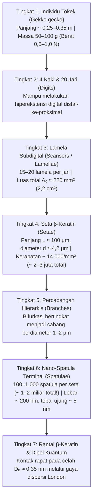
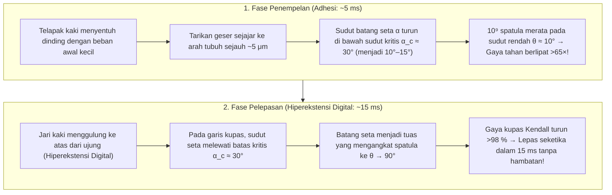

## 1. Pendahuluan: Kekaguman Aristoteles dan Teka-Teki Biomekanika Berusia 2.300 Tahun

Pada abad ke-4 SM, filsuf dan naturalis Yunani kuno Aristoteles (384–322 SM) mencatat pengamatan menakjubkan dalam karyanya *Historia Animalium* (*Sejarah Hewan*, Buku IX, Bab 9) mengenai reptil kecil Mediterania—cicak dan tokek (*Askalaros* atau *Ascalabotes*):

> "Tokek dapat berlari naik dan turun pohon dengan cara apa pun, <strong>bahkan dengan kepala menghadap ke bawah</strong>."
> — Aristoteles, *Historia Animalium* (sekitar 350 SM)

Lebih dari dua milenium kemudian, kemampuan menantang gravitasi ini tetap menjadi salah satu mahakarya paling mengagumkan dalam biofisika dan mekanika kontak. <strong>Tokek (*Gekko gecko*)</strong> yang banyak ditemukan di Indonesia dan Asia Tenggara memiliki panjang tubuh $25\text{–}35\,\text{cm}$ dan berat $50\text{–}100\,\text{g}$ (bahkan hingga $300\,\text{g}$). Meskipun tergolong sangat berat dibandingkan serangga, tokek mampu berlari dengan kecepatan lebih dari $1\,\text{m/s}$ menaiki dinding kaca kuarsa vertikal yang halus secara molekuler atau berjalan terbalik di langit-langit kaca ($180^\circ$). Dengan frekuensi $15\text{ langkah per detik}$, tokek mengunci adhesi kakinya dalam $5\,\text{ms}$ dan melepaskannya hanya dalam <strong>$15\,\text{ms}$ ($0{,}015\,\text{detik}$)</strong> dengan gaya pelepasan mendekati nol.

Yang lebih menakjubkan lagi, tokek <strong>tidak meninggalkan jejak lendir, lipid, atau lem kimia apa pun</strong> pada permukaan kaca. Berbeda dengan semut, kumbang, atau katak pohon yang mengeluarkan cairan sekretori ("adhesi basah"), bantalan jari kaki tokek sama sekali tidak memiliki kelenjar sekresi. Ini adalah <strong>adhesi kering (Dry Adhesion)</strong> murni yang tersusun dari protein <strong>$\beta$-keratin</strong> hidrofobik. Jika seluruh $\sim 2\text{ juta}$ rambut mikro (seta / *setae*) pada keempat kakinya bekerja serentak pada kapasitas maksimum, secara teoritis kaki tokek mampu menahan beban <strong>$80\text{ hingga }130\,\text{kg}$ — lebih dari $1.000$ kali berat tubuhnya sendiri!</strong>

---

## 2. Tujuh Hipotesis Historis yang Dipatahkan oleh Eksperimen (Autumn et al., 2000 & 2002)

Dari abad ke-19 hingga awal abad ke-21, tujuh hipotesis klasik telah diajukan. Melalui eksperimen perintis <strong>Wolf-Dietrich Dellit (1934)</strong>, mikroskopi elektron <strong>Ruibal & Ernst (1965)</strong>, serta penelitian penentu oleh <strong>Kellar Autumn, Robert J. Full, Thomas W. Kenny, Ronald Fearing, dan Jacob N. Israelachvili</strong> di *Nature* (2000) dan *PNAS* (2002), enam hipotesis pertama berhasil dipatahkan secara eksperimental:

1. <strong>Hipotesis Mangkuk Isap / Vakum (Suction, Simmermacher 1884)</strong>:
   - <strong>Bantahan Eksperimental</strong>: Dellit (1934) menempatkan tokek hidup di dalam ruang vakum tinggi ($P_{\text{atm}} \to 0$): kakinya tetap menempel sekuat di udara normal! Selain itu, batas maksimum tekanan atmosfer di permukaan laut hanya $1\,\text{atm} \approx 101{,}3\,\text{kPa}$, sedangkan satu seta tokek menghasilkan tegangan adhesi <strong>$1.000\,\text{kPa}$ ($1\,\text{MPa} \approx 10\,\text{atm}$, Autumn et al., 2000)</strong>.
2. <strong>Sekresi Lem atau Lendir (Wagler 1830)</strong>:
   - <strong>Bantahan Eksperimental</strong>: Epidermis $\beta$-keratin <strong>tidak memiliki kelenjar sekresi</strong>, tidak meninggalkan residu, dan mampu membersihkan diri secara kering (Hansen & Autumn, 2005).
3. <strong>Gesekan Coulomb Murni</strong>:
   - <strong>Bantahan Eksperimental</strong>: Gesekan klasik $F_f = \mu N$ membutuhkan gaya normal tekan $N > 0$ dan bernilai nol pada langit-langit terbalik ($N = -mg < 0$) tanpa adhesi tarik.
4. <strong>Penguncian Mikromekanis (Kait Mikro, Hora 1923; Mahendra 1941)</strong>:
   - <strong>Bantahan Eksperimental</strong>: Tokek menempel paling kuat pada permukaan <strong>mika muskovit belah yang rata secara atomik (kekasaran $\text{RMS} < 0{,}1\,\text{nm}$)</strong> dan wafer silikon poles (Autumn et al., 2000).
5. <strong>Tarikan Elektrostatik (Muatan Triboelektrik, Schmidt 1904)</strong>:
   - <strong>Bantahan Eksperimental</strong>: Mengionisasi udara di sekitar kaki tokek dengan <strong>sinar-X dan pancaran radium</strong> (Dellit, 1934) untuk menetralkan seluruh muatan statis tidak mengurangi daya tempel tokek.
6. <strong>Jembatan Kapiler Air (Tekanan Laplace, Stork 1980) vs. Gaya Van der Waals (Autumn et al., 2002)</strong>:
   Jika meniskus air menghasilkan gaya kapiler $F_{\text{cap}} = 4\pi R\gamma_L \cos\theta_c$, maka adhesi akan runtuh pada permukaan sangat hidrofobik ($\theta_c > 90^\circ \implies \cos\theta_c < 0$).
   - <strong>Eksperimen Penentu di *PNAS* (Autumn et al., 2002)</strong>: Tim peneliti mengukur adhesi tokek hidup dan seta tunggal pada semikonduktor <strong>galium arsenida yang sangat hidrofobik ($\text{GaAs}$, sudut kontak air $\theta_c \approx 110^\circ$)</strong> dibandingkan dengan <strong>silikon dioksida yang sangat hidrofilik ($\text{SiO}_2$, $\theta_c < 5^\circ$)</strong>. Karena kedua substrat memiliki polarisabilitas dielektrik yang tinggi, kaki tokek maupun seta tunggal menghasilkan <strong>tegangan adhesi geser yang sama persis ($\sim 200\,\text{kPa}$) pada $\text{GaAs}$ hidrofobik dan $\text{SiO}_2$ hidrofilik</strong>! Ini membuktikan bahwa mekanisme utamanya adalah <strong>gaya dispersi kuantum van der Waals (London)</strong>.

| No | Hipotesis Historis | Tokoh | Mekanisme Fisika | Bantahan Eksperimental Penentu |
| :--- | :--- | :--- | :--- | :--- |
| <strong>1</strong> | <strong>Mangkuk Isap (Vakum)</strong> | Simmermacher (1884) | Tekanan atmosfer $P_{\text{atm}} \approx 101\,\text{kPa}$ | <strong>Tetap menempel kuat di ruang vakum ($P \to 0$)</strong> (Dellit 1934); tegangan ($1\,\text{MPa}$) $10\times$ batas $1\,\text{atm}$. |
| <strong>2</strong> | <strong>Lem / Lendir</strong> | Wagler (1830) | Sekresi cairan lengket oleh kelenjar | Murni $\beta$-keratin <strong>tanpa kelenjar (100 % kering)</strong>, bebas residu dan *self-cleaning*. |
| <strong>3</strong> | <strong>Gesekan Murni</strong> | Tribologi klasik | Koefisien gesek tinggi $\mu$ | Gagal pada langit-langit terbalik ($N = -mg < 0$) tanpa gaya tarik normal. |
| <strong>4</strong> | <strong>Kait Mikro</strong> | Hora (1923) | Mengait pada kekasaran permukaan | <strong>Adhesi maksimum pada mika rata atomik ($\text{RMS} < 0{,}1\,\text{nm}$)</strong> (Autumn 2000). |
| <strong>5</strong> | <strong>Elektrostatik</strong> | Schmidt (1904) | Muatan triboelektrik $\sigma_q^2/(2\varepsilon_0)$ | <strong>Ionisasi udara dengan sinar-X tidak menurunkan adhesi</strong> (Dellit 1934). |
| <strong>6</strong> | <strong>Kapilaritas Air</strong> | Stork (1980) | Meniskus air $4\pi R\gamma_L\cos\theta_c$ | <strong>Adhesi identik ($\sim 200\,\text{kPa}$) pada $\text{GaAs}$ hidrofobik ($\theta_c = 110^\circ$) dan $\text{SiO}_2$ hidrofilik</strong> (Autumn 2002). |
| <strong>7</strong> | <strong>Gaya Van der Waals</strong> | Hiller (1968), Autumn (2000, 2002) | Fluktuasi dipol titik-nol kuantum (dispersi London) | <strong>Dikonfirmasi semua eksperimen</strong>: sebanding dengan konstanta Hamaker $A_H$. |

---

## 3. Arsitektur Hierarkis 7 Tingkat dan Kriteria Dahlquist

Gaya van der Waals hanya bekerja pada jarak $D_0 \approx 0{,}3\text{–}0{,}4\,\text{nm}$. Untuk mengikuti kekasaran permukaan dari skala milimeter hingga nanometer, tokek mengembangkan arsitektur hierarkis 7 tingkat:

### 3.1 Mekanika Balok Kantilever Euler-Bernoulli dan Kriteria Kelekatan Dahlquist

$\beta$-keratin padat adalah polimer kaku dengan modulus Young $E_{\text{bulk}} \approx 2{,}0\,\text{GPa}$. Namun menurut <strong>Kriteria Dahlquist (Carl A. Dahlquist, 1966)</strong>, agar suatu bahan dapat menempel secara spontan pada permukaan kasar, <strong>modulus elastisitas efektifnya harus $E_{\text{eff}} \le 100\text{–}300\,\text{kPa}$</strong>.

Dengan membentuk keratin kaku menjadi balok kantilever miring pada sudut $\alpha_0 \approx 45^\circ$ ($L \approx 100\,\mu\text{m}$, jari-jari $r \approx 2{,}1\,\mu\text{m}$, jarak antar-seta $s \approx 8{,}5\,\mu\text{m}$, momen inersia $I = \frac{\pi r^4}{4}$) dengan kekakuan lentur $k_\perp = \frac{3 E_{\text{bulk}} I}{L^3 \sin^2\alpha_0}$, modulus efektif susunan seta turun empat orde besaran:

$$E_{\text{eff}} = \frac{k_\perp L \sin\alpha_0}{s^2} = \frac{3\pi}{4 \sin\alpha_0} E_{\text{bulk}} \left(\frac{r}{L}\right)^2 \left(\frac{r}{s}\right)^2 \approx 80\text{–}100\,\text{kPa}$$

Satu spatula menghasilkan gaya $\sim 10\,\text{nN}$ (Huber et al., 2005) dan satu seta menahan $40\,\mu\text{N}$ hingga $194 \pm 25\,\mu\text{N}$ (Autumn et al., 2000), memberikan kapasitas teoritis total $80\text{ hingga }130\,\text{kg}$ pada keempat kaki!

---

## 4. Elektrodinamika Kuantum Gaya Van der Waals, Dispersi London, dan Teori Casimir-Lifshitz

Potensial van der Waals antara dua molekul netral yang terpisah sejauh $r$ adalah:

$$U_{\text{vdW}}(r) = -\frac{C_{\text{Keesom}} + C_{\text{Debye}} + C_{\text{London}}}{r^6}$$

Untuk $\beta$-keratin non-polar, interaksi didominasi oleh <strong>gaya dispersi London (Fritz London, 1930)</strong> yang berasal dari fluktuasi dipol titik-nol kuantum osilator harmonik 3D (frekuensi $\omega_0$, polarisabilitas $\alpha_1, \alpha_2$):

$$U_{\text{London}}(r) = -\frac{3}{4} \frac{\hbar \omega_0 \alpha_1 \alpha_2}{(4\pi\varepsilon_0)^2 r^6}$$

Integrasi volume atas ujung bola spatula berjari-jari $R \approx 100\,\text{nm}$ pada jarak $D_0 \approx 0{,}35\,\text{nm}$ dari bidang datar menurut <strong>Hugo C. Hamaker (1937)</strong> dan <strong>Evgeny Lifshitz (1956)</strong> (konstanta Hamaker $A_H = \pi^2 C \rho_1 \rho_2 \approx 10^{-19}\,\text{J}$) menghasilkan:

$$F_{\text{vdW}}(D_0) = \frac{A_H R}{6 D_0^2} \approx 13{,}6\,\text{nN}$$

Teori Lifshitz menunjukkan bahwa $A_H$ bergantung pada suku optik UV $\frac{(n_1^2 - 1)(n_2^2 - 1)}{(n_1^2 + 1)(n_2^2 + 1)}$, menjelaskan mengapa tokek terpeleset pada <strong>politetrafluoroetilena (PTFE / Teflon)</strong> yang memiliki indeks bias sangat rendah ($n_{\text{PTFE}} \approx 1{,}35$) akibat ikatan $\text{C–F}$ yang mengikat elektron dengan sangat kuat.

---

## 5. Prinsip Pemecahan Kontak ("Contact Splitting") melalui Mekanika Kontak JKR

Menurut <strong>teori Johnson-Kendall-Roberts (JKR, 1971)</strong>, jari-jari kontak $a$ dan gaya lepas (*pull-off force*) $F_{\text{JKR}}^{(1)}$ dari setengah bola elastis berjari-jari $R$ dengan kerja adhesi $W_{\text{ad}} = \Delta\gamma$ adalah:

$$a^3 = \frac{3 R}{4 E^*} \left( P + 3\pi W_{\text{ad}} R + \sqrt{6\pi W_{\text{ad}} R P + (3\pi W_{\text{ad}} R)^2} \right) \implies F_{\text{JKR}}^{(1)} = \frac{3}{2}\pi W_{\text{ad}} R$$

Karena gaya lepas <strong>berbanding lurus dengan jari-jari linear $R$ (bukan luas $\pi R^2$!)</strong>, <strong>Arzt, Gorb, dan Spolenak (2003, *PNAS*)</strong> membuktikan bahwa membagi luas tampak $\pi R_0^2$ menjadi $N$ sub-kontak berjari-jari $r_N = R_0 / \sqrt{N}$ melipatgandakan gaya adhesi total sebesar $\sqrt{N}$:

$$\boxed{F_{\text{total}}(N) = N \cdot \frac{3}{2}\pi W_{\text{ad}} \left(\frac{R_0}{\sqrt{N}}\right) = \sqrt{N} \, F_{\text{JKR}}^{(1)}}$$

<strong>Memecah kontak menjadi $N = 10^9$ nano-spatula melipatgandakan gaya adhesi total sebesar $\sqrt{10^9} \approx 31.623$ kali (lebih dari 30.000 kali)!</strong> Ini menjelaskan hukum alometri evolusioner $\rho_A \propto m^{2/3}$ dari lalat hingga tokek, serta ketahanan terhadap cacat (*flaw insensitivity*) di bawah jari-jari kritis Gao & Yao (2004) $r_{\text{crit}} = \frac{8 E^* W_{\text{ad}}}{\pi \sigma_{\text{th}}^2} \approx 170\,\text{nm}$.

---

## 6. Paradoks Pelepasan Mudah dalam 15 ms: Persamaan Pengelupasan Kendall & Hiperekstensi Digital

Bagaimana tokek melepaskan kakinya dalam $15\,\text{ms}$ tanpa usaha? <strong>Persamaan pengelupasan pita elastis Kevin Kendall (1971)</strong> (lebar $b$, tebal $d$, modulus $E$) pada sudut pengelupasan $\theta$ adalah:

$$\left(\frac{F_{\text{peel}}}{b}\right)^2 \frac{1}{2 d E} + \frac{F_{\text{peel}}}{b}(1 - \cos\theta) = W_{\text{ad}} \implies F_{\text{peel}}(\theta) \approx \frac{b W_{\text{ad}}}{1 - \cos\theta}$$

Saat ditarik sejajar ($\theta \approx 10^\circ, \alpha < 30^\circ$), faktor $1 - \cos 10^\circ \approx 0{,}0152$ menghasilkan gaya tahan raksasa ($F_{\text{peel}}(10^\circ) \approx 65{,}8\,b W_{\text{ad}}$). Untuk melepas, <strong>hiperekstensi digital</strong> membuat seta melewati sudut kritis $\alpha_c \approx 30^\circ$ (Autumn et al., 2006), menegakkan spatula ke $\theta \approx 90^\circ$ ($1 - \cos 90^\circ = 1$) dan menurunkan gaya kupas hampir seratus kali lipat!

---

## 7. Pembersihan Diri Kering (*Self-Cleaning*) dan Aplikasi Biomimetika (Pencengkeram Antariksa NASA JPL)

1. <strong>Pembersihan Diri lewat Kontak (Hansen & Autumn, 2005 *PNAS*)</strong>: Partikel debu berjari-jari $R_p \approx 2{,}5\,\mu\text{m}$ mengalami gaya van der Waals $F_{\text{particle-wall}} \propto R_p$ ke dinding datar yang jauh lebih besar daripada jumlah gaya $F_{\text{particle-setae}} \propto n R_s$ ke beberapa spatula ($R_s \approx 100\,\text{nm}$) yang menyentuhnya. Hanya dalam $4\text{–}8\text{ langkah}$, debu berpindah ke dinding.
2. <strong>Rekayasa Biomimetika & Pencengkeram Sampah Antariksa NASA JPL (Parness, Jiang et al., 2017 *Science Robotics*)</strong>: Dari pilar mikro Andre Geim (2003), baji mikro PDMS terarah Stanford yang memungkinkan manusia $70\,\text{kg}$ memanjat gedung kaca (Hawkes et al., 2014), dan karpet tabung nano karbon ($100\,\text{N/cm}^2$, Qu et al., 2008), hingga <strong>pencengkeram sampah antariksa dan robot *Astrobee* di ISS oleh NASA JPL</strong>, adhesi kering van der Waals bekerja sempurna di ruang hampa dan suhu $-190^\circ\text{C}$.
