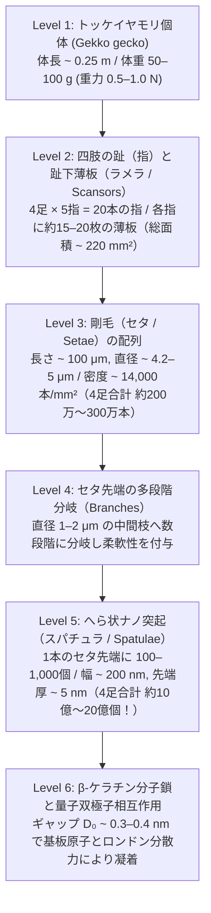
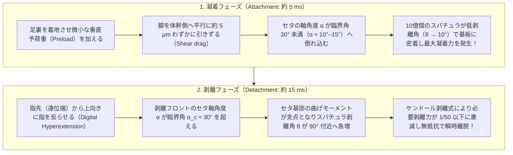

## 1. 序論：アリストテレスの驚嘆と2300年間未解決だった「逆さまの疾走」

紀元前4世紀、古代ギリシャの哲学者アリストテレス（Aristotle, 384–322 BCE）は大著『動物誌』（*Historia Animalium*, 第9巻第9章）の中で、地中海沿岸の生家の壁や樹木を駆け回る小さな爬虫類——ヤモリ（古代ギリシャ語で *Askalaros* または *Ascalabotes*）の異様な運動能力について、次のような賛嘆の記録を残している。

> 「ヤモリは木の幹をどのような向きにでも、たとえ<strong>頭を下にして逆さまの状態であっても</strong>、自在に駆け上がったり駆け下りたりすることができる。」
> ——アリストテレス『動物誌』（紀元前350年頃）

東南アジアからインドネシアにかけて生息する大型のヤモリである<strong>トッケイヤモリ（Tokay gecko, 学名：*Gekko gecko*）</strong>は、体長約 $25\text{〜}35\,\text{cm}$、体重 $50\text{〜}100\,\text{g}$（さらには最大 $300\,\text{g}$ 近く）に達する堂々たる体躯を持つ。これほど重い脊椎動物でありながら、トッケイヤモリは分子レベルで平滑に研磨された垂直な石英ガラスの壁面や、重力が完全に引き剥がし方向（法線引張方向）に作用する<strong>ガラスの天井（傾斜角 $180^\circ$）</strong>を、毎秒 $1\,\text{m}$ 以上の速度で疾走することができる。しかもその際、毎秒 $15$ 回という猛烈なピッチで四肢を交互に貼り付け、わずか<strong> $15\,\text{ms}$（$0.015$ 秒）</strong>という瞬きする間の何分の一かの時間で、何の苦もなく足裏をガラス面から剥がして次のステップへと踏み出していく。

さらに驚異的なのは、ヤモリが走り去った後のガラス面をどれほど高感度の質量分析計や光学顕微鏡で調べても、<strong>粘液・脂質・接着剤の痕跡（フットプリント）が一切残らない</strong>という事実である。ハエや甲虫、アマガエルが足裏から分泌液を出して張り付く「湿式凝着（wet adhesion）」とは根本的に異なり、ヤモリの足裏には分泌腺（腺組織）が完全に欠如している。それにもかかわらず、ヤモリの四肢すべてが同時に最大凝着力を発揮した場合、理論上は<strong> $80\text{〜}130\,\text{kg}$ もの荷重（自重の $1,000$ 倍以上！）</strong>を支えることができる。

「接着剤も吸盤も使わずに、なぜ体重の $1,000$ 倍もの力でガラスの天井に張り付くことができ、しかも次の瞬間にはゼロに近い力で $15\,\text{ms}$ のうちに剥がせるのか？」——この<strong>「強固な凝着と無抵抗な剥離のパラドックス」</strong>は、アリストテレスの記述から実に $2,300$ 年以上にわたって博物学者・物理学者・生物学者を悩ませ続けた科学史上の大難問であった。

---

## 2. 実験によって棄却された7つの古典的仮説（Autumn et al., 2000 & 2002）

19世紀から20世紀末にかけて、ヤモリの驚異的な登攀能力を説明するために、物理学および解剖学の観点から<strong>7つの主要な仮説</strong>が提唱された。しかし、1930年代のヴォルフ＝ディートリヒ・デリット（Wolf-Dietrich Dellit, 1934）による先駆的な実験、ルドルフォ・ルイバルとヴェラ・エルンスト（Ruibal & Ernst, 1965）による電子顕微鏡観察、そして決定打となったルイス・アンド・クラーク大学の<strong>ケラー・オータム（Kellar Autumn）</strong>、カリフォルニア大学バークレー校の<strong>ロバート・フル（Robert J. Full）</strong>、スタンフォード大学の<strong>トーマス・ケニー（Thomas W. Kenny）</strong>、<strong>ロナルド・フィアリング（Ronald Fearing）</strong>らの共同研究チームによる2000年の『Nature』論文および2002年の『米国科学アカデミー紀要（PNAS）』論文によって、従来の直感的な仮説はことごとく実験的に論破され、ただ一つの量子力学的起源へと収束していった。

### 2.1 棄却された6つの古典的メカニズムと「毛細管現象説 vs. ファンデルワールス力説」の最終決着

歴史的に提案された7つの仮説と、それらを葬り去った決定的な反証実験をひとつずつ検証しよう。

1. <strong>吸盤説（Suction / 真空大気圧仮説）</strong>
   1884年、ドイツの動物学者ジンメルマッハー（G. Simmermacher）は、ヤモリの足裏のひだ（薄板：ラメラ）が微小な吸盤として機能し、内部を減圧することで大気圧によって壁に押し付けられていると主張した。
   - <strong>決定的な反証</strong>：1934年、デリット（Dellit）は生きたヤモリを真空チャンバーに入れ、周囲の空気を抜いて大気圧 $P_{\text{atm}} \to 0$ に近づける実験を行った。もし吸盤であれば真空中では一切張り付けなくなるはずだが、ヤモリの足は<strong>高真空中でも大気中と全く同じ強さでガラス壁に張り付いた</strong>。さらに物理計算からも吸盤説は即座に否定される。1気圧の大気が生み出せる理論限界の負圧（凝着応力）は $P_{\text{atm}} \approx 101.3\,\text{kPa}$（約 $1\,\text{kgf/cm}^2$）に過ぎないが、後述するオータムらの単一剛毛測定（2000年）では、ヤモリの剛毛（セタ）は単位面積あたり<strong>約 $1,000\,\text{kPa}$（$1\,\text{MPa} \approx 10$ 気圧）</strong>という、大気圧の理論限界の10倍もの引張・せん断応力を発生させることが実証されたのである。

2. <strong>粘着液・化学接着剤説（Glue / Mucus Secretion）</strong>
   1830年代にヴァグラー（J. G. Wagler）らが唱えた「足裏から粘着性の分泌液を出している」という説である。実際、アリ、テントウムシ、ゴキブリなどの昆虫やアマガエルは、足先の腺から脂質や粘液を分泌している。
   - <strong>決定的な反証</strong>：爬虫類であるヤモリの表皮は純粋な<strong>$\beta$-ケラチン（ベータ・ケラチン）</strong>の角質層からなり、解剖学的に足裏には分泌腺が1個も存在しない（完全な乾式凝着：<strong>Dry Adhesion</strong>）。また、粘着テープや粘液であれば埃だらけの地面を歩いた瞬間にゴミが付着して粘着力を失うが、ヤモリの足は汚れても数歩歩くだけで自らゴミを弾き飛ばす<strong>「自己洗浄機能（Self-cleaning）」</strong>を備えている（Hansen & Autumn, 2005）。

3. <strong>単純摩擦説（Pure Coulomb Friction）</strong>
   足裏の微細な毛が大きな摩擦係数 $\mu$ を生み出すという説。
   - <strong>決定的な反証</strong>：古典的なクーロン摩擦 $F_f = \mu N$ は、壁面に対して垂直に押し付ける正の法線抗力 $N > 0$ が存在するときにのみ発生する。垂直な壁（$N = 0$）や、重力が壁から引き剥がす向きに働く天井の裏（$N < 0$）では、表面間に<strong>引張方向の凝着力（Adhesion, $F_{\text{ad}} > 0$）</strong>が存在しない限り、摩擦力はゼロとなって落下してしまう。

4. <strong>微小フック・機械的噛み合い説（Micro-interlocking / Micro-crampons）</strong>
   1923年にホラ（S. L. Hora）、1941年にマヘンドラ（B. C. Mahendra）が提唱した説で、足裏の微細な毛がアイゼンの爪のように壁面のミクロな凹凸に引っかかっているというアイデアである。
   - <strong>決定的な反証</strong>：もし機械的な引っかかりが原因であれば、凹凸のない完全に平滑な面では滑落するはずである。しかしヤモリは、原子レベルで劈開（へきかい）された<strong>分子論的に平坦な白雲母（マイカ、表面粗さ $\text{RMS} < 0.1\,\text{nm}$）</strong>や、半導体製造用の超鏡面研磨シリコンウエハーに対して、粗い壁面よりもむしろ<strong>さらに強力に凝着する</strong>ことが確認された（Autumn et al., 2000）。

5. <strong>静電気引力説（Electrostatic Attraction / 接触帯電説）</strong>
   1904年にシュミット（H. Schmidt）が提唱した、足裏と壁面の摩擦・接触によって静電気（クーロン引力）が生じるという説である。
   - <strong>決定的な反証</strong>：デリット（1934）はガラス面に張り付いたヤモリの足元に<strong>X線や放射性同位体からの電離放射線</strong>を照射し、周囲の空気をイオン化（導電化）して静電気を完全に放電させる実験を行った。もし静電気力であれば電荷が中和された瞬間に落下するはずだが、ヤモリは微動だにしなかった。また、接地（アース）された金属板や半導体基板の上でも、さらには導電性の水中であっても疎水面に対してヤモリは問題なく張り付くことができる。

6. <strong>毛細管湿潤凝着説（Capillary Wet Adhesion / 水膜メニスカス仮説）</strong>
   上記の5説がすべて否定された後、2000年代初頭まで物理学者の間で最後まで激しい論争となったのが、ストーク（N. E. Stork, 1980）らが支持した<strong>「毛細管現象（ラプラス圧）説」</strong>と、ヒラー（U. Hiller, 1968）やオータムらが支持した<strong>「ファンデルワールス力（分子間力）説」</strong>の対決であった。
   大気中のあらゆる固体表面には、湿度に応じて厚さ数オングストローム〜数ナノメートルの目に見えない水分子の吸着層が存在する。もしヤモリの毛先（スパチュラ）と壁面の間に微小な水膜の架橋（キャピラリーブリッジ／メニスカス）が形成されれば、水の表面張力 $\gamma_L \approx 72.8\,\text{mN/m}$ によって以下のラプラス引力 $F_{\text{cap}}$ が生じる：
   $$F_{\text{cap}} = 4\pi R \gamma_L \cos\theta_c \quad \text{または} \quad F_{\text{cap}} = 2\pi R \gamma_L (\cos\theta_1 + \cos\theta_2)$$
   ここで $R$ は毛先の曲率半径、$\theta_1, \theta_2$ はそれぞれ毛先と壁面に対する水の接触角（Contact angle）である。
   - <strong>2002年『PNAS』論文による決定的な実験（Autumn et al., 2002）</strong>：
     毛細管現象説とファンデルワールス力説のどちらが真の主役であるかを完全に切り分けるため、ケラー・オータムらの研究チームは極めてエレガントな実験を設計した。
     もし毛細管現象（水膜のメニスカス）が主原因であれば、壁面が水を弾く<strong>強疎水性（Hydrophobic, $\theta_2 > 90^\circ \implies \cos\theta_2 < 0$）</strong>である場合、水膜の架橋は形成されず、凝着力は劇的に低下するはずである。一方、ファンデルワールス力（特に量子力学的なロンドン分散力）が主原因であれば、凝着力は表面の親水性・疎水性（水との接触角）には依存せず、基板物質の<strong>誘電分極率（屈折率 $n$ や誘電率 $\varepsilon$）</strong>のみによって決まるはずである。
     オータムらは、高分極率を持つ<strong>強疎水性のヒ化ガリウム半導体ウエハー（$\text{GaAs}$、水接触角 $\theta_c \approx 110^\circ$）</strong>と、<strong>強親水性の二酸化ケイ素（$\text{SiO}_2$ ガラス、水接触角 $\theta_c < 5^\circ$）</strong>の2種類の基板を用意し、生きたトッケイヤモリの足全体のせん断凝着力と、切り出した単一剛毛（セタ）の凝着力を精密測定した。
     その結果は劇的であった。ヤモリの足も単一のセタも、水を激しく弾く疎水性の $\text{GaAs}$ 基板と、水が完全に濡れ広がる親水性の $\text{SiO}_2$ 基板の双方に対して、<strong>統計的に全く同一の最大凝着応力（約 $200\,\text{kPa}$）</strong>を発揮したのである！（一方、分極率の低い疎水性自己組織化単分子膜 OTS-SAM 上では、ファンデルワールス理論の予測通りに凝着力が低下した）。

これにより、2300年間にわたる論争に終止符が打たれた。ヤモリがガラスの天井を歩ける真の理由は、粘着剤でも吸盤でも静電気でも毛細管現象でもなく、<strong>すべての原子・分子間に普遍的に働く量子力学的な「ファンデルワールス力（特にロンドン分散力）」</strong>だったのである。

| 番号 | 歴史的仮説 | 提唱者・年代 | 想定された物理機構 | 決定的な反証実験と棄却理由 |
| :--- | :--- | :--- | :--- | :--- |
| <strong>1</strong> | <strong>吸盤説（大気圧減圧）</strong> | Simmermacher (1884) | 足裏のラメラが減圧空間を作り大気圧 $P_{\text{atm}}$ で吸着 | <strong>真空チャンバー内（$P \to 0$）でも凝着力が全く低下しない</strong>（Dellit 1934）。また発生応力（$1\,\text{MPa}$）が大気圧限界（$0.1\,\text{MPa}$）の10倍に達する（Autumn 2000）。 |
| <strong>2</strong> | <strong>粘着液・分泌腺説</strong> | Wagler (1830) | 昆虫やカエルのように粘液・脂質を分泌して接着 | ヤモリの足裏表皮は純粋な$\beta$-ケラチンであり<strong>分泌腺が完全に存在しない（乾式凝着）</strong>。歩行跡に一切の残留物がなく、自己洗浄性を持つ。 |
| <strong>3</strong> | <strong>単純クーロン摩擦説</strong> | 古典力学モデル | 表面の微細毛による高摩擦係数 $\mu$ | クーロン摩擦 $F_f = \mu N$ は正の押し付け力 $N > 0$ が必須であり、<strong>重力で下に引っ張られる天井裏（$N < 0$）では成立しない</strong>。 |
| <strong>4</strong> | <strong>微小フック・噛み合い説</strong> | Hora (1923), Mahendra (1941) | 微細毛がアイゼンの爪のように壁面の凹凸に引っかかる | 凹凸が原子サイズ未満（$\text{RMS} < 0.5\,\text{nm}$）の<strong>劈開マイカ結晶や超鏡面研磨シリコンウエハーに最も強く張り付く</strong>。 |
| <strong>5</strong> | <strong>静電気引力説</strong> | Schmidt (1904) | 接触帯電・摩擦帯電によるクーロン静電引力 | <strong>X線照射で周囲の空気を電離（イオン化）して静電気を完全放電させても落下しない</strong>（Dellit 1934）。接地導体上でも凝着する。 |
| <strong>6</strong> | <strong>毛細管現象（水膜架橋）説</strong> | Stork (1980) | 吸着水膜のメニスカスによるラプラス圧 $4\pi R\gamma_L\cos\theta_c$ | 水を弾く<strong>強疎水性の半導体 $\text{GaAs}$（$\theta_c = 110^\circ$）と強親水性の $\text{SiO}_2$（$\theta_c < 5^\circ$）で全く同じ凝着力（$\sim 200\,\text{kPa}$）を示す</strong>（Autumn et al. 2002）。 |
| <strong>7</strong> | <strong>ファンデルワールス力説（実証）</strong> | Hiller (1968), Autumn et al. (2000, 2002) | 量子力学的な瞬時双極子ゆらぎ（ロンドン分散力）とナノ階層接触 | <strong>すべての実験事実と完全一致</strong>。基板の誘電分極率（ハマカー定数 $A_H$）に比例し、真空・水中・疎水面・極低温でも機能する。 |

---

## 3. トッケイヤモリ足裏の7段階マルチスケール階層構造（マクロからナノへ）

ここで一つの重大な疑問が浮かび上がる。もしファンデルワールス力がすべての物質間に普遍的に働いているのであれば、<strong>なぜ私たち人間は手のひらをガラス壁に押し付けてもヤモリのように張り付くことができないのか？</strong>

その答えは、ファンデルワールス力の到達距離が<strong>わずか $0.3\text{〜}1\,\text{nm}$（数オングストローム＝原子数個分の隙間）</strong>という極端な短距離力であることに起因する。どれほど滑らかに見える人間の皮膚やゴム板であっても、マイクロメートルやナノメートルの倍率で見れば激しい山と谷（表面粗さ）が存在する。剛体や通常の弾性体を壁に押し付けても、実際に原子間距離（$< 1\,\text{nm}$）まで接近して接触している「真実接触面積（Real area of contact）」は、見かけの面積の $0.01\%$ にも満たない。

この「表面粗さの障壁」を突破し、あらゆる壁面に対して足裏全体の原子を $0.3\text{〜}0.4\,\text{nm}$ の距離まで密着させるために、ヤモリが進化の過程で獲得した究極の機械的アーキテクチャが、ミリメートルからナノメートルまで<strong>7桁の空間スケールを貫く階層的ナノ毛構造（Hierarchical Fibrillar Structure）</strong>である。

### 3.1 ラメラ（薄板）からセタ（剛毛）、そしてスパチュラ（ナノへら）へ

トッケイヤモリの足裏をマクロからナノへとズームインしていくと、以下のような精緻な階層構造が現れる（Ruibal & Ernst, 1965; Russell, 1975; Autumn et al., 2000）。

1. <strong>趾下薄板（Scansors / Lamellae：ミリメートル領域 $\sim 1\text{〜}10\,\text{mm}$）</strong>
   ヤモリの4本の足にはそれぞれ5本の指（趾）があり、各指の裏側には屋根瓦のように重なり合った約 $15\text{〜}20$ 枚の柔らかいひだ——<strong>趾下薄板（ラメラ）</strong>が並んでいる。4足すべての足裏パッドの総見かけ面積は $A_{\text{total}} \approx 220\,\text{mm}^2$（$2.2\,\text{cm}^2$）である。ラメラの内部には<strong>血管洞（血洞：Vascular sinus）</strong>と呼ばれる血液のクッションと、指の屈伸と連動する精巧な<strong>側方腱ネットワーク</strong>が張り巡らされており、ミリメートル単位の大きな壁面のうねりに足裏全体を柔らかく追従させる。
2. <strong>剛毛：セタ（Setae：マイクロメートル領域 $\sim 100\,\mu\text{m}$）</strong>
   各ラメラの表面を走査型電子顕微鏡（SEM）で拡大すると、ビロードの絨毯のようにびっしりと生え揃った微細な毛——<strong>セタ（Seta、複数形 Setae）</strong>の格子状配列が現れる。
   - 1本のセタの長さは $L_s \approx 30\text{〜}130\,\mu\text{m}$（代表値 $100\,\mu\text{m}$）、太さ（直径）は $d_s \approx 4.2\text{〜}5\,\mu\text{m}$（人間の髪の毛の約20分の1の細さ）である。
   - セタは $1\,\text{mm}^2$ あたり約 $14,000$ 本という高密度で規則正しく並んでおり、<strong>片足あたり約 $500,000$ 本（50万本）、4足合計で約 $200\text{万〜}300\text{万本}$</strong> に達する。
3. <strong>へら状終端：スパチュラ（Spatulae：ナノメートル領域 $\sim 200\,\text{nm}$）</strong>
   さらに倍率を上げて1本のセタの先端を拡大すると、セタは数段階にわたって細い枝（Branches）へと枝分かれし、その最先端には<strong>1本のセタあたり $100\text{〜}1,000$ 個</strong>もの極小の三角形の「へら（しゃもじ）」のような構造——<strong>スパチュラ（Spatula、複数形 Spatulae）</strong>がついている。
   - スパチュラの柄の長さは約 $0.5\,\mu\text{m}$（$500\,\text{nm}$）、先端の三角形パドル部分の幅は $b_s \approx 200\,\text{nm}$（可視光の波長よりも小さい！）、そして<strong>先端の厚みはわずか $t_s \approx 5\text{〜}10\,\text{nm}$</strong> しかない。
   - 4足全体で計算すると、ヤモリは実に<strong>約 $2\times 10^8\text{〜}2\times 10^9$ 個（数億〜20億個）ものナノスケールのへら</strong>を足裏に備えていることになる。

### 3.2 ダールキスト基準（Dahlquist Criterion）と「硬いケラチンから柔らかい粘着材を作る」構造力学

ここで材料科学上の驚くべきパラドックスに注目しよう。ヤモリのセタやスパチュラを構成している素材は、鳥の羽や人間の爪、爬虫類の鱗と同じ<strong>$\beta$-ケラチン（ベータ・ケラチン）</strong>という硬い構造タンパク質である。バルク（塊）としての$\beta$-ケラチンのヤング率（弾性率）は、実に <strong>$E_{\text{bulk}} \approx 1.5\text{〜}2.5\,\text{GPa}$（代表値 $2\,\text{GPa}$）</strong>に達する。これは硬質プラスチック（ポリカーボネートやナイロン）に匹敵するカチカチの硬さである。

一方、高分子粘着工学の世界には、3M社の科学者カール・ダールキスト（Carl A. Dahlquist, 1966）が提唱した<strong>「粘着のダールキスト基準（Dahlquist Criterion for Tack）」</strong>という絶対的な経験則・物理法則が存在する。

> <strong>ダールキスト基準（Dahlquist Criterion）</strong>：
> ある材料が微細な凹凸を持つ固体表面に押し付けられた際、自身の弾性反発力に打ち勝って表面の凹凸に自発的に密着し、瞬時に粘着（タック）を発現するためには、その材料の<strong>実効ヤング率（または貯蔵弾性率）が $E_{\text{eff}} < 100\text{〜}300\,\text{kPa}$（$0.1\text{〜}0.3\,\text{MPa}$）以下</strong>でなければならない。

市販のセロハンテープやガムテープの粘着剤は、ガラス転移点 $T_g$ の低い柔らかいゴム系・アクリル系高分子（$E \sim 100\,\text{kPa}$）を使うことでこの基準を満たしている。しかし、最初から素材自体が $100\,\text{kPa}$ のように柔らかいゲルやゴムを使って毛を作ると、毛同士が自身の分子間力で隣の毛とペタペタとくっついて団子状に凝集（<strong>自己凝集・マット化：Self-matting / Lateral bunching</strong>）してしまい、さらに地面の泥やゴミが一度ついたら二度と取れなくなってしまう。

ヤモリはこのジレンマをどう解決したのか？ 素材には<strong>汚れがつかず耐久性の高いカチカチの疎水性ポリマー（$\beta$-ケラチン、$E_{\text{bulk}} \approx 2\,\text{GPa}$）</strong>を採用しつつ、それを<strong>「斜めに傾いた細長いマイクロ・ナノ片持ち梁（カンチレバー）の階層アレイ」</strong>へと加工することで、構造全体としての<strong>実効弾性率 $E_{\text{eff}}$ を約4桁（2万分の1）も劇的に低下させた</strong>のである！

これをオイラー＝ベルヌーイの梁理論（Euler-Bernoulli beam theory）で定量的に導出しよう。長さ $L \approx 100\,\mu\text{m}$、半径 $r \approx 2.1\,\mu\text{m}$、ヤング率 $E_{\text{bulk}} \approx 2\,\text{GPa}$ の円柱状のセタが、ラメラ基板に対して角度 $\alpha_0 \approx 45^\circ$ で傾いて生えているとする。断面二次モーメントは $I = \frac{\pi r^4}{4}$ である。
壁面から垂直方向の変位 $\Delta z$ を受けたとき、傾いた梁は軸圧縮ではなく主に<strong>曲げ変形（Bending）</strong>を起こす。先端の法線ばね定数 $k_{\perp}$ は次式で与えられる：

$$k_{\perp} = \frac{3 E_{\text{bulk}} I}{L^3 \sin^2\alpha_0} = \frac{3\pi E_{\text{bulk}} r^4}{4 L^3 \sin^2\alpha_0}$$

セタが平均間隔 $s \approx 8.5\,\mu\text{m}$（面積密度 $\rho_s = 1/s^2 \approx 14,000\,\text{mm}^{-2}$）で並んでいるとき、このセタ配列を厚さ $L\sin\alpha_0$ の連続体層と見なした<strong>実効弾性率 $E_{\text{eff}}$</strong> は次のようになる：

$$E_{\text{eff}} = \frac{k_{\perp} (L \sin\alpha_0)}{s^2} = \frac{3\pi}{4 \sin\alpha_0} E_{\text{bulk}} \left(\frac{r}{L}\right)^2 \left(\frac{r}{s}\right)^2$$

具体的な数値を代入してみよう（$E_{\text{bulk}} = 2 \times 10^9\,\text{Pa}$, $r = 2.1\,\mu\text{m}$, $L = 100\,\mu\text{m}$, $s = 8.5\,\mu\text{m}$, $\alpha_0 = 45^\circ$）：

$$E_{\text{eff}} \approx \frac{3\pi}{4 \times 0.7071} (2 \times 10^9\,\text{Pa}) \times \left(\frac{2.1}{100}\right)^2 \times \left(\frac{2.1}{8.5}\right)^2 \approx 3.33 \times (2 \times 10^9) \times (4.41 \times 10^{-4}) \times (0.061) \approx 1.79 \times 10^5\,\text{Pa} \approx 180\,\text{kPa}$$

さらに先端の分岐とスパチュラの柔軟性を加味したオータムらの実測値（Autumn et al., 2006, *J. Exp. Biol.*）では、セタ配列の実効弾性率は <strong>$E_{\text{eff}} \approx 80\text{〜}100\,\text{kPa}$</strong> という驚異的な低さに収まっており、<strong>ダールキスト基準（$E_{\text{eff}} \le 100\,\text{kPa}$）に見事に合致している</strong>ことが証明されたのである！

### 3.3 単一セタから個体全体までの凝着力バジェット（なぜ100kgを支えられるのか）

2000年の『Nature』論文において、オータム、リャン（Y. A. Liang）、ケニー、フルらは、半導体微細加工技術で作製した超高感度の二軸ピエゾ抵抗型MEMSカンチレバーセンサーを用い、ピンセットで切り出した<strong>たった1本のセタ</strong>が発生させる凝着力を世界で初めて直接測定した。

- <strong>単一セタの最大せん断凝着力（壁面に沿って引っ張る力）</strong>：
  微小な垂直予荷重（Preload）を与えて壁面に平行に約 $5\,\mu\text{m}$ 引きずったとき、1本のセタは最大で <strong>$F_{\parallel,\text{seta}} \approx 194 \pm 25\,\mu\text{N}$（約 $200\,\mu\text{N} \approx 20\,\text{mgf}$）</strong>もの力を発生させた。
- <strong>単一セタの標準的な引張・凝着力</strong>：
  典型的な条件下での1本のセタの引き剥がし力は <strong>$F_{\text{seta}} \approx 40\,\mu\text{N}$</strong> である。
- <strong>4足全体（セタ約200万〜300万本）での理論的最大凝着力</strong>：
  控えめに $F_{\text{seta}} = 40\,\mu\text{N}$ として4足合計 $2 \times 10^6$ 本を掛け合わせても、
  $$F_{\text{total, conservative}} = (2 \times 10^6) \times (40 \times 10^{-6}\,\text{N}) = 80\,\text{N} \quad (\text{約 } 8.2\,\text{kgf})$$
  もしすべてのセタ（最大約 $3 \times 10^6$ 本）が最適配向で最大せん断力 $200\,\mu\text{N}$ を同時に発揮したと仮定すれば、
  $$F_{\text{total, max}} = (6.5 \times 10^5\,\text{本/足} \times 4\,\text{足}) \times 200\,\mu\text{N} \approx 520\,\text{N} \sim 1,280\,\text{N} \quad (\text{約 } 53\text{〜}130\,\text{kgf}！)$$
  すなわち、トッケイヤモリの足裏のナノ毛がすべて同時に機能すれば、<strong>大人1人〜2人分の体重（$80\text{〜}130\,\text{kg}$、ヤモリ自身の体重 $50\text{〜}100\,\text{g}$ の $1,000$ 倍以上）</strong>をぶら下げても剥がれない計算になる。
- <strong>安全率（Safety Factor）の意味</strong>：
  逆に言えば、体重 $50\,\text{g}$（重力 $mg \approx 0.5\,\text{N}$）のヤモリが天井に逆さまにぶら下がるためには、足裏にある $200\text{万}$ 本のセタのうち<strong>わずか $0.04\%\text{〜}0.6\%$（片足の数千本程度）が接触していれば十分お釣りが来る</strong>。だからこそ、自然界の泥だらけの樹皮や濡れた岩場、暴風雨の中であっても、ヤモリは決して足を踏み外して落下することがないのである。

---

## 4. ファンデルワールス力とロンドン分散力の量子電気力学（ミクロからマクロへの積分）

では、1個のスパチュラ（幅 $200\,\text{nm}$、厚さ $5\,\text{nm}$）とガラスや半導体基板の間でどのようにして引力が生まれるのか？ ここでは分子間力の量子力学的起源から出発し、ハマカー（Hugo C. Hamaker, 1937）の体積積分およびリフシッツ（Evgeny Lifshitz, 1956）のマクロ量子電気力学（カシミール＝リフシッツ理論）までを厳密に導出する。

### 4.1 ファンデルワールス相互作用の3成分（Keesom・Debye・London）

1873年、オランダの物理学者ヨハネス・ファン・デル・ワールス（Johannes Diderik van der Waals、1910年ノーベル物理学賞）は、実在気体の状態方程式 $\left(P + \frac{a}{V_m^2}\right)(V_m - b) = RT$ において、電荷を持たない中性分子同士の間にも普遍的な引力項 $a/V_m^2$ が存在することを示した。その後、20世紀初頭にケーソム（W. H. Keesom, 1915）、デバイ（P. Debye, 1920）、そしてフリッツ・ロンドン（Fritz London, 1930）の研究により、距離 $r$ だけ離れた2つの中性分子間に働くファンデルワールス相互作用ポテンシャル $U_{\text{vdW}}(r)$ は、すべて<strong>距離の6乗に反比例する3つの引力項の和</strong>として表されることが明らかになった：

$$U_{\text{vdW}}(r) = -\frac{C_{\text{total}}}{r^6} = -\frac{C_{\text{Keesom}} + C_{\text{Debye}} + C_{\text{London}}}{r^6}$$

1. <strong>ケーソム配向力（Keesom Orientation Force：永久双極子 — 永久双極子）</strong>
   水分子（$\text{H}_2\text{O}$）のように永久電気双極子モーメント $p_1, p_2$ を持つ極性分子同士が、熱運動（温度 $T$）の中で互いに引力が働く向きに統計力学的に優先配向することで生じる引力：
   $$U_{\text{Keesom}}(r) = -\frac{2}{3 k_B T} \frac{p_1^2 p_2^2}{(4\pi\varepsilon_0)^2 r^6} \implies C_{\text{Keesom}} = \frac{2 p_1^2 p_2^2}{3 (4\pi\varepsilon_0)^2 k_B T}$$
2. <strong>デバイ誘起力（Debye Induction Force：永久双極子 — 誘起双極子）</strong>
   片方の分子の永久双極子 $p_1$ が作る電場によって、もう片方の分子（分極率 $\alpha_2$）に双極子が誘起されることで生じる引力：
   $$U_{\text{Debye}}(r) = -\frac{p_1^2 \alpha_2 + p_2^2 \alpha_1}{(4\pi\varepsilon_0)^2 r^6} \implies C_{\text{Debye}} = \frac{p_1^2 \alpha_2 + p_2^2 \alpha_1}{(4\pi\varepsilon_0)^2}$$
3. <strong>ロンドン分散力（London Dispersion Force：瞬時量子双極子 — 誘起双極子）</strong>
   ヤモリのスパチュラを構成する$\beta$-ケラチン表面は疎水性の炭化水素鎖（非極性、$p_1 \approx 0$）で覆われている。もし古典電磁気学しか存在しなければ、永久双極子を持たない非極性分子同士（$p_1 = p_2 = 0$）では $C_{\text{Keesom}} = C_{\text{Debye}} = 0$ となり、引力は一切働かないはずである。
   1930年、フリッツ・ロンドンは誕生したばかりの<strong>量子力学の2次摂動論</strong>を用いることで、非極性分子同士の間にも<strong>「零点振動（Zero-point fluctuation）に伴う瞬時双極子」</strong>によって強力な普遍的引力が生じることを証明した。

### 4.2 ロンドン分散力の量子力学的導出（結合調和振動子の2次摂動論）

2つの中性原子（または分子）1, 2が距離 $r$ だけ離れて置かれているとする。ドルーデ（Drude）モデルに従い、各分子の電子雲（電荷 $-e$、有効質量 $m_e$）が原子核の周りで角振動数 $\omega_1, \omega_2$ の3次元等方調和振動子として束縛されているとモデル化しよう。静電場 $\mathbf{E}$ 中での分子の電子分極率 $\alpha_i$（SI単位系で誘起双極子 $\mathbf{p}_{\text{ind}} = \alpha_i \mathbf{E}$ と定義、または分極体積 $\alpha_i' = \alpha_i / (4\pi\varepsilon_0)$）は、フックの法則 $m_e \omega_i^2 \mathbf{u}_i = e\mathbf{E}$ より $\alpha_i = \frac{e^2}{m_e \omega_i^2}$ と表される。

相互作用がないときの非摂動ハミルトニアン $\hat{H}_0$ は次の通りである：

$$\hat{H}_0 = \sum_{i=1,2} \left( \frac{\hat{\mathbf{p}}_i^2}{2m_e} + \frac{1}{2} m_e \omega_i^2 \hat{\mathbf{u}}_i^2 \right)$$

基底状態 $|0, 0\rangle$ において、電子変位の期待値はゼロであり、したがって時間平均された永久双極子モーメントは完全にゼロである：

$$\langle 0 | e\hat{\mathbf{u}}_i | 0 \rangle = \mathbf{0}$$

しかし、<strong>ハイゼンベルクの不確定性原理（$\Delta x \Delta p_x \ge \hbar/2$）</strong>により、電子は基底状態であっても決して静止することはできず、零点エネルギー $E_0 = \frac{3}{2}\hbar\omega_i$ を持って絶えず量子的にゆらいでいる（<strong>量子零点振動</strong>）。そのため、双極子モーメントの2乗平均（分散）はゼロにならない：

$$\langle 0 | (e\hat{\mathbf{u}}_i)^2 | 0 \rangle = \frac{3 e^2 \hbar}{2 m_e \omega_i} \neq 0$$

ある瞬間に分子1の電子雲がゆらいで<strong>瞬時双極子（Instantaneous dipole）</strong> $\mathbf{p}_1 = e\mathbf{u}_1$ が生じると、距離 $r$（$z$ 軸方向とする）離れた分子2の位置に双極子電場 $\mathbf{E}_{1\to 2} \propto 1/r^3$ を作り、分子2の電子雲を同期して偏らせる（<strong>誘起双極子：Induced dipole</strong> $\mathbf{p}_2 = e\mathbf{u}_2$）。2つの瞬時双極子間の静電相互作用ハミルトニアン $\hat{V}_{\text{dd}}$ は次式で与えられる：

$$\hat{V}_{\text{dd}} = \frac{e^2}{4\pi\varepsilon_0 r^3} \left( \hat{x}_1 \hat{x}_2 + \hat{y}_1 \hat{y}_2 - 2\hat{z}_1 \hat{z}_2 \right)$$

1次摂動エネルギーは対称性からゼロとなる：

$$\Delta E^{(1)} = \langle 0, 0 | \hat{V}_{\text{dd}} | 0, 0 \rangle = 0$$

続いて<strong>2次摂動エネルギー $\Delta E^{(2)}$</strong> を計算する。基底状態から両方の分子が第1励起状態 $|1_x, 1_x\rangle, |1_y, 1_y\rangle, |1_z, 1_z\rangle$ へと仮想励起される遷移行列要素 $\langle 1 | \hat{x}_i | 0 \rangle = \sqrt{\frac{\hbar}{2 m_e \omega_i}}$ を代入し、方向因子の2乗和 $1^2 + 1^2 + (-2)^2 = 6$ を用いると、エネルギー変化は必ず<strong>負（引力）</strong>となる：

$$\Delta E^{(2)} = -\sum_{(n_1, n_2) \neq (0,0)} \frac{|\langle n_1, n_2 | \hat{V}_{\text{dd}} | 0, 0 \rangle|^2}{E_{n_1, n_2}^{(0)} - E_{0,0}^{(0)}} = -\frac{6 e^4}{(4\pi\varepsilon_0)^2 r^6} \frac{\hbar}{2 m_e \omega_1} \frac{\hbar}{2 m_e \omega_2} \frac{1}{\hbar(\omega_1 + \omega_2)}$$

ここに $\frac{e^2}{m_e \omega_i^2} = \alpha_i$（ガウス単位・分極体積表記では $4\pi\varepsilon_0 \alpha_i' = \frac{e^2}{m_e \omega_i^2}$）を代入すると、<strong>フリッツ・ロンドンの分散力公式（1930）</strong>が導かれる：

$$U_{\text{London}}(r) = -\frac{3}{2} \frac{\hbar \omega_1 \omega_2}{\omega_1 + \omega_2} \frac{\alpha_1 \alpha_2}{(4\pi\varepsilon_0)^2 r^6}$$

特に両物質の特性励起エネルギー（第1イオン化エネルギー $I \approx \hbar\omega_0 \sim 10\,\text{eV}$）がほぼ等しい（$\omega_1 \approx \omega_2 = \omega_0$）とき、この式は極めて美しい形に簡約される：

$$U_{\text{London}}(r) = -\frac{3}{4} \frac{\hbar \omega_0 \alpha_1 \alpha_2}{(4\pi\varepsilon_0)^2 r^6} \implies C_{\text{London}} = \frac{3}{4} \frac{\hbar \omega_0 \alpha_1 \alpha_2}{(4\pi\varepsilon_0)^2}$$

この式が持つ物理学的な意味は計り知れない。
- 第一に、ロンドン分散力はプランク定数 $\hbar$ に比例する<strong>純粋な量子力学的効果</strong>であり、絶対零度（$T \to 0\,\text{K}$）の宇宙空間でも一切衰えることなく働き続ける。
- 第二に、極性の有無や化学結合の種類を問わず、<strong>電子を持つあらゆる物質（ガラス、金属、半導体、プラスチック、岩石）に対して例外なく引力を生み出す</strong>。これこそが、ヤモリが自然界のほぼあらゆる壁面を登れる根本的な理由である。

### 4.3 ハマカー（Hamaker 1937）の体積積分とマクロ物体の凝着力公式

分子1対のポテンシャル $U(r) = -C/r^6$ は距離の6乗で急激に減衰するが、マクロな物体（スパチュラ先端とガラス基板）には単位体積あたり $\rho_1, \rho_2 \approx 3 \times 10^{28}\,\text{個/m}^3$ という膨大な数の分子が詰まっている。1937年、オランダの物理学者ヒューゴ・ハマカー（Hugo C. Hamaker）は、半無限の平坦な基板（分子数密度 $\rho_2$）から最短隙間（ギャップ） $D_0$ の位置にある<strong>曲率半径 $R$ の球体（分子数密度 $\rho_1$、$R \gg D_0$）</strong>に働く全ファンデルワールス引力を体積積分によって求めた。

1. <strong>1個の分子と半無限平面基板の相互作用</strong>：
   平面基板の表面から垂直距離 $z$ にある1個の分子と、基板内のすべての分子との間の $-C/r^6$ ポテンシャルを円筒座標 $(\rho_{\text{cyl}}, \phi, z')$ で積分すると、距離の6乗則は3次元積分（体積要素 $dV \propto r^3$）によって<strong>距離の3乗則</strong>へと長距離化する：
   $$U_{\text{mol-plane}}(z) = -\int_z^\infty dz' \int_0^\infty \frac{C \rho_2}{\left(\rho_{\text{cyl}}^2 + z'^2\right)^3} 2\pi\rho_{\text{cyl}}\,d\rho_{\text{cyl}} = -\frac{\pi C \rho_2}{6 z^3}$$

2. <strong>半径 $R$ の球体（スパチュラ先端モデル）と平面基板の相互作用（デルヤギン近似：Derjaguin Approximation）</strong>：
   次に、最短距離 $D_0$ にある半径 $R$ の球体を、基板に平行な薄い円盤スライス（高さ $z = D_0 + h$、微小体積 $dV(h) \approx 2\pi R h\,dh$、よってその上に積み重なる柱要素の積分）に分割して積分すると、ポテンシャルはついに<strong>隙間 $D_0$ の1乗に反比例</strong>する形になる：
   $$U_{\text{sphere-plane}}(D_0) = -\frac{\pi^2 C \rho_1 \rho_2 R}{6 D_0} = -\frac{A_H R}{6 D_0}$$
   ここで導入された比例定数 $A_H$ を<strong>ハマカー定数（Hamaker Constant）</strong>と呼ぶ：
   $$A_H \equiv \pi^2 C \rho_1 \rho_2 \approx (0.4 \sim 4.0) \times 10^{-19}\,\text{J} \quad (\text{典型値：} A_H \approx 10^{-19}\,\text{J} = 100\,\text{zJ})$$

3. <strong>スパチュラ先端に働くファンデルワールス引力 $F_{\text{vdW}}(D_0)$</strong>：
   ポテンシャル $U_{\text{sphere-plane}}(D_0)$ をギャップ $D_0$ で微分することで、半径 $R$ のスパチュラ先端と平面基板の間に働く<strong>引力の厳密式</strong>が得られる：
   $$F_{\text{vdW}}(D_0) = -\frac{\partial U_{\text{sphere-plane}}(D_0)}{\partial D_0} = \frac{A_H R}{6 D_0^2}$$
   また、面積 $A$ の平行平板同士に働く単位面積あたりのファンデルワールス圧力（凝着応力）は次式となる：
   $$P_{\text{vdW}}(D_0) = \frac{A_H}{6\pi D_0^3}$$
   さらに、距離 $D_0$ にある2つの平面を無限遠（$D \to \infty$）まで引き離すのに必要な単位面積あたりの仕事（熱力学的凝着仕事 $W_{\text{ad}} = 2\gamma$）は、この圧力を $D_0$ から $\infty$ まで積分することで直ちに求まる：
   $$W_{\text{ad}} = \int_{D_0}^{\infty} P_{\text{vdW}}(D)\,dD = \int_{D_0}^{\infty} \frac{A_H}{6\pi D^3}\,dD = \frac{A_H}{12\pi D_0^2}$$
   ここに $A_H = 1.0 \times 10^{-19}\,\text{J}$、$D_0 = 0.35\,\text{nm}$ を代入すると、$W_{\text{ad}} \approx 21.6\,\text{mJ/m}^2$（表面エネルギー $\gamma = W_{\text{ad}}/2 \approx 10.8\,\text{mJ/m}^2$）、また理論的な最大引張凝着応力（理論凝着強度 $\sigma_{\text{th}}$）はレナード＝ジョーンズ（Lennard-Jones 6-12）ポテンシャル $w(D) = -\frac{A_H}{12\pi D_0^2}\left[\left(\frac{D_0}{D}\right)^2 - \frac{1}{4}\left(\frac{D_0}{D}\right)^8\right]$ の変曲点 $D_{\text{inst}} = (2)^{1/6} D_0 \approx 1.122 D_0$ において、
   $$\sigma_{\text{th}} \approx \frac{16}{9\sqrt{3}} \frac{W_{\text{ad}}}{D_0} \approx \frac{W_{\text{ad}}}{D_0} \approx 60\,\text{MPa} \quad (\text{約 } 600\,\text{気圧！})$$
   という途方もない局所引張強度に達することが分かる。

<strong>【数値検証：ヤモリのスパチュラ1個の引力を計算する】</strong>
この公式にヤモリのスパチュラの実測パラメータを代入してみよう。
- ハマカー定数：$A_H \approx 1.0 \times 10^{-19}\,\text{J}$（ケラチンとガラス／ケイ素酸化物の間）
- スパチュラ先端の有効曲率半径：$R \approx 100\,\text{nm} = 1.0 \times 10^{-7}\,\text{m}$
- 原子間接触距離（反発ボルン壁までの平衡距離）：$D_0 \approx 0.35\,\text{nm} = 3.5 \times 10^{-10}\,\text{m}$

$$F_{\text{vdW, 1 spatula}} = \frac{(1.0 \times 10^{-19}\,\text{J}) \times (1.0 \times 10^{-7}\,\text{m})}{6 \times (3.5 \times 10^{-10}\,\text{m})^2} = \frac{1.0 \times 10^{-26}}{7.35 \times 10^{-19}} \approx 1.36 \times 10^{-8}\,\text{N} = 13.6\,\text{nN}$$

驚くべきことに、マックス・プランク金属研究所のフーバーとアルツトらのグループ（Huber et al., 2005, *PNAS*）が原子間力顕微鏡（AFM）を用いて<strong>ヤモリの単一スパチュラ1個の引き剥がし力を直接測定した実験値は $F_{\text{spatula}} \approx 10\,\text{nN}$</strong> であった！
理論計算値（$\sim 13.6\,\text{nN}$）とAFM実測値（$\sim 10\,\text{nN}$）は驚くべき精度で一致する。さらに、1本のセタに $1,000$ 個のスパチュラがついていれば $10\,\text{nN} \times 1,000 = 10\,\mu\text{N}$（せん断方向への引きずり効果を含めれば $40\text{〜}200\,\mu\text{N}$）、4足の $20\text{億}$ 個のスパチュラ全体では $10\,\text{nN} \times 2\times 10^9 = 20\,\text{N}\text{〜}100\,\text{N}$ となり、ミクロの量子力学からマクロの生体力学までが一本の数式で完全に繋がるのである。

### 4.4 カシミール＝リフシッツ理論（1956）と「なぜヤモリはテフロン（PTFE）で滑るのか？」

ハマカーの積分は2体相互作用の単純な足し合わせ（加法性）を仮定しているが、実際の凝縮系（固体や液体）の中では、周囲の原子による電場の遮蔽効果（多体効果）が働く。1956年、旧ソ連の理論物理学者エフゲニー・リフシッツ（Evgeny Lifshitz）は、ヘンドリック・カシミール（Hendrik Casimir, 1948）の量子電磁場零点エネルギー理論を一般化し、媒質3を介して対向する媒質1（ヤモリのケラチン）と媒質2（壁面基板）の間のハマカー定数 $A_{132}$ を、松原振動数（虚数周波数 $\xi_n = \frac{2\pi n k_B T}{\hbar}$）に沿った周波数依存誘電関数 $\varepsilon_i(i\xi)$ の積分として厳密に導出した。さらにジェイコブ・イスラエルアシュヴィリ（Jacob N. Israelachvili）は、各媒質の<strong>マクロな静電誘電率 $\varepsilon_i$ と可視光屈折率 $n_i$</strong> を用いた実用的な近似表現を次のように定式化した：

$$A_{132} \approx \frac{3}{4} k_B T \left(\frac{\varepsilon_1 - \varepsilon_3}{\varepsilon_1 + \varepsilon_3}\right)\left(\frac{\varepsilon_2 - \varepsilon_3}{\varepsilon_2 + \varepsilon_3}\right) + \frac{3\hbar \omega_e}{8\sqrt{2}} \frac{(n_1^2 - n_3^2)(n_2^2 - n_3^2)}{\sqrt{n_1^2 + n_3^2}\sqrt{n_2^2 + n_3^2}\left(\sqrt{n_1^2 + n_3^2} + \sqrt{n_2^2 + n_3^2}\right)}$$

ここで第1項はゼロ周波数（静電・極性成分：Keesom + Debye）、第2項は紫外領域の主電子吸収振動数 $\omega_e \approx 3 \times 10^{16}\,\text{rad/s}$ における光学分散項（London分散力成分）である。非極性の$\beta$-ケラチン（$n_1 \approx 1.55$）が空気中（$n_3 = 1.00, \varepsilon_3 = 1.00$）で凝着する場合、ハマカー定数の<strong>$90\text{〜}95\%$ 以上は第2項（屈折率 $n_2$ で決まる量子分散項）が支配している</strong>。

このリフシッツの公式は、ヤモリに関する3つの興味深い現象を見事に説明する：
1. <strong>なぜ強疎水性の半導体 $\text{GaAs}$ にガラスと同等以上に強く張り付くのか？</strong>
   $\text{GaAs}$ は水を弾くが、電子分極率が極めて高く屈折率が $n_2 \approx 3.3\text{〜}3.8$ と非常に大きいため、第2項の $(n_2^2 - 1)/(n_2^2 + 1)$ が大きくなり、ガラス（$\text{SiO}_2, n_2 \approx 1.46$）と同等以上の大きなハマカー定数 $A_H$ を生み出す。
2. <strong>なぜヤモリが唯一苦手とする壁が「乾燥したテフロン（PTFE：ポリテトラフルオロエチレン）」なのか？</strong>
   フライパンのコーティングに使われるテフロン（PTFE）の上では、さすがのトッケイヤモリも足を滑らせてしまうことが知られている。なぜか？ フッ素原子（$\text{F}$）は全元素中で最大の電気陰性度を持ち、炭素—フッ素結合（$\text{C–F}$）の電子雲を原子核の近くに極めて強く束縛している。そのため電子雲がゆらぎにくく（分極率 $\alpha$ が極小）、固体高分子の中で異常に低い屈折率 <strong>$n_{\text{PTFE}} \approx 1.35$</strong> を持つ。リフシッツの式に $n_2 = 1.35$ を代入すると $(n_2^2 - 1) = 0.82$ となり、ガラスや半導体に比べてハマカー定数 $A_H$ が半分以下に激減するためである！
3. <strong>水中での凝着はどうなるのか？</strong>
   媒質3が空気（$n_3 = 1.0$）から水（$n_3 \approx 1.333$）に変わると、親水性のガラス（$n_2 \approx 1.46$）上では $(n_2^2 - n_3^2) = 2.13 - 1.78 = 0.35$ へと激減し、水の侵入によって凝着力は大きく低下する。しかし、疎水性の基板上ではヤモリのセタ配列自身が超疎水性（ロータス効果）を示して足裏に薄い空気層（プラストロン）を保持するか、または疎水界面間で水を排除して直接接触するため、水中でも高い凝着力を維持できることが実証されている（Stark et al., 2012, 2013）。

| 基板材質 | 水接触角 $\theta_c$（親疎水性） | 屈折率 $n_2$（可視域） | ケラチンとの有効ハマカー定数 $A_{132}$ ($10^{-20}\,\text{J}$) | トッケイヤモリの凝着挙動 |
| :--- | :--- | :--- | :--- | :--- |
| <strong>石英ガラス（$\text{SiO}_2$）</strong> | $< 5^\circ$（超親水性） | $1.46$ | $\sim 6.5 \sim 8.5$ | <strong>極めて強固に凝着（$\sim 200\,\text{kPa}$）</strong> |
| <strong>ヒ化ガリウム（$\text{GaAs}$）</strong> | $\approx 110^\circ$（強疎水性） | $3.3 \sim 3.8$ | $\sim 12.0 \sim 18.0$ | <strong>水を弾くにもかかわらずガラスと同等以上に強固に凝着！</strong> |
| <strong>劈開白雲母（マイカ）</strong> | $< 5^\circ$（親水性・原子平坦） | $1.58$ | $\sim 9.0 \sim 10.0$ | <strong>凹凸ゼロでも極めて強固に凝着（微小フック説の完全反証）</strong> |
| <strong>ポリテトラフルオロエチレン（PTFE / テフロン）</strong> | $\approx 115^\circ$（強疎水性・低分極率） | <strong>$1.35$（極小）</strong> | <strong>$\sim 2.8 \sim 3.5$（最小）</strong> | <strong>C–F結合の低分極率により $A_H$ が激減し、ヤモリが滑落する</strong> |

---

## 5. 「細かく分けるほど強くなる」：JKR接触力学と接触分割の原理（Contact Splitting Principle）

ここで、バイオミメティクスおよび接触力学における最も美しい定理へと進もう。
「ヤモリの足裏の総面積 $A_0$ が同じであるならば、なぜ1枚の滑らかな柔らかいパッドにするのではなく、わざわざ<strong>約10億〜20億個ものナノサイズのスパチュラに細かく分割（細分化）</strong>しているのか？」

もちろん、前述のように壁面のミクロな凹凸に追従するためという幾何学的な理由もある。しかし2003年、マックス・プランク金属研究所の<strong>エドゥアルト・アルツト（Eduard Arzt）</strong>、<strong>スタニスラフ・ゴルブ（Stanislav N. Gorb）</strong>、<strong>ラルフ・スポレナク（Ralph Spolenak）</strong>の3名は『PNAS』誌に発表した歴史的論文（*"From micro to nano contacts in biological attachment devices"*, PNAS 100:10603–10606, 2003）において、<strong>「たとえ壁面が完全に平坦であっても、1つの接触面を $N$ 個の微小な接触点に分割するだけで、全体の引き剥がし凝着力は $\sqrt{N}$ 倍に増幅される」</strong>という驚くべき物理法則——<strong>接触分割の原理（Contact Splitting Principle）</strong>を導出した。

### 5.1 JKR接触力学（Johnson-Kendall-Roberts Theory, 1971）の厳密導出

古典的なヘルツの接触力学（Hertzian contact mechanics, 1882）では表面間の分子間引力（凝着エネルギー）を無視するため、半径 $R$ の弾性球を平面に押し付けたときの接触円の半径 $a_{\text{Hertz}}$ は $a_{\text{Hertz}}^3 = \frac{3 R P}{4 E^*}$ となり、引張荷重（$P < 0$）を支えることはできない。

1971年、ケンブリッジ大学のケネス・ジョンソン（Kenneth L. Johnson）、ケヴィン・ケンドール（Kevin Kendall）、アラン・ロバーツ（Alan D. Roberts）の3名は、弾性変形エネルギーと表面凝着エネルギー（グリフィスの破壊力学）を融合させた<strong>JKR接触力学理論</strong>（*Proc. R. Soc. Lond. A* 324:301–313, 1971）を打ち立てた。

半径 $R$ の弾性半球が平面基板と接触し、半径 $a$ の円形接触面を形成しているとする。複合ヤング率を $E^* = \left(\frac{1-\nu_1^2}{E_1} + \frac{1-\nu_2^2}{E_2}\right)^{-1}$ とし、単位面積あたりの熱力学的凝着仕事（Dupré work of adhesion、接触面を剥がして2つの自由表面を作るのに必要なエネルギー）を $W_{\text{ad}} = \gamma_1 + \gamma_2 - \gamma_{12}$（ファンデルワールス接触では $W_{\text{ad}} \approx \frac{A_H}{12\pi D_0^2} \approx 30\text{〜}60\,\text{mJ/m}^2$）とする。

系の全エネルギー $U_{\text{total}}(a)$ は、弾性ひずみエネルギー $U_E$、外力 $P$ のポテンシャルエネルギー $U_M$、そして接触によって得をする表面エネルギー $U_S = -\pi a^2 W_{\text{ad}}$ の和で表される。全エネルギーを接触半径 $a$ で極小化（$\frac{\partial U_{\text{total}}}{\partial a} = 0$）すると、外力 $P$ と接触半径 $a$ の間に成り立つ<strong>JKR基本方程式</strong>が得られる：

$$a^3 = \frac{3 R}{4 E^*} \left( P + 3\pi W_{\text{ad}} R + \sqrt{6\pi W_{\text{ad}} R P + (3\pi W_{\text{ad}} R)^2} \right)$$

ここで、球を基板から引き剥がすために逆向きの引張荷重（$P < 0$）を加えていく状況を考えよう。引張力を大きくしていくと、上式のルートの中身 $6\pi W_{\text{ad}} R P + (3\pi W_{\text{ad}} R)^2$ がゼロに達した瞬間に実数解が消滅し（$\frac{\partial P}{\partial a} = 0$ の力学的不安定点）、接触面が一気に破断して球が剥がれる（Pull-off）。
ルートの中身がゼロになる条件：

$$6\pi W_{\text{ad}} R P_{\text{crit}} + (3\pi W_{\text{ad}} R)^2 = 0 \implies P_{\text{crit}} = -\frac{3}{2}\pi W_{\text{ad}} R$$

すなわち、半径 $R$ の単一の半球状接触を引き剥がすのに必要な<strong>JKR最大引き剥がし力（Pull-off force） $F_{\text{JKR}}^{(1)}$</strong> は次式で与えられる：

$$F_{\text{JKR}}^{(1)} = \frac{3}{2}\pi W_{\text{ad}} R$$

（※なお、より硬く曲率半径が小さい極限を扱うDMT理論［Derjaguin-Muller-Toporov, 1975］では係数がわずかに変わり $F_{\text{DMT}}^{(1)} = 2\pi W_{\text{ad}} R$ となるが、JKR理論でもDMT理論でも、<strong>引き剥がし力は接触面積 $\pi R^2$ ではなく、曲率半径 $R$ の1乗（長さスケール）に比例する</strong>という本質は全く同じである！）

### 5.2 アルツト・ゴルブ・スポレナクの「$\sqrt{N}$ 倍スケーリング則」の証明

この $F_{\text{JKR}}^{(1)} \propto R$（面積 $R^2$ ではなく半径 $R$ に比例する！）という非直感的な性質こそが、接触分割の魔法を生み出す源泉である。
いま、見かけの半径が $R_0$（見かけの総面積 $A_0 = \pi R_0^2$）の1つの大きなパッドがあるとする。これを分割せずに1個の半球状パッドとして壁に貼り付けた場合、引き剥がし力は次の通りである：

$$F_{\text{JKR}}^{(1)} = \frac{3}{2}\pi W_{\text{ad}} R_0$$

次に、この同じ見かけ面積 $A_0 = \pi R_0^2$ を、<strong>$N$ 個の小さな自己相似な半球状サブコンタクト（それぞれ曲率半径 $r_N$）</strong>に均等に分割してみよう。総投影面積が保存されるとすると（充填率を定数として）：

$$N \cdot \pi r_N^2 = \pi R_0^2 \implies r_N = \frac{R_0}{\sqrt{N}}$$

分割された小さなサブコンタクト1個あたりのJKR引き剥がし力 $f_i$ は、半径が $r_N = R_0 / \sqrt{N}$ になったので、

$$f_i = \frac{3}{2}\pi W_{\text{ad}} r_N = \frac{3}{2}\pi W_{\text{ad}} \left(\frac{R_0}{\sqrt{N}}\right) = \frac{1}{\sqrt{N}} F_{\text{JKR}}^{(1)}$$

となる。ところが、そのようなサブコンタクトが足裏全体に <strong>$N$ 個</strong> 並列に存在している！ すべてのサブコンタクトが均等に荷重を分担するとき、足裏全体の<strong>総引き剥がし力 $F_{\text{total}}(N)$</strong> は $f_i$ の $N$ 倍となる：

$$F_{\text{total}}(N) = N \cdot f_i = N \cdot \frac{3}{2}\pi W_{\text{ad}} \left(\frac{R_0}{\sqrt{N}}\right) = \sqrt{N} \left(\frac{3}{2}\pi W_{\text{ad}} R_0\right) = \sqrt{N} \, F_{\text{JKR}}^{(1)}$$

$$\boxed{F_{\text{total}}(N) = \sqrt{N} \, F_{\text{JKR}}^{(1)}}$$

この数式が示す衝撃的な結論を味わってほしい。
- 接触面を $N = 100$ 個に分割すれば、同じ面積・同じ素材でありながら凝着力は $\sqrt{100} = 10$ 倍になる。
- 接触面を $N = 10,000$ 個に分割すれば、凝着力は $\sqrt{10^4} = 100$ 倍になる。
- そしてヤモリのように、足裏の接触面を <strong>$N \approx 10^9$ 個（10億個）のナノスケール・スパチュラに分割すると、総凝着力は単一パッドに比べて実に $\sqrt{10^9} \approx 31,623$ 倍（約3万倍！）に増幅される</strong>のである！

なぜ物理的にこのような増幅が起きるのか？ 1つの大きな接触面を剥がすとき、剥離（界面き裂）は外周の「輪郭線（ペリメーター、長さ $\propto R_0$）」に沿って応力が集中し、ファスナーを開けるように簡単に進行してしまう。しかし接触を $N$ 個のナノ突起に分割すると、引き剥がすために破断しなければならない<strong>「接触境界の総周長（Total perimeter length）」が $N \times 2\pi (R_0/\sqrt{N}) = \sqrt{N} \times 2\pi R_0$ へと $\sqrt{N}$ 倍に増大する</strong>からである。さらに、ハオ・ガオ（Huajian Gao）とヤオ（H. Yao）が2004年の『PNAS』論文（*"Shape insensitive optimal adhesion of nanoscale fibrillar structures"*）で証明したように、毛先の直径が臨界サイズ（約 $100\text{〜}200\,\text{nm}$）以下になると、接触面内で応力集中（グリフィスき裂）そのものが発生できなくなり、接触面全体が<strong>ファンデルワールス力の理論的極限強度（$\sigma_{\text{th}} \approx 20\text{〜}100\,\text{MPa}$）</strong>で一斉に踏ん張る「欠陥鈍感性（Flaw insensitivity）」領域へと突入するのである。

### 5.3 生物界の進化スケーリング則：ハエ $\to$ 甲虫 $\to$ クモ $\to$ アノールトカゲ $\to$ ヤモリ

この「接触分割の原理」は、進化生物学における長年の謎も見事に解き明かした。
動物の代表的な体長を $L$ とすると、幾何学的相似性から<strong>体重（質量） $m$ は体長の3乗（$m \propto L^3$）</strong>に比例して増大する一方、<strong>足裏の面積 $A_0$ は体長の2乗（$A_0 \propto L^2 \propto m^{2/3}$）</strong>にしか比例しない。したがって、動物が大型化して体重が重くなるほど、単位足裏面積あたりに支えなければならない荷重 $m / A_0 \propto m^{1/3}$ は厳しくなっていく。

体重 $m$ を支えるために必要な凝着力 $F_{\text{total}} \propto \sqrt{N} R_0 = \sqrt{\rho_A A_0} \sqrt{A_0} = \sqrt{\rho_A} A_0 \propto m$（ここで $\rho_A = N / A_0$ は単位面積あたりの毛先の本数密度）を満たすためには、毛先の密度 $\rho_A$ と毛先の直径 $d_{\text{tip}} \propto 1/\sqrt{\rho_A}$ は体重 $m$ に対して以下の<strong>アロメトリー（相対成長）スケーリング則</strong>に従わなければならない：

$$\rho_A \propto \left(\frac{m}{A_0}\right)^2 \propto m^{2/3}, \qquad d_{\text{tip}} \propto m^{-1/3}$$

アルツト、ゴルブ、スポレナク（2003）がハエ、甲虫、ハエトリグモ、アマガエル、アノールトカゲ、そしてヤモリに至る<strong>300種以上の壁登り生物（体重が $10^{-6}\,\text{kg}$ から $10^{-1}\,\text{kg}$ まで5桁にわたる！）</strong>の足裏を電子顕微鏡で計測してプロットしたところ、生物界全体が驚くべき精度でこの $m^{2/3}$ スケーリング直線の上に乗っていることが判明したのである！

| 生物グループ（代表種） | 体重 $m$ の目安 | 毛先（終端素子）の直径 $d_{\text{tip}}$ | 毛先の面積密度 $\rho_A$（個 / $100\,\mu\text{m}^2$） | 凝着方式 |
| :--- | :--- | :--- | :--- | :--- |
| <strong>ショウジョウバエ・双翅目</strong> (*Drosophila* / *Calliphora*) | $1\text{〜}20\,\text{mg}$ ($10^{-6}\text{〜}10^{-5}\,\text{kg}$) | $1,500\text{〜}3,000\,\text{nm}$ ($1.5\text{〜}3\,\mu\text{m}$) | $\sim 5\text{〜}20$ 個 | 湿式（分泌液＋毛管力） |
| <strong>ハムシ・テントウムシ（甲虫目）</strong> (*Gastrophysa viridula*) | $10\text{〜}100\,\text{mg}$ ($10^{-5}\text{〜}10^{-4}\,\text{kg}$) | $1,000\text{〜}2,000\,\text{nm}$ ($1\text{〜}2\,\mu\text{m}$) | $\sim 10\text{〜}50$ 個 | 湿式（脂質分泌液） |
| <strong>ハエトリグモ（クモ目）</strong> (*Evarcha arcuata*) | $15\text{〜}100\,\text{mg}$ ($10^{-5}\text{〜}10^{-4}\,\text{kg}$) | $300\text{〜}600\,\text{nm}$ ($0.3\text{〜}0.6\,\mu\text{m}$) | $\sim 150\text{〜}300$ 個 | <strong>乾式（ファンデルワールス力）</strong> |
| <strong>グリーンアノール（イグアナ科）</strong> (*Anolis carolinensis*) | $2\text{〜}6\,\text{g}$ ($2\text{〜}6 \times 10^{-3}\,\text{kg}$) | $300\text{〜}400\,\text{nm}$ | $\sim 400\text{〜}600$ 個 | <strong>乾式（ファンデルワールス力）</strong> |
| <strong>トッケイヤモリ（ヤモリ科）</strong> (*Gekko gecko*) | <strong>$50\text{〜}100\,\text{g}$ ($0.05\text{〜}0.1\,\text{kg}$)</strong> | <strong>$100\text{〜}200\,\text{nm}$（先端厚 $5\,\text{nm}$）</strong> | <strong>$\sim 1,000\text{〜}2,000$ 個（最高密度！）</strong> | <strong>乾式（ファンデルワールス力）</strong> |

すなわち、<strong>「壁を登る動物の中で最も体が重く巨大なヤモリこそが、重力に打ち勝つために物理法則（$\rho_A \propto m^{2/3}$）の要請に従って、生物界で最も細かく（$200\,\text{nm}$）、最も高密度なナノ毛（スパチュラ）へと進化せざるを得なかった」</strong>のである。これほど物理学と進化生物学が美しく融合した事例は他に類を見ない。

### 5.4 欠陥鈍感性（Flaw Insensitivity：Gao & Yao, 2004）とフラクタル粗面追従性

さらに、接触をナノメートル領域（半径 $r_N \approx 50\text{〜}100\,\text{nm}$）まで細分化することには、単純な $\sqrt{N}$ 倍スケーリング則を超えた<strong>3つの本質的な破壊力学的メリット</strong>が存在する。

1. <strong>テイバー・パラメータ（Tabor Parameter）とJKR–DMT遷移</strong>：
   接触力学において、弾性球の凝着挙動はデヴィッド・テイバー（David Tabor, 1977）が導入した無次元数<strong>テイバー・パラメータ $\mu_T$</strong> によって支配される：
   $$\mu_T = \left( \frac{R W_{\text{ad}}^2}{E^{*2} D_0^3} \right)^{1/3}$$
   マクロな軟質ゴム球（$\mu_T \gg 5$）はJKR極限（$F_{\text{pull}} = \frac{3}{2}\pi W_{\text{ad}} R$）に従い、ナノスケールの硬質チップ（$\mu_T \ll 0.1$）はDMT（Derjaguin-Muller-Toporov, 1975）極限（$F_{\text{pull}} = 2\pi W_{\text{ad}} R$）に従う。その中間領域はモージス＝ダグデール（Maugis-Dugdale, 1992）理論で記述されるが、いずれの領域においても引き剥がし力は $F_{\text{pull}} = c \pi W_{\text{ad}} R \propto R^1$ に比例し、接触分割の $\sqrt{N}$ 増幅則が普遍的に成立する。

2. <strong>グリフィスき裂の消滅と「欠陥鈍感性（Flaw Insensitivity）」の達成（Gao & Yao, 2004）</strong>：
   マクロな接触面を引き剥がす際、界面の外周や内部の微小な未接触欠陥（クラック）の先端に激しい応力集中が生じ、理論的なファンデルワールス凝着強度 $\sigma_{\text{th}} \approx \frac{W_{\text{ad}}}{D_0} \approx 20\text{〜}100\,\text{MPa}$ より何桁も低い応力で界面き裂が伝播して破断してしまう。
   2004年、マックス・プランク研究所（のちブラウン大学）のファジアン・ガオ（Huajian Gao）とヤオ（H. Yao）は『PNAS』誌において、円柱状ファイバーの半径 $r$ が以下の<strong>臨界ナノスケール半径 $r_{\text{crit}}$</strong> を下回ると、き裂先端の応力集中領域（凝着ゾーン）が接触面全体のサイズを超えるため、もはや界面き裂（グリフィス破壊）が核生成できなくなることを数学的に証明した：
   $$r \le r_{\text{crit}} = \frac{8}{\pi} \frac{E^* W_{\text{ad}}}{\sigma_{\text{th}}^2}$$
   ここに $\beta$-ケラチンの複合弾性率 $E^* \approx 2\,\text{GPa}$、凝着仕事 $W_{\text{ad}} \approx 30\,\text{mJ/m}^2$、理論凝着強度 $\sigma_{\text{th}} \approx 30\,\text{MPa}$ を代入すると：
   $$r_{\text{crit}} \approx \frac{8}{\pi} \frac{(2 \times 10^9\,\text{Pa}) \times (0.03\,\text{J/m}^2)}{(3 \times 10^7\,\text{Pa})^2} \approx 1.7 \times 10^{-7}\,\text{m} = 170\,\text{nm} \quad (\text{直径 } d_{\text{crit}} \approx 340\,\text{nm})$$
   トッケイヤモリのスパチュラ幅（$100\text{〜}200\,\text{nm}$、先端厚 $5\,\text{nm}$）は、まさにこの<strong>臨界サイズ $d_{\text{crit}} \approx 340\,\text{nm}$ の直下にぴったりと収まっている</strong>！ その結果、ヤモリのスパチュラは表面の微小な傷や形状のばらつきに影響されず、接触面全体が理論強度 $\sigma_{\text{th}}$ で一斉に荷重を支える<strong>「欠陥鈍感性（Flaw insensitivity / Theoretical strength saturation）」</strong>を実現しているのである。

3. <strong>フラクタル粗面への弾性追従とクラック・トラッピング（き裂阻止）</strong>：
   自然界の岩や樹皮は、ミリメートルからナノメートルまで自己アフィン・フラクタル的な凹凸スペクトル $C(q) \propto q^{-2(1+H)}$（ハースト指数 $H \approx 0.8$）を持つ（Persson, 2001, 2003）。ヤモリの階層分岐したセタとスパチュラは、それぞれが独立した微小ばねとして機能するため、高い山に当たった毛だけが縮み、隣の毛は深い谷底まで届いて密着することができる。さらに、万が一ある1個のスパチュラが剥がれても、そこに蓄えられていた弾性ひずみエネルギーは空間的に切り離された隣のスパチュラへは伝わらず（<strong>Crack trapping / き裂の局所閉じ込め</strong>）、連鎖的な全体剥離を完全に防ぐことができる。

---

## 6. 瞬時剥離のパラドックス：なぜヤモリは $15\,\text{ms}$ で何の苦もなく足を剥がせるのか？

さて、ここまでで「なぜヤモリが体重の1,000倍もの力で壁に張り付けるのか」は完全に解明された。しかし、凝着力が強ければ強いほど、今度は<strong>逆のパラドックス</strong>が立ちはだかる。

<strong>「足裏全体で $80\text{〜}130\,\text{kg}$ もの力が出るのなら、なぜヤモリはハエ取り紙に捕まった虫のように壁面に永久に貼り付いて動けなくなってしまわないのか？ どうやって毎秒15歩、わずか $15\,\text{ms}$（$0.015$ 秒）で、ほぼゼロの力で足を剥がしているのか？」</strong>

この秘密は、ヤモリのセタとスパチュラが持つ<strong>極端な方向異方性（Directional Anisotropy）</strong>と、ケネス・ケンドール（Kevin Kendall, 1971）の<strong>弾性テープ剥離力学（Elastic Tape Peeling Mechanics）</strong>、そしてヤモリ特有の<strong>「指先を逆向きに反らせる動作（Digital Hyperextension）」</strong>の組み合わせにある。

### 6.1 ケンドールの弾性テープ剥離方程式（Kendall's Peel Equation, 1971）の導出

1971年、JKR理論の共著者でもあるケヴィン・ケンドール（Kevin Kendall）は、幅 $b$、厚さ $d$、ヤング率 $E$ の弾性テープ（スパチュラの先端パドルに相当）が、剛体基板から<strong>剥離角 $\theta$（Peel angle）</strong>の方向に張力 $F_{\text{peel}}$ で引き剥がされるときのエネルギー収支を厳密に導出した（*J. Phys. D: Appl. Phys.* 4:1191–1197, 1971）。

テープが基板から微小長さ $\Delta x$ だけ新しく剥がれる過程を考えよう。
1. <strong>新しい表面を作るのに必要な表面凝着エネルギー $\Delta U_{\text{surf}}$</strong>：
   凝着仕事 $W_{\text{ad}}$ に剥離面積 $b\Delta x$ を掛けて、
   $$\Delta U_{\text{surf}} = b W_{\text{ad}} \Delta x$$
2. <strong>新しく剥がれたテープ要素 $\Delta x$ に蓄えられる弾性引張ひずみエネルギー $\Delta U_{\text{el}}$</strong>：
   張力 $F_{\text{peel}}$ を受けるテープの引張応力は $\sigma = \frac{F_{\text{peel}}}{bd}$、ひずみは $\varepsilon = \frac{F_{\text{peel}}}{bdE}$ であるから、体積 $bd\Delta x$ に蓄えられる弾性エネルギーは、
   $$\Delta U_{\text{el}} = \frac{1}{2} (bd\Delta x) E \varepsilon^2 = \frac{F_{\text{peel}}^2}{2 b d E} \Delta x$$
3. <strong>外力 $F_{\text{peel}}$ がなす仕事 $\Delta W_{\text{ext}}$</strong>：
   テープが $\Delta x$ だけ剥がれると、幾何学的な回転によって荷重点は $\Delta x (1 - \cos\theta)$ だけ移動し、さらに新しく剥がれた部分がひずみ $\varepsilon$ だけ伸びることで $\Delta x \cdot \varepsilon = \frac{F_{\text{peel}}}{bdE}\Delta x$ だけ余分に移動する。よって外力がなす仕事は、
   $$\Delta W_{\text{ext}} = F_{\text{peel}} \Delta x (1 - \cos\theta) + \frac{F_{\text{peel}}^2}{b d E} \Delta x$$

グリフィスのエネルギー平衡条件 $\Delta W_{\text{ext}} - \Delta U_{\text{el}} = \Delta U_{\text{surf}}$ に代入して両辺を $b\Delta x$ で割ると、<strong>ケンドールの弾性テープ剥離方程式（Kendall's Peel Equation）</strong>が得られる：

$$\left(\frac{F_{\text{peel}}}{b}\right)^2 \frac{1}{2 d E} + \frac{F_{\text{peel}}}{b}(1 - \cos\theta) = W_{\text{ad}}$$

この方程式から、剥離角 $\theta$ による劇的な力のスイッチング機構が直ちに導かれる：

- <strong>ケースA：低角度での引っ張り（凝着モード：$\theta \to 0^\circ\text{〜}10^\circ$）</strong>
  ヤモリが足を着いて体幹方向へ平行に引きずるとき、スパチュラの柄は壁面とほぼ平行（$\theta \approx 0^\circ\text{〜}10^\circ$）になる。
  $\theta \to 0^\circ$ では $1 - \cos\theta \to 0$ となるため、ケンドール方程式の第1項（弾性伸び項）が支配的となり、最大保持力は次式に達する：
  $$F_{\text{peel}}(\theta \to 0^\circ) = b \sqrt{2 d E W_{\text{ad}}}$$
  ここでスパチュラの素材である$\beta$-ケラチンのヤング率 $E \approx 2\,\text{GPa}$ が真価を発揮する！ $E$ が極めて大きいため、$\sqrt{2 d E W_{\text{ad}}}$ は巨大な値となる。また、伸びを無視した非伸長近似でも：
  $$F_{\text{peel}}(\theta) \approx \frac{b W_{\text{ad}}}{1 - \cos\theta}$$
  において、$\theta = 10^\circ$ では $1 - \cos 10^\circ \approx 0.0152$ であるから、$F_{\text{peel}}(10^\circ) \approx 65.8 \, b W_{\text{ad}}$（$\theta = 5^\circ$ なら実に $262 \, b W_{\text{ad}}$！）という莫大なせん断保持力が生まれる。

- <strong>ケースB：高角度での引き剥がし（剥離モード：$\theta \to 90^\circ$）</strong>
  逆に、スパチュラの柄を壁面に対して垂直（$\theta = 90^\circ$）に立ち上げると、$1 - \cos 90^\circ = 1$ となるため、必要な剥離力は第2項のみで決まる最小値へと急落する：
  $$F_{\text{peel}}(90^\circ) \approx b W_{\text{ad}}$$
  すなわち、<strong>テープの角度を $\theta \approx 5^\circ\text{〜}10^\circ$ から $\theta \approx 90^\circ$ へと変えるだけで、剥がすのに必要な力は $1/60 \sim 1/200$（約2桁！）も劇的に小さくなる</strong>のである！

### 6.2 「摩擦凝着モデル（Frictional Adhesion）」と臨界シャフト角 $\alpha_c \approx 30^\circ$

2006年、オータムらのグループ（Autumn et al., 2006, *J. Exp. Biol.* "Frictional adhesion: a new angle on gecko attachment"）は、単一セタおよびセタ配列の実験から、ヤモリの凝着が従う美しい幾何学的法則——<strong>摩擦凝着モデル（Frictional Adhesion Model）</strong>を定式化した。

ヤモリのセタは最初から真っ直ぐではなく、先端に向かって鉤（かぎ）状に曲がって生えている（無負荷時のシャフト角は約 $45^\circ$）。
1. <strong>ロックオン（付着）条件</strong>：
   足裏を壁に軽く押し付け（微小な垂直予荷重）、手前に<strong>わずか $5\,\mu\text{m}$ だけ平行に引きずる（Shear preload）</strong>と、セタのシャフト角 $\alpha$（壁面とセタ軸のなす角）が <strong>$\alpha < 30^\circ$</strong> に倒れ込み、先端のスパチュラが壁面にペタリと平らに広がる。この状態では、平行に引っ張るせん断力 $F_\parallel$ に比例して、壁から引き剥がそうとする垂直引張力 $F_{\perp,\text{pull}}$ に耐えることができる：
   $$F_{\perp,\text{pull}} \le F_\parallel \tan\alpha_c \quad (\text{臨界角 } \alpha_c \approx 30^\circ)$$
2. <strong>リリース（自動剥離）条件</strong>：
   ヤモリが足を剥がすとき、脚全体を一気に垂直に引っ張るような無駄なことは絶対にしない。代わりに、<strong>指先（遠位端）から付け根に向かって指を背中側へクルリと反らせる「指の過伸展（Digital Hyperextension）」</strong>を行う。
   指先が反り返ると、剥離の最前線（ピールフロント）にある1列のセタのシャフト角 $\alpha$ が<strong>臨界角 $\alpha_c \approx 30^\circ$ を突破する</strong>。$\alpha > 30^\circ$ になった瞬間、剛性の高いセタ軸が「てこ（バール）」の支点として働き、先端のスパチュラを壁面から高角度（$\theta \to 90^\circ$）で次々とピール（剥離）していく。
   しかも、一度に200万本すべてのセタを剥がすのではなく、指を反らせる進行波に沿って<strong>一瞬に数千本ずつのラインとして順番に剥がしていく（応力集中を逆利用したファスナー剥離）</strong>ため、ヤモリが感じる剥離抵抗力は文字通り<strong>測定限界以下（ほぼゼロ）</strong>となり、わずか $15\,\text{ms}$ で足裏全体が音もなく離脱するのである。

---

## 7. 自己洗浄機能（Self-Cleaning）と宇宙工学・バイオミメティクスへの応用

### 7.1 水も石鹸も使わない「乾式自己洗浄メカニズム」（Hansen & Autumn, 2005）

市販の粘着テープは、一度でも砂埃のついた床に落とすと表面に微粒子が付着し、二度と粘着力を取り戻すことはできない。では、毎日泥や砂埃、花粉にまみれた樹皮や地面を走り回っているヤモリの足裏は、なぜ一生汚れずに凝着力を保ち続けられるのだろうか？

2005年、ウォルター・ハンセン（W. R. Hansen）とケラー・オータムは『PNAS』誌に発表した論文（*"Evidence for self-cleaning in gecko setae"*）において、生きたヤモリの足裏に直径 $2.5\,\mu\text{m}$ のシリカ微粒子（人工の砂埃）をびっしりとまぶして凝着力を一時的にゼロ近くまで低下させた後、きれいなガラス板の上を歩かせる実験を行った。
驚くべきことに、<strong>ヤモリがガラスの上をたった4歩〜8歩ステップしただけで、足裏の微粒子は次々とガラス壁側へと乗り移り、凝着力は元の約 $70\text{〜}80\%$ まで劇的に自己回復した</strong>のである！

なぜゴミはヤモリの足裏から壁面へと自発的に移るのか？ これも先ほどのハマカーの公式 $F_{\text{vdW}} = \frac{A_H R}{6 D_0^2}$ から明快に説明できる（幾何学的非対称性）：
- 半径 $R_p \approx 2.5\,\mu\text{m}$（$2,500\,\text{nm}$）の球状ダスト粒子が平坦な壁面と接触するとき、接触の有効曲率半径はダスト自身の大きな半径 $R_p = 2,500\,\text{nm}$ となるため、<strong>粒子—壁面間のファンデルワールス引力 $F_{\text{particle-wall}} \propto R_p$ は非常に大きい</strong>。
- 一方、ヤモリのスパチュラ1個の先端曲率半径は $R_s \approx 50\text{〜}100\,\text{nm}$ と極めて小さく、しかも球状のダスト粒子の表面には幾何学的にごく少数のスパチュラ（$n \approx 10\text{〜}25$ 個程度）しか同時に接触できない。そのため、<strong>粒子—スパチュラ間の総引力 $F_{\text{particle-setae}} = n \cdot F_{\text{spatula}} \propto n R_s$ は、粒子—壁面間の引力よりも小さくなる</strong>：
  $$F_{\text{particle-wall}} > F_{\text{particle-setae}}$$
- さらに歩行時の「指を反らせる（Digital Hyperextension）」動作に伴う粒子の転がりモーメントが加わることで、ダスト粒子はスパチュラから引き剥がされて壁面側へと置き去りにされる。これが<strong>「接触による乾式自己洗浄（Contact Self-Cleaning）」</strong>の物理機構である。

### 7.2 人工ヤモリテープ（Gecko Tape）からNASA宇宙デブリ捕獲ロボットまで

このヤモリのナノ凝着メカニズムの解明は、21世紀の材料工学・ロボット工学に空前の<strong>バイオミメティクス（生物模倣技術）革命</strong>を引き起こした。

1. <strong>アンドレ・ガイムらによる初の人工ヤモリ微細毛（Geim et al., 2003, *Nature Materials*）</strong>
   のちにグラフェンの単離で2010年ノーベル物理学賞を受賞するマンチェスター大学の<strong>アンドレ・ガイム（Andre K. Geim）</strong>らのチームは2003年、電子線リソグラフィと酸素プラズマエッチングを用いてポリイミド製の高密度マイクロピラー配列を作製し、手のひらサイズのスパイダーマン人形をガラスの天井に貼り付けるデモンストレーションに世界で初めて成功した。
2. <strong>スタンフォード大学の「Stickybot」と人間がガラス壁を登るパドル（Cutkosky & Hawkes, 2006–2014）</strong>
   スタンフォード大学のマーク・カットコスキー（Mark R. Cutkosky）とエリオット・ホークス（Elliot W. Hawkes）らの研究チームは、ヤモリのセタの「斜めに傾いた異方性構造」を模倣し、シリコーンゴム（PDMS）を斜めのくさび形（Directional Microwedges）に成形した異方性ドライアドヒーシブを開発した。このシートは「下に引っ張ると強く凝着し、力を抜くとゼロの力で剥がれる」というヤモリそのままの特性を持ち、2014年には<strong>体重 $70\,\text{kg}$ の成人男性が両手に持った手のひらサイズのヤモリ型パドルだけで垂直なガラスビルの壁面を登り切る</strong>ことに成功した（DARPA Z-Manプログラム）。
3. <strong>カーボンナノチューブ（CNT）階層カーペット（Qu, Dai et al., 2008, *Science*）</strong>
   デイ（Liming Dai）らの研究チームは、垂直配向させた多層カーボンナノチューブ（MWCNT）の先端を意図的にカールさせて絡み合わせることで、セタとスパチュラの2段階階層構造を模倣したCNTアレイを開発した。そのせん断凝着応力は<strong>$100\,\text{N/cm}^2$（$1\,\text{MPa}$、本物のトッケイヤモリの約10倍！）</strong>に達し、しかも垂直接触から高角度で引き剥がすだけで簡単に外れ、液体窒素温度（$-190^\circ\text{C}$）から $+1,000^\circ\text{C}$ の超高温まで機能する究極の耐熱・耐寒凝着材となった。
4. <strong>NASAジェット推進研究所（JPL）の宇宙デブリ捕獲グリッパー（Parness, Jiang et al., 2017, *Science Robotics*）</strong>
   ヤモリ型凝着技術が最も劇的な活躍を見せているのが<strong>宇宙空間（軌道上サービス・スペースデブリ除去）</strong>である。
   宇宙空間は超高真空（$10^{-10}\,\text{Torr}$）かつ $-150^\circ\text{C} \sim +120^\circ\text{C}$ の過酷な温度環境であるため、<strong>吸盤は原理的に一切使えず（$P_{\text{atm}}=0$）、化学粘着テープは真空中でのアウトガス放出や極低温での凍結・ガラス化によって機能を失い、電磁石はアルミ合金や炭素繊維複合材（CFRP）、太陽電池パネルには全くくっつかない</strong>。さらに無重力空間で漂う人工衛星やスペースデブリを捕獲する際、通常のグリッパーのように強い力で押し付ける（Preload）と、反作用で対象物を宇宙の彼方へ突き飛ばしてしまう。
   NASA JPLのアーロン・パーネス（Aaron Parness）らが開発した<strong>ヤモリ型グリッパー（Gecko Gripper）</strong>は、量子力学的なファンデルワールス力を利用するため<strong>真空中でも極低温でも全く性能が落ちず、押し付け力ゼロでそっと触れて互いに逆向きにせん断テンションをかけるだけで非磁性体の太陽光パネルや衛星外壁を確実に把持し、3万回以上の着脱を繰り返すことができる</strong>。この技術はすでに国際宇宙ステーション（ISS）内の飛行ロボット「Astrobee」のパーチング（壁面係留）機構としても実証されている。

---

## 8. 結論：量子力学と生物進化が紡ぎ出したナノメカニクスの極致

アリストテレスが『動物誌』に記してから2300年。ヤモリがガラスの天井を逆さまに疾走できる理由は、決して魔法でも特殊な粘液でもなかった。

1. 原子の基底状態におけるハイゼンベルクの不確定性原理と量子零点振動が生み出す<strong>ロンドン分散力（$U_{\text{London}} \propto -r^{-6}$、球—平面間で $F_{\text{vdW}} = \frac{A_H R}{6 D_0^2}$）</strong>という普遍的な量子電磁相互作用を源泉とし、
2. 硬く汚れにくい疎水性タンパク質である$\beta$-ケラチン（$E_{\text{bulk}} \approx 2\,\text{GPa}$）を、ミリメートルのラメラからマイクロメートルの<strong>セタ（約200万本）</strong>、そしてナノメートルの<strong>スパチュラ（約10億〜20億個、先端厚 $5\,\text{nm}$）</strong>へと7桁のスケールで階層化することで、構造全体の実効弾性率を<strong>ダールキスト基準（$E_{\text{eff}} \approx 100\,\text{kPa}$）</strong>まで下げてあらゆる表面粗さに原子レベル（$D_0 \approx 0.35\,\text{nm}$）で密着させ、
3. JKR接触力学に基づく<strong>接触分割の原理（$F_{\text{total}}(N) = \sqrt{N} \, F_{\text{JKR}}^{(1)}$）</strong>によって凝着力を単一接触の<strong>約3万倍（最大支持荷重 $\sim 100\,\text{kg}$）</strong>へと増幅しつつ、
4. 最後に<strong>ケンドールの弾性剥離力学（$F_{\text{peel}} \approx \frac{b W_{\text{ad}}}{1 - \cos\theta}$）</strong>と臨界シャフト角（$\alpha_c \approx 30^\circ$）を利用した<strong>指の過伸展（Digital Hyperextension）</strong>によって、わずか $15\,\text{ms}$ のうちにほぼゼロの力で足裏を剥がし、同時にダスト粒子を壁面へ転写法的に排除する<strong>自己洗浄（Self-cleaning）</strong>までを達成する。

ヤモリの小さな足裏は、<strong>量子電気力学・破壊力学・接触力学・構造力学・進化生物学</strong>のすべてがナノメートルスケールで完璧に統合された、自然界最高峰の物理エンジニアリングの結晶なのである。

---

## 参考文献（References）

1. Aristotle (c. 350 BCE). *Historia Animalium* (*History of Animals*), Book IX, Part 9.
2. Dellit, W.-D. (1934). "Zur Anatomie und Physiologie der Geckozehe." *Jenaische Zeitschrift für Naturwissenschaft*, 68, 613–656.
3. Ruibal, R., & Ernst, V. (1965). "The structure of the digital setae of lizards." *Journal of Morphology*, 117(3), 271–293.
4. London, F. (1930). "Zur Theorie und Systematik der Molekularkräfte." *Zeitschrift für Physik*, 63(3–4), 245–279.
5. Hamaker, H. C. (1937). "The London–van der Waals attraction between spherical particles." *Physica*, 4(10), 1058–1072.
6. Lifshitz, E. M. (1956). "The theory of molecular attractive forces between solids." *Soviet Physics JETP*, 2(1), 73–83.
7. Dahlquist, C. A. (1966). "Tack." In *Adhesion: Fundamentals and Practice* (pp. 143–151). McLaren and Sons, London.
8. Johnson, K. L., Kendall, K., & Roberts, A. D. (1971). "Surface energy and the contact of elastic solids." *Proceedings of the Royal Society of London. A. Mathematical and Physical Sciences*, 324(1558), 301–313.
9. Kendall, K. (1971). "Thin-film peeling—the elastic term." *Journal of Physics D: Applied Physics*, 4(8), 1186–1195.
10. Autumn, K., Liang, Y. A., Hsieh, S. T., Zesch, W., Chan, W. P., Kenny, T. W., Fearing, R., & Full, R. J. (2000). "Adhesive force of a single gecko foot-hair." *Nature*, 405(6787), 681–685.
11. Autumn, K., Sitti, M., Liang, Y. A., Peattie, A. M., Hansen, W. R., Sponberg, S., Kenny, T. W., Fearing, R., Israelachvili, J. N., & Full, R. J. (2002). "Evidence for van der Waals adhesion in gecko setae." *Proceedings of the National Academy of Sciences (PNAS)*, 99(19), 12252–12256.
12. Arzt, E., Gorb, S., & Spolenak, R. (2003). "From micro to nano contacts in biological attachment devices." *Proceedings of the National Academy of Sciences (PNAS)*, 100(19), 10603–10606.
13. Geim, A. K., Dubonos, S. V., Grigorieva, I. V., Novoselov, K. S., Zhukov, A. A., & Shapoval, S. Y. (2003). "Microfabricated adhesive mimicking gecko foot-hair." *Nature Materials*, 2(7), 461–463.
14. Gao, H., & Yao, H. (2004). "Shape insensitive optimal adhesion of nanoscale fibrillar structures." *Proceedings of the National Academy of Sciences (PNAS)*, 101(21), 7851–7856.
15. Hansen, W. R., & Autumn, K. (2005). "Evidence for self-cleaning in gecko setae." *Proceedings of the National Academy of Sciences (PNAS)*, 102(2), 385–389.
16. Huber, G., Mantz, H., Spolenak, R., Mecke, K., Jacobs, K., Gorb, S. N., & Arzt, E. (2005). "Evidence for capillarity contributions to gecko adhesion from single spatula nanomechanical measurements." *Proceedings of the National Academy of Sciences (PNAS)*, 102(45), 16293–16296.
17. Autumn, K., Dittmore, A., Santos, D., Spenko, M., & Cutkosky, M. (2006). "Frictional adhesion: a new angle on gecko attachment." *Journal of Experimental Biology*, 209(18), 3569–3579.
18. Qu, L., Dai, L., Stone, M., Xia, Z., & Wang, Z. L. (2008). "Carbon nanotube arrays with strong shear binding-on and easy normal lifting-off." *Science*, 322(5899), 238–242.
19. Jiang, H., Hawkes, E. W., Fuller, C., Estrada, M. A., Suresh, S. A., Abcouwer, N., Han, A. K., Wang, S., Ploch, C. J., Parness, A., & Cutkosky, M. R. (2017). "Actuation-controlled gecko adhesive grippers for robotic manipulation on orbital debris." *Science Robotics*, 2(7), eaan4545.
