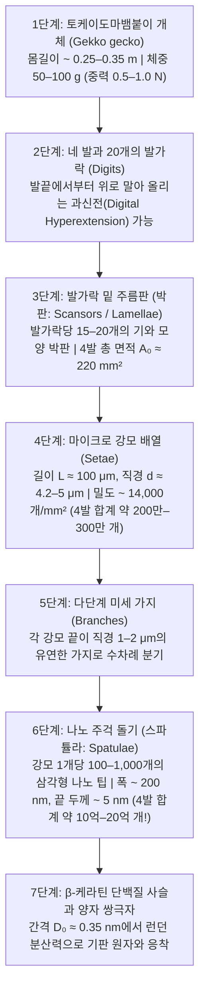
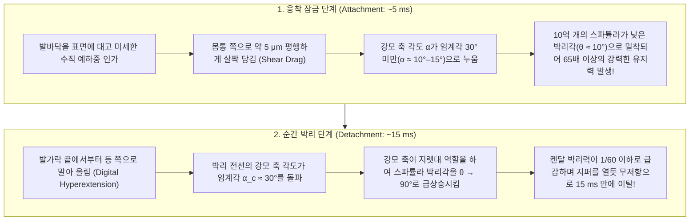

## 1. 서론: 아리스토텔레스의 경탄과 2,300년간 풀리지 않던 생체역학의 수수께끼

기원전 4세기, 고대 그리스의 철학자 아리스토텔레스(Aristotle, 384–322 BCE)는 대저 『동물지』(*Historia Animalium*, 제9권 제9장)에서 지중해 연안의 나무와 벽을 뛰어다니는 작은 파충류인 도마뱀붙이(고대 그리스어 *Askalaros* 또는 *Ascalabotes*)의 기이한 등반 능력에 대해 다음과 같은 기록을 남겼다.

> "도마뱀붙이는 나무줄기를 어떤 방향으로든, <strong>심지어 머리를 아래로 향한 채 거꾸로 매달린 상태에서도</strong> 자유자재로 오르내릴 수 있다."
> — 아리스토텔레스, 『동물지』(기원전 350년경)

그로부터 2,300년이 흐른 오늘날에도 중력을 거스르는 이 경이로운 현상은 생물물리학, 접촉역학(Contact Mechanics), 나노 생체모방공학에서 가장 매혹적인 연구 주제로 꼽힌다. 동남아시아에 서식하는 대형 종인 <strong>토케이도마뱀붙이(Tokay gecko, 학명: *Gekko gecko*)</strong>는 몸길이 $25\text{–}35\,\text{cm}$, 몸무게 $50\text{–}100\,\text{g}$에 달하는 육중한 척추동물이다. 그러나 이 도마뱀붙이는 원자 수준으로 매끄럽게 연마된 수직 석영 유리벽이나 중력이 완전히 잡아당기는 <strong>유리 천장(경사각 $180^\circ$)</strong>을 초속 $1\,\text{m}$ 이상의 속도로 질주한다. 달리는 동안 매초 $15$걸음의 맹렬한 속도로 발을 교차하며, 단 $5\,\text{ms}$ 만에 발바닥을 표면에 고정하고 다음 걸음을 내디딜 때는 불과 <strong>$15\,\text{ms}$($0.015$초)</strong> 만에 거의 $0$에 가까운 힘으로 발바닥을 떼어낸다.

더욱 놀라운 사실은 도마뱀붙이가 지나간 유리 표면에 <strong>점액, 지질, 화학 접착제의 흔적이 단 하나도 남지 않는다</strong>는 점이다. 개미, 딱정벌레, 청개구리가 발바닥 분비선에서 액체를 분비해 부착하는 '습식 응착(wet adhesion)'과 달리, 도마뱀붙이의 발바닥은 분비선이 전혀 없는 순수한 소수성 <strong>$\beta$-케라틴($\beta$-keratin)</strong> 단백질로 이루어진 <strong>건식 응착(Dry Adhesion)</strong> 시스템이다. 만약 토케이도마뱀붙이의 네 발에 나 있는 약 $200\text{만}\text{–}300\text{만}$ 개의 미세 강모(Setae)가 동시에 최대 응착력을 발휘한다면, 이론적으로 <strong>$80\text{–}130\,\text{kg}$의 하중(자신의 몸무게의 $1,000$배 이상!)</strong>을 지탱할 수 있다.

접착제도 흡반도 없이 어떻게 자기 체중의 $1,000$배가 넘는 힘으로 유리 천장에 매달릴 수 있으며, 먼지투성이 나무껍질을 달려도 발이 더러워지지 않고, 나아가 $15\,\text{ms}$ 만에 아무런 저항 없이 발을 떼어낼 수 있는가? 이 '강력한 응착과 무저항 박리의 역설'을 풀기 위해 과학자들은 양자전기역학부터 파괴역학까지 7자릿수의 공간 스케일을 통합해야만 했다.

---

## 2. 결정적 실험으로 기각된 7가지 역사적 가설 (Autumn et al., 2000 & 2002)

19세기부터 20세기 말까지 제안되었던 <strong>7가지 물리·해부학적 가설</strong>은 볼프디트리히 델리트(Wolf-Dietrich Dellit, 1934)의 선구적 실험, 루이발과 에른스트(Ruibal & Ernst, 1965)의 전자현미경 분석, 그리고 루이스앤드클라크 대학의 <strong>켈러 오텀(Kellar Autumn)</strong>, UC 버클리의 <strong>로버트 풀(Robert J. Full)</strong>, 스탠퍼드 대학의 <strong>토머스 케니(Thomas W. Kenny)</strong>, <strong>로널드 피어링(Ronald Fearing)</strong>, UC 산타바바라의 <strong>제이콥 이스라엘라슈빌리(Jacob N. Israelachvili)</strong> 연구팀이 2000년 『Nature』와 2002년 『미국국립과학원회보(PNAS)』에 발표한 결정적 실험을 통해 6가지 가설이 완전히 기각되었다.

1. <strong>흡반 가설 (Suction / 대기압 감압설)</strong>: Simmermacher(1884)는 발바닥 주름(Lamellae)이 미세 흡반처럼 작동한다고 주장했다.
   - <strong>실험적 반증</strong>: Dellit(1934)가 진공 챔버에서 공기를 빼내어 대기압 $P_{\text{atm}} \to 0$으로 만들었음에도 도마뱀붙이의 응착력은 전혀 감소하지 않았다. 또한 1기압이 낼 수 있는 이론적 최대 응력은 $101.3\,\text{kPa}$에 불과하지만, Autumn 연구팀(2000)이 측정한 단일 강모(Seta)의 응착 응력은 <strong>$1,000\,\text{kPa}$($1\,\text{MPa} \approx 10$기압)</strong>으로 대기압 한계의 10배에 달했다!
2. <strong>점액·화학 접착제 분비설 (Glue / Mucus Secretion)</strong>: Wagler(1830)의 가설.
   - <strong>실험적 반증</strong>: 도마뱀붙이 발바닥 표피는 순수한 $\beta$-케라틴 각질층이며 <strong>분비선이 전혀 존재하지 않는다</strong>. 발자국 잔류물이 없으며 스스로 먼지를 털어내는 자가 세정(Self-cleaning) 능력을 갖는다(Hansen & Autumn, 2005).
3. <strong>단순 쿨롱 마찰설 (Pure Coulomb Friction)</strong>:
   - <strong>실험적 반증</strong>: 고전 마찰력 $F_f = \mu N$은 양의 수직 항력 $N > 0$이 필수적이므로, 중력이 아래로 잡아당기는 천장($N = -mg < 0$)에서는 인장 응착력이 없으면 즉시 추락한다.
4. <strong>미세 갈고리·기계적 맞물림설 (Micro-Interlocking)</strong>: Hora(1923)와 Mahendra(1941)는 미세 털이 아이젠 발톱처럼 표면 요철에 걸린다고 보았다.
   - <strong>실험적 반증</strong>: 원자 수준으로 평탄하게 쪼갠 백운모(Mica, 표면 거칠기 $\text{RMS} < 0.1\,\text{nm}$)와 초정밀 연마 실리콘 웨이퍼 위에서 오히려 <strong>가장 강력한 응착력</strong>을 발휘한다(Autumn et al., 2000).
5. <strong>정전기 인력설 (Electrostatic Attraction)</strong>: Schmidt(1904)는 접촉 대전에 의한 쿨롱 정전기력을 제안했다.
   - <strong>실험적 반증</strong>: Dellit(1934)가 X선과 라듐 방사선을 쬐어 주변 공기를 이온화시켜 정전기를 완전히 방전시켰으나 도마뱀붙이는 떨어지지 않았다.
6. <strong>모세관 수막 가교설 (Capillary Wet Adhesion) vs. 반데르발스 힘 가설 (Van der Waals Forces)</strong>:
   Stork(1980) 등은 공기 중 수분이 나노 수막 메니스커스(Meniscus)를 형성해 라플라스 모세관력 $F_{\text{cap}} = 4\pi R\gamma_L \cos\theta_c$를 만든다고 주장했다.
   - <strong>2002년 『PNAS』 결정적 실험 (Autumn et al., 2002)</strong>: 모세관력과 반데르발스 힘을 구분하기 위해 Autumn 팀은 물을 강하게 튕겨내는 <strong>강소수성 갈륨비소 반도체($\text{GaAs}$, 물 접촉각 $\theta_c \approx 110^\circ$, $\cos\theta_c < 0$이므로 모세관 인력 형성 불가)</strong>와 물이 완전히 젖는 <strong>강친수성 이산화규소 유리($\text{SiO}_2$, $\theta_c < 5^\circ$)</strong> 위에서 생체 발바닥 및 단일 강모의 응착력을 비교 측정했다. 결과는 놀라웠다. 두 기판 모두 높은 유전 분극률(굴절률 $n$)을 가지므로, 도마뱀붙이는 <strong>강소수성 $\text{GaAs}$와 강친수성 $\text{SiO}_2$ 위에서 통계적으로 완전히 동일한 전단 응착력($\sim 200\,\text{kPa}$)</strong>을 발휘했다! 이로써 도마뱀붙이 응착의 본질이 표면 친수성과 무관한 <strong>양자역학적 반데르발스 분산력(London Dispersion Force)</strong>임이 최종 입증되었다.

| 번호 | 역사적 가설 | 주요 제창자 | 물리적 메커니즘 | 결정적 반증 실험 및 기각 이유 |
| :--- | :--- | :--- | :--- | :--- |
| <strong>1</strong> | <strong>진공 흡반설</strong> | Simmermacher (1884) | 대기압 차 $P_{\text{atm}} \approx 101\,\text{kPa}$ | <strong>고진공($P \to 0$)에서도 응착력 불변</strong>(Dellit 1934); 실측 응력($1\,\text{MPa}$)이 대기압 한계의 10배(Autumn 2000). |
| <strong>2</strong> | <strong>점액·접착제 분비설</strong> | Wagler (1830) | 분비선에서 점성 액체 분비 | 순수 $\beta$-케라틴 구조로 <strong>분비선이 전무(건식 응착)</strong>하며 잔류물이 없고 자가 세정됨. |
| <strong>3</strong> | <strong>단순 마찰설</strong> | 고전 트라이볼로지 | 미세 털에 의한 높은 마찰계수 $\mu$ | 쿨롱 마찰 $F_f = \mu N$은 천장($N < 0$)에서 수직 인장력을 지탱할 수 없음. |
| <strong>4</strong> | <strong>미세 갈고리 맞물림설</strong> | Hora (1923) | 표면의 미세 요철에 갈고리처럼 걸림 | <strong>원자 수준으로 매끄러운 운모 결정($\text{RMS} < 0.1\,\text{nm}$)</strong>에서 가장 강하게 붙음. |
| <strong>5</strong> | <strong>정전기 인력설</strong> | Schmidt (1904) | 마찰 대전에 의한 정전기장 $\sigma_q^2/(2\varepsilon_0)$ | <strong>X선 조사로 공기를 이온화해 정전기를 완전 방전시켜도 떨어지지 않음</strong>(Dellit 1934). |
| <strong>6</strong> | <strong>모세관 수막 가교설</strong> | Stork (1980) | 수막 표면장력 $4\pi R\gamma_L\cos\theta_c$ | <strong>강소수성 $\text{GaAs}$($\theta_c = 110^\circ$)와 강친수성 $\text{SiO}_2$($\theta_c < 5^\circ$)에서 동일한 응착력($\sim 200\,\text{kPa}$)</strong> 발휘(Autumn 2002). |
| <strong>7</strong> | <strong>반데르발스 분산력설</strong> | Hiller (1968), Autumn (2000, 2002) | 양자 영점 쌍극자 요동(런던 분산력) | <strong>모든 실험과 일치</strong>: 기판의 하마커 상수 $A_H$에 비례하며 진공·수중·극저온에서 작동함. |

---

## 3. 토케이도마뱀붙이 발바닥의 7단계 계층 구조와 달퀴스트 기준 (Dahlquist Criterion)

반데르발스 힘은 작동 거리가 $D_0 \approx 0.3\text{–}0.4\,\text{nm}$에 불과한 극단적인 단거리 힘이다. 표면 거칠기의 장벽을 넘어 발바닥 전체를 원자 간 거리까지 밀착시키기 위해 도마뱀붙이는 7자릿수 스케일의 계층 구조를 진화시켰다.

### 3.1 오일러-베르누이 외팔보 역학과 달퀴스트 점착 기준 (Dahlquist Criterion)

강모를 구성하는 <strong>$\beta$-케라틴</strong>은 벌크 영률이 $E_{\text{bulk}} \approx 2.0\,\text{GPa}$에 달하는 단단한 고분자다. 그러나 고분자 점착공학의 <strong>달퀴스트 기준(Dahlquist Criterion for Tack, 1966)</strong>에 따르면, 거친 표면에 자발적으로 밀착하기 위해서는 재료의 <strong>유효 탄성계수가 $E_{\text{eff}} \le 100\text{–}300\,\text{kPa}$ 이하</strong>여야 한다.

도마뱀붙이는 $2\,\text{GPa}$의 단단한 케라틴을 각도 $\alpha_0 \approx 45^\circ$로 기울어진 가늘고 긴 마이크로 외팔보(길이 $L \approx 100\,\mu\text{m}$, 반경 $r \approx 2.1\,\mu\text{m}$, 간격 $s \approx 8.5\,\mu\text{m}$, 단면 이차 모멘트 $I = \frac{\pi r^4}{4}$) 배열로 만들어 수직 굽힘 강성 $k_\perp = \frac{3 E_{\text{bulk}} I}{L^3 \sin^2\alpha_0}$을 통해 유효 탄성률을 다음과 같이 낮추었다:

$$E_{\text{eff}} = \frac{k_\perp L \sin\alpha_0}{s^2} = \frac{3\pi}{4 \sin\alpha_0} E_{\text{bulk}} \left(\frac{r}{L}\right)^2 \left(\frac{r}{s}\right)^2 \approx 80\text{–}100\,\text{kPa}$$

이 기하학적 설계 덕분에 강모 배열은 자체 엉킴(Self-matting)이나 오염 없이도 강성을 <strong>2만 분의 1(4자릿수)</strong>로 낮추어 달퀴스트 기준($E_{\text{eff}} \le 100\,\text{kPa}$)을 완벽히 충족한다!

### 3.2 정량적 힘 예산: 단일 스파튤라($10\,\text{nN}$)에서 개체 전체($130\,\text{kg}$)까지

- <strong>단일 스파튤라(Spatula) 인장력</strong>: $F_{\text{spatula}} \approx 10\,\text{nN}$ (Huber et al., 2005 AFM 측정).
- <strong>단일 강모(Seta) 응착력</strong>: 평균 $F_{\text{seta}} \approx 40\,\mu\text{N}$; 수직 예하중 후 평행하게 $5\,\mu\text{m}$ 끌었을 때 최대 전단력 <strong>$F_{\parallel,\text{seta, max}} = 194 \pm 25\,\mu\text{N} \approx 200\,\mu\text{N}$</strong> (Autumn et al., 2000 *Nature*).
- <strong>네 발 전체($2 \times 10^6\text{–}3 \times 10^6$개 강모) 이론적 최대 하중</strong>: 보수적으로도 $2 \times 10^6 \times 40\,\mu\text{N} = 80\,\text{N}$($8.2\,\text{kg}$), 최대 전단력 기준 <strong>$400\text{–}1,280\,\text{N}$(약 $40\text{–}130\,\text{kg}$, 체중의 $1,000$배 이상!)</strong>을 지탱한다.

---

## 4. 반데르발스 힘, 런던 분산력 및 하마커-리프시츠(Hamaker-Lifshitz) 양자전기역학

### 4.1 프리츠 런던(Fritz London, 1930)의 양자 분산력 유도

비극성 분자인 $\beta$-케라틴($p_1 \approx 0$)에서는 영구 쌍극자에 의한 Keesom 항과 Debye 항이 사라진다. 1930년 프리츠 런던은 3차원 등방성 양자 조화진동자(특성 주파수 $\omega_0$, 분극률 $\alpha_1, \alpha_2$)의 2차 섭동 이론을 통해, 하이젠베르크 불확정성 원리에 의한 <strong>바닥 상태 영점 진동(Zero-point fluctuation)</strong>이 순간 쌍극자와 유도 쌍극자 사이의 보편적 인력을 생성함을 증명했다:

$$U_{\text{London}}(r) = -\frac{3}{4} \frac{\hbar \omega_0 \alpha_1 \alpha_2}{(4\pi\varepsilon_0)^2 r^6}$$

### 4.2 하마커(Hamaker 1937) 체적 적분과 리프시츠(Lifshitz 1956) 이론

분자 쌍 퍼텐셜 $-C/r^6$을 반경 $R \approx 100\,\text{nm}$의 구형 스파튤라 팁과 간격 $D_0 \approx 0.35\,\text{nm}$ 떨어진 평면 기판에 대해 적분하면(<strong>하마커 상수 $A_H = \pi^2 C \rho_1 \rho_2 \approx 10^{-19}\,\text{J}$</strong>), 거시적 반데르발스 힘 공식이 도출된다:

$$F_{\text{vdW}}(D_0) = \frac{A_H R}{6 D_0^2}, \qquad P_{\text{vdW}}(D_0) = \frac{A_H}{6\pi D_0^3}$$

여기에 $A_H = 10^{-19}\,\text{J}$, $R = 100\,\text{nm}$, $D_0 = 0.35\,\text{nm}$를 대입하면 단일 스파튤라의 힘 $F_{\text{vdW}} \approx 13.6\,\text{nN}$이 나와 AFM 실험치($10\,\text{nN}$)와 정확히 일치한다! 또한 리프시츠(1956)의 거시적 양자장론에서 $A_{132}$는 기판의 광학 굴절률 $n_2$에 지배되므로, 전기음성도가 큰 플루오린($\text{C–F}$) 결합 때문에 굴절률이 극도로 낮은 <strong>폴리테트라플루오로에틸렌(PTFE / 테플론, $n_2 \approx 1.35$) 위에서만 도마뱀붙이가 미끄러지는 이유</strong>를 완벽히 설명해 준다.

---

## 5. JKR 접촉역학과 '접촉 분할의 원리' (Contact Splitting Principle: Arzt et al., 2003)

<strong>Johnson-Kendall-Roberts (JKR, 1971) 탄성 응착 접촉 이론</strong>에 따르면, 반경 $R$, 응착 일 $W_{\text{ad}} = \Delta\gamma$인 단일 반구형 접촉의 접촉 반경 $a$와 최대 분리력(Pull-off force) $F_{\text{JKR}}^{(1)}$은 다음과 같다:

$$a^3 = \frac{3 R}{4 E^*} \left( P + 3\pi W_{\text{ad}} R + \sqrt{6\pi W_{\text{ad}} R P + (3\pi W_{\text{ad}} R)^2} \right) \implies F_{\text{JKR}}^{(1)} = \frac{3}{2}\pi W_{\text{ad}} R$$

즉 분리력은 면적 $\pi R^2$이 아니라 <strong>선형 반경 $R$에 비례</strong>한다! 따라서 겉보기 반경 $R_0$(면적 $A_0 = \pi R_0^2$)인 단일 패드를 동일한 총면적을 갖는 $N$개의 작은 하위 접촉(반경 $r_N = R_0 / \sqrt{N}$)으로 분할하면, 전체 분리력 $F_{\text{total}}(N)$은 다음과 같이 증폭된다(Arzt, Gorb, & Spolenak, 2003 *PNAS*):

$$\boxed{F_{\text{total}}(N) = N \cdot \frac{3}{2}\pi W_{\text{ad}} \left(\frac{R_0}{\sqrt{N}}\right) = \sqrt{N} \, F_{\text{JKR}}^{(1)}}$$

<strong>접촉면을 $N = 10^9$개의 나노 스파튤라로 분할하면 총 응착력은 $\sqrt{10^9} \approx 31,623$배(약 3만 배!)로 증폭된다!</strong> 또한 동물 체중 $m \propto L^3$과 발바닥 면적 $A_0 \propto L^2$의 불균형을 극복하기 위해 털 끝 밀도는 $\rho_A \propto m^{2/3}$ 법칙을 따르며, 스파튤라 반경이 가오와 야오(Gao & Yao, 2004)의 <strong>결함 둔감성 임계 반경 $r_{\text{crit}} = \frac{8 E^* W_{\text{ad}}}{\pi \sigma_{\text{th}}^2} \approx 170\,\text{nm}$</strong> 이하로 작아지면서 균열 응력 집중 없이 이론적 분자 응착 강도 한계에 도달한다.

---

## 6. 15밀리초 무저항 박리의 역설: 켄달(Kendall) 박리 방정식과 발가락 과신전

도마뱀붙이는 어떻게 $15\,\text{ms}$ 만에 아무런 힘도 들이지 않고 발을 떼어내는가? 1971년 <strong>케빈 켄달(Kevin Kendall)</strong>이 유도한 탄성 테이프 박리 방정식(폭 $b$, 두께 $d$, 영률 $E$, 박리각 $\theta$)을 보자:

$$\left(\frac{F_{\text{peel}}}{b}\right)^2 \frac{1}{2 d E} + \frac{F_{\text{peel}}}{b}(1 - \cos\theta) = W_{\text{ad}} \implies F_{\text{peel}}(\theta) \approx \frac{b W_{\text{ad}}}{1 - \cos\theta}$$

- <strong>응착 시($\theta \approx 10^\circ$, 강모 축 각도 $\alpha < \alpha_c \approx 30^\circ$)</strong>: $1 - \cos 10^\circ \approx 0.0152$이므로 $F_{\text{peel}}(10^\circ) \approx 65.8 \, b W_{\text{ad}}$의 막대한 전단 유지력이 발생한다.
- <strong>박리 시(발가락 과신전, Digital Hyperextension)</strong>: 발가락 끝부터 위로 말아 올리면 박리 전선에 있는 강모의 축 각도가 임계각 $\alpha_c \approx 30^\circ$를 넘어서며(Autumn et al., 2006), 지렛대 작용으로 스파튤라 박리각이 $\theta \to 90^\circ$($1 - \cos 90^\circ = 1$)로 세워져 필요 박리력이 $1/65 \sim 1/200$로 급감한다!

---

## 7. 건식 자가 세정(Self-Cleaning)과 우주 데브리 포획 로봇 응용

1. <strong>건식 접촉 자가 세정 (Hansen & Autumn, 2005 *PNAS*)</strong>: 반경 $R_p \approx 2.5\,\mu\text{m}$인 먼지 입자는 단일 스파튤라 반경($R_s \approx 100\,\text{nm}$)보다 훨씬 크므로, 하마커 공식 $F_{\text{vdW}} = \frac{A_H R}{6 D_0^2}$에 의해 먼지–벽면 간 인력($\propto R_p$)이 먼지–소수 스파튤라 간 인력($\propto n R_s$)보다 항상 크다($F_{\text{particle-wall}} > F_{\text{particle-setae}}$). 덕분에 도마뱀붙이는 더러워진 발로 깨끗한 유리를 단 $4\text{–}8$걸음 걷기만 해도 먼지가 벽면으로 전사되어 응착력의 $80\%$를 회복한다.
2. <strong>생체모방 공학 및 NASA JPL 우주 그리퍼 (Parness, Jiang et al., 2017 *Science Robotics*)</strong>: 안드레 가임(Geim et al., 2003)의 나노 필라 패치, $70\,\text{kg}$ 성인이 유리벽을 등반한 스탠퍼드 대학의 비대칭 PDMS 마이크로 웨지 패들(Hawkes et al., 2014), 실제 도마뱀붙이보다 10배 강한 탄소나노튜브 계층 카펫(Qu et al., 2008 *Science*), 그리고 진공과 극저온($-190^\circ\text{C}$)에서도 예하중 없이 작동하는 <strong>NASA 제트추진연구소(JPL)의 우주 데브리 포획 그리퍼 및 국제우주정거장(ISS) Astrobee 로봇 계류 패드</strong>에 이르기까지, 도마뱀붙이의 양자 나노역학은 첨단 공학의 미래를 바꾸고 있다.
