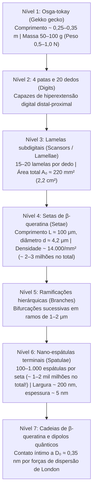
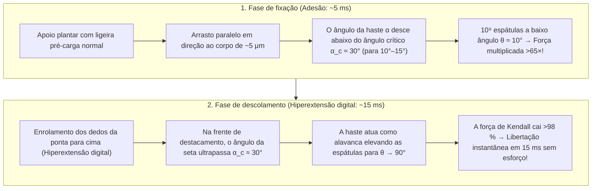

## 1. Introdução: O espanto de Aristóteles e um enigma biomecânico de 2.300 anos

No século IV a.C., o filósofo e naturalista grego Aristóteles (384–322 a.C.) registou na sua obra *História dos Animais* (*Historia Animalium*, Livro IX, Capítulo 9) uma observação fascinante sobre um pequeno réptil mediterrânico — a osga ou lagartixa (*Askalaros* ou *Ascalabotes*):

> «A osga pode correr para cima e para baixo numa árvore de qualquer maneira, <strong>mesmo com a cabeça voltada para baixo</strong>.»
> — Aristóteles, *Historia Animalium* (c. 350 a.C.)

Mais de dois milénios depois, este aparente desafio à gravidade continua a ser uma das maiores obras-primas da biofísica e da mecânica de contato. A <strong>osga-tokay (*Gekko gecko*)</strong> do Sudeste Asiático atinge $25\text{ a }35\,\text{cm}$ de comprimento e pesa entre $50\text{ e }100\,\text{g}$ (chegando a $300\,\text{g}$). Apesar desta massa elevada para um animal trepador, consegue correr a mais de $1\,\text{m/s}$ por uma parede vertical de vidro de sílica polido à escala molecular ou caminhar invertida num teto de vidro ($180^\circ$). Dando $15\text{ passos por segundo}$, fixa cada pata em $5\,\text{ms}$ e destaca-a em apenas <strong>$15\,\text{ms}$ ($0{,}015\,\text{s}$)</strong> com uma força de descolamento praticamente nula.

Mais impressionante ainda: a osga não deixa <strong>qualquer vestígio de muco, lípidos ou cola química</strong> sobre o vidro. Ao contrário das formigas, besouros ou rãs arborícolas que segregam fluidos («adesão húmida»), as almofadas subdigitais da osga são totalmente desprovidas de glândulas secretoras. Trata-se de uma <strong>adesão seca (Dry Adhesion)</strong> composta exclusivamente por <strong>$\beta$-queratina</strong> hidrofóbica. Se os cerca de $2\text{ milhões}$ de micro-pelos (setas / *setae*) das suas quatro patas atuassem simultaneamente na capacidade máxima, poderiam sustentar teoricamente entre <strong>$80\text{ e }130\,\text{kg}$ — mais de $1.000$ vezes o seu próprio peso corporal!</strong>

---

## 2. As sete hipóteses históricas refutadas por experiências decisivas (Autumn et al., 2000 & 2002)

Do século XIX ao início do século XXI foram propostos sete mecanismos clássicos. Graças às experiências pioneiras de <strong>Wolf-Dietrich Dellit (1934)</strong>, à microscopia eletrónica de <strong>Ruibal & Ernst (1965)</strong> e aos estudos definitivos de <strong>Kellar Autumn, Robert J. Full, Thomas W. Kenny, Ronald Fearing e Jacob N. Israelachvili</strong> na *Nature* (2000) e *PNAS* (2002), seis dessas hipóteses foram refutadas:

1. <strong>Sucção (ventosas por pressão atmosférica, Simmermacher 1884)</strong>:
   - <strong>Refutação</strong>: Dellit (1934) colocou osgas vivas numa câmara de alto vácuo ($P_{\text{atm}} \to 0$): as patas aderiram no vácuo com a mesma força que no ar! Além disso, a sucção atmosférica está limitada a $1\,\text{atm} \approx 101{,}3\,\text{kPa}$, enquanto uma única seta gera uma tensão adesiva de <strong>$1.000\,\text{kPa}$ ($1\,\text{MPa} \approx 10\,\text{atm}$, Autumn et al., 2000)</strong>.
2. <strong>Cola química ou secreção de muco (Wagler 1830)</strong>:
   - <strong>Refutação</strong>: A epiderme de $\beta$-queratina <strong>não possui glândulas secretoras</strong>, não deixa resíduos e autolimpa-se a seco (Hansen & Autumn, 2005).
3. <strong>Atrito puro de Coulomb</strong>:
   - <strong>Refutação</strong>: O atrito clássico $F_f = \mu N$ exige uma força normal compressiva $N > 0$ e anula-se num teto invertido ($N = -mg < 0$) sem adesão de tração.
4. <strong>Engrenamento micromecânico (micro-ganchos, Hora 1923; Mahendra 1941)</strong>:
   - <strong>Refutação</strong>: As osgas aderem com força máxima à <strong>mica moscovite clivada atomicamente lisa (rugosidade $\text{RMS} < 0{,}1\,\text{nm}$)</strong> e a bolachas de silício polidas (Autumn et al., 2000).
5. <strong>Atração eletrostática (carga triboelétrica, Schmidt 1904)</strong>:
   - <strong>Refutação</strong>: Dellit (1934) ionizou o ar em redor das patas com <strong>raios X e emissões de rádio</strong> para dissipar qualquer carga estática sem que o animal caísse.
6. <strong>Pontes capilares de água (pressão de Laplace, Stork 1980) vs. Forças de van der Waals (Autumn et al., 2002)</strong>:
   Se meniscos de água produzissem atração capilar $F_{\text{cap}} = 4\pi R\gamma_L \cos\theta_c$, a adesão colapsaria em substratos fortemente hidrofóbicos ($\theta_c > 90^\circ \implies \cos\theta_c < 0$).
   - <strong>A experiência decisiva na *PNAS* (Autumn et al., 2002)</strong>: A equipa mediu a adesão em <strong>arsenieto de gálio fortemente hidrofóbico ($\text{GaAs}$, ângulo de contato da água $\theta_c \approx 110^\circ$)</strong> face ao <strong>dióxido de silício fortemente hidrofílico ($\text{SiO}_2$, $\theta_c < 5^\circ$)</strong>. Como ambos os substratos têm elevada polarizabilidade dielétrica, tanto os animais vivos como as setas isoladas geraram <strong>exatamente a mesma tensão de adesão ($\sim 200\,\text{kPa}$) em $\text{GaAs}$ hidrofóbico e em $\text{SiO}_2$ hidrofílico</strong>! Isto provou que o motor universal são as <strong>forças quânticas de dispersão de van der Waals (London)</strong>.

| N.º | Hipótese histórica | Autores | Mecanismo físico | Refutação experimental decisiva |
| :--- | :--- | :--- | :--- | :--- |
| <strong>1</strong> | <strong>Sucção / Ventosas</strong> | Simmermacher (1884) | Pressão atmosférica $P_{\text{atm}} \approx 101\,\text{kPa}$ | <strong>Funciona intacto em alto vácuo ($P \to 0$)</strong> (Dellit 1934); tensão ($1\,\text{MPa}$) $10\times$ superior a $1\,\text{atm}$. |
| <strong>2</strong> | <strong>Cola / Muco</strong> | Wagler (1830) | Secreções glandulares adesivas | $\beta$-queratina pura <strong>sem glândulas (100 % seca)</strong>, sem resíduos e autolimpante. |
| <strong>3</strong> | <strong>Atrito puro</strong> | Tribologia clássica | Elevado coeficiente de atrito $\mu$ | Falha em tetos invertidos ($N = -mg < 0$) sem força de tração. |
| <strong>4</strong> | <strong>Micro-ganchos</strong> | Hora (1923) | Engate mecânico em rugosidades | <strong>Adesão máxima em mica atomicamente lisa ($\text{RMS} < 0{,}1\,\text{nm}$)</strong> (Autumn 2000). |
| <strong>5</strong> | <strong>Eletrostática</strong> | Schmidt (1904) | Cargas triboelétricas $\sigma_q^2/(2\varepsilon_0)$ | <strong>Ionizar o ar com raios X não reduz a adesão</strong> (Dellit 1934). |
| <strong>6</strong> | <strong>Capilaridade (água)</strong> | Stork (1980) | Meniscos de água $4\pi R\gamma_L\cos\theta_c$ | <strong>Adesão idêntica ($\sim 200\,\text{kPa}$) em $\text{GaAs}$ hidrofóbico ($\theta_c = 110^\circ$) e $\text{SiO}_2$ hidrofílico</strong> (Autumn 2002). |
| <strong>7</strong> | <strong>Forças de van der Waals</strong> | Hiller (1968), Autumn (2000, 2002) | Flutuações quânticas de dipolos (dispersão de London) | <strong>Confirmado por todas as experiências</strong>: escala com a constante de Hamaker $A_H$. |

---

## 3. Arquitetura hierárquica de 7 níveis e o critério de Dahlquist

As forças de van der Waals apenas atuam a distâncias de $D_0 \approx 0{,}3\text{–}0{,}4\,\text{nm}$. Para se adaptar à rugosidade superficial desde milímetros até nanómetros, a osga desenvolveu uma hierarquia de 7 níveis:

### 3.1 Mecânica de vigas de Euler-Bernoulli e o critério de aderência de Dahlquist

A $\beta$-queratina maciça é um polímero rígido com módulo de Young $E_{\text{bulk}} \approx 2{,}0\,\text{GPa}$. Porém, segundo o <strong>critério de Dahlquist (Carl A. Dahlquist, 1966)</strong>, um adesivo sensível à pressão necessita de um <strong>módulo elástico efetivo $E_{\text{eff}} \le 100\text{–}300\,\text{kPa}$</strong> para se moldar espontaneamente a superfícies rugosas.

Ao estruturar a queratina rígida em micro-vigas em consola inclinadas a $\alpha_0 \approx 45^\circ$ ($L \approx 100\,\mu\text{m}$, raio $r \approx 2{,}1\,\mu\text{m}$, espaçamento $s \approx 8{,}5\,\mu\text{m}$, momento de inércia $I = \frac{\pi r^4}{4}$) com rigidez de flexão $k_\perp = \frac{3 E_{\text{bulk}} I}{L^3 \sin^2\alpha_0}$, o módulo efetivo desce quatro ordens de grandeza:

$$E_{\text{eff}} = \frac{k_\perp L \sin\alpha_0}{s^2} = \frac{3\pi}{4 \sin\alpha_0} E_{\text{bulk}} \left(\frac{r}{L}\right)^2 \left(\frac{r}{s}\right)^2 \approx 80\text{–}100\,\text{kPa}$$

Cada espátula gera $\sim 10\,\text{nN}$ (Huber et al., 2005) e cada seta suporta de $40\,\mu\text{N}$ a $194 \pm 25\,\mu\text{N}$ (Autumn et al., 2000), perfazendo uma capacidade teórica total de $80\text{ a }130\,\text{kg}$ nas quatro patas.

---

## 4. Eletrodinâmica quântica das forças de van der Waals, London e Casimir-Lifshitz

O potencial intermolecular de van der Waals entre duas moléculas neutras à distância $r$ é:

$$U_{\text{vdW}}(r) = -\frac{C_{\text{Keesom}} + C_{\text{Debye}} + C_{\text{London}}}{r^6}$$

Na $\beta$-queratina apolar domina a <strong>força de dispersão de London (Fritz London, 1930)</strong>, gerada pelas flutuações quânticas do ponto zero de osciladores harmónicos 3D (frequência $\omega_0$, polarizabilidades $\alpha_1, \alpha_2$):

$$U_{\text{London}}(r) = -\frac{3}{4} \frac{\hbar \omega_0 \alpha_1 \alpha_2}{(4\pi\varepsilon_0)^2 r^6}$$

Integrando este potencial sobre uma ponta esférica de raio $R \approx 100\,\text{nm}$ a uma distância $D_0 \approx 0{,}35\,\text{nm}$ de um plano segundo <strong>Hugo C. Hamaker (1937)</strong> e <strong>Evgeny Lifshitz (1956)</strong> (constante de Hamaker $A_H = \pi^2 C \rho_1 \rho_2 \approx 10^{-19}\,\text{J}$), obtém-se:

$$F_{\text{vdW}}(D_0) = \frac{A_H R}{6 D_0^2} \approx 13{,}6\,\text{nN}$$

A teoria de Lifshitz mostra que $A_H$ depende do fator ótico UV $\frac{(n_1^2 - 1)(n_2^2 - 1)}{(n_1^2 + 1)(n_2^2 + 1)}$, explicando por que razão a osga escorrega no <strong>politetrafluoroetileno (PTFE / Teflon)</strong>, cujas ligações $\text{C–F}$ pouco polarizáveis conferem um índice de refração extremamente baixo ($n_{\text{PTFE}} \approx 1{,}35$).

---

## 5. O princípio da divisão do contato («Contact Splitting») via mecânica JKR

Segundo a <strong>teoria de Johnson-Kendall-Roberts (JKR, 1971)</strong>, o raio de contato $a$ e a força de arrancamento $F_{\text{JKR}}^{(1)}$ de uma semiesfera elástica de raio $R$ e trabalho de adesão $W_{\text{ad}} = \Delta\gamma$ são:

$$a^3 = \frac{3 R}{4 E^*} \left( P + 3\pi W_{\text{ad}} R + \sqrt{6\pi W_{\text{ad}} R P + (3\pi W_{\text{ad}} R)^2} \right) \implies F_{\text{JKR}}^{(1)} = \frac{3}{2}\pi W_{\text{ad}} R$$

Como a força de arrancamento é <strong>proporcional ao raio linear $R$ (e não à área $\pi R^2$!)</strong>, <strong>Arzt, Gorb e Spolenak (2003, *PNAS*)</strong> demonstraram que ao dividir uma área aparente $\pi R_0^2$ em $N$ sub-contatos de raio $r_N = R_0 / \sqrt{N}$, a força adesiva total é multiplicada por $\sqrt{N}$:

$$\boxed{F_{\text{total}}(N) = N \cdot \frac{3}{2}\pi W_{\text{ad}} \left(\frac{R_0}{\sqrt{N}}\right) = \sqrt{N} \, F_{\text{JKR}}^{(1)}}$$

<strong>Dividir o contato em $N = 10^9$ nano-espátulas multiplica a força total de adesão por $\sqrt{10^9} \approx 31.623$ (mais de 30.000 vezes)!</strong> Isto explica a lei alométrica $\rho_A \propto m^{2/3}$ desde as moscas até às osgas, bem como a insensibilidade a defeitos abaixo do raio crítico de Gao & Yao (2004) $r_{\text{crit}} = \frac{8 E^* W_{\text{ad}}}{\pi \sigma_{\text{th}}^2} \approx 170\,\text{nm}$.

---

## 6. O paradoxo do descolamento em 15 ms: Equação de destacamento de Kendall e hiperextensão digital

Como é que a osga descola a pata em $15\,\text{ms}$ sem esforço? A <strong>equação de destacamento elástico de Kevin Kendall (1971)</strong> para uma fita (largura $b$, espessura $d$, módulo $E$) num ângulo de destacamento $\theta$ é:

$$\left(\frac{F_{\text{peel}}}{b}\right)^2 \frac{1}{2 d E} + \frac{F_{\text{peel}}}{b}(1 - \cos\theta) = W_{\text{ad}} \implies F_{\text{peel}}(\theta) \approx \frac{b W_{\text{ad}}}{1 - \cos\theta}$$

Ao puxar paralelamente ($\theta \approx 10^\circ, \alpha < 30^\circ$), $1 - \cos 10^\circ \approx 0{,}0152$ gera uma força enorme ($F_{\text{peel}}(10^\circ) \approx 65{,}8\,b W_{\text{ad}}$). Para descolar, a <strong>hiperextensão digital</strong> faz com que as setas ultrapassem o ângulo crítico $\alpha_c \approx 30^\circ$ (Autumn et al., 2006), erguendo as espátulas a $\theta \approx 90^\circ$ ($1 - \cos 90^\circ = 1$) e reduzindo a força necessária quase cem vezes.

---

## 7. Autolimpeza a seco e aplicações biomiméticas (Garras espaciais do NASA JPL)

1. <strong>Autolimpeza por contato (Hansen & Autumn, 2005 *PNAS*)</strong>: Uma partícula de poeira ($R_p \approx 2{,}5\,\mu\text{m}$) sofre uma atração de van der Waals $F_{\text{particle-wall}} \propto R_p$ para a parede plana muito superior à soma das atrações $F_{\text{particle-setae}} \propto n R_s$ para as poucas espátulas ($R_s \approx 100\,\text{nm}$) que lhe tocam. Em $4\text{ a }8\text{ passos}$, o pó transfere-se para a parede.
2. <strong>Engenharia biomimética e garras espaciais do NASA JPL (Parness, Jiang et al., 2017 *Science Robotics*)</strong>: Desde os micropilares de Andre Geim (2003), as microcunhas direcionais de PDMS de Stanford com que um humano de $70\,\text{kg}$ escalou uma fachada de vidro (Hawkes et al., 2014) e os tapetes de nanotubos de carbono ($100\,\text{N/cm}^2$, Qu et al., 2008), até às <strong>garras de captura de detritos orbitais e aos robôs *Astrobee* da ISS do NASA JPL</strong>, a adesão seca de van der Waals opera no vácuo espacial e a $-190^\circ\text{C}$ sem pré-carga repulsiva.
