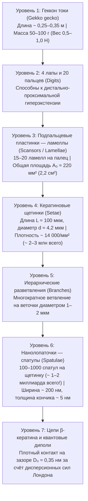
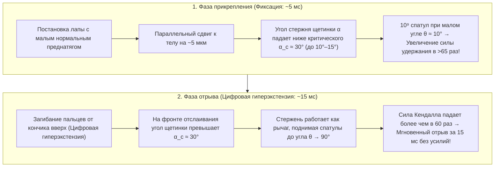

## 1. Введение: Восхищение Аристотеля и биомеханическая загадка длиной в 2300 лет

В IV веке до нашей эры древнегреческий философ и натуралист Аристотель (384–322 гг. до н. э.) в своей знаменитой «Истории животных» (*Historia Animalium*, книга IX, глава 9) оставил удивительное наблюдение о маленькой средиземноморской ящерице — гекконе (*Askalaros* или *Ascalabotes*):

> «Геккон может бегать вверх и вниз по стволу дерева каким угодно образом, <strong>даже вниз головой</strong>».
> — Аристотель, *История животных* (ок. 350 г. до н. э.)

Более двух тысячелетий спустя эта кажущаяся победа над гравитацией остаётся одним из самых ярких шедевров биофизики и механики контактного взаимодействия. Крупный юго-восточноазиатский <strong>геккон токи (*Gekko gecko*)</strong> достигает длины $25\text{–}35\,\text{см}$ и массы $50\text{–}100\,\text{г}$ (у крупных особей до $300\,\text{г}$). Несмотря на внушительную массу тела по сравнению с насекомыми, геккон токи способен бежать со скоростью свыше $1\,\text{м/с}$ вверх по вертикальному, молекулярно гладкому кварцевому стеклу или вниз спиной по стеклянному потолку ($180^\circ$). Совершая $15\text{ шагов в секунду}$, он фиксирует лапу за $5\,\text{мс}$ и отрывает её всего за <strong>$15\,\text{мс}$ ($0{,}015\,\text{с}$)</strong> практически с нулевым усилием отрыва.

Ещё более поразительно то, что на оптическом зеркале или кремниевой пластине после пробежки геккона <strong>не остаётся ни малейших следов слизи, липидов или химического клея</strong>. В отличие от муравьёв, жуков или древесных лягушек, выделяющих секреторную жидкость («влажная адгезия»), подпальцевые подушечки геккона полностью лишены желёз. Это чисто <strong>сухая адгезия (Dry Adhesion)</strong>, построенная исключительно из гидрофобного <strong>$\beta$-кератина</strong>. Если бы все около $2\text{ миллионов}$ микрощетинок (*setae*) на четырёх лапах геккона сработали одновременно на максимуме, они теоретически смогли бы удержать груз массой <strong>от $80\text{ до }130\,\text{кг}$ — более чем в $1000$ раз больше собственного веса животного!</strong>

---

## 2. Семь исторических гипотез, опровергнутых решающими экспериментами (Autumn et al., 2000 & 2002)

С XIX по начало XXI века выдвигались семь классических гипотез. Благодаря пионерским опытам <strong>Вольфа-Дитриха Деллита (Wolf-Dietrich Dellit, 1934)</strong>, электронной микроскопии <strong>Руибала и Эрнст (Ruibal & Ernst, 1965)</strong> и фундаментальным работам группы <strong>Келлара Отама (Kellar Autumn), Роберта Фулла (Robert J. Full), Томаса Кенни (Thomas W. Kenny), Рональда Фиринга (Ronald Fearing) и Джейкоба Исраелашвили (Jacob N. Israelachvili)</strong> в журналах *Nature* (2000) и *PNAS* (2002), шесть из них были окончательно опровергнуты:

1. <strong>Гипотеза вакуумных присосок (Suction, Simmermacher 1884)</strong>:
   - <strong>Опровержение</strong>: Деллит (1934) поместил живых гекконов в вакуумную камеру ($P_{\text{atm}} \to 0$) — лапы держались в глубоком вакууме так же крепко, как и в воздухе! Кроме того, предел атмосферной присоски на уровне моря составляет $1\,\text{атм} \approx 101{,}3\,\text{кПа}$, тогда как одна щетинка геккона развивает адгезионное напряжение <strong>$1000\,\text{кПа}$ ($1\,\text{МПа} \approx 10\,\text{атм}$, Autumn et al., 2000)</strong>.
2. <strong>Секреция клея или слизи (Wagler 1830)</strong>:
   - <strong>Опровержение</strong>: Эпидермис из $\beta$-кератина <strong>не имеет секреторных желёз</strong>, не оставляет следов и обладает сухим самоочищением (Hansen & Autumn, 2005).
3. <strong>Чистое кулоновское трение</strong>:
   - <strong>Опровержение</strong>: Закон Кулона $F_f = \mu N$ требует прижимающей нормальной силы $N > 0$ и обращается в нуль на потолке ($N = -mg < 0$) без растягивающей адгезии.
4. <strong>Микромеханическое зацепление (микрокрючки, Hora 1923; Mahendra 1941)</strong>:
   - <strong>Опровержение</strong>: Гекконы сильнее всего прилипают к <strong>атомарно гладкому сколу слюды мусковита (шероховатость $\text{RMS} < 0{,}1\,\text{нм}$)</strong> и полированным кремниевым пластинам (Autumn et al., 2000).
5. <strong>Электростатическое притяжение (контактная электризация, Schmidt 1904)</strong>:
   - <strong>Опровержение</strong>: Ионизация воздуха вокруг лап с помощью <strong>рентгеновских лучей и радия</strong> (Dellit, 1934) полностью снимает электростатические заряды, но не ослабляет сцепление.
6. <strong>Капиллярные водные мостики (давление Лапласа, Stork 1980) против сил Ван-дер-Ваальса (Autumn et al., 2002)</strong>:
   Если бы адгезия создавалась менисками воды $F_{\text{cap}} = 4\pi R\gamma_L \cos\theta_c$, она бы исчезала на сильно гидрофобных поверхностях ($\theta_c > 90^\circ \implies \cos\theta_c < 0$).
   - <strong>Решающий эксперимент в *PNAS* (Autumn et al., 2002)</strong>: Учёные измерили силу сцепления живых гекконов и отдельных щетинок на <strong>сильно гидрофобном арсениде галлия ($\text{GaAs}$, краевой угол смачивания водой $\theta_c \approx 110^\circ$)</strong> и на <strong>сильно гидрофильном диоксиде кремния ($\text{SiO}_2$, $\theta_c < 5^\circ$)</strong>. Поскольку оба материала обладают высокой диэлектрической поляризуемостью, лапы геккона и отдельные щетинки показали <strong>одинаково высокую адгезию ($\sim 200\,\text{кПа}$) как на гидрофобном $\text{GaAs}$, так и на гидрофильном $\text{SiO}_2$</strong>! Это доказало, что главный механизм — квантовомеханические <strong>дисперсионные силы Ван-дер-Ваальса (Лондона)</strong>.

| № | Историческая гипотеза | Авторы | Физический механизм | Решающее экспериментальное опровержение |
| :--- | :--- | :--- | :--- | :--- |
| <strong>1</strong> | <strong>Вакуумные присоски</strong> | Simmermacher (1884) | Атмосферное давление $P_{\text{atm}} \approx 101\,\text{кПа}$ | <strong>Работает в глубоком вакууме ($P \to 0$)</strong> (Dellit 1934); напряжение ($1\,\text{МПа}$) в $10$ раз выше $1\,\text{атм}$. |
| <strong>2</strong> | <strong>Клей / Слизь</strong> | Wagler (1830) | Секреция липкой жидкости железами | Чистый $\beta$-кератин <strong>без желёз (100 % сухая адгезия)</strong>, без следов и с самоочищением. |
| <strong>3</strong> | <strong>Чистое трение</strong> | Классическая трибология | Высокий коэффициент трения $\mu$ | Не работает на потолке ($N = -mg < 0$) без нормальной силы притяжения. |
| <strong>4</strong> | <strong>Микрокрючки</strong> | Hora (1923) | Механическое зацепление за неровности | <strong>Максимальная адгезия на атомарно гладкой слюде ($\text{RMS} < 0{,}1\,\text{нм}$)</strong> (Autumn 2000). |
| <strong>5</strong> | <strong>Электростатика</strong> | Schmidt (1904) | Трибоэлектрические заряды $\sigma_q^2/(2\varepsilon_0)$ | <strong>Ионизация воздуха рентгеновскими лучами не снижает адгезию</strong> (Dellit 1934). |
| <strong>6</strong> | <strong>Капиллярные мостики</strong> | Stork (1980) | Мениски воды $4\pi R\gamma_L\cos\theta_c$ | <strong>Одинаковая адгезия ($\sim 200\,\text{кПа}$) на гидрофобном $\text{GaAs}$ ($\theta_c = 110^\circ$) и гидрофильном $\text{SiO}_2$</strong> (Autumn 2002). |
| <strong>7</strong> | <strong>Силы Ван-дер-Ваальса</strong> | Hiller (1968), Autumn (2000, 2002) | Квантовые нулевые флуктуации диполей (дисперсия Лондона) | <strong>Подтверждено всеми опытами</strong>: пропорционально константе Гамакера $A_H$. |

---

## 3. 7-уровневая иерархическая архитектура и критерий Дальквиста (Dahlquist Criterion)

Силы Ван-дер-Ваальса действуют лишь на расстояниях $D_0 \approx 0{,}3\text{–}0{,}4\,\text{нм}$. Чтобы преодолеть шероховатость поверхностей от миллиметров до нанометров, геккон выработал 7-уровневую иерархию:

### 3.1 Механика консольных балок Эйлера–Бернулли и критерий липкости Дальквиста

Массивный $\beta$-кератин — жёсткий полимер с модулем Юнга $E_{\text{bulk}} \approx 2{,}0\,\text{ГПа}$. Однако по <strong>критерию Дальквиста (Carl A. Dahlquist, 1966)</strong>, для спонтанного облегания микронеровностей материал должен иметь <strong>эффективный модуль упругости $E_{\text{eff}} \le 100\text{–}300\,\text{кПа}$</strong>.

Формируя жёсткий кератин в наклонные консольные микробалки ($\alpha_0 \approx 45^\circ$, $L \approx 100\,\text{мкм}$, радиус $r \approx 2{,}1\,\text{мкм}$, шаг $s \approx 8{,}5\,\text{мкм}$, момент инерции $I = \frac{\pi r^4}{4}$) с изгибной жёсткостью $k_\perp = \frac{3 E_{\text{bulk}} I}{L^3 \sin^2\alpha_0}$, геккон снижает эффективный модуль массива на четыре порядка:

$$E_{\text{eff}} = \frac{k_\perp L \sin\alpha_0}{s^2} = \frac{3\pi}{4 \sin\alpha_0} E_{\text{bulk}} \left(\frac{r}{L}\right)^2 \left(\frac{r}{s}\right)^2 \approx 80\text{–}100\,\text{кПа}$$

Каждая спатула даёт силу отрыва $\sim 10\,\text{нН}$ (Huber et al., 2005), а одна щетинка удерживает от $40\,\text{мкН}$ до $194 \pm 25\,\text{мкН}$ (Autumn et al., 2000), обеспечивая теоретическую грузоподъёмность всех четырёх лап до $80\text{–}130\,\text{кг}$!

---

## 4. Квантовая электродинамика сил Ван-дер-Ваальса, Лондона и Казимира–Лифшица

Межмолекулярный потенциал Ван-дер-Ваальса между двумя нейтральными молекулами на расстоянии $r$ равен:

$$U_{\text{vdW}}(r) = -\frac{C_{\text{Keesom}} + C_{\text{Debye}} + C_{\text{London}}}{r^6}$$

Для неполярного $\beta$-кератина доминирует <strong>дисперсионная сила Лондона (Fritz London, 1930)</strong>, выведенная во втором порядке теории возмущений квантовой механики из нулевых колебаний 3D гармонических осцилляторов (частота $\omega_0$, поляризуемости $\alpha_1, \alpha_2$):

$$U_{\text{London}}(r) = -\frac{3}{4} \frac{\hbar \omega_0 \alpha_1 \alpha_2}{(4\pi\varepsilon_0)^2 r^6}$$

Интегрирование по объёму сферического кончика спатулы радиуса $R \approx 100\,\text{нм}$ на расстоянии $D_0 \approx 0{,}35\,\text{нм}$ от плоской подложки по <strong>Хьюго Гамакеру (Hugo C. Hamaker, 1937)</strong> и <strong>Евгению Лифшицу (1956)</strong> (с константой Гамакера $A_H = \pi^2 C \rho_1 \rho_2 \approx 10^{-19}\,\text{Дж}$) даёт:

$$F_{\text{vdW}}(D_0) = \frac{A_H R}{6 D_0^2} \approx 13{,}6\,\text{нН}$$

Макроскопическая квантовая теория Е. М. Лифшица (1956) показывает, что $A_H$ определяется оптическим УФ-множителем $\frac{(n_1^2 - 1)(n_2^2 - 1)}{(n_1^2 + 1)(n_2^2 + 1)}$, что объясняет, почему геккон скользит по <strong>политетрафторэтилену (ПТФЭ / тефлону)</strong> с крайне низким показателем преломления ($n_{\text{PTFE}} \approx 1{,}35$) из-за жёстко связанных электронов в связях $\text{C–F}$.

---

## 5. Принцип дробления контакта («Contact Splitting») и механика контакта JKR

Согласно <strong>теории Джонсона–Кендалла–Робертса (JKR, 1971)</strong>, радиус контакта $a$ и сила отрыва $F_{\text{JKR}}^{(1)}$ упругой полусферы радиуса $R$ с работой адгезии $W_{\text{ad}} = \Delta\gamma$ равны:

$$a^3 = \frac{3 R}{4 E^*} \left( P + 3\pi W_{\text{ad}} R + \sqrt{6\pi W_{\text{ad}} R P + (3\pi W_{\text{ad}} R)^2} \right) \implies F_{\text{JKR}}^{(1)} = \frac{3}{2}\pi W_{\text{ad}} R$$

Поскольку сила отрыва <strong>пропорциональна линейному радиусу $R$ (а не площади $\pi R^2$!)</strong>, <strong>Эдуард Арцт, Станислав Горб и Ральф Споленак (Arzt, Gorb, & Spolenak, 2003, *PNAS*)</strong> доказали, что разбиение видимой площади $\pi R_0^2$ на $N$ субконтактов радиуса $r_N = R_0 / \sqrt{N}$ увеличивает суммарную силу отрыва в $\sqrt{N}$ раз:

$$\boxed{F_{\text{total}}(N) = N \cdot \frac{3}{2}\pi W_{\text{ad}} \left(\frac{R_0}{\sqrt{N}}\right) = \sqrt{N} \, F_{\text{JKR}}^{(1)}}$$

<strong>Дробление контакта на $N = 10^9$ наноспатул усиливает общую адгезию в $\sqrt{10^9} \approx 31\,623$ раза (более чем в 30 000 раз)!</strong> Это объясняет эволюционный закон масштабирования плотности волосков $\rho_A \propto m^{2/3}$ от мух до гекконов, а также нечувствительность к дефектам ниже критического радиуса Гао и Яо (Gao & Yao, 2004) $r_{\text{crit}} = \frac{8 E^* W_{\text{ad}}}{\pi \sigma_{\text{th}}^2} \approx 170\,\text{нм}$.

---

## 6. Парадокс лёгкого отрыва за 15 мс: Уравнение Кендалла и цифровая гиперэкстензия

Как геккон отрывает лапу за $15\,\text{мс}$ без усилий? <strong>Уравнение отслаивания упругой ленты Кевина Кендалла (Kendall, 1971)</strong> (ширина $b$, толщина $d$, модуль $E$) при угле отслаивания $\theta$ имеет вид:

$$\left(\frac{F_{\text{peel}}}{b}\right)^2 \frac{1}{2 d E} + \frac{F_{\text{peel}}}{b}(1 - \cos\theta) = W_{\text{ad}} \implies F_{\text{peel}}(\theta) \approx \frac{b W_{\text{ad}}}{1 - \cos\theta}$$

При параллельном натяжении ($\theta \approx 10^\circ, \alpha < 30^\circ$) множитель $1 - \cos 10^\circ \approx 0{,}0152$ даёт колоссальную силу удержания ($F_{\text{peel}}(10^\circ) \approx 65{,}8\,b W_{\text{ad}}$). При <strong>цифровой гиперэкстензии</strong> (загибании пальцев вверх от кончиков) угол щетинки превышает критический порог $\alpha_c \approx 30^\circ$ (Autumn et al., 2006), переводя спатулы к $\theta \approx 90^\circ$ ($1 - \cos 90^\circ = 1$) и снижая силу отрыва почти в 100 раз!

---

## 7. Сухое самоочищение и биомиметика (Космические захваты NASA JPL)

1. <strong>Контактное самоочищение (Hansen & Autumn, 2005 *PNAS*)</strong>: Частица пыли радиуса $R_p \approx 2{,}5\,\text{мкм}$ притягивается к плоской стене с силой Ван-дер-Ваальса $F_{\text{particle-wall}} \propto R_p$, которая значительно превышает сумму сил притяжения $F_{\text{particle-setae}} \propto n R_s$ к нескольким касающимся её спатулам ($R_s \approx 100\,\text{нм}$). За $4\text{–}8\text{ шагов}$ грязь переходит на стену.
2. <strong>Биомиметика и космические захваты NASA JPL (Parness, Jiang et al., 2017 *Science Robotics*)</strong>: От микростолбиков Андре Гейма (2003), направленных микроклиньев PDMS Стэнфорда для подъёма человека весом $70\,\text{кг}$ по стеклянной стене (Hawkes et al., 2014) и массивов углеродных нанотрубок ($100\,\text{Н/см}^2$, Qu et al., 2008) до <strong>захватов космического мусора и роботов *Astrobee* на МКС от NASA JPL</strong> — сухая адгезия Ван-дер-Ваальса работает в глубоком вакууме и при $-190^\circ\text{C}$ без отталкивающего преднатяга.
