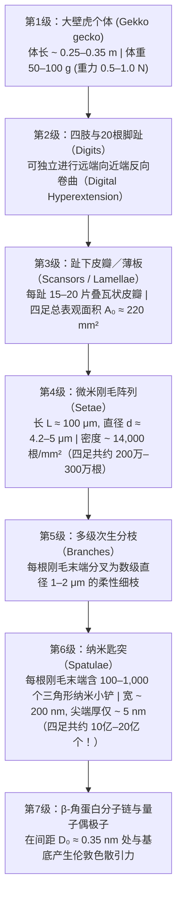
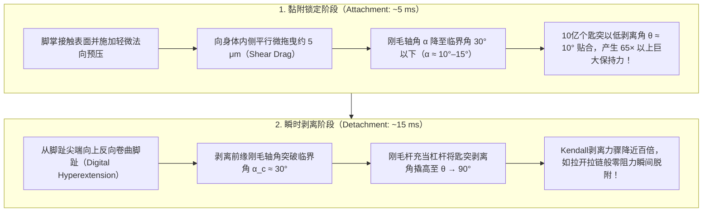

## 1. 引言：亚里士多德的惊叹与困扰科学界2300年的生物力学之谜

公元前4世纪，古希腊哲学家亚里士多德（Aristotle, 384–322 BCE）在其巨著《动物志》（*Historia Animalium*，第9卷第9章）中记载了地中海沿岸常见的一种小型爬行动物——壁虎（古希腊语 *Askalaros* 或 *Ascalabotes*）不可思议的攀爬能力：

> “壁虎可以沿着树干向任何方向奔跑，<strong>甚至头朝下倒立着也能自如地上下疾驰</strong>。”
> ——亚里士多德《动物志》（约公元前350年）

两千三百多年后，这一看似违背重力的现象依然是生物物理学、接触力学与纳米仿生工程中最具传奇色彩的研究课题。以分布于东南亚与中国南方的<strong>大壁虎（Tokay gecko，学名：*Gekko gecko*）</strong>为例，成年个体体长可达 $25\text{–}35\,\text{cm}$，体重达 $50\text{–}100\,\text{g}$（最大个体甚至接近 $300\,\text{g}$）。尽管在攀爬动物中属于庞然大物，大壁虎却能以超过 $1\,\text{m/s}$ 的速度沿着原子级平滑的垂直石英玻璃壁面疾驰，甚至倒挂在倾角 $180^\circ$ 的玻璃天花板上。在高速奔跑时，它的四肢每秒交替迈步 $15$ 次，每次仅需 $5\,\text{ms}$ 即可锁死黏附，而在迈出下一步时，仅需<strong> $15\,\text{ms}$（$0.015$ 秒）</strong>就能以几乎为零的脱附力将脚掌从玻璃上轻松揭下。

更令人惊叹的是，壁虎走过的光学镜面或硅晶圆表面<strong>不会留下任何黏液、脂质或化学胶水的痕迹</strong>。与蚂蚁、甲虫或树蛙依靠足垫腺体分泌液体的“湿式黏附（wet adhesion）”截然不同，壁虎的脚底完全没有分泌腺，完全由疏水性的刚性 <strong>$\beta$-角蛋白（$\beta$-keratin）</strong>构成（纯干式黏附，<strong>Dry Adhesion</strong>）。如果一只大壁虎四只脚上的约 $200\text{万}$ 根刚毛同时发挥最大黏附力，理论上足以承受 <strong>$80\text{–}130\,\text{kg}$ 的拉力（超过其自身体重的 $1,000$ 倍！）</strong>。

为什么壁虎在没有胶水和吸盘的情况下能产生自身体重千倍以上的吸附力，走过布满灰尘的树皮却永不脏污，而且还能在 $15\,\text{ms}$ 内毫不费力地揭下脚掌？解开这一“强力黏附与零阻力剥离悖论”，需要跨越从宏观解剖学到量子电动力学的7个空间数量级。

---

## 2. 被决定性实验推翻的七大历史假说（Autumn et al., 2000 & 2002）

从19世纪到21世纪初，科学家们曾先后提出过<strong>七种物理学与解剖学假说</strong>。经过德国学者德利特（Wolf-Dietrich Dellit, 1934）的早期实验、鲁伊巴尔与恩斯特（Ruibal & Ernst, 1965）的电子显微镜观察，以及由<strong>凯勒·奥텀（Kellar Autumn）</strong>、<strong>罗伯特·富尔（Robert J. Full）</strong>、<strong>托马斯·肯尼（Thomas W. Kenny）</strong>、<strong>罗纳德·费어링（Ronald Fearing）</strong>和<strong>雅各布·伊斯拉埃拉什维利（Jacob N. Israelachvili）</strong>等人在2000年《Nature》与2002年《美国国家科学院院刊（PNAS）》上发表的决定性实验，前六种经典假说被彻底证伪：

1. <strong>真空吸盘假说（Suction）</strong>：Simmermacher（1884）认为壁虎趾下瓣膜（Lamellae）像微型吸盘一样靠大气压压紧。
   - <strong>实验证伪</strong>：Dellit（1934）将壁虎放入高真空腔室（$P_{\text{atm}} \to 0$），发现壁虎在真空中依然能牢牢吸附在玻璃上。此外，1个标准大气压的理论吸附极限仅为 $101.3\,\text{kPa}$，而Autumn等人（2000）实测单根刚毛的黏附应力高达 <strong>$1,000\,\text{kPa}$（$1\,\text{MPa}$，即 $10$ 个大气压！）</strong>，达到真空吸盘理论上限的10倍。
2. <strong>化学胶水或黏液分泌假说（Glue / Secretions）</strong>：Wagler（1830）假设壁虎足底分泌黏液。
   - <strong>实验证伪</strong>：组织学证实壁虎足底完全由角质化的 $\beta$-角蛋白构成，<strong>没有任何腺体组织</strong>，且具有干式自清洁能力（Hansen & Autumn, 2005）。
3. <strong>单纯库仑摩擦假说（Pure Friction）</strong>：
   - <strong>实验证伪</strong>：经典库仑摩擦 $F_f = \mu N$ 需要正的法向压力 $N > 0$，在垂直墙壁（$N = 0$）或倒挂天花板（$N = -mg < 0$）上，若无内禀法向黏附力，摩擦力必为零。
4. <strong>微观机械互锁／微钩假说（Micro-Interlocking）</strong>：Hora（1923）与Mahendra（1941）认为刚毛像微型冰爪一样钩住表面粗糙微凸体。
   - <strong>实验证伪</strong>：壁虎在原子级平整的解理白云母表面（粗糙度 $\text{RMS} < 0.1\,\text{nm}$）和超精密抛光硅晶圆上反而表现出<strong>最强的黏附力</strong>（Autumn et al., 2000）。
5. <strong>静电吸引假说（Electrostatic Attraction）</strong>：Schmidt（1904）认为是接触摩擦起电产生的库仑静电力。
   - <strong>实验证伪</strong>：Dellit（1934）用X射线和镭放射源电离空气以彻底中和表面静电荷，壁虎依然稳固吸附；在接地金属导体表面同样有效。
6. <strong>毛细管湿润水膜假说（Capillary Wet Adhesion） vs. 范德华力假说（Van der Waals Forces）</strong>：
   Stork（1980）等人认为空气湿度在刚毛尖端与基底之间形成纳米水弯月面（Meniscus），依靠拉普拉斯毛细管力 $F_{\text{cap}} = 4\pi R\gamma_L \cos\theta_c$ 产生吸附。
   - <strong>2002年《PNAS》决定性实验（Autumn et al., 2002）</strong>：为了彻底区分毛细管力与范德华力，Autumn团队对比测试了壁虎活体脚掌与单根刚毛在<strong>强疏水性半导体砷化镓（$\text{GaAs}$，水接触角 $\theta_c \approx 110^\circ$，$\cos\theta_c < 0$，无法形成吸水弯月面）</strong>与<strong>强亲水性二氧化硅玻璃（$\text{SiO}_2$，$\theta_c < 5^\circ$）</strong>上的黏附力。结果发现，由于 $\text{GaAs}$ 与 $\text{SiO}_2$ 均具有高介电极化率（高折射率 $n$），壁虎在强疏水 $\text{GaAs}$ 与强亲水 $\text{SiO}_2$ 表面产生了<strong>完全相同的最大剪切黏附应力（约 $200\,\text{kPa}$）</strong>！这无可辩驳地证明：壁虎黏附的主导机制是不依赖亲疏水性的<strong>量子力学范德华色散力（London Dispersion Force）</strong>。

| 编号 | 历史假说 | 代表学者 | 物理机制 | 决定性反证实验 |
| :--- | :--- | :--- | :--- | :--- |
| <strong>1</strong> | <strong>真空吸盘说</strong> | Simmermacher (1884) | 大气压差 $P_{\text{atm}} \approx 101\,\text{kPa}$ | <strong>高真空中（$P \to 0$）黏附力丝毫不减</strong>（Dellit 1934）；实测应力（$1\,\text{MPa}$）超大气压极限10倍。 |
| <strong>2</strong> | <strong>黏液／胶水说</strong> | Wagler (1830) | 足底分泌黏性液体 | 壁虎足底为纯 $\beta$-角蛋白，<strong>无任何分泌腺</strong>，不留残胶且具自清洁性。 |
| <strong>3</strong> | <strong>单纯摩擦说</strong> | 经典摩擦学 | 表面微毛提供高摩擦系数 $\mu$ | 库仑摩擦 $F_f = \mu N$ 在倒挂天花板（$N < 0$）时无法提供法向拉力。 |
| <strong>4</strong> | <strong>微钩机械互锁说</strong> | Hora (1923) | 微毛钩住表面微观凹凸坑 | 在<strong>原子级平滑的解理云母片（$\text{RMS} < 0.1\,\text{nm}$）</strong>上黏附力反而最强。 |
| <strong>5</strong> | <strong>接触静电引力说</strong> | Schmidt (1904) | 摩擦起电产生静电场 $\sigma_q^2/(2\varepsilon_0)$ | <strong>用X射线电离空气消除一切静电荷后壁虎仍不掉落</strong>（Dellit 1934）。 |
| <strong>6</strong> | <strong>毛细管水膜桥说</strong> | Stork (1980) | 水膜表面张力 $4\pi R\gamma_L\cos\theta_c$ | 在<strong>强疏水 $\text{GaAs}$（$\theta_c = 110^\circ$）与强亲水 $\text{SiO}_2$（$\theta_c < 5^\circ$）上黏附力完全相同（$\sim 200\,\text{kPa}$）</strong>（Autumn 2002）。 |
| <strong>7</strong> | <strong>范德华色散力说</strong> | Hiller (1968), Autumn (2000, 2002) | 量子零点瞬时偶极子涨落（伦敦色散力） | <strong>全部实验证实</strong>：正比于基底哈梅克常数 $A_H$，在真空、水下及极低温下均有效。 |

---

## 3. 大壁虎足底的7级多尺度分层结构与达尔奎斯特准则（Dahlquist Criterion）

既然范德华力普遍存在于一切原子之间，为什么人类用手掌按压玻璃却无法吸住？因为范德华力的作用距离极短（仅 $D_0 \approx 0.3\text{–}0.4\,\text{nm}$），宏观表面哪怕微米级的粗糙度也会使实际分子接触面积不足表观面积的 $0.01\%$。为此，大壁虎演化出了跨越7个数量级的分级纳米结构：

### 3.1 欧拉-伯努利斜悬臂梁力学与达尔奎斯特粘性准则（Dahlquist Criterion）

壁虎刚毛的材料是坚硬的疏水性 <strong>$\beta$-角蛋白</strong>，其本体杨氏模量高达 $E_{\text{bulk}} \approx 2.0\,\text{GPa}$（与硬塑料相当）。然而根据高分子粘合剂领域的<strong>达尔奎斯特准则（Dahlquist Criterion for Tack, 1966）</strong>，材料要想在极小预压力下自发贴合粗糙表面，其<strong>有效弹性模量必须低于 $E_{\text{eff}} \le 100\text{–}300\,\text{kPa}$</strong>。

壁虎通过将 $2\,\text{GPa}$ 的硬角蛋白加工成倾角 $\alpha_0 \approx 45^\circ$、长径比高达 $L/d \approx 100\,\mu\text{m} / 4.2\,\mu\text{m}$ 的倾斜微悬臂梁阵列（间距 $s \approx 8.5\,\mu\text{m}$，截面惯性矩 $I = \frac{\pi r^4}{4}$），使其法向弯曲刚度 $k_\perp = \frac{3 E_{\text{bulk}} I}{L^3 \sin^2\alpha_0}$ 转化为连续介质有效模量：

$$E_{\text{eff}} = \frac{k_\perp L \sin\alpha_0}{s^2} = \frac{3\pi}{4 \sin\alpha_0} E_{\text{bulk}} \left(\frac{r}{L}\right)^2 \left(\frac{r}{s}\right)^2 \approx 80\text{–}100\,\text{kPa}$$

这一精妙的几何设计将 $2\,\text{GPa}$ 的刚性材料软化了<strong>两万倍（4个数量级）</strong>，既完美满足了 $E_{\text{eff}} \le 100\,\text{kPa}$ 的达尔奎斯特粘性准则，又避免了软凝胶材料常见的自身粘连结块（Self-matting）与灰尘污染！

### 3.2 定量力学预算：从单个匙突（$10\,\text{nN}$）到全身千倍安全系数

- <strong>单个纳米匙突（Spatula）脱附力</strong>：$F_{\text{spatula}} \approx 10\,\text{nN}$（Huber et al., 2005 AFM实测）。
- <strong>单根刚毛（Seta，含 $100\text{–}1,000$ 个匙突）</strong>：常规拉力 $F_{\text{seta}} \approx 40\,\mu\text{N}$；在施加微小法向预压并平行拖曳 $5\,\mu\text{m}$ 后，单根刚毛最大剪切黏附力高达 <strong>$F_{\parallel,\text{seta, max}} = 194 \pm 25\,\mu\text{N} \approx 200\,\mu\text{N}$</strong>（Autumn et al., 2000 *Nature*）。
- <strong>四足整体理论最大负载</strong>：$2 \times 10^6\text{ 根} \times 40\,\mu\text{N} = 80\,\text{N}$（约 $8.2\,\text{kg}$）；若按全部约 $3 \times 10^6$ 根刚毛达到峰值 $200\,\mu\text{N}$ 计算，总支撑力可达 <strong>$400\text{–}1,280\,\text{N}$（约 $40\text{–}130\,\text{kg}$，超过壁虎体重的 $1,000$ 倍！）</strong>。因此，壁虎只需不到 $0.1\%\text{–}2\%$ 的刚毛接触表面即可稳稳悬挂在天花板上。

---

## 4. 范德华力、伦敦色散力与哈梅克-栗弗席兹（Hamaker-Lifshitz）理论

### 4.1 分子间范德华势的三大分量与伦敦色散力（Fritz London, 1930）

相距 $r$ 的两个中性分子间的总范德华势 $U_{\text{vdW}}(r)$ 包含取向力（Keesom）、诱导力（Debye）和色散力（London）三项：

$$U_{\text{vdW}}(r) = -\frac{C_{\text{Keesom}} + C_{\text{Debye}} + C_{\text{London}}}{r^6}, \quad C_{\text{Keesom}} = \frac{2 p_1^2 p_2^2}{3(4\pi\varepsilon_0)^2 k_B T}, \quad C_{\text{Debye}} = \frac{p_1^2\alpha_2 + p_2^2\alpha_1}{(4\pi\varepsilon_0)^2}$$

对于非极性的 $\beta$-角蛋白（永久偶极矩 $p_1 \approx 0$），前两项为零。1930年，弗里茨·伦敦（Fritz London）利用三维各向同性量子谐振子（特征电离频率 $\omega_0$，极化率 $\alpha_1, \alpha_2$）的二阶微扰理论证明：由于海森堡不确定性原理导致的<strong>基态量子零点涨落（Zero-point dipole fluctuations）</strong>，瞬时偶极子与诱导偶极子之间会产生恒为负值的吸引势：

$$U_{\text{London}}(r) = -\frac{3}{4} \frac{\hbar \omega_0 \alpha_1 \alpha_2}{(4\pi\varepsilon_0)^2 r^6}$$

### 4.2 哈梅克（Hamaker 1937）宏观体积积分与栗弗席兹（Lifshitz 1956）量子场论

将分子对势 $-C/r^6$ 对曲率半径为 $R \approx 100\,\text{nm}$ 的球形匙突尖端（数密度 $\rho_1$）与相距 $D_0 \approx 0.35\,\text{nm}$ 的半无限平面基底（数密度 $\rho_2$）进行体积积分（Hugo C. Hamaker, 1937），引入<strong>哈梅克常数 $A_H = \pi^2 C \rho_1 \rho_2 \approx 10^{-19}\,\text{J}$</strong>，可得宏观范德华引力公式：

$$F_{\text{vdW}}(D_0) = \frac{A_H R}{6 D_0^2}, \qquad P_{\text{vdW}}(D_0) = \frac{A_H}{6\pi D_0^3}$$

代入 $A_H = 10^{-19}\,\text{J}$、$R = 100\,\text{nm}$、$D_0 = 0.35\,\text{nm}$，立即算出单个匙突引力 $F_{\text{vdW}} \approx 13.6\,\text{nN}$，与AFM实验值（$10\,\text{nN}$）完美吻合！

进一步根据栗弗席兹（Evgeny Lifshitz, 1956）的宏观涨落电动力学，哈梅克常数主要由紫外特征频率 $\omega_e$ 处的介质光学折射率 $n_1, n_2$ 决定：

$$A_{132} \approx \frac{3}{4} k_B T \left(\frac{\varepsilon_1 - \varepsilon_3}{\varepsilon_1 + \varepsilon_3}\right)\left(\frac{\varepsilon_2 - \varepsilon_3}{\varepsilon_2 + \varepsilon_3}\right) + \frac{3\hbar \omega_e}{8\sqrt{2}} \frac{(n_1^2 - n_3^2)(n_2^2 - n_3^2)}{\sqrt{n_1^2 + n_3^2}\sqrt{n_2^2 + n_3^2}\left(\sqrt{n_1^2 + n_3^2} + \sqrt{n_2^2 + n_3^2}\right)}$$

这直接解释了<strong>为什么大壁虎唯独在干燥的聚四氟乙烯（PTFE / 特氟龙）表面会打滑</strong>：氟原子极强的电负性将 $\text{C–F}$ 键电子死死束缚在原子核周围，导致特氟龙具有极低的折射率（$n_2 \approx 1.35$）与极化率，使 $A_{132}$ 骤减一半以上！

---

## 5. JKR接触力学与“接触分裂原理”（Contact Splitting Principle: Arzt, Gorb, & Spolenak, 2003）

根据<strong>Johnson-Kendall-Roberts（JKR, 1971）弹性黏附接触理论</strong>，半径为 $R$、黏附功为 $W_{\text{ad}} = \Delta\gamma$ 的单个球形接触的接触半径 $a$ 满足：

$$a^3 = \frac{3 R}{4 E^*} \left( P + 3\pi W_{\text{ad}} R + \sqrt{6\pi W_{\text{ad}} R P + (3\pi W_{\text{ad}} R)^2} \right)$$

当根号内判别式为零时发生失稳脱附，最大拉脱力（Pull-off force）<strong>正比于线性半径 $R$，而非面积 $\pi R^2$</strong>：

$$F_{\text{JKR}}^{(1)} = \frac{3}{2}\pi W_{\text{ad}} R$$

2003年，Arzt、Gorb与Spolenak（*PNAS* 100:10603）证明：若将半径为 $R_0$（表观面积 $A_0 = \pi R_0^2$）的单一接触垫等面积分裂为 $N$ 个半径为 $r_N = R_0 / \sqrt{N}$ 的纳米子接触，则总拉脱力为：

$$\boxed{F_{\text{total}}(N) = N \cdot \frac{3}{2}\pi W_{\text{ad}} \left(\frac{R_0}{\sqrt{N}}\right) = \sqrt{N} \, F_{\text{JKR}}^{(1)}}$$

<strong>将足底接触分裂为 $N = 10^9$ 个纳米匙突，总黏附力将惊人地放大 $\sqrt{10^9} \approx 31,623$ 倍（超过3万倍）！</strong> 同时，由于动物体重 $m \propto L^3$ 而足底面积 $A_0 \propto L^2$，为维持 $F_{\text{total}} \propto m$，刚毛终端面积密度必须满足标度律 $\rho_A = N/A_0 \propto m^{2/3}$。因此从苍蝇（$1\,\text{mg}$）$\to$ 甲虫 $\to$ 跳蛛 $\to$ 安乐蜥 $\to$ 大壁虎（$100\,\text{g}$），体重越大的动物演化出了越精细、越密集的纳米毛端，且尺寸恰好低于高华健（Gao & Yao, 2004）推导的<strong>缺陷不敏感临界半径 $r_{\text{crit}} = \frac{8 E^* W_{\text{ad}}}{\pi \sigma_{\text{th}}^2} \approx 170\,\text{nm}$</strong>，从而达到理论分子内聚强度极限！

---

## 6. 15毫秒零阻力剥离悖论：Kendall弹性剥离方程与脚趾过伸展（Digital Hyperextension）

为什么壁虎不会被自己高达 $100\,\text{kg}$ 的黏附力粘死在墙上？1971年，<strong>凯文·肯德尔（Kevin Kendall）</strong>推导了宽 $b$、厚 $d$、杨氏模量 $E$ 的弹性薄膜以剥离角 $\theta$ 从基底剥离时的能量平衡方程：

$$\left(\frac{F_{\text{peel}}}{b}\right)^2 \frac{1}{2 d E} + \frac{F_{\text{peel}}}{b}(1 - \cos\theta) = W_{\text{ad}} \implies F_{\text{peel}}(\theta) \approx \frac{b W_{\text{ad}}}{1 - \cos\theta}$$

- <strong>黏附时（$\theta \approx 10^\circ$，轴角 $\alpha < \alpha_c \approx 30^\circ$）</strong>：$1 - \cos 10^\circ \approx 0.0152$，剥离阻力高达 $F_{\text{peel}}(10^\circ) \approx 65.8 \, b W_{\text{ad}}$，配合摩擦黏附定律 $F_{\perp,\text{pull}} \le F_\parallel \tan 30^\circ$（Autumn et al., 2006）实现强力自锁。
- <strong>脱附时（脚趾远端向近端反向卷曲，Digital Hyperextension）</strong>：脚趾向上翘起使剥离前缘的刚毛轴角突破临界角 $\alpha_c \approx 30^\circ$，匙突倾角跃升至 $\theta \approx 90^\circ$（$1 - \cos 90^\circ = 1$），剥离力瞬间暴跌近两个数量级（$F_{\text{peel}}(90^\circ) = b W_{\text{ad}}$），在 $15\,\text{ms}$ 内如撕开胶带般逐排轻松脱离！

---

## 7. 干式接触自清洁与NASA太空碎片抓捕器应用

1. <strong>干式自清洁（Hansen & Autumn, 2005 *PNAS*）</strong>：半径 $R_p \approx 2.5\,\mu\text{m}$ 的灰尘颗粒远大于单个匙突半径 $R_s \approx 100\,\text{nm}$。根据 $F_{\text{vdW}} = \frac{A_H R}{6 D_0^2}$，灰尘与平坦墙面之间的范德华引力 $F_{\text{particle-wall}} \propto R_p$ 远大于灰尘与少数几个接触匙突之间的总引力 $F_{\text{particle-setae}} \propto n R_s$。因此壁虎在脏污后仅需在干净表面走 $4\text{–}8$ 步，灰尘就会被墙面“抢走”，恢复 $80\%$ 以上的黏附力。
2. <strong>仿生工程与NASA JPL太空抓手（Parness, Jiang et al., 2017 *Science Robotics*）</strong>：从Andre Geim（2003）的微柱阵列、斯坦福大学让 $70\,\text{kg}$ 成年人攀爬玻璃幕墙的PDMS单向微楔块（Hawkes et al., 2014），到戴黎明团队（Qu et al., 2008 *Science*）强度达壁虎10倍（$100\,\text{N/cm}^2$）的碳纳米管分级阵列，再到NASA喷气推进实验室（JPL）研发的<strong>太空碎片抓捕器与国际空间站（ISS）Astrobee机器人驻留足垫</strong>——范德华干式黏附无需大气压、不释气、耐受 $-190^\circ\text{C}$ 极低温且无需法向预推力，正在开启人类太空机器人操作的新纪元。
