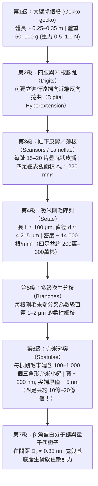
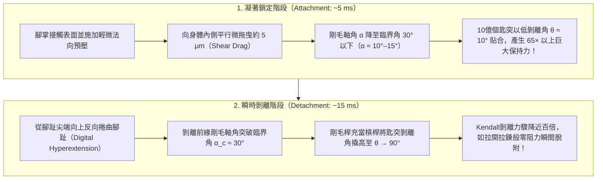

## 1. 序論：亞里斯多德的驚嘆與困擾科學界2300年的生物力學之謎

西元前4世紀，古希臘哲學家亞里斯多德（Aristotle, 384–322 BCE）在其巨著《動物誌》（*Historia Animalium*，第9卷第9章）中記載了地中海沿岸常見的一種小型爬行動物——壁虎（古希臘語 *Askalaros* 或 *Ascalabotes*）不可思議的攀爬能力：

> 「壁虎可以沿著樹幹向任何方向奔跑，<strong>甚至頭朝下倒立著也能自如地上下疾馳</strong>。」
> ——亞里斯多德《動物誌》（約西元前350年）

兩千三百多年後，這一看似違背重力的現象依然是生物物理學、接觸力學與奈米仿生工程中最具傳奇色彩的研究課題。以分佈於東南亞的<strong>大壁虎（Tokay gecko，學名：*Gekko gecko*）</strong>為例，成年個體體長可達 $25\text{–}35\,\text{cm}$，體重達 $50\text{–}100\,\text{g}$。儘管在攀爬動物中屬於龐然大物，大壁虎卻能以超過 $1\,\text{m/s}$ 的速度沿著原子級平滑的垂直石英玻璃壁面疾馳，甚至倒掛在傾角 $180^\circ$ 的玻璃天花板上。在高速奔跑時，牠的四肢每秒交替邁步 $15$ 次，每次僅需 $5\,\text{ms}$ 即可鎖死凝著，而在邁出下一步時，僅需<strong> $15\,\text{ms}$（$0.015$ 秒）</strong>就能以幾乎為零的脫附力將腳掌從玻璃上輕鬆揭下。

更令人驚嘆的是，壁虎走過的光學鏡面或矽晶圓表面<strong>不會留下任何黏液、脂質或化學膠水的痕跡</strong>。與螞蟻、甲蟲或樹蛙依靠足墊腺體分泌液體的「濕式凝著（wet adhesion）」截然不同，壁虎的腳底完全沒有分泌腺，完全由疏水性的剛性 <strong>$\beta$-角蛋白（$\beta$-keratin）</strong>構成（純乾式凝著，<strong>Dry Adhesion</strong>）。如果一隻大壁虎四隻腳上的約 $200\text{萬}$ 根剛毛同時發揮最大凝著力，理論上足以承受 <strong>$80\text{–}130\,\text{kg}$ 的拉力（超過其自身體重的 $1,000$ 倍！）</strong>。

為什麼壁虎在沒有膠水和吸盤的情況下能產生自身體重千倍以上的吸附力，走過佈滿灰塵的樹皮卻永不髒污，而且還能在 $15\,\text{ms}$ 內毫不費力地揭下腳掌？解開這一「強力凝著與零阻力剝離悖論」，需要跨越從巨觀解剖學到量子電動力學的7個空間數量級。

---

## 2. 被決定性實驗推翻的七大歷史假說（Autumn et al., 2000 & 2002）

從19世紀到21世紀初，科學家們曾先後提出過<strong>七種物理學與解剖學假說</strong>。經過德國學者德利特（Wolf-Dietrich Dellit, 1934）的早期實驗、魯伊巴爾與恩斯特（Ruibal & Ernst, 1965）的電子顯微鏡觀察，以及由<strong>凱勒·奧特姆（Kellar Autumn）</strong>、<strong>羅伯特·富爾（Robert J. Full）</strong>、<strong>湯瑪斯·肯尼（Thomas W. Kenny）</strong>、<strong>羅納德·費アリング（Ronald Fearing）</strong>和<strong>雅各布·伊斯拉埃拉什維利（Jacob N. Israelachvili）</strong>等人在2000年《Nature》與2002年《美國國家科學院院刊（PNAS）》上發表的決定性實驗，前六種經典假說被徹底證偽：

1. <strong>真空吸盤假說（Suction）</strong>：Simmermacher（1884）認為壁虎趾下皮瓣（Lamellae）像微型吸盤一樣靠大氣壓壓緊。
   - <strong>實驗證偽</strong>：Dellit（1934）將壁虎放入高真空腔室（$P_{\text{atm}} \to 0$），發現壁虎在真空中依然能牢牢吸附在玻璃上。此外，1個標準大氣壓的理論吸附極限僅為 $101.3\,\text{kPa}$，而Autumn等人（2000）實測單根剛毛的凝著應力高達 <strong>$1,000\,\text{kPa}$（$1\,\text{MPa}$，即 $10$ 個大氣壓！）</strong>，達到真空吸盤理論上限的10倍。
2. <strong>化學膠水或黏液分泌假說（Glue / Secretions）</strong>：Wagler（1830）假設壁虎足底分泌黏液。
   - <strong>實驗證偽</strong>：組織學證實壁虎足底完全由角質化的 $\beta$-角蛋白構成，<strong>沒有任何腺體組織</strong>，且具有乾式自清潔能力（Hansen & Autumn, 2005）。
3. <strong>單純庫侖摩擦假說（Pure Friction）</strong>：
   - <strong>實驗證偽</strong>：經典庫侖摩擦 $F_f = \mu N$ 需要正的法向壓力 $N > 0$，在垂直牆壁（$N = 0$）或倒掛天花板（$N = -mg < 0$）上，若無內稟法向凝著力，摩擦力必為零。
4. <strong>微觀機械互鎖／微鉤假說（Micro-Interlocking）</strong>：Hora（1923）與Mahendra（1941）認為剛毛像微型冰爪一樣鉤住表面粗糙微凸體。
   - <strong>實驗證偽</strong>：壁虎在原子級平整的解理白雲母表面（粗糙度 $\text{RMS} < 0.1\,\text{nm}$）和超精密拋光矽晶圓上反而表現出<strong>最強的凝著力</strong>（Autumn et al., 2000）。
5. <strong>靜電吸引假說（Electrostatic Attraction）</strong>：Schmidt（1904）認為是接觸摩擦起電產生的庫侖靜電力。
   - <strong>實驗證偽</strong>：Dellit（1934）用X射線和鐳放射源電離空氣以徹底中和表面靜電荷，壁虎依然穩固吸附；在接地金屬導體表面同樣有效。
6. <strong>毛細管濕潤水膜假說（Capillary Wet Adhesion） vs. 凡得瓦力假說（Van der Waals Forces）</strong>：
   Stork（1980）等人認為空氣濕度在剛毛尖端與基底之間形成奈米水彎月面（Meniscus），依靠拉普拉斯毛細管力 $F_{\text{cap}} = 4\pi R\gamma_L \cos\theta_c$ 產生吸附。
   - <strong>2002年《PNAS》決定性實驗（Autumn et al., 2002）</strong>：為了徹底區分毛細管力與凡得瓦力，Autumn團隊對比測試了壁虎活體腳掌與單根剛毛在<strong>強疏水性半導體砷化鎵（$\text{GaAs}$，水接觸角 $\theta_c \approx 110^\circ$，$\cos\theta_c < 0$，無法形成吸水彎月面）</strong>與<strong>強親水性二氧化矽玻璃（$\text{SiO}_2$，$\theta_c < 5^\circ$）</strong>上的凝著力。結果發現，由於 $\text{GaAs}$ 與 $\text{SiO}_2$ 均具有高介電極化率（高折射率 $n$），壁虎在強疏水 $\text{GaAs}$ 與強親水 $\text{SiO}_2$ 表面產生了<strong>完全相同的最大剪切凝著應力（約 $200\,\text{kPa}$）</strong>！這無可辯駁地證明：壁虎凝著的主導機制是不依賴親疏水性的<strong>量子力學凡得瓦色散力（London Dispersion Force）</strong>。

| 編號 | 歷史假說 | 代表學者 | 物理機制 | 決定性反證實驗 |
| :--- | :--- | :--- | :--- | :--- |
| <strong>1</strong> | <strong>真空吸盤說</strong> | Simmermacher (1884) | 大氣壓差 $P_{\text{atm}} \approx 101\,\text{kPa}$ | <strong>高真空中（$P \to 0$）凝著力絲毫不減</strong>（Dellit 1934）；實測應力（$1\,\text{MPa}$）超大氣壓極限10倍。 |
| <strong>2</strong> | <strong>黏液／膠水說</strong> | Wagler (1830) | 足底分泌黏性液體 | 壁虎足底為純 $\beta$-角蛋白，<strong>無任何分泌腺</strong>，不留殘膠且具自清潔性。 |
| <strong>3</strong> | <strong>單純摩擦說</strong> | 經典摩擦學 | 表面微毛提供高摩擦係數 $\mu$ | 庫侖摩擦 $F_f = \mu N$ 在倒掛天花板（$N < 0$）時無法提供法向拉力。 |
| <strong>4</strong> | <strong>微鉤機械互鎖說</strong> | Hora (1923) | 微毛鉤住表面微觀凹凸坑 | 在<strong>原子級平滑的解理雲母片（$\text{RMS} < 0.1\,\text{nm}$）</strong>上凝著力反而最強。 |
| <strong>5</strong> | <strong>接觸靜電引力說</strong> | Schmidt (1904) | 摩擦起電產生靜電場 $\sigma_q^2/(2\varepsilon_0)$ | <strong>用X射線電離空氣消除一切靜電荷後壁虎仍不掉落</strong>（Dellit 1934）。 |
| <strong>6</strong> | <strong>毛細管水膜橋說</strong> | Stork (1980) | 水膜表面張力 $4\pi R\gamma_L\cos\theta_c$ | 在<strong>強疏水 $\text{GaAs}$（$\theta_c = 110^\circ$）與強親水 $\text{SiO}_2$（$\theta_c < 5^\circ$）上凝著力完全相同（$\sim 200\,\text{kPa}$）</strong>（Autumn 2002）。 |
| <strong>7</strong> | <strong>凡得瓦色散力說</strong> | Hiller (1968), Autumn (2000, 2002) | 量子零點瞬時偶極子漲落（倫敦色散力） | <strong>全部實驗證實</strong>：正比於基底哈梅克常數 $A_H$，在真空、水下及極低溫下均有效。 |

---

## 3. 大壁虎足底的7級多尺度階層結構與達爾奎斯特準則（Dahlquist Criterion）

既然凡得瓦力普遍存在於一切原子之間，為什麼人類用手掌按壓玻璃卻無法吸住？因為凡得瓦力的作用距離極短（僅 $D_0 \approx 0.3\text{–}0.4\,\text{nm}$），巨觀表面哪怕微米級的粗糙度也會使實際分子接觸面積不足表觀面積的 $0.01\%$。為此，大壁虎演化出了跨越7個數量級的階層式奈米結構：

### 3.1 歐拉-伯努利斜懸臂樑力學與達爾奎斯特黏性準則（Dahlquist Criterion）

壁虎剛毛的材料是堅硬的疏水性 <strong>$\beta$-角蛋白</strong>，其本體楊氏模量高達 $E_{\text{bulk}} \approx 2.0\,\text{GPa}$（與硬塑膠相當）。然而根據高分子黏著劑領域的<strong>達爾奎斯特準則（Dahlquist Criterion for Tack, 1966）</strong>，材料要想在極小預壓力下自發貼合粗糙表面，其<strong>有效彈性模量必須低於 $E_{\text{eff}} \le 100\text{–}300\,\text{kPa}$</strong>。

壁虎透過將 $2\,\text{GPa}$ 的硬角蛋白加工成傾角 $\alpha_0 \approx 45^\circ$、長徑比高達 $L/d \approx 100\,\mu\text{m} / 4.2\,\mu\text{m}$ 的傾斜微懸臂樑陣列（間距 $s \approx 8.5\,\mu\text{m}$，截面慣性矩 $I = \frac{\pi r^4}{4}$），使其法向彎曲剛度 $k_\perp = \frac{3 E_{\text{bulk}} I}{L^3 \sin^2\alpha_0}$ 轉化為連續介質有效模量：

$$E_{\text{eff}} = \frac{k_\perp L \sin\alpha_0}{s^2} = \frac{3\pi}{4 \sin\alpha_0} E_{\text{bulk}} \left(\frac{r}{L}\right)^2 \left(\frac{r}{s}\right)^2 \approx 80\text{–}100\,\text{kPa}$$

這一精妙的幾何設計將 $2\,\text{GPa}$ 的剛性材料軟化了<strong>兩萬倍（4個數量級）</strong>，既完美滿足了 $E_{\text{eff}} \le 100\,\text{kPa}$ 的達爾奎斯特黏性準則，又避免了軟凝膠材料常見的自身黏連結塊（Self-matting）與灰塵污染！

### 3.2 定量力學預算：從單個匙突（$10\,\text{nN}$）到全身千倍安全係數

- <strong>單個奈米匙突（Spatula）脫附力</strong>：$F_{\text{spatula}} \approx 10\,\text{nN}$（Huber et al., 2005 AFM實測）。
- <strong>單根剛毛（Seta，含 $100\text{–}1,000$ 個匙突）</strong>：常規拉力 $F_{\text{seta}} \approx 40\,\mu\text{N}$；在施加微小法向預壓並平行拖曳 $5\,\mu\text{m}$ 後，單根剛毛最大剪切凝著力高達 <strong>$F_{\parallel,\text{seta, max}} = 194 \pm 25\,\mu\text{N} \approx 200\,\mu\text{N}$</strong>（Autumn et al., 2000 *Nature*）。
- <strong>四足整體理論最大負載</strong>：$2 \times 10^6\text{ 根} \times 40\,\mu\text{N} = 80\,\text{N}$（約 $8.2\,\text{kg}$）；若按全部約 $3 \times 10^6$ 根剛毛達到峰值 $200\,\mu\text{N}$ 計算，總支撐力可達 <strong>$400\text{–}1,280\,\text{N}$（約 $40\text{–}130\,\text{kg}$，超過壁虎體重的 $1,000$ 倍！）</strong>。因此，壁虎只需不到 $0.1\%\text{–}2\%$ 的剛毛接觸表面即可穩穩懸掛在天花板上。

---

## 4. 凡得瓦力、倫敦色散力與哈梅克-栗弗席茲（Hamaker-Lifshitz）理論

### 4.1 分子間凡得瓦勢的三大分量與倫敦色散力（Fritz London, 1930）

相距 $r$ 的兩個中性分子間的總凡得瓦勢 $U_{\text{vdW}}(r)$ 包含取向力（Keesom）、誘導力（Debye）和色散力（London）三項：

$$U_{\text{vdW}}(r) = -\frac{C_{\text{Keesom}} + C_{\text{Debye}} + C_{\text{London}}}{r^6}, \quad C_{\text{Keesom}} = \frac{2 p_1^2 p_2^2}{3(4\pi\varepsilon_0)^2 k_B T}, \quad C_{\text{Debye}} = \frac{p_1^2\alpha_2 + p_2^2\alpha_1}{(4\pi\varepsilon_0)^2}$$

對於非極性的 $\beta$-角蛋白（永久偶極矩 $p_1 \approx 0$），前兩項為零。1930年，弗里茨·倫敦（Fritz London）利用三維各向同性量子諧振子（特徵電離頻率 $\omega_0$，極化率 $\alpha_1, \alpha_2$）的二階微擾理論證明：由於海森堡不確定性原理導致的<strong>基態量子零點漲落（Zero-point dipole fluctuations）</strong>，瞬時偶極子與誘導偶極子之間會產生恆為負值的吸引勢：

$$U_{\text{London}}(r) = -\frac{3}{4} \frac{\hbar \omega_0 \alpha_1 \alpha_2}{(4\pi\varepsilon_0)^2 r^6}$$

### 4.2 哈梅克（Hamaker 1937）巨觀體積積分與栗弗席茲（Lifshitz 1956）量子場論

將分子對勢 $-C/r^6$ 對曲率半徑為 $R \approx 100\,\text{nm}$ 的球形匙突尖端（數密度 $\rho_1$）與相距 $D_0 \approx 0.35\,\text{nm}$ 的半無限平面基底（數密度 $\rho_2$）進行體積積分（Hugo C. Hamaker, 1937），引入<strong>哈梅克常數 $A_H = \pi^2 C \rho_1 \rho_2 \approx 10^{-19}\,\text{J}$</strong>，可得巨觀凡得瓦引力公式：

$$F_{\text{vdW}}(D_0) = \frac{A_H R}{6 D_0^2}, \qquad P_{\text{vdW}}(D_0) = \frac{A_H}{6\pi D_0^3}$$

代入 $A_H = 10^{-19}\,\text{J}$、$R = 100\,\text{nm}$、$D_0 = 0.35\,\text{nm}$，立即算出單個匙突引力 $F_{\text{vdW}} \approx 13.6\,\text{nN}$，與AFM實驗值（$10\,\text{nN}$）完美吻合！

進一步根據栗弗席茲（Evgeny Lifshitz, 1956）的巨觀漲落電動力學，哈梅克常數主要由紫外特徵頻率 $\omega_e$ 處的介質光學折射率 $n_1, n_2$ 決定：

$$A_{132} \approx \frac{3}{4} k_B T \left(\frac{\varepsilon_1 - \varepsilon_3}{\varepsilon_1 + \varepsilon_3}\right)\left(\frac{\varepsilon_2 - \varepsilon_3}{\varepsilon_2 + \varepsilon_3}\right) + \frac{3\hbar \omega_e}{8\sqrt{2}} \frac{(n_1^2 - n_3^2)(n_2^2 - n_3^2)}{\sqrt{n_1^2 + n_3^2}\sqrt{n_2^2 + n_3^2}\left(\sqrt{n_1^2 + n_3^2} + \sqrt{n_2^2 + n_3^2}\right)}$$

這直接解釋了<strong>為什麼大壁虎唯獨在乾燥的聚四氟乙烯（PTFE / 鐵氟龍）表面會打滑</strong>：氟原子極強的電負度將 $\text{C–F}$ 鍵電子死死束縛在原子核周圍，導致鐵氟龍具有極低的折射率（$n_2 \approx 1.35$）與極化率，使 $A_{132}$ 驟減一半以上！

---

## 5. JKR接觸力學與「接觸分割原理」（Contact Splitting Principle: Arzt, Gorb, & Spolenak, 2003）

根據<strong>Johnson-Kendall-Roberts（JKR, 1971）彈性凝著接觸理論</strong>，半徑為 $R$、凝著功為 $W_{\text{ad}} = \Delta\gamma$ 的單個球形接觸的接觸半徑 $a$ 滿足：

$$a^3 = \frac{3 R}{4 E^*} \left( P + 3\pi W_{\text{ad}} R + \sqrt{6\pi W_{\text{ad}} R P + (3\pi W_{\text{ad}} R)^2} \right)$$

當根號內判別式為零時發生失穩脫附，最大拉脫力（Pull-off force）<strong>正比於線性半徑 $R$，而非面積 $\pi R^2$</strong>：

$$F_{\text{JKR}}^{(1)} = \frac{3}{2}\pi W_{\text{ad}} R$$

2003年，Arzt、Gorb與Spolenak（*PNAS* 100:10603）證明：若將半徑為 $R_0$（表觀面積 $A_0 = \pi R_0^2$）的單一接觸墊等面積分割為 $N$ 個半徑為 $r_N = R_0 / \sqrt{N}$ 的奈米子接觸，則總拉脫力為：

$$\boxed{F_{\text{total}}(N) = N \cdot \frac{3}{2}\pi W_{\text{ad}} \left(\frac{R_0}{\sqrt{N}}\right) = \sqrt{N} \, F_{\text{JKR}}^{(1)}}$$

<strong>將足底接觸分割為 $N = 10^9$ 個奈米匙突，總凝著力將驚人地放大 $\sqrt{10^9} \approx 31,623$ 倍（超過3萬倍）！</strong> 同時，由於動物體重 $m \propto L^3$ 而足底面積 $A_0 \propto L^2$，為維持 $F_{\text{total}} \propto m$，剛毛終端面積密度必須滿足標度律 $\rho_A = N/A_0 \propto m^{2/3}$。因此從果蠅（$1\,\text{mg}$）$\to$ 甲蟲 $\to$ 跳蛛 $\to$ 安樂蜥 $\to$ 大壁虎（$100\,\text{g}$），體重越大的動物演化出了越精細、越密集的奈米毛端，且尺寸恰好低於高華健（Gao & Yao, 2004）推導的<strong>缺陷不敏感臨界半徑 $r_{\text{crit}} = \frac{8 E^* W_{\text{ad}}}{\pi \sigma_{\text{th}}^2} \approx 170\,\text{nm}$</strong>，從而達到理論分子內聚強度極限！

---

## 6. 15毫秒零阻力剝離悖論：Kendall彈性剝離方程式與腳趾過伸展（Digital Hyperextension）

為什麼壁虎不會被自己高達 $100\,\text{kg}$ 的凝著力黏死在牆上？1971年，<strong>凱文·肯德爾（Kevin Kendall）</strong>推導了寬 $b$、厚 $d$、楊氏模量 $E$ 的彈性薄膜以剝離角 $\theta$ 從基底剝離時的能量平衡方程式：

$$\left(\frac{F_{\text{peel}}}{b}\right)^2 \frac{1}{2 d E} + \frac{F_{\text{peel}}}{b}(1 - \cos\theta) = W_{\text{ad}} \implies F_{\text{peel}}(\theta) \approx \frac{b W_{\text{ad}}}{1 - \cos\theta}$$

- <strong>凝著時（$\theta \approx 10^\circ$，軸角 $\alpha < \alpha_c \approx 30^\circ$）</strong>：$1 - \cos 10^\circ \approx 0.0152$，剝離阻力高達 $F_{\text{peel}}(10^\circ) \approx 65.8 \, b W_{\text{ad}}$，配合摩擦凝著定律 $F_{\perp,\text{pull}} \le F_\parallel \tan 30^\circ$（Autumn et al., 2006）實現強力自鎖。
- <strong>脫附時（腳趾遠端向近端反向捲曲，Digital Hyperextension）</strong>：腳趾向上翹起使剝離前緣的剛毛軸角突破臨界角 $\alpha_c \approx 30^\circ$，匙突傾角躍升至 $\theta \approx 90^\circ$（$1 - \cos 90^\circ = 1$），剝離力瞬間暴跌近兩個數量級（$F_{\text{peel}}(90^\circ) = b W_{\text{ad}}$），在 $15\,\text{ms}$ 內如撕開膠帶般逐排輕鬆脫離！

---

## 7. 乾式接觸自清潔與NASA太空碎片抓捕器應用

1. <strong>乾式自清潔（Hansen & Autumn, 2005 *PNAS*）</strong>：半徑 $R_p \approx 2.5\,\mu\text{m}$ 的灰塵顆粒遠大於單個匙突半徑 $R_s \approx 100\,\text{nm}$。根據 $F_{\text{vdW}} = \frac{A_H R}{6 D_0^2}$，灰塵與平坦牆面之間的凡得瓦引力 $F_{\text{particle-wall}} \propto R_p$ 遠大於灰塵與少數幾個接觸匙突之間的總引力 $F_{\text{particle-setae}} \propto n R_s$。因此壁虎在髒污後僅需在乾淨表面走 $4\text{–}8$ 步，灰塵就會被牆面「搶走」，恢復 $80\%$ 以上的凝著力。
2. <strong>仿生工程與NASA JPL太空抓手（Parness, Jiang et al., 2017 *Science Robotics*）</strong>：從Andre Geim（2003）的微柱陣列、史丹佛大學讓 $70\,\text{kg}$ 成年人攀爬玻璃帷幕牆的PDMS單向微楔塊（Hawkes et al., 2014），到戴黎明團隊（Qu et al., 2008 *Science*）強度達壁虎10倍（$100\,\text{N/cm}^2$）的奈米碳管階層陣列，再到NASA噴射推進實驗室（JPL）研發的<strong>太空碎片抓捕器與國際太空站（ISS）Astrobee機器人駐留足墊</strong>——凡得瓦乾式凝著無需大氣壓、不釋氣、耐受 $-190^\circ\text{C}$ 極低溫且無需法向預推力，正在開啟人類太空機器人操作的新紀元。
