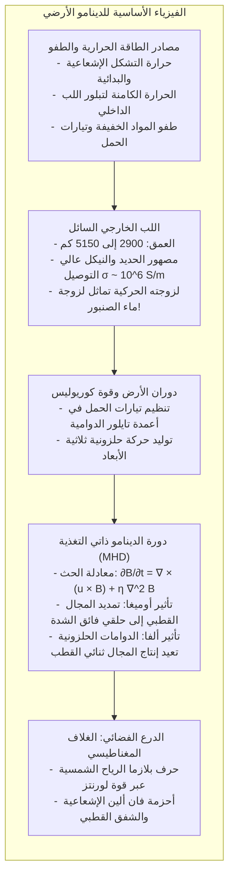
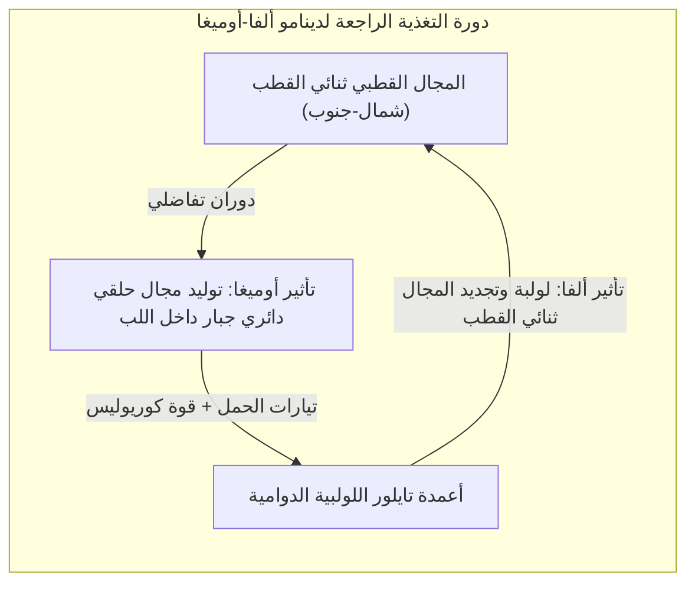

ضع بوصلة بسيطة على راحة يدك، وستجد إبرتها المغناطيسية تستقر بثبات مشيرة إلى الشمال. لقد وجه هذا المبدأ المستكشفين عبر البحار لقرون، واليوم يوجه حساسات الهواتف الذكية. إننا نسلم ببديهية أن <strong>الأرض مغناطيس عملاق</strong>.

لكن عند النظر إلى هذا الأمر من منظور فيزياء المادة المكثفة، تبرز مفارقة كبرى: <strong>كيف يمكن لباطن الأرض أن يكون ممغنطاً؟</strong>

تصور الكتب المدرسية وجود قضيب مغناطيسي دائم داخل كوكبنا. غير أن الحرارة تتصاعد بشدة مع العمق، لتصل عند حدود اللب (عمق 2900 كم) إلى <strong>4000 حتى 5000 كلفن</strong>، وهي حرارة تقارب سطح الشمس.

تخضع جميع المواد المغناطيسية الحديدية لحد حراري صارم يعرف باسم <strong>درجة حرارة كوري ($T_C$)</strong>، وتبلغ للحديد النقي <strong>770 درجة مئوية</strong> فقط. وبمجرد تجاوز هذا الحد، تدمر الطاقة الحرارية التراصف المغناطيسي للجسيمات، ويفقد المعدن مغناطيسيته تماماً ليتحول إلى مادة شبه مغناطيسية خاملة.

وبما أن الحرارة تتجاوز 1000 مئوية على عمق بضع عشرات الكيلومترات فقط، فإن <strong>أكثر من 99% من حجم الأرض شديد السخونة بحيث يستحيل وجود أي مغناطيس دائم داخله</strong>.

فكيف يتولد هذا المجال المغناطيسي منذ أكثر من 3.5 مليار سنة؟ ولماذا <strong>انعكست أقطابه مئات المرات</strong> عبر التاريخ الجيولوجي؟

---

## 1. سقوط فرضية المغناطيس الدائم: جيلبرت وحد كوري

في عام 1600، نشر الطبيب الإنجليزي <strong>ويليام جيلبرت</strong> كتابه الشهير *De Magnete*، وأثبت باستخدام كرة مغناطيسية صغيرة أن الأرض تتصرف كمغناطيس كروي.

غير أن اكتشاف <strong>بيير كوري</strong> عام 1895 أثبت زوال المغناطيسية فوق 770 مئوية. وبالتالي فإن المجال المغناطيسي للأرض ليس ناجماً عن صخور متجمدة، بل عن <strong>تيارات كهربائية هائلة تتدفق باستمرار في سائل اللب</strong>.

---

## 2. اللب الخارجي: محيط معدني لزوجته مثل الماء

أظهر علم الزلازل أن مركز الأرض ينقسم إلى:
- <strong>اللب الداخلي الصلب</strong> (5150–6371 كم): كرة متبلورة تحت ضغط ملايين الأجواء؛
- <strong>اللب الخارجي السائل</strong> (2900–5150 كم): طبقة من مصهور الحديد والنيكل بسمك 2260 كم.

وتظهر التجارب أن لزوجة هذا الحديد المصهور تبلغ $10^{-6} \, \text{m}^2/\text{s}$، <strong>أي أنها تماثل لزوجة الماء العادي تماماً</strong>. فاللب الخارجي محيط هائج شديد التوصيل للكهرباء.

---

## 3. الديناميكا المائية المغناطيسية ونظرية الدينامو

تخضع حركة السائل الموصل لـ <strong>معادلة الحث المغناطيسي</strong>:

$$\frac{\partial \mathbf{B}}{\partial t} = \nabla \times (\mathbf{u} \times \mathbf{B}) + \eta \nabla^2 \mathbf{B}$$

حيث $\eta = \frac{1}{\mu_0 \sigma}$ هي الانتشارية المغناطيسية.

ولولا حركة المائع لتلاشى المجال خلال <strong>20 ألف سنة</strong>. وبفضل رقم رينولدز المغناطيسي المرتفع ($R_m \sim 100\text{--}1000 \gg 1$)، تنطبق <strong>نظرية ألفين لتجمد خطوط المجال</strong>: تتحرك خطوط القوى المغناطيسية مع السائل وتتمدد وتلتوي مولدة مجالات أشد قوة.

---

## 4. دورة ألفا-أوميغا: دوران الأرض كمولد

تمنع مبرهنة كاولينغ حركة متناظرة محورياً من توليد دينامو مستقر. وهنا يتدخل دوران الأرض وقوة كوريوليس لتوليد تدفق لولبي:

1. <strong>تأثير أوميغا:</strong> يلتف المجال القطبي حول محور الدوران مشكلاً <strong>مجالاً حلقياً</strong> بمئات الغاوس داخل اللب.
2. <strong>تأثير ألفا:</strong> تدور التيارات الصاعدة بفعل <strong>قوة كوريوليس</strong> مشكلة دوامات حلزونية (<strong>أعمدة تايلور</strong>)، فتقوم بليّ الحلقات المغناطيسية لتجديد <strong>المجال القطبي ثنائي القطب</strong>.

---

## 5. ذاكرة الصخور: انقلاب الأقطاب والعصر الشيباني

عندما تبرد الحمم البركانية تحت نقطة كوري، تسجل المعادن اتجاه المجال المغناطيسي السائد آنذاك (<strong>المغناطيسية المتبقية حرارياً</strong>).

في عام 1929، اكتشف الجيوفيزيائي الياباني <strong>موتونوري ماتسوياما</strong> صخوراً ممغنطة بالاتجاه المعاكس تماماً، معلناً أن <strong>المجال المغناطيسي للأرض ينقلب دورياً</strong>. وسُميت الفترة العكسية (قبل 774 ألف إلى 2.58 مليون سنة) باسم <strong>حقبة ماتسوياما</strong>. وأثبتت الأشرطة المغناطيسية المتناظرة في قيعان البحار نظرية الصفائح التكتونية.

وفي عام 2020، اعتمد الاتحاد الدولي للعلوم الجيولوجية رسمياً <strong>العصر الشيباني (Chibanian)</strong> في تشيبا باليابان، حيث حُفظ أدق سجل رسوبي لآخر انقلاب كامل للمجال (حد ماتسوياما-برونهيس قبل 774 ألف عام).

---

## 6. الفوضى الحاسوبية وانقلاب المجال

في عام 1995، أجرى غلاتزماير وروبرتس محاكاة حاسوبية لدينامو الأرض لـ 300 ألف سنة، وأثبتا أن <strong>الاضطراب اللاخطي الفوضوي</strong> في اللب يؤدي تلقائياً إلى انهيار ثنائي القطب بنسبة 80%، وتحوله إلى حالة متعددة الأقطاب لعدة آلاف من السنين قبل أن يعيد ترتيب نفسه في الاتجاه المعاكس.

---

## 7. الدرع الحامي للحياة: الغلاف المغناطيسي

في الفضاء، تقوم <strong>قوة لورنتز $\mathbf{F} = q(\mathbf{v} \times \mathbf{B})$</strong> بحرف الرياح الشمسية القاتلة على بعد 65 ألف كم، بينما تحبس <strong>أحزمة فان ألين</strong> الجسيمات المشحونة، ويتولد <strong>الشفق القطبي</strong> عند القطبين.

أما في <strong>المريخ</strong> الأصغر حجماً، فقد برد اللب سريعاً وتوقف الدينامو قبل 4 مليارات سنة، فجرفت الرياح الشمسية غلافه الجوي ومياهه ليتحول إلى صحراء قاحلة.

إن المحيط المعدني المنصهر الهادر في أعماق الأرض هو الحارس الخفي الذي يصون الحياة على كوكبنا.
