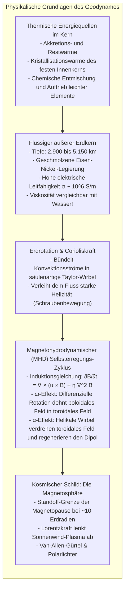
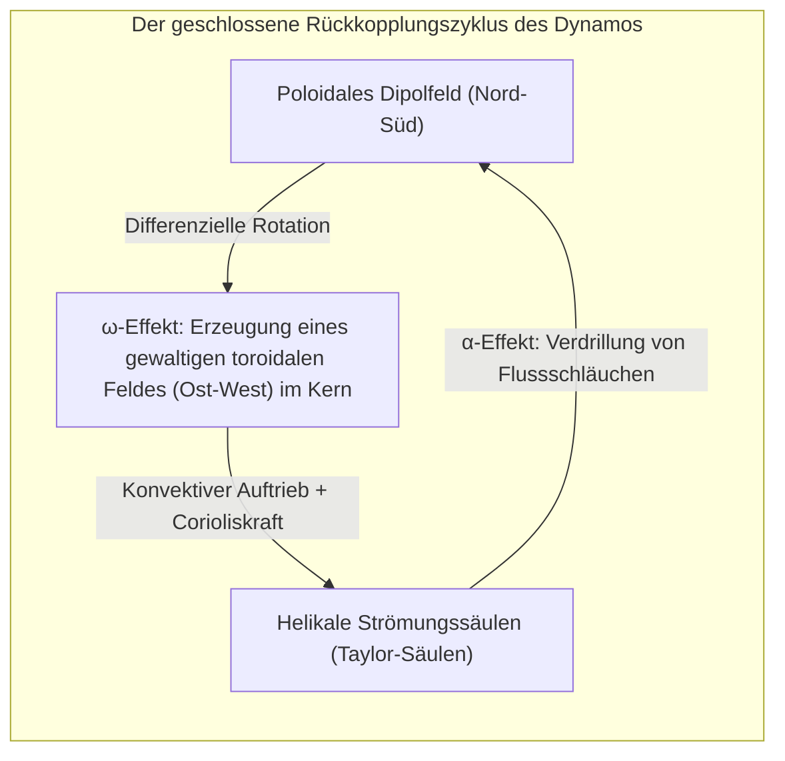

Legen Sie einen gewöhnlichen Kompass auf Ihre flache Hand, so richtet sich die feine Nadel nach kurzem Pendeln ruhig und präzise nach Norden aus. Dieses Phänomen hat über Jahrhunderte Seefahrer über die Weltmeere geleitet und bildet bis heute das Fundament moderner Orientierungssysteme. Wir betrachten es als selbstverständlich: <strong>Die Erde ist ein gigantischer Magnet.</strong>

Doch betrachtet man diesen Umstand aus der Perspektive der Festkörperphysik, stößt man auf ein tiefes Paradoxon: <strong>Warum ist das Erdinnere überhaupt magnetisch?</strong>

In Schulbüchern findet sich oft die schematische Zeichnung eines riesigen Stabmagneten im Zentrum der Erde. Doch mit zunehmender Tiefe steigt die Temperatur drastisch an. An der Kern-Mantel-Grenze in 2.900 Kilometern Tiefe herrschen <strong>4.000 bis 5.000 Kelvin</strong> – Temperaturen, die denen der Sonnenoberfläche gleichen.

Alle ferromagnetischen Stoffe (wie Eisen, Nickel oder Kobalt) besitzen eine fundamentale thermische Obergrenze: die <strong>Curie-Temperatur ($T_C$)</strong>. Für reines Eisen liegt dieser Wert bei lediglich <strong>770 °C</strong>. Oberhalb dieser Schwelle zerstört die thermische Bewegung die parallele Ausrichtung der Elektronenspins vollständig; der Ferromagnetismus bricht schlagartig zusammen und geht in gewöhnlichen Paramagnetismus über. 

Da bereits in wenigen Dutzend Kilometern Tiefe Temperaturen von über 1.000 °C herrschen, <strong>ist mehr als 99 % des Erdvolumens viel zu heiß, um als Dauermagnet zu existieren</strong>.

Wie kann ein Planet ohne Dauermagneten seit über 3,5 Milliarden Jahren ein stabiles globales Magnetfeld aufrechterhalten? Und warum hat sich dieses Feld im Laufe der Erdgeschichte hunderte Male <strong>vollständig umgepolt</strong>?

---

## 1. Das Ende des Dauermagneten: Gilbert und die Curie-Schwelle

Die wissenschaftliche Erforschung des Erdmagnetismus begann im Jahr 1600 mit dem Werk *De Magnete* des englischen Arztes <strong>William Gilbert</strong>. Anhand eines kugelförmigen Magnetit-Modells („Terrella“) bewies Gilbert, dass die Erde selbst wie ein riesiger magnetischer Himmelskörper wirkt.

Gilbert nahm jedoch an, das Erdinnere bestehe aus massivem, kaltem Magneteisenstein. 1895 widerlegte der französische Physiker <strong>Pierre Curie</strong> diese statische Vorstellung: Oberhalb der Curie-Temperatur $T_C$ (770 °C bei Eisen) bricht die spontane Magnetisierung zusammen. Da das Erdinnere flüssig und tausende Grad heiß ist, kann das Erdmagnetfeld nicht statisch sein, sondern muss durch <strong>permanente, gewaltige elektrische Ströme</strong> im Erdkern erzeugt werden.

---

## 2. Der flüssige Erdkern: Ein Ozean aus geschmolzenem Eisen

Seismologische Forschungen zeigen den Aufbau der Erde:
- <strong>Fester Innenkern</strong> (5.150 bis 6.371 km): Eine durch enormen Druck kristallisierte Eisenkugel.
- <strong>Flüssiger Außenkern</strong> (2.900 bis 5.150 km): Eine 2.260 km dicke Schicht aus geschmolzenem Eisen und Nickel.

Unter Drücken von bis zu 3,3 Millionen Atmosphären ist das flüssige Eisen keineswegs zähflüssig. Moderne Experimente belegen, dass seine kinematische Viskosität bei etwa $10^{-6} \, \text{m}^2/\text{s}$ liegt – <strong>es fließt so leicht wie gewöhnliches Leitungswasser</strong>. Der äußere Kern ist ein riesiger, elektrisch hochgradig leitfähiger Ozean aus flüssigem Metall.

---

## 3. Magnetohydrodynamik und die Dynamotheorie

Bewegt sich eine leitfähige Flüssigkeit in einem Magnetfeld, greifen Hydrodynamik und Elektrodynamik ineinander: der <strong>Geodynamo</strong> entsteht. Die zeitliche Entwicklung des Magnetfeldes gehorcht der <strong>Induktionsgleichung</strong>:

$$\frac{\partial \mathbf{B}}{\partial t} = \nabla \times (\mathbf{u} \times \mathbf{B}) + \eta \nabla^2 \mathbf{B}$$

mit der magnetischen Diffusivität $\eta = \frac{1}{\mu_0 \sigma}$.

Ohne Strömung ($\mathbf{u} = 0$) würde das Erdmagnetfeld durch Ohmsche Verluste in nur <strong>20.000 Jahren</strong> vollständig abklingen. Dass es seit Milliarden Jahren existiert, liegt an der hohen magnetischen Reynolds-Zahl:

$$R_m = \frac{U L}{\eta} \sim 100 \text{ bis } 1000 \gg 1$$

Nach <strong>Alfvéns Theorem der eingefrorenen Feldlinien</strong> sind die magnetischen Feldlinien fest an die Flüssigkeit gekoppelt. Strömungen dehnen und verdrehen die Feldlinien und verstärken das Magnetfeld kontinuierlich.

---

## 4. Der $\alpha$-$\omega$-Zyklus: Die Rolle der Erdrotation

Nach Cowlings Theorem kann kein rein achsensymmetrisches Feld aufrechterhalten werden. Die Dynamowirkung verlangt dreidimensionale, helikale Wirbel:

1. <strong>$\omega$-Effekt:</strong> Scherräume der differenziellen Rotation im Erdkern wickeln das nord-südliche poloidale Feld um die Drehachse auf und erzeugen ein hunderte Gauß starkes <strong>toroidales Feld</strong> im Kerninneren.
2. <strong>$\alpha$-Effekt:</strong> Aufsteigende heiße Metallströme werden durch die <strong>Corioliskraft</strong> der Erdrotation korkenzieherartig verdrillt (Taylor-Säulen). Diese helikalen Wirbel heben und verdrehen toroidale Feldlinien um 90 Grad und regenerieren so das makroskopische <strong>poloidale Dipolfeld</strong>.

---

## 5. Das Geheimnis der Steine: Umpolung und das Chibanium

Kühlt Magma unter die Curie-Temperatur ab, frieren magnetische Minerale die Richtung des damaligen Erdmagnetfeldes dauerhaft ein (<strong>thermoremanente Magnetisierung</strong>).

1929 stellte der japanische Geophysiker <strong>Motonori Matsuyama</strong> fest, dass ältere Basaltschichten genau umgekehrt zur heutigen Richtung magnetisiert sind, und postulierte kühn die <strong>Umpolung des Erdmagnetfeldes</strong>. Die Epoche vor 774.000 bis 2,58 Millionen Jahren heißt heute <strong>Matsuyama-Epoche</strong>. Das symmetrische Muster magnetischer Streifen auf dem Meeresboden bewies in den 1960er Jahren die Plattentektonik.

2020 ratifizierte die IUGS das <strong>Chibanium (Chiba-Zeitalter)</strong>: Ein Sedimentprofil in Chiba (Japan) dokumentiert die letzte Umpolung (Matuyama-Brunhes-Grenze vor 774.000 Jahren) mit unübertroffener zeitlicher Auflösung.

---

## 6. Chaos im Erdkern: Computersimulationen der Umpolung

1995 simulierten Gary Glatzmaier und Paul Roberts den Geodynamo auf Supercomputern über 300.000 Jahre hinweg. Das Ergebnis: Ohne äußere Einwirkung bricht das Dipolfeld durch <strong>nichtlineare chaotische Fluktuationen</strong> im flüssigen Kern spontan um 80 bis 90 % ein, zerfällt in chaotische Multipole und organisiert sich innerhalb weniger Jahrtausende mit umgekehrter Polarität neu. Umpolungen sind eine natürliche Eigenschaft turbulenter Dynamos.

---

## 7. Der kosmische Schutzschild: Warum die Erde lebt und der Mars starb

Das Erdmagnetfeld wölbt sich zehntausende Kilometer weit in den Weltraum und bildet die <strong>Magnetosphäre</strong>. Durch die <strong>Lorentzkraft $\mathbf{F} = q(\mathbf{v} \times \mathbf{B})$</strong> werden die tödlichen, hochenergetischen Ionen des Überschall-Sonnenwinds abgelenkt. Eingefangene Teilchen bilden die <strong>Van-Allen-Strahlungsgürtel</strong> und erzeugen in den Polregionen das magische Leuchten der <strong>Polarlichter</strong>.

Auf dem kleineren Nachbarplaneten <strong>Mars</strong> erlosch der Kern-Dynamo vor vier Milliarden Jahren durch rasche Abkühlung. Ohne Magnetschild riss der Sonnenwind fast die gesamte Atmosphäre und das Wasser des Planeten ins All und verwandelte ihn in eine eiskalte Wüste.

Das flüssige Eisenmeer tief unter unseren Füßen ist somit der unsichtbare Lebensretter unseres Planeten.
