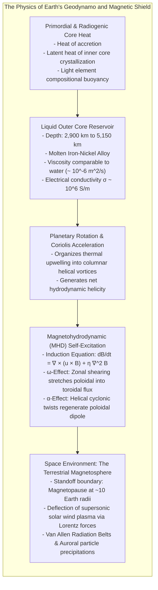
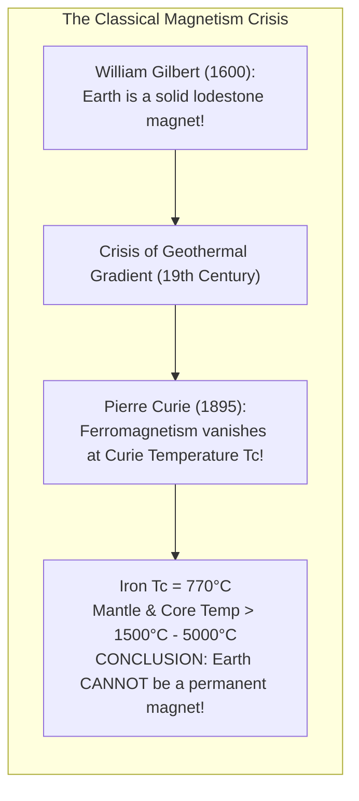
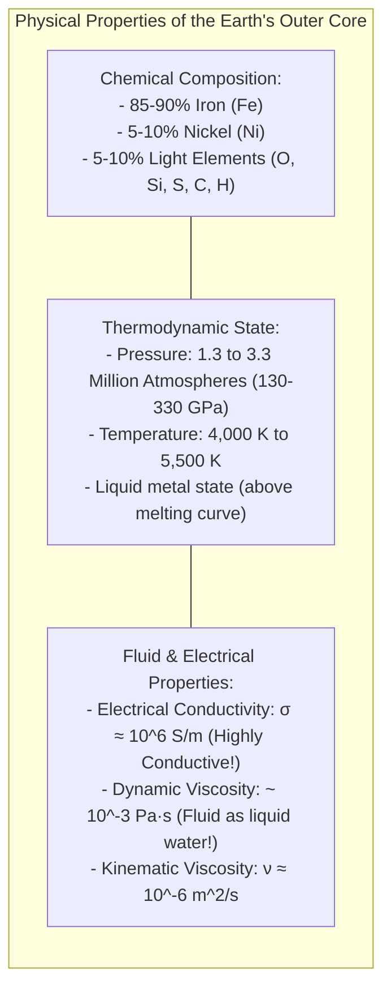
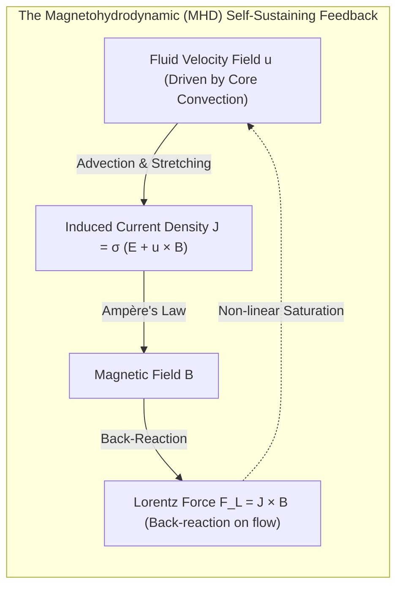
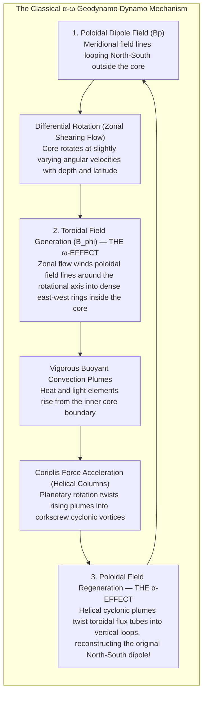
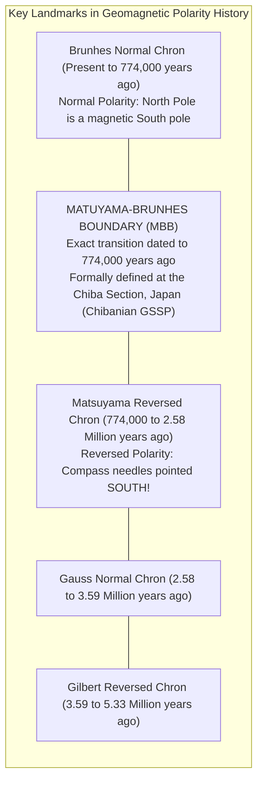
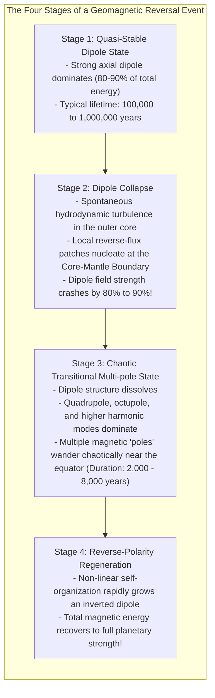
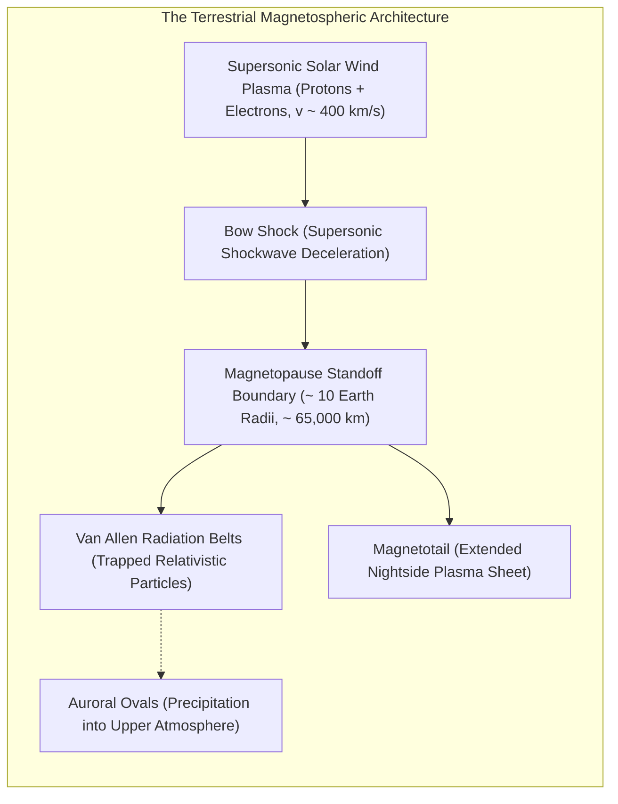
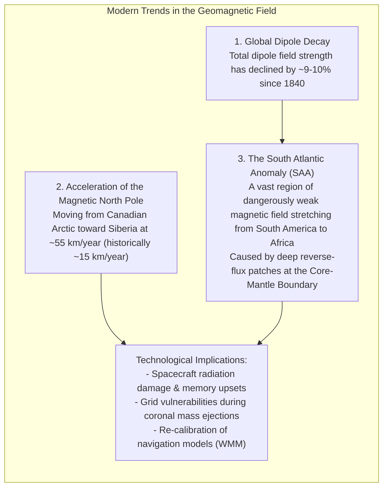

Hold a compass in the palm of your hand, and its slender magnetized needle will pivot smoothly until it points unwaveringly toward the northern horizon. For over a millennium, this simple instrument guided Polynesian navigators across the open Pacific, steered the wooden caravels of the Age of Exploration across perilous oceans, and today enables the digital sensors within modern smartphones to orient interactive maps in the heart of dense metropolitan canyons.

Yet beneath this everyday familiarity lies a profound physical paradox: <strong>Why is the Earth a magnet at all?</strong>

Every introductory school textbook offers the comforting analogy of a giant bar magnet embedded deep within the planet's interior, with its south magnetic pole tilted near the geographic north pole. However, as an explanation of reality, this picture is physically impossible. As one descends beneath the Earth's continental crust, temperature increases rapidly along the geothermal gradient. At the boundary of the Earth's core, nearly 2,900 kilometers below our feet, temperatures exceed <strong>4,000 to 5,000 Kelvin</strong>—comparable to the blistering surface of the Sun.

In classical condensed matter physics, all known ferromagnetic materials—iron, nickel, cobalt, and lodestone—possess a fundamental physical ceiling known as the <strong>Curie temperature</strong> (approximately $770^\circ\text{C}$ for pure iron). Above this threshold, intense thermal agitation violently scrambles the quantum exchange alignment of atomic magnetic moments, obliterating ferromagnetism and transforming the material into a non-magnetic paramagnetic state. 

Therefore, there is not a single kilogram of solid permanent magnet inside the Earth's core. 

How can a planetary sphere devoid of permanent magnets sustain an immense, self-generating magnetic field across billions of years? And why has this field repeatedly collapsed, dissolved into chaotic multipoles, and <strong>completely flipped its north and south magnetic poles</strong> throughout geological history—most recently recorded in the sediments of the Chibanian GSSP in Japan?

This comprehensive treatise delves into the mathematical, fluid-mechanical, and astrophysical foundations of <strong>Geodynamo Theory</strong> (the self-excited magnetic engine of rotating conductive fluids), exploring how turbulence in a molten sea of iron thousands of kilometers beneath our feet forms the invisible shield that preserves the oceans, atmosphere, and biosphere of our world.



---

## 1. The Death of the Permanent Magnet: Gilbert, Curie, and the Geothermal Paradox

The scientific study of geomagnetism began in 1600 with the publication of the seminal treatise <strong>*De Magnete, Magneticisque Corporibus, et de Magno Magnete Tellure</strong>* (*On the Magnet and Magnetic Bodies, and on That Great Magnet the Earth*) by <strong>William Gilbert</strong>, physician to Queen Elizabeth I of England.

### Gilbert’s Terrella
Rejecting ancient superstitions that compasses were drawn toward the North Star or magnetic islands in polar seas, Gilbert crafted a sphere from natural lodestone (magnetite, $\text{Fe}_3\text{O}_4$), which he termed a <strong>terrella</strong> ("little Earth"). 

By tracing the dip and azimuth of tiny magnetic needles across the surface of the terrella, Gilbert demonstrated that the orientation of the needle varied with latitude in exact correspondence with navigational observations on Earth. Gilbert made the revolutionary deductive leap: <strong>the Earth itself is a gigantic spherical magnet</strong>.



### Pierre Curie and the Quantum Breakdown of Ferromagnetism
Gilbert assumed that the Earth's interior was solid, cold, and composed of lodestone. Three centuries later, this static hypothesis collapsed under the scrutiny of thermodynamics and atomic physics.

In 1895, French physicist <strong>Pierre Curie</strong> published his systematic experimental studies on the magnetic properties of substances at elevated temperatures. In ferromagnetic materials, quantum mechanical exchange interactions favor the parallel alignment of unpaired electron spins in neighboring atoms, forming macroscopic <strong>magnetic domains</strong>.

However, thermal energy ($k_B T$) acts as an entropic disruptor. As temperature rises toward a critical material threshold known as the <strong>Curie temperature ($T_C$)</strong>, thermal kinetic fluctuations overcome the quantum exchange coupling. At $T = T_C$, the material undergoes a second-order phase transition: the spontaneous net magnetization drops discontinuously to zero, and the material becomes purely <strong>paramagnetic</strong>.

```
   Curie Temperatures of Common Ferromagnetic Substances:
   - Pure Metallic Iron (Fe)    : 770 °C  (1,043 K)
   - Metallic Cobalt (Co)       : 1,115 °C (1,388 K)
   - Metallic Nickel (Ni)       : 358 °C  (631 K)
   - Magnetite (Fe3O4)          : 580 °C  (853 K)
   - Hematite (Fe2O3)           : 675 °C  (948 K)
```

Direct borehole measurements and seismological thermal modeling reveal that the Earth’s temperature increases at a rate of roughly $20\text{ to }30 \, \text{K/km}$ in the upper crust. At depths of merely <strong>30 to 50 kilometers</strong>, temperatures exceed $800^\circ\text{C}$ to $1,000^\circ\text{C}$, completely surpassing the Curie point of all known magnetic minerals. 

Except for a microscopically thin crustal rind—which accounts for less than 1% of the observed geomagnetic field—<strong>more than 99% of the Earth's volume is far too hot to possess permanent magnetization</strong>.

If the Earth is not a permanent magnet, the magnetic field must be actively generated by <strong>dynamic electrical currents</strong>.

---

## 2. Anatomy of the Earth's Core: A Molten Metal Ocean

To generate currents on a global scale, a planet requires an immense reservoir of an electrically conductive fluid. Seismology and high-pressure mineral physics reveal the internal stratification of our planet:

```
   Earth's Deep Radial Profile:
   0 km   - 35 km    : Silicate Crust
   35 km  - 2,891 km : Solid Silicate Mantle (Viscous Convection on 100-Myr timescales)
   ------------------- Core-Mantle Boundary (CMB / D'' Layer) -------------------
   2,891 km - 5,150 km: LIQUID OUTER CORE (Molten Fe-Ni Alloy + Light Elements)
   ------------------- Inner Core Boundary (ICB) -------------------
   5,150 km - 6,371 km: SOLID INNER CORE (Crystalline Fe-Ni Alloy)
```



### The Fluidity of the Outer Core
Discovered by seismologist Inge Lehmann in 1936, the boundary between the liquid outer core and the solid inner core represents a fundamental phase transition. In the outer core, between depths of 2,891 km and 5,150 km, pressures span from 1.3 to 3.3 million atmospheres (130 to 330 GPa), yet the temperature exceeds the liquidus melting point of iron.

Remarkably, despite harboring pressures that crush atomic lattices, the <strong>outer core is not a sluggish, viscous magma</strong>. Theoretical ab initio molecular dynamics calculations and shock-compression laser experiments demonstrate that the kinematic viscosity of molten iron at core pressures is approximately:

$$\nu_{\text{core}} \approx 10^{-6} \, \text{m}^2/\text{s}$$

This is essentially <strong>identical to the viscosity of room-temperature liquid tap water</strong>. 

The outer core is a turbulent, low-viscosity, roaring subterranean ocean of liquid metal, 2,260 kilometers thick, wrapping around a crystalline inner core roughly the size of the Moon, and churning under the twin forces of heat dissipation and planetary rotation.

---

## 3. Mathematical Foundations of Dynamo Theory: Magnetohydrodynamics (MHD)

How does a flowing liquid metal produce a sustained magnetic field? The answer lies in <strong>Magnetohydrodynamics (MHD)</strong>—the field of physics governing the mutual interaction between magnetic fields and electrically conducting fluids.

The pioneer of dynamo theory, Irish physicist <strong>Sir Joseph Larmor (1919)</strong>, suggested that solar and terrestrial magnetic fields might be sustained by fluid motions acting like a self-exciting electrical generator. This concept was rigorously transformed into a modern mathematical discipline by <strong>Walter Elsasser (1946)</strong> and <strong>Sir Edward Bullard (1954)</strong>.



### Derivation of the Magnetic Induction Equation
The temporal evolution of the magnetic field in a moving conductor is derived by combining Maxwell’s equations with Ohm’s law for moving media.

Let $\mathbf{u}$ denote fluid velocity, $\mathbf{B}$ magnetic flux density, $\mathbf{E}$ electric field, $\mathbf{J}$ electric current density, $\sigma$ electrical conductivity, and $\mu_0$ magnetic permeability of free space.

In a non-relativistic conducting fluid ($u \ll c$), the generalized Ohm’s law is:

$$\mathbf{J} = \sigma \left( \mathbf{E} + \mathbf{u} \times \mathbf{B} \right)$$

Faraday’s law of induction states:

$$\frac{\partial \mathbf{B}}{\partial t} = -\nabla \times \mathbf{E}$$

From Ampère’s law, neglecting Maxwell’s displacement current $\epsilon_0 \frac{\partial \mathbf{E}}{\partial t}$ (which is negligible for non-relativistic fluid velocities):

$$\nabla \times \mathbf{B} = \mu_0 \mathbf{J} \implies \mathbf{J} = \frac{1}{\mu_0} \nabla \times \mathbf{B}$$

Rearranging Ohm’s law for the electric field $\mathbf{E}$:

$$\mathbf{E} = \frac{\mathbf{J}}{\sigma} - \mathbf{u} \times \mathbf{B} = \frac{1}{\mu_0 \sigma} \nabla \times \mathbf{B} - \mathbf{u} \times \mathbf{B}$$

Taking the curl of both sides:

$$\frac{\partial \mathbf{B}}{\partial t} = -\nabla \times \left( \frac{1}{\mu_0 \sigma} \nabla \times \mathbf{B} - \mathbf{u} \times \mathbf{B} \right)$$

Defining the <strong>magnetic diffusivity</strong> $\eta \equiv \frac{1}{\mu_0 \sigma}$ (with dimensions $\text{m}^2/\text{s}$), and utilizing the vector calculus identity $\nabla \times (\nabla \times \mathbf{B}) = \nabla (\nabla \cdot \mathbf{B}) - \nabla^2 \mathbf{B} = -\nabla^2 \mathbf{B}$ (since $\nabla \cdot \mathbf{B} = 0$):

$$\frac{\partial \mathbf{B}}{\partial t} = \nabla \times (\mathbf{u} \times \mathbf{B}) + \eta \nabla^2 \mathbf{B}$$

This is the <strong>Magnetic Induction Equation</strong>—the cornerstone of planetary dynamo physics.

### The Competition Between Stretching and Diffusion
The induction equation encapsulates two diametrically opposed physical tendencies:
1. <strong>The Advective Stretching Term $\nabla \times (\mathbf{u} \times \mathbf{B})$:</strong> Fluid motions capture, warp, and stretch magnetic field lines. When flow shears a field line, it stretches the flux tube; by magnetic flux conservation, as the tube narrows and elongates, the local magnetic field intensity amplifies exponentially.
2. <strong>The Ohmic Diffusion Term $\eta \nabla^2 \mathbf{B}$:</strong> Electrical resistivity causes currents to decay into Joule heat, dissipating magnetic energy into thermal entropy.

If the liquid outer core were to come to an abrupt standstill ($\mathbf{u} = 0$), the induction equation would reduce to a pure vector diffusion equation:

$$\frac{\partial \mathbf{B}}{\partial t} = \eta \nabla^2 \mathbf{B}$$

The characteristic Ohmic free-decay time $\tau_{\text{decay}}$ of a magnetic dipole in a sphere of radius $R_{\text{core}} \approx 3,480 \, \text{km}$ is:

$$\tau_{\text{decay}} = \frac{R_{\text{core}}^2}{\pi^2 \eta} \approx \frac{(3.48 \times 10^6 \, \text{m})^2}{\pi^2 \times (1.5 \, \text{m}^2/\text{s})} \approx 8 \times 10^{11} \, \text{seconds} \approx 25,000 \, \text{years}$$

Without active regeneration, <strong>the entire geomagnetic field of planet Earth would completely vanish within 25,000 years</strong>. The fact that Earth has maintained an active magnetic shield for over 3.5 billion years is definitive proof that the outer core's fluid stretching continuously overcomes Ohmic decay.

### The Magnetic Reynolds Number and Alfvén's Frozen-In Flux
The ratio of magnetic advection to magnetic diffusion is quantified by the dimensionless <strong>Magnetic Reynolds Number ($R_m$)</strong>:

$$R_m = \frac{|\nabla \times (\mathbf{u} \times \mathbf{B})|}{|\eta \nabla^2 \mathbf{B}|} \sim \frac{U L}{\eta} = \mu_0 \sigma U L$$

where $U$ is characteristic fluid flow velocity (observed via geomagnetic westward drift to be $\sim 10\text{--}40 \, \text{km/year} \approx 10^{-4} \, \text{m/s}$), and $L$ is the spatial scale of the outer core ($\sim 10^6 \, \text{m}$).

For Earth’s outer core:

$$R_m \approx \frac{(10^{-4} \, \text{m/s}) \times (10^6 \, \text{m})}{1.5 \, \text{m}^2/\text{s}} \approx 100 \text{ to } 1,000$$

Because $R_m \gg 1$, advective terms dominate over diffusion. Under this condition, <strong>Alfvén’s Frozen-In Flux Theorem</strong> (formulated by Hannes Alfvén in 1942) applies: <strong>magnetic field lines behave as if they are physical elastic threads frozen into the fluid parcel</strong>. Where the fluid flows, the magnetic field lines must follow, twisting and amplifying the magnetic field.

---

## 4. The Self-Sustaining Dynamo Cycle: The $\alpha$-$\omega$ Engine

Can any random, turbulent fluid flow sustain a planetary magnetic field? In 1934, British astrophysicist <strong>Thomas Cowling</strong> proved a devastating limitation known as <strong>Cowling's Theorem</strong>: *An axisymmetric magnetic field cannot be maintained by a steady, axisymmetric fluid dynamo.*

A simple two-dimensional circulating flow cannot generate a 3D magnetic field; any axisymmetric field lines inevitably contract and decay into nothingness. To circumvent Cowling's theorem and sustain a planetary dipole, the flow must be <strong>fully three-dimensional, non-axisymmetric, and possess hydrodynamic helicity</strong>.

This three-dimensional helical flow is provided by the interplay of two physical phenomena: <strong>The $\omega$-Effect</strong> and <strong>The $\alpha$-Effect</strong>.



### The $\omega$-Effect: Transforming Poloidal Field into Toroidal Field
The magnetic field observed at the Earth's surface is primarily a <strong>poloidal field</strong> ($B_r, B_\theta$), characterized by magnetic field lines emerging from the southern hemisphere and entering the northern hemisphere in a dipole geometry.

In the liquid outer core, differential rotation—variations in angular velocity with radius and latitude ($\partial \Omega / \partial r \neq 0$)—shears the poloidal field lines. Because the field lines are frozen into the fluid, the faster-rotating inner layers wrap the field lines around the rotational axis in an azimuthal, east-west direction.

This process is known as the <strong>$\omega$-Effect</strong>. It generates a massive <strong>toroidal magnetic field</strong> ($B_\phi$), confined entirely within the core. While invisible to magnetometers on the Earth's surface, theoretical models indicate that the toroidal field within the core is extraordinarily intense, reaching <strong>100 to 400 Gauss</strong> (hundreds of times stronger than the 0.5 Gauss dipole field measured at the surface).

### The $\alpha$-Effect: Twisting Toroidal Field Back into Poloidal Field
A toroidal field alone cannot sustain the geodynamo; if left unchecked, the poloidal field would diffuse away, and the $\omega$-effect would have nothing left to stretch.

The regeneration of the poloidal field is achieved by <strong>turbulent, helical convection</strong>, a mechanism conceptualized by Eugene Parker (1955) and formalized by Max Steenbeck, Fritz Krause, and Karl-Heinz Rädler (1966) as the <strong>$\alpha$-Effect</strong>.

As molten iron at the bottom of the outer core is heated by the cooling inner core, it becomes buoyant and rises. Simultaneously, as the solid inner core crystallizes, it rejects lighter elements (silicon, oxygen, sulfur, and carbon), generating intense <strong>compositional buoyancy</strong> that drives convective upwelling plumes.

As these plumes rise through the liquid core, the Earth's rotation exerts a ferocious <strong>Coriolis force</strong>:

$$\mathbf{F}_{\text{Coriolis}} = -2 m (\mathbf{\Omega} \times \mathbf{u})$$

In a rapidly rotating sphere, the Taylor-Proudman theorem dictates that slow, inviscid flows become two-dimensional, aligning themselves into stable, cylindrical vertical columns parallel to the rotation axis known as <strong>Taylor Columns</strong>. 

Rising plumes within these Taylor columns are forced to twist into <strong>helical, corkscrew-like cyclonic vortices</strong>. As a helical vortex lifts and twists a horizontal toroidal flux tube, it creates a small perpendicular magnetic loop oriented in the meridional (north-south) plane. 

When thousands of these small-scale loops combine coherently across the planetary volume, they reconstruct and amplify the global <strong>poloidal dipole field</strong>.

The circular feedback loop is complete:
$$\text{Poloidal Field} \xrightarrow{\omega\text{-Effect}} \text{Toroidal Field} \xrightarrow{\alpha\text{-Effect}} \text{Poloidal Field}$$

This coupled non-linear feedback loop constitutes the <strong>$\alpha$-$\omega$ dynamo</strong>. It maintains Earth's magnetic heartbeat across astronomical epochs.

---

## 5. Reading the Stones: Paleomagnetism and the Discovery of Magnetic Reversals

One of the most astonishing realizations of modern Earth science is that the geomagnetic field is not fixed in direction. Throughout geological time, <strong>the North and South magnetic poles have swapped places hundreds of times</strong>.



### The Mechanism of Rock Magnetism
When basaltic lava erupts from a volcanic rift and cools across its solidus, tiny crystals of titanium-rich magnetite ($\text{Fe}_{3-x}\text{Ti}_x\text{O}_4$) precipitate. As the rock cools through the Curie temperature ($\sim 580^\circ\text{C}$), the magnetic moments of these iron-oxide crystals freeze into strict alignment with the prevailing geomagnetic field vector (inclination and declination).

This permanent fossil imprint is known as <strong>Thermo-Remanent Magnetization (TRM)</strong>. Once the rock drops below its blocking temperature, its magnetic record remains locked in stone for hundreds of millions of years.

Similarly, in calm lacustrine or deep-ocean depositional environments, microscopic magnetic sediment grains settle like microscopic compass needles through the water column, aligning with the ambient field before becoming cemented into shale or mudstone. This is <strong>Detrital Remanent Magnetization (DRM)</strong>.

### Motonori Matsuyama’s Unheeded Prophecy (1929)
In 1906, French physicist <strong>Bernard Brunhes</strong> discovered basalt flows in the Massif Central of France magnetized in an orientation almost exactly opposite to today's geomagnetic field. 

The global significance of this phenomenon was illuminated in 1929 by Japanese geophysicist <strong>Motonori Matsuyama</strong> of Kyoto Imperial University. Matsuyama collected and analyzed hundreds of oriented basalt specimens from 36 locations across Japan, Korea, and Manchuria. He discovered that:
1. All early Pleistocene basalts exhibited <strong>reversed polarity</strong> (pointing south and upward).
2. All late Pleistocene and recent volcanic rocks exhibited <strong>normal polarity</strong> (pointing north and downward).

Matsuyama drew the daring conclusion that <strong>the Earth's magnetic field itself had reversed its polarity in the early Quaternary epoch</strong>. At the time, Western geophysicists dismissed Matsuyama's hypothesis, assuming the results were artifacts of complex mineralogical self-reversal. 

By the 1960s, the advent of precision potassium-argon ($^{40}\text{K}\text{-}^{40}\text{Ar}$) isotopic dating confirmed Matsuyama's conclusions: rocks of identical age worldwide recorded identical polarity flips. The modern normal polarity epoch was named the <strong>Brunhes Chron</strong> (0 to 774 ka), and the preceding reversed polarity epoch was immortalized as the <strong>Matsuyama Chron</strong> (774 ka to 2.58 Ma).

### The Seafloor Spreading Tape Recorder
The validation of magnetic reversals spurred the <strong>Plate Tectonics revolution</strong>. 

In 1963, British geophysicists <strong>Fred Vine</strong> and <strong>Drummond Matthews</strong>, along with Canadian geophysicist <strong>Lawrence Morley</strong>, formulated the <strong>Vine-Matthews-Morley Hypothesis</strong>:
- Along mid-ocean ridges (such as the Mid-Atlantic Ridge), upwelling mantle magma continuously creates new oceanic crust.
- As the basaltic crust cools through its Curie point, it records the prevailing magnetic polarity.
- Tectonic forces pull the oceanic plates symmetrically apart like twin conveyor belts.

As the geomagnetic field flipped repeatedly over millions of years, the ocean floor was stamped with a symmetric series of <strong>alternating magnetic stripes (magnetic anomalies)</strong> parallel to the ridge axis. The ocean floor functioned as a gigantic geological tape recorder, providing undeniable empirical proof of seafloor spreading and continental drift.

### The Chibanian Golden Spike (774,000 Years Ago)
In 2020, the International Union of Geological Sciences (IUGS) officially ratified the <strong>Chibanian Stage</strong> (Middle Pleistocene, 774,000 to 129,000 years ago). 

The global stratotype section and point (GSSP)—the symbolic "Golden Spike"—was established at the <strong>Chiba section</strong> along the Yoro River in Ichihara, Chiba Prefecture, Japan. Preserved in continuous, undisturbed deep marine sedimentary strata, the Chiba section provides the world's most temporally refined record of the <strong>Matuyama-Brunhes magnetic polarity reversal</strong>, detailing how the dipolar field collapsed, wandered, and re-emerged with inverted polarity over a span of several thousand years.

---

## 6. The Physics of Polarity Flips: Chaos Inside the Supercomputer

Why does a stable, self-exciting dynamo suddenly lose its orientation and flip? The answer was revealed through high-performance supercomputer modeling.



### The Glatzmaier-Roberts 3D Simulation (1995)
For decades, geophysicists wondered whether geomagnetic reversals required an external trigger, such as a giant meteorite impact or sudden mantle avalanche.

In 1995, American computational geophysicists <strong>Gary Glatzmaier</strong> and <strong>Paul Roberts</strong> achieved a historic milestone: the first <strong>three-dimensional, self-consistent numerical computer simulation of the geodynamo</strong>. 

Solving the coupled non-linear Navier-Stokes, energy transport, and magnetic induction equations on a massively parallel Cray supercomputer, Glatzmaier and Roberts simulated over 300,000 years of fluid time inside a rotating spherical shell.

Without any external perturbations or artificial parameter adjustments, the simulated geodynamo ran stably for tens of thousands of years, displaying a classic dipole field. Then, driven solely by the <strong>inherent, non-linear chaotic turbulence of core convection</strong>, a spontaneous reversal occurred:
1. Convective thermal fluctuations near the Core-Mantle Boundary (CMB) gave birth to localized pockets of reversed magnetic flux.
2. These reverse-flux patches migrated toward the poles, eroding the global dipole moment.
3. The dipole collapsed, leaving behind a complex, tangled <strong>multipolar magnetic field (quadrupole and octupole modes)</strong> at the surface, with compass needles pointing in erratic directions.
4. Over a transitional interval of roughly 5,000 years, the reversed polarity components coalesced, self-organizing into a brand-new, powerful, stable <strong>reversed dipole</strong>.

The simulation demonstrated that <strong>magnetic reversals are an intrinsic, unavoidable feature of chaotic magnetohydrodynamics in a turbulent fluid shell</strong>. Reversals are not cosmic accidents; they are natural phase instabilities of the planetary dynamo engine.

---

## 7. The Cosmic Shield: Magnetospheres and Planetary Habitability

Why does geomagnetism matter to living organisms? Because without the geodynamo, life on the surface of our planet would be untenable.

The Sun continuously blasts the Solar System with the <strong>Solar Wind</strong>—a supersonic stream of magnetized, high-energy plasma composed of ionized protons, alpha particles, and relativistic electrons ejected from the solar corona at velocities between <strong>$300\text{ and }800 \, \text{km/s}$</strong>.



### The Physics of Magnetospheric Deflection
When the solar wind encounters Earth's magnetic dipole, charged particles experience the <strong>Lorentz force</strong>:

$$\mathbf{F} = q (\mathbf{E} + \mathbf{v} \times \mathbf{B})$$

Because the velocity vector $\mathbf{v}$ of solar wind particles is perpendicular to Earth's dipole field lines in the equatorial plane, the particles are deflected into helical trajectories along the magnetic boundary, unable to cross magnetic flux surfaces.

1. <strong>The Bow Shock:</strong> Approximately 12 to 15 Earth radii ($R_E \approx 6,371 \, \text{km}$) upstream of Earth on the sunlit side, the supersonic solar wind collides with Earth's magnetic obstacle, creating a detached standing bow shock that decelerates the plasma to subsonic speeds.
2. <strong>The Magnetopause:</strong> The standoff boundary where the dynamic ram pressure of the solar wind ($P_{\text{ram}} = \rho v^2$) balances the compressed magnetic energy density of Earth's magnetic field ($P_{\text{mag}} = \frac{B^2}{2\mu_0}$) is called the <strong>magnetopause</strong>, located approximately <strong>$10 \, R_E$ ($\sim 65,000 \, \text{km}$)</strong> above the surface.
3. <strong>The Van Allen Radiation Belts:</strong> High-energy particles that penetrate the magnetosphere become trapped by magnetic mirroring forces, bouncing between the magnetic poles within doughnut-shaped toroidal zones discovered by James Van Allen in 1958.
4. <strong>The Aurora:</strong> Particles accelerated down magnetic field lines into the upper polar ionosphere collide with oxygen and nitrogen atoms at altitudes of 100 to 400 kilometers. The de-excitation of these atmospheric gases produces the ethereal green and crimson curtains of the <strong>Northern and Southern Lights (Aurora Borealis and Australis)</strong>.

### Mars vs. Earth: The Tragedy of a Dying Dynamo
To witness what happens when a planetary dynamo dies, one need only look across the void at <strong>Mars</strong>.

Four billion years ago, Mars was a warm, wet world cloaked in a dense carbon dioxide atmosphere, with broad river deltas, deep lake basins, and possibly a northern ocean. Remanent crustal magnetization mapped by NASA’s Mars Global Surveyor confirms that early Mars possessed a vigorous, global geodynamo.

However, Mars possesses only <strong>11% of the Earth's mass</strong>. Because smaller planetary bodies have a higher surface-area-to-volume ratio, Mars cooled far more rapidly than Earth. Within 500 million years of its formation, the Martian core crystallized or stratifying convection ceased, <strong>shutting down the Martian dynamo forever</strong>.

Stripped of its protective magnetic shield, the Martian atmosphere was exposed to the unmitigated fury of the solar wind. For billions of years, solar wind ions slammed directly into the Martian exosphere, stripping away atmospheric gases via <strong>ion pick-up, sputtering, and photochemical escape</strong>. Atmospheric pressure plummeted from over 1 bar to a barren <strong>0.006 bar (6 millibars)</strong>, water boiled away into space or froze into permafrost, and Mars degraded into the hyper-arid, radiation-blasted frozen desert we observe today.

---

## 8. Comparative Planetology: Dynamos Across the Solar System

A comparative survey of our planetary neighbors demonstrates that active dynamos are governed by precise planetary conditions:

| Celestial Body | Active Global Dipole? | Surface Magnetic Field | Energy Source & Core Physics |
| :--- | :--- | :--- | :--- |
| <strong>Mercury</strong> | <strong>Yes (Weak)</strong> | $\sim 300 \, \text{nT}$ ($0.01 \times \text{Earth}$) | Disproportionately gigantic iron core (75% of planetary radius). Maintained by a sluggish, partially solidified dynamo. |
| <strong>Venus</strong> | <strong>No</strong> | $< 5 \, \text{nT}$ (Effectively zero) | Nearly identical to Earth in size and bulk composition. However, lacks plate tectonics (stagnant lid regime prevents core cooling) and rotates backwards extraordinarily slowly ($P_{\text{rot}} = 243 \text{ days}$), quenching helical convection. |
| <strong>Earth</strong> | <strong>Yes (Vigorous)</strong> | $\sim 30,000\text{--}60,000 \, \text{nT}$ ($1.0 \times \text{Earth}$) | Vigorous thermal and compositional convection in liquid iron-nickel outer core, driven by plate-tectonic cooling and rapid rotation ($24 \text{ hours}$). |
| <strong>Mars</strong> | <strong>No (Dead)</strong> | Fossil crustal patches only | Global dynamo quenched $\sim 4.0$ billion years ago due to rapid planetary cooling. |
| <strong>Jupiter</strong> | <strong>Yes (Immense)</strong> | Up to $1,400,000 \, \text{nT}$ ($20\text{--}30 \times \text{Earth}$) | Internal pressures exceeding 4 million atmospheres compress molecular hydrogen into <strong>liquid metallic hydrogen</strong>—an ultra-conductive fluid that churns under rapid 10-hour rotation, driving the most powerful dynamo in the Solar System. |
| <strong>Ganymede</strong> | <strong>Yes (Unique)</strong> | $\sim 700 \, \text{nT}$ | The only moon in the Solar System possessing an intrinsic dipole field, driven by a convective liquid iron-sulfur core deep beneath an icy mantle. |

---

## 9. The Modern Geomagnetic Field: The South Atlantic Anomaly and the Next Flip

Today, geophysicists are monitoring rapid, unexpected changes in our modern magnetic field:



### The South Atlantic Anomaly (SAA)
Since systematic geomagnetic monitoring began in the 1830s under Carl Friedrich Gauss, <strong>Earth's dipole field has decayed by approximately 10%</strong>. 

The focal point of this decay is the <strong>South Atlantic Anomaly (SAA)</strong>, an expansive oceanic region spanning South America, the South Atlantic, and southern Africa where magnetic field strength is less than half the global average ($\sim 22,000 \, \text{nT}$). 

Because the magnetic shield is thin in this region, the inner Van Allen radiation belt dips to altitudes of merely 200 kilometers. When satellites and the International Space Station (ISS) transit through the SAA, they are bombarded by intense trapped proton fluxes, triggering single-event upsets (SEUs) in computer memory, corrupting sensor data, and occasionally blinding astronomical instruments like the Hubble Space Telescope.

Inverting surface and satellite magnetic data (from the ESA Swarm satellite constellation) down to the Core-Mantle Boundary reveals that the SAA is generated by a vast, growing <strong>reverse-flux patch</strong>—an area where magnetic flux lines from the outer core are pointed inward instead of outward.

### Are We on the Verge of a Magnetic Reversal?
Does the growth of the South Atlantic Anomaly and the acceleration of the North Magnetic Pole (racing from northern Canada toward Siberia at an unprecedented $55 \, \text{km/year}$) mean Earth is about to experience a full magnetic flip?

Statistically, the average interval between geomagnetic reversals over the last 20 million years is approximately <strong>200,000 to 300,000 years</strong>. Since the last reversal (the Matuyama-Brunhes boundary) occurred <strong>774,000 years ago</strong>, Earth is geologically overdue. 

However, paleomagnetic reconstructions show that the geomagnetic field frequently experiences "geomagnetic excursions"—temporary dips in dipole strength followed by a return to normal polarity without a full flip (such as the Laschamp Excursion 41,000 years ago). 

Even if a true reversal begins tomorrow, geodynamo models and sediment cores indicate that <strong>the transition takes between 2,000 and 8,000 years to unfold</strong>. The field will not vanish into an apocalyptic zero; rather, it will decompose into an intricate multipolar web where compass needles point in different directions depending on your continent. 

While a multipolar transition would pose significant engineering challenges for high-voltage power grids, satellite constellations, and global aviation, the geological fossil record reveals <strong>no correlation between past magnetic reversals and mass extinction events</strong>. Earth's thick, nitrogen-oxygen atmosphere (equivalent to 10 meters of water or 1 meter of lead) provides a formidable secondary radiation shield, ensuring the continuity of biological life.

---

## Conclusion: The Living Heart of a Dynamic Planet

The quiet oscillation of a compass needle is an intimate reminder of the dynamic engine operating beneath our feet.

Earth is not a cold, inert rock tumbling blindly through the freezing vacuum of space. Deep within its core, a subterranean ocean of liquid metal spins, roars, and boils in the darkness, spinning dynamic currents of electricity that reach out tens of thousands of kilometers into the cosmos.

This geodynamo is the living pulse of our world. It deflects the ionizing fury of the solar wind, protects the precious envelope of our atmosphere, guides migrating birds across trackless continents, and paints the polar night with the glowing hues of the aurora. In understanding the physics of geomagnetism, we uncover the grand, unified architecture of our planetary home—where subatomic electromagnetism and planetary thermodynamics intertwine to make life possible on Earth.
