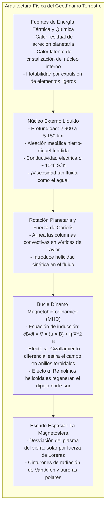
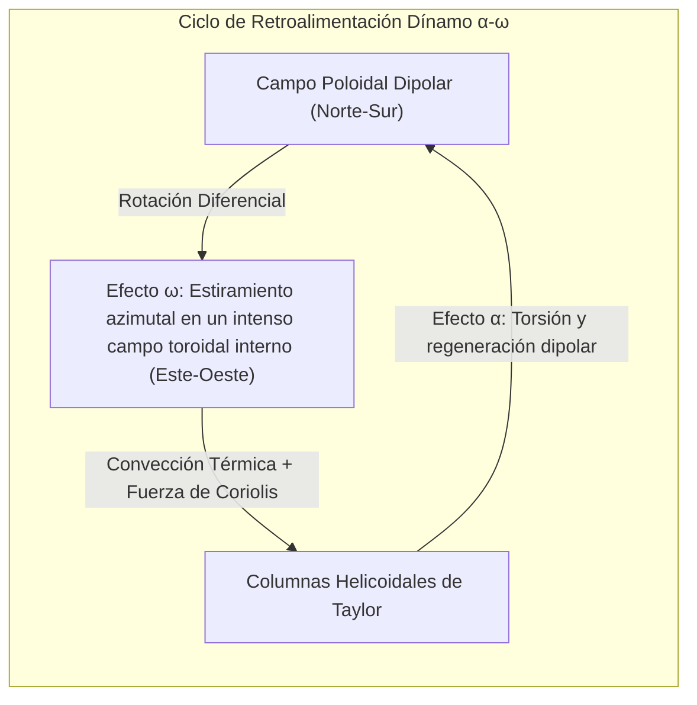

Sostenga una brújula en su mano y observe cómo la aguja imantada oscila brevemente antes de fijar su rumbo invariable hacia el norte. Esta fuerza invisible ha guiado expediciones marítimas a través de los océanos y hoy calibra la orientación espacial de nuestros teléfonos. Damos por sentado que <strong>la Tierra es un imán colosal</strong>.

Sin embargo, la física de la materia condensada plantea una contradicción irreconciliable: <strong>¿cómo puede existir magnetismo en el abrasador corazón del planeta?</strong>

A menudo se describe la Tierra como si contuviera una barra magnética sólida en su centro. No obstante, al descender hacia el interior, la temperatura asciende de forma implacable. En el límite del núcleo, a 2.900 kilómetros de profundidad, se alcanzan <strong>entre 4.000 y 5.000 Kelvin</strong>, un calor similar al de la superficie del Sol.

Todo material ferromagnético (como el hierro metálico) posee una frontera térmica inmutable: la <strong>temperatura de Curie ($T_C$)</strong>, que para el hierro es de solo <strong>770 °C</strong>. Superado este umbral, la violencia del movimiento térmico destruye la alineación paralela de los espines electrónicos, haciendo desaparecer el ferromagnetismo.

Dado que a pocas decenas de kilómetros de profundidad ya se superan los 1.000 °C, <strong>más del 99 % del volumen de la Tierra está demasiado caliente para albergar imanes permanentes</strong>.

¿Cómo genera la Tierra su magnetismo y por qué los polos se han <strong>invertido cientos de veces</strong> a lo largo de las eras geológicas?

---

## 1. La caída del imán permanente: Gilbert y la barrera de Curie

En 1600, <strong>William Gilbert</strong> publicó *De Magnete*, demostrando con una esfera de magnetita (*terrella*) que la Tierra se comporta como un imán esférico.

Pero en 1895, <strong>Pierre Curie</strong> descubrió que por encima de los 770 °C el hierro pierde su magnetismo. El geomagnetismo no proviene de rocas magnetizadas, sino de <strong>gigantescas corrientes eléctricas en movimiento en el núcleo terrestre</strong>.

---

## 2. El núcleo externo: Un océano de hierro tan fluido como el agua

La sismología moderna ha determinado la estructura interna:
- <strong>Núcleo interno sólido</strong> (5.150 a 6.371 km): Esfera metálica cristalizada por la colosal presión;
- <strong>Núcleo externo líquido</strong> (2.900 a 5.150 km): Capa fundida de 2.260 km de espesor.

A más de un millón de atmósferas, el hierro fundido posee una viscosidad de apenas $10^{-6} \, \text{m}^2/\text{s}$, <strong>prácticamente idéntica a la del agua líquida</strong>. El núcleo externo es un turbulento océano metálico ultraconductor en incesante agitación.

---

## 3. Magnetohidrodinámica y el dínamo autoexcitado

El movimiento de fluidos conductores genera el <strong>geodínamo</strong>, gobernado por la <strong>ecuación de inducción</strong>:

$$\frac{\partial \mathbf{B}}{\partial t} = \nabla \times (\mathbf{u} \times \mathbf{B}) + \eta \nabla^2 \mathbf{B}$$

donde $\eta = \frac{1}{\mu_0 \sigma}$ representa la difusividad magnética.

Sin fluidos en movimiento, el campo magnético terrestre se disiparía por resistencia eléctrica en unos <strong>20.000 años</strong>. Con un número de Reynolds magnético $R_m \sim 100 \text{ a } 1000 \gg 1$, rige el <strong>teorema de las líneas congeladas de Alfvén</strong>: las líneas de fuerza magnética viajan atrapadas por el fluido, estirándose y amplificándose continuamente.

---

## 4. El ciclo $\alpha$-$\omega$: La fuerza motriz de la rotación

El teorema de Cowling demuestra que un flujo puramente simétrico no puede mantener un dínamo. La rotación terrestre induce corrientes helicoidales tridimensionales:

1. <strong>Efecto $\omega$:</strong> La rotación diferencial enrolla las líneas poloidales norte-sur, generando un potente <strong>campo toroidal</strong> interno de cientos de gauss.
2. <strong>Efecto $\alpha$:</strong> El calor del núcleo interno genera penachos ascendentes que la <strong>fuerza de Coriolis</strong> retuerce en vórtices helicoidales (<strong>columnas de Taylor</strong>). Estos remolinos retuercen el campo toroidal en bucles verticales, reconstruyendo el <strong>campo dipolar poloidal</strong>.

---

## 5. El registro geológico: Inversiones magnéticas y el Chibaniense

Al enfriarse la lava por debajo del punto de Curie, los minerales magnéticos sellan la orientación del campo terrestre en ese momento (<strong>magnetización termorremanente</strong>).

En 1929, el geofísico japonés <strong>Motonori Matsuyama</strong> descubrió basaltos invertidos y postuló que <strong>el campo terrestre se invierte periódicamente</strong>. La época entre hace 774.000 y 2,58 millones de años se bautizó como <strong>Época de Matsuyama</strong>. El patrón de bandas magnéticas simétricas en los fondos marinos demostró la tectónica de placas.

En 2020, la IUGS ratificó el piso <strong>Chibaniense (Chibanian)</strong>: una sección en Chiba (Japón) que registra con asombrosa resolución geológica la última inversión de polaridad (límite Matuyama-Brunhes hace 774.000 años).

---

## 6. Simulaciones del caos magnético

En 1995, Glatzmaier y Roberts simularon el geodínamo en supercomputadoras. Descubrieron que las <strong>turbulencias caóticas no lineales</strong> del núcleo provocan de forma natural y espontánea el colapso del dipolo en un 80-90 %, dando paso a una fase multipolar errática antes de autoorganizarse con polaridad opuesta.

---

## 7. El escudo espacial de la vida

En el espacio, la <strong>fuerza de Lorentz $\mathbf{F} = q(\mathbf{v} \times \mathbf{B})$</strong> desvía las partículas letales del viento solar a 65.000 km de la superficie. Las partículas atrapadas forman los <strong>cinturones de Van Allen</strong> y descienden hacia los polos generando las <strong>auroras</strong>.

En <strong>Marte</strong>, de menor tamaño, el núcleo se enfrió hace 4.000 millones de años y el dínamo se apagó. Sin escudo magnético, el viento solar barrió su atmósfera y sus océanos, convirtiéndolo en un desierto estéril.

Ese océano de hierro líquido que hierve en las profundidades de la Tierra es el guardián silencioso de la vida en nuestro planeta.
