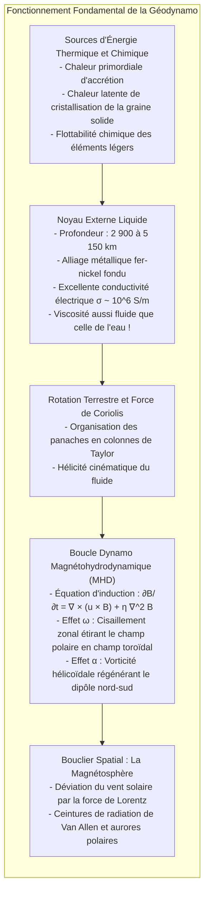
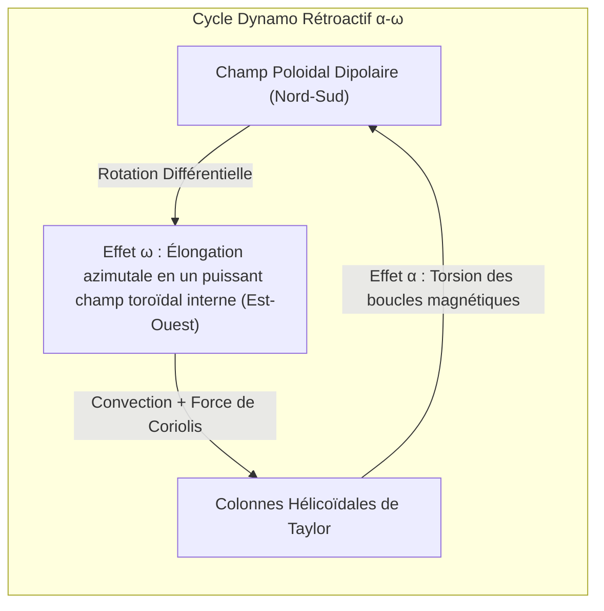

Posez une boussole au creux de votre main : après quelques oscillations, son aiguille aimantée se stabilise invariablement vers le nord. Ce phénomène universel a permis aux grands navigateurs de traverser les océans et guide encore aujourd'hui les capteurs de nos téléphones. Nous tenons pour acquis que <strong>la Terre se comporte comme un gigantesque aimant</strong>.

Pourtant, ce constat élémentaire cache un paradoxe physique fondamental : <strong>pourquoi l'intérieur de la Terre possède-t-il un champ magnétique ?</strong>

On enseigne parfois que le centre de la Terre abrite un immense barreau aimanté. Mais en s'enfonçant vers les profondeurs terrestres, la température augmente rapidement. À la frontière du noyau, à 2 900 kilomètres sous terre, elle atteint <strong>4 000 à 5 000 Kelvin</strong>, une fournaise comparable à la surface du Soleil.

En physique de la matière condensée, tous les matériaux ferromagnétiques (comme le fer pur) perdent irrémédiablement leur aimantation spontanée au-delà d'une température critique appelée <strong>point de Curie ($T_C$)</strong>, qui n'est que de <strong>770 °C</strong> pour le fer. Au-delà, l'agitation thermique désordonne totalement les spins électroniques : la matière devient purement paramagnétique.

Puisque les températures dépassent 1 000 °C dès quelques dizaines de kilomètres de profondeur, <strong>plus de 99 % du volume terrestre est bien trop chaud pour abriter le moindre aimant permanent</strong>.

Comment notre planète parvient-elle à engendrer son champ magnétique depuis 3,5 milliards d'années ? Et pourquoi les pôles magnétiques se sont-ils <strong>inversés des centaines de fois</strong> au cours des temps géologiques ?

---

## 1. La mort de l'aimant permanent : Gilbert et la limite de Curie

En 1600, le médecin de la reine Élisabeth Ire, <strong>William Gilbert</strong>, publia son chef-d'œuvre *De Magnete*. En étudiant une sphère d'aimant naturel (la *terrella*), il prouva que la Terre se comporte comme un aimant sphérique.

Toutefois, Gilbert croyait que la Terre était un bloc de roche magnétique froide. En 1895, <strong>Pierre Curie</strong> démontra qu'au-dessus de $T_C$ (770 °C pour le fer), le ferromagnétisme s'évanouit. Le géomagnétisme ne provient donc pas d'un aimant solide statique, mais de <strong>courants électriques titanesques circulant au cœur de la Terre</strong>.

---

## 2. Le noyau externe liquide : Un océan de fer aussi fluide que l'eau

La sismologie révèle que sous le manteau rigide se trouve :
- La <strong>graine solide</strong> (noyau interne, 5 150 à 6 371 km) : alliage de fer cristallisé sous pression extrême ;
- Le <strong>noyau externe liquide</strong> (2 900 à 5 150 km) : une couche de 2 260 km de fer-nickel fondu.

À plus de 1,3 million d'atmosphères, ce métal en fusion possède une viscosité cinétique d'environ $10^{-6} \, \text{m}^2/\text{s}$, <strong>identique à celle de l'eau du robinet</strong>. Le noyau externe est un océan d'électricité liquide agité de violents tourbillons.

---

## 3. Magnétohydrodynamique et auto-excitation dynamo

Le couplage entre mouvements fluides et magnétisme est décrit par <strong>l'équation d'induction</strong> :

$$\frac{\partial \mathbf{B}}{\partial t} = \nabla \times (\mathbf{u} \times \mathbf{B}) + \eta \nabla^2 \mathbf{B}$$

où $\eta = \frac{1}{\mu_0 \sigma}$ est la diffusivité magnétique.

Sans écoulement fluide ($\mathbf{u} = 0$), le champ magnétique terrestre s'éteindrait par effet Joule en <strong>20 000 ans</strong>. Mais comme le nombre de Reynolds magnétique $R_m \sim 100 \text{ à } 1000 \gg 1$, le <strong>théorème d'Alfvén du gel des lignes de champ</strong> s'applique : les lignes de force magnétiques sont transportées et étirées par le fluide, amplifiant le champ sans relâche.

---

## 4. Le cycle $\alpha$-$\omega$ : L'orchestration par la rotation terrestre

Le théorème de Cowling interdit à un écoulement purement axisymétrique de maintenir une dynamo. C'est la rotation de la Terre qui crée les mouvements hélicoïdaux nécessaires :

1. <strong>Effet $\omega$ :</strong> Les variations de vitesse de rotation dans le noyau étirent le champ polaire nord-sud pour forger un gigantesque <strong>champ toroïdal</strong> circulaire interne de plusieurs centaines de Gauss.
2. <strong>Effet $\alpha$ :</strong> Les panaches ascendants chauds subissent la <strong>force de Coriolis</strong> et forment des vortex en tire-bouchon (<strong>colonnes de Taylor</strong>). Ces tourbillons hélicoïdaux tordent le champ toroïdal à 90 degrés, régénérant le <strong>champ dipolaire polaire</strong> macroscopique.

---

## 5. La mémoire des roches : Inversions magnétiques et le Chibanien

En se refroidissant sous le point de Curie, les minéraux magnétiques de la lave figent l'orientation du champ magnétique terrestre de l'époque (<strong>aimantation thermorémanente</strong>).

En 1929, le chercheur japonais <strong>Motonori Matsuyama</strong> découvrit que les basaltes anciens étaient polarisés en sens inverse et affirma que <strong>le champ magnétique terrestre s'était totalement inversé dans le passé</strong>. La période inverse comprise entre 774 000 ans et 2,58 millions d'années porte le nom officiel d'<strong>époque de Matsuyama</strong>. Les bandes magnétiques symétriques des fonds océaniques prouvèrent par la suite la tectonique des plaques.

En 2020, l'Union internationale des sciences géologiques a ratifié le <strong>Chibanien (âge de Chiba)</strong> : une coupe géologique à Chiba (Japon) qui conserve avec une résolution exceptionnelle l'enregistrement sédimentaire de la dernière inversion (frontière Matuyama-Brunhes il y a 774 000 ans).

---

## 6. Les simulations numériques du chaos magnétique

En 1995, Gary Glatzmaier et Paul Roberts modélisèrent la géodynamo sur supercalculateur sur plus de 300 000 ans. Ils montrèrent que sous l'effet de <strong>turbulences hydrodynamiques non linéaires</strong>, le dipôle principal peut spontanément s'effondrer de 80 %, transiter par un état multipolaire complexe pendant quelques millénaires, puis s'auto-organiser dans une polarité inverse. Les inversions sont inhérentes au chaos de la géodynamo.

---

## 7. Le bouclier spatial : Pourquoi la Terre vit et Mars est morte

Dans l'espace, la <strong>force de Lorentz $\mathbf{F} = q(\mathbf{v} \times \mathbf{B})$</strong> dévie le vent solaire supersonique, créant la <strong>magnétopause</strong> à environ 65 000 km de la Terre. Les particules piégées forment les <strong>ceintures de radiation de Van Allen</strong>, et celles guidées vers les pôles illuminent le ciel des <strong>aurores polaires</strong>.

Sur <strong>Mars</strong>, plus petite, le noyau s'est refroidi rapidement et la dynamo s'est éteinte il y a 4 milliards d'années. Privée de bouclier magnétique, la planète a vu son atmosphère et ses océans balayés par le vent solaire, la transformant en désert glacé.

L'océan de fer en fusion qui tourbillonne sous nos pieds est le cœur battant qui préserve la vie sur Terre.
