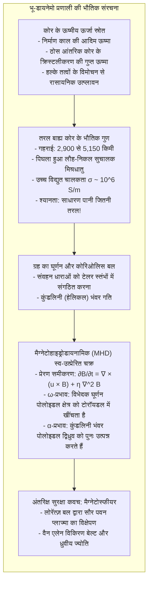
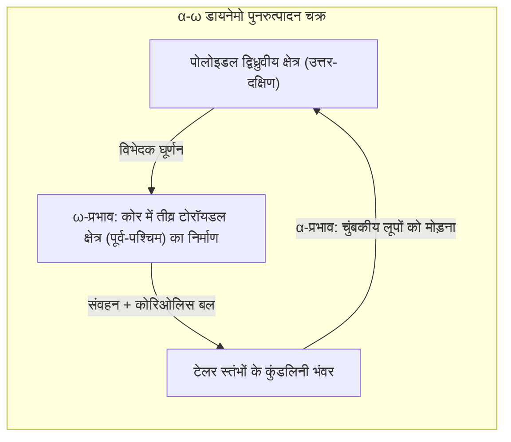

अपनी हथेली पर कंपास रखिए, और उसकी चुंबकीय सुई थोड़ा डोलने के बाद सीधे उत्तर की ओर स्थिर हो जाएगी। सदियों से इस बल ने नाविकों को समुद्र पार कराया है और आज स्मार्टफोन नेविगेशन को दिशा देता है। हम सहज रूप से मानते हैं: <strong>पृथ्वी एक विशाल चुंबक है।</strong>

किंतु संघनित पदार्थ भौतिकी के दृष्टिकोण से यह एक विरोधाभास है: <strong>पृथ्वी के अत्यधिक गर्म केंद्र में चुंबकत्व कैसे जीवित रह सकता है?</strong>

अक्सर पृथ्वी के केंद्र में एक विशाल छड़ चुंबक की कल्पना की जाती है। परंतु गहराई के साथ तापमान तेजी से बढ़ता है: 2,900 किमी गहराई पर कोर सीमा पर तापमान <strong>4,000 से 5,000 केल्विन</strong> तक पहुंच जाता है, जो सूर्य की सतह जितना गर्म है।

सभी लौह-चुंबकीय पदार्थ (जैसे लोहा) <strong>क्यूरी तापमान ($T_C$)</strong> की सीमा से बंधे होते हैं। लोहे के लिए यह तापमान मात्र <strong>770 °C</strong> है। इससे अधिक गर्म होने पर तापीय हलचल इलेक्ट्रॉनों के समानांतर संरेखण को नष्ट कर देती है और पदार्थ पूरी तरह अचुंबकीय (पैरा-मैग्नेटिक) बन जाता है।

चूंकि कुछ ही दसियों किमी गहराई पर तापमान 1,000 °C पार कर जाता है, <strong>पृथ्वी के आयतन का 99% से अधिक भाग स्थायी चुंबक होने के लिए अत्यधिक गर्म है।</strong>

फिर पृथ्वी अरबों वर्षों से अपना चुंबकीय क्षेत्र कैसे बनाए हुए है? और इतिहास में सैकड़ों बार <strong>चुंबकीय ध्रुव पूरी तरह उल्टे (उत्क्रमित)</strong> क्यों हुए हैं?

---

## 1. स्थायी चुंबक का भ्रम और क्यूरी तापमान

1600 में <strong>विलियम गिल्बर्ट</strong> ने *De Magnete* में सिद्ध किया कि पृथ्वी एक गोलाकार चुंबक है।

किंतु 1895 में <strong>पियरे क्यूरी</strong> ने पाया कि 770 °C से ऊपर लोहा अपना चुंबकत्व खो देता है। अतः भू-चुंबकत्व ठोस पत्थरों से नहीं, बल्कि <strong>पृथ्वी के तरल कोर में बहने वाली विशाल विद्युत धाराओं</strong> से उत्पन्न होता है।

---

## 2. तरल बाह्य कोर: पानी जैसा तरल पिघला लोहा

भूकंपीय तरंगों से स्पष्ट हुआ है:
- <strong>ठोस आंतरिक कोर</strong> (5,150 से 6,371 किमी): अत्यधिक दबाव में जमा हुआ ठोस लोहा;
- <strong>तरल बाह्य कोर</strong> (2,900 से 5,150 किमी): 2,260 किमी मोटी पिघले लोहे की परत।

लाखों वायुमंडलीय दबाव में पिघले लोहे की श्यानता लगभग $10^{-6} \, \text{m}^2/\text{s}$ होती है, <strong>जो सामान्य नल के पानी जितनी ही तरल है</strong>। बाह्य कोर अत्यधिक विद्युत चालक तरल धातु का एक विशाल उबलता हुआ महासागर है।

---

## 3. मैग्नेटोहाइड्रोडायनामिक्स और डायनेमो सिद्धांत

गतिशील सुचालक द्रव <strong>प्रेरण समीकरण</strong> के अनुसार कार्य करता है:

$$\frac{\partial \mathbf{B}}{\partial t} = \nabla \times (\mathbf{u} \times \mathbf{B}) + \eta \nabla^2 \mathbf{B}$$

जहाँ $\eta = \frac{1}{\mu_0 \sigma}$ चुंबकीय विसरणशीलता है।

यदि प्रवाह रुक जाए तो चुंबकीय क्षेत्र <strong>20,000 वर्षों</strong> में नष्ट हो जाएगा। चूँकि चुंबकीय रेनॉल्ड्स संख्या $R_m \gg 1$ है, <strong>अल्फवेन की फ्रोजन-इन प्रमेय</strong> लागू होती है: चुंबकीय रेखाएं द्रव के साथ खिंचकर और मुड़कर लगातार प्रवर्धित होती रहती हैं।

---

## 4. α-ω चक्र: घूर्णन और कोरिओलिस बल

काउलिंग प्रमेय के अनुसार साधारण अक्षीय प्रवाह डायनेमो नहीं चला सकता। पृथ्वी का घूर्णन त्रिविमीय कुंडलिनी प्रवाह बनाता है:

1. <strong>ω-प्रभाव:</strong> कोर का विभेदक घूर्णन उत्तर-दक्षिण रेखाओं को लपेटकर पूर्व-पश्चिम दिशा में सैकड़ों गॉस का <strong>टोरॉयडल क्षेत्र</strong> बनाता है।
2. <strong>α-प्रभाव:</strong> संवहन धाराएं <strong>कोरिओलिस बल</strong> से घूमकर कुंडलिनी भंवर (<strong>टेलर स्तंभ</strong>) बनाती हैं। ये भंवर टोरॉयडल रेखाओं को 90 डिग्री मोड़कर नए <strong>पोलोइडल द्विध्रुवीय क्षेत्र</strong> को पुनर्जीवित करते हैं।

---

## 5. पत्थरों का इतिहास: चुंबकीय उत्क्रमण और चिबानियन

लावा ठंडा होते समय क्यूरी बिंदु पर तत्कालीन चुंबकीय दिशा को दर्ज कर लेता है (<strong>ऊष्मीय अवशेषी चुंबकत्व</strong>)।

1929 में जापानी वैज्ञानिक <strong>मोतोनोरी मात्सुयामा</strong> ने प्राचीन चट्टानों में उल्टी दिशा देखकर सिद्ध किया कि <strong>पृथ्वी के चुंबकीय ध्रुव अतीत में पूरी तरह उल्टे हो चुके हैं</strong>। 7.74 लाख से 25.8 लाख वर्ष पूर्व का काल <strong>मात्सुयामा काल</strong> कहलाता है। समुद्र तल पर चुंबकीय पट्टियों ने प्लेट विवर्तनिकी को प्रमाणित किया।

2020 में जापान के चिबा प्रांत में 7.74 लाख वर्ष पूर्व हुए अंतिम उत्क्रमण के साक्ष्य मिलने पर इस भूवैज्ञानिक युग को आधिकारिक रूप से <strong>चिबानियन (Chibanian)</strong> नाम दिया गया।

---

## 6. कंप्यूटर सिमुलेशन: अराजक उत्क्रमण

1995 में सुपरकंप्यूटर पर 3 लाख वर्षों के सिमुलेशन ने सिद्ध किया कि बाह्य कोर के <strong>अरेखीय अशांत प्रवाह</strong> के कारण द्विध्रुव अचानक 80-90% तक गिर जाता है और कुछ हजार वर्षों में उल्टी दिशा में पुनः संगठित हो जाता है।

---

## 7. मैग्नेटोस्फीयर: जीवन का सुरक्षा कवच

अंतरिक्ष में <strong>लोरेंत्ज़ बल $\mathbf{F} = q(\mathbf{v} \times \mathbf{B})$</strong> तीव्र सौर पवन को 65,000 किमी दूर ही मोड़ देता है। फंसे हुए कण <strong>वैन एलेन बेल्ट</strong> बनाते हैं और ध्रुवों पर <strong>ध्रुवीय ज्योति (ऑरोरा)</strong> बिखेरते हैं।

<strong>मंगल</strong> छोटा होने के कारण ठंडा हो गया और उसका डायनेमो 4 अरब वर्ष पूर्व बंद हो गया। चुंबकीय ढाल न होने से सौर पवन ने उसका वायुमंडल और जल उड़ा दिया।

हमारे पैरों के नीचे हजारों किमी गहराई में घूमता हुआ पिघले लोहे का समुद्र ही पृथ्वी पर जीवन को सुरक्षित रखने वाला अदृश्य रक्षक है।
