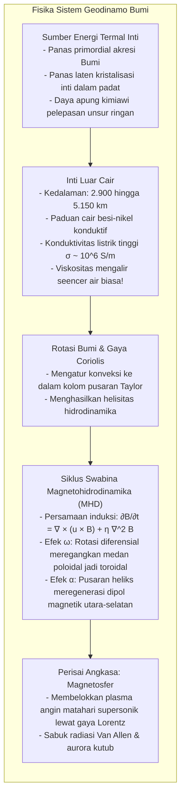

Letakkan kompas di telapak tangan Anda, dan jarum magnetnya akan berayun stabil menunjuk ke arah utara. Fenomena ini telah memandu pelayaran melintasi samudra selama berabad-abad dan kini mengorientasikan peta digital ponsel pintar kita. Kita menganggapnya wajar: <strong>Bumi adalah sebuah magnet raksasa.</strong>

Namun, ditinjau dari fisika benda terkondensasi, sebuah paradoks besar muncul: <strong>mengapa bagian dalam Bumi bisa bersifat magnetis?</strong>

Buku pelajaran sekolah kerap menggambarkan batang magnet permanen raksasa di dalam Bumi. Namun pada kenyataannya, temperatur meningkat tajam seiring kedalaman: di batas inti Bumi pada kedalaman 2.900 kilometer, suhunya mencapai <strong>4.000 hingga 5.000 Kelvin</strong>, sebanding dengan panas permukaan Matahari.

Semua material feromagnetik memiliki batas suhu mutlak yang disebut <strong>titik Curie ($T_C$)</strong>. Untuk besi murni, batas ini hanya <strong>770 °C</strong>. Di atas temperatur ini, agitasi termal menghancurkan penataan paralel spin elektron, melenyapkan feromagnetisme seketika dan mengubah logam menjadi paramagnetik biasa.

Karena suhu sudah melampaui 1.000 °C pada kedalaman puluhan kilometer saja, <strong>lebih dari 99% volume Bumi terlalu panas untuk memuat magnet permanen</strong>.

Bagaimana planet kita menghasilkan medan magnet global yang bertahan selama lebih dari 3,5 miliar tahun? Dan mengapa kutub magnet Bumi telah <strong>berbalik arah ratusan kali</strong> sepanjang sejarah geologi?

---

## 1. Runtuhnya Model Magnet Permanen: Gilbert dan Titik Curie

Kajian ilmiah geomagnetisme bermula pada tahun 1600 lewat buku *De Magnete* karya dokter Inggris <strong>William Gilbert</strong>. Melalui model bola magnetit (*terrella*), Gilbert membuktikan bahwa Bumi itu sendiri berperilaku seperti bola magnet.

Namun pada tahun 1895, <strong>Pierre Curie</strong> menemukan bahwa di atas $T_C$ (770 °C untuk besi), magnetisme spontan musnah total. Medan magnet Bumi bukanlah berasal dari batuan beku yang dingin, melainkan digerakkan oleh <strong>arus listrik fluida berskala masif di inti Bumi</strong>.

---

## 2. Inti Luar Cair: Samudra Besi Seencer Air

Metode seismologi mengungkap struktur interior Bumi:
- <strong>Inti dalam padat</strong> (5.150–6.371 km): Bola logam yang terkristalisasi akibat tekanan ekstrem;
- <strong>Inti luar cair</strong> (2.900–5.150 km): Lapisan besi-nikel cair setebal 2.260 km.

Pada tekanan jutaan atmosfer, besi cair di inti luar memiliki viskositas kinematik sekitar $10^{-6} \, \text{m}^2/\text{s}$, <strong>sama encernya dengan air keran biasa</strong>. Inti luar adalah samudra logam cair penghantar listrik yang terus bergolak hebat.

---

## 3. Magnetohidrodinamika dan Teori Dinamo

Kombinasi gerak fluida konduktif dan elektromagnetisme melahirkan <strong>geodinamo</strong>, yang dinyatakan dalam <strong>persamaan induksi</strong>:

$$\frac{\partial \mathbf{B}}{\partial t} = \nabla \times (\mathbf{u} \times \mathbf{B}) + \eta \nabla^2 \mathbf{B}$$

dengan difusivitas magnetik $\eta = \frac{1}{\mu_0 \sigma}$.

Jika fluida berhenti bergerak, medan magnet Bumi akan punah akibat disipasi Ohm dalam waktu <strong>20.000 tahun</strong>. Namun karena bilangan Reynolds magnetik $R_m \sim 100\text{–}1000 \gg 1$, berlaku <strong>teorema pembekuan garis gaya magnet Alfvén</strong>: garis-garis magnetik terikat pada fluida, ditarik, dipelintir, dan terus diperkuat.

---

## 4. Siklus $\alpha$-$\omega$: Peran Rotasi Planet

Teorema Cowling membuktikan bahwa aliran simetris murni tidak dapat mempertahankan dinamo. Rotasi Bumi memicu terbentuknya pusaran heliks tiga dimensi:

```mermaid
flowchart LR
    subgraph DYNAMO_ID ["Siklus Umpan Balik Dinamo α-ω"]
        direction TB
        POL_ID["Medan Dipol Poloidal (Utara-Selatan)"] -->|Rotasi Diferensial| TOR_ID["Efek ω: Peregangan azimutal jadi medan toroidal dahsyat di dalam inti (Timur-Barat)"]
        TOR_ID -->|Konveksi Termal + Gaya Coriolis| HELIX_ID["Kolom Pusaran Heliks Taylor"]
        HELIX_ID -->|Efek α: Pemuntiran jerat magnetik| POL_ID
    end
```

1. <strong>Efek $\omega$:</strong> Rotasi diferensial meregangkan garis gaya utara-selatan mengitari sumbu rotasi, menciptakan <strong>medan toroidal</strong> horizontal ratusan Gauss di dalam inti.
2. <strong>Efek $\alpha$:</strong> Aliran apung panas mengalami <strong>gaya Coriolis</strong> dan membentuk pusaran spiral pembuka tutup botol (<strong>kolom Taylor</strong>). Pusaran ini memuntir medan toroidal sebesar 90 derajat, meregenerasi <strong>medan dipol poloidal</strong> utara-selatan.

---

## 5. Rekaman Fosil Batuan: Pembalikan Kutub dan Tahap Chibanian

Ketika lava mendingin melintasi titik Curie, mineral magnetik merekam arah medan magnet saat itu (<strong>magnetisasi sisa termal</strong>).

Pada tahun 1929, geofisikawan Jepang <strong>Motonori Matsuyama</strong> menemukan basal purba dengan arah magnet terbalik dan mengusulkan bahwa <strong>medan magnet Bumi berbalik arah secara berkala</strong>. Zaman terbalik antara 774 ribu hingga 2,58 juta tahun lalu dinamai <strong>Zaman Matsuyama</strong>. Pola belang magnetik simetris di dasar laut kemudian membuktikan kebenaran tektonik lempeng.

Pada tahun 2020, IUGS meresmikan kala <strong>Chibanian (Kala Chiba)</strong> di Prefektur Chiba, Jepang, yang merekam pembalikan kutub terakhir (batas Matuyama-Brunhes 774.000 tahun lalu) dengan resolusi stratigrafi sempurna.

---

## 6. Simulasi Komputer: Dinamika Kaos Pembalikan

Pada tahun 1995, Gary Glatzmaier dan Paul Roberts menyimulasikan geodinamo di superkomputer selama 300.000 tahun. Terbukti bahwa <strong>turbulensi non-linear fluida inti</strong> dapat menyebabkan dipol runtuh spontan hingga 80-90%, memicu fase multipol acak sebelum mengorganisasi diri kembali ke polaritas terbalik.

---

## 7. Perisai Pelindung Kehidupan: Magnetosfer

Di luar angkasa, <strong>gaya Lorentz $\mathbf{F} = q(\mathbf{v} \times \mathbf{B})$</strong> menangkis angin matahari supersonik pada jarak 65.000 km dari permukaan Bumi. Partikel yang tertangkap membentuk <strong>sabuk radiasi Van Allen</strong> dan menciptakan pemandangan indah <strong>aurora</strong> di kutub.

Di <strong>Mars</strong>, yang bermassa lebih kecil, intinya mendingin cepat dan dinamonya mati 4 miliar tahun lalu. Tanpa perisai magnet, angin matahari mengikis atmosfer dan airnya ke angkasa, mengubah Mars menjadi gurun beku.

Samudra besi cair yang bergolak di kedalaman ribuan kilometer di bawah kaki kita adalah perisai pelindung utama kelangsungan hidup di Bumi.
