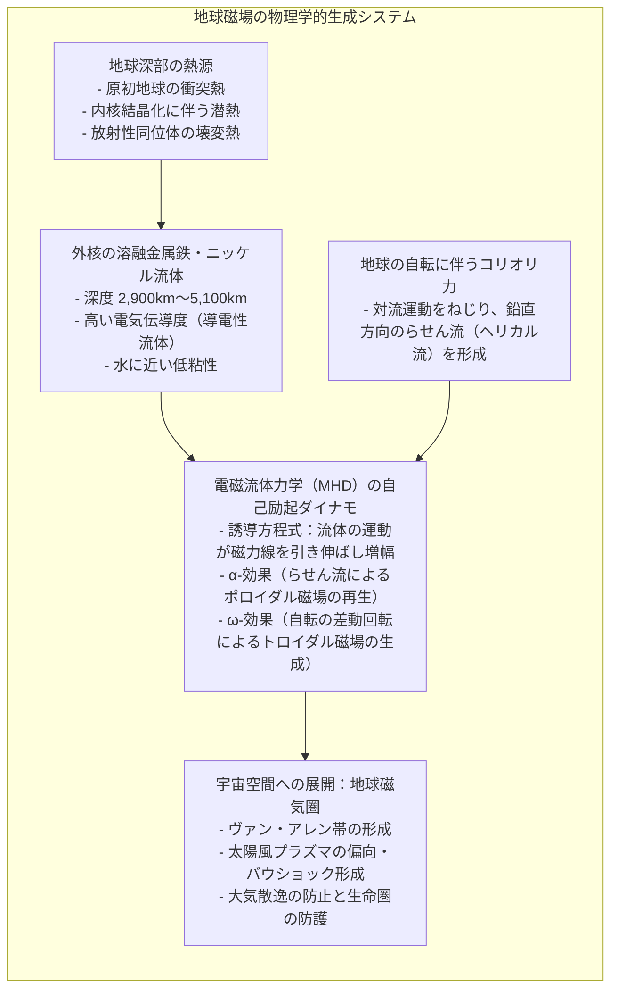
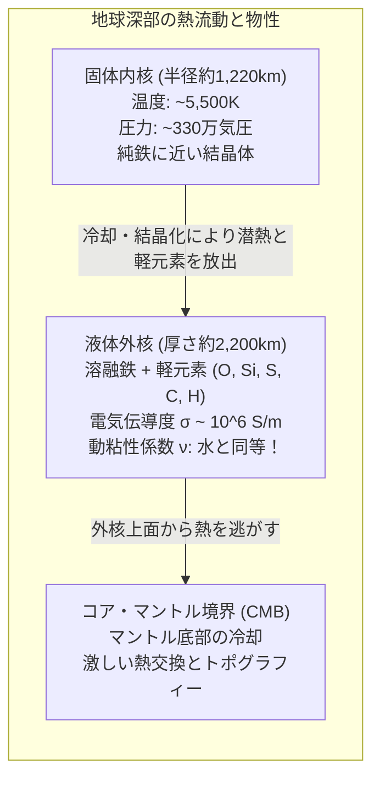
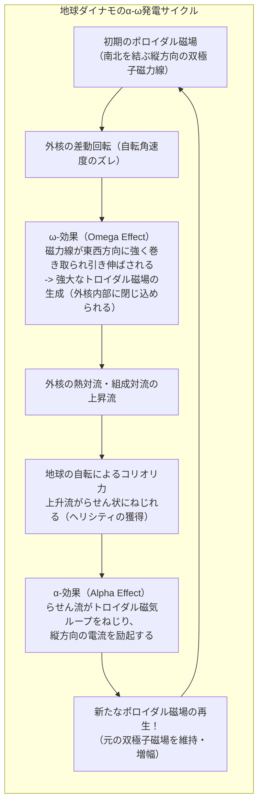
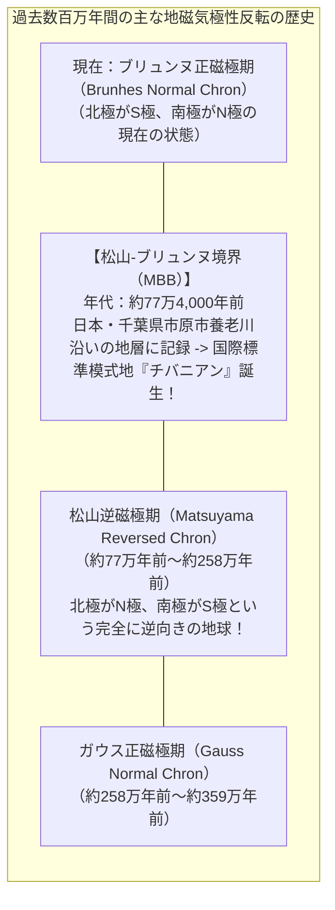
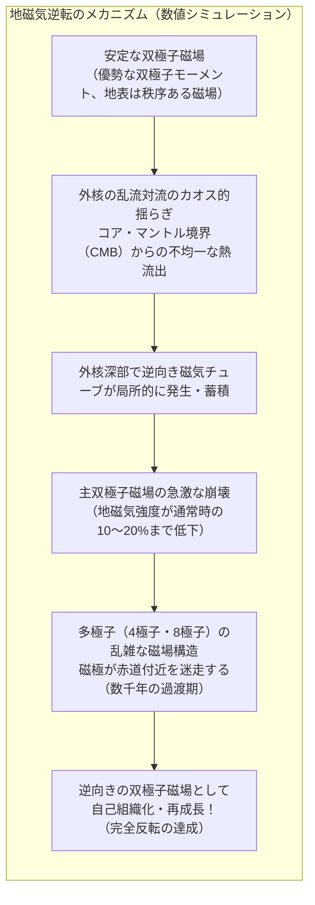
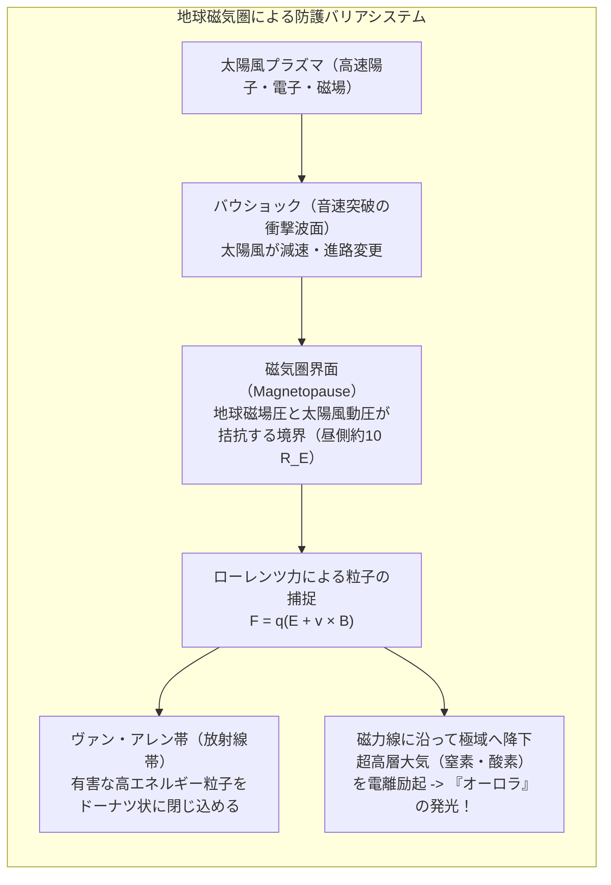

方位磁針を手のひらに乗せると、細い針は静かに揺れ、やがて正確に北を指して静止します。航海者たちが何世紀にもわたって大海原を旅することができたのも、スマートフォンが地図アプリ上で自分の向いている方角を瞬時に割り出せるのも、すべて地球が星全体として巨大な磁場を帯びているからです。

しかし、立ち止まって考えてみてください。<strong>「地球はなぜ磁石なのか？」</strong>

小学校の理科では、「地球の北極付近がS極、南極付近がN極の性質を持った巨大な棒磁石のようなものだ」と教わります。しかし、この説明は物理学的には全く成り立ちません。なぜなら、地球の内部は地下深くへ進むほど超高温・超高圧の世界であり、中心付近の温度は<strong>太陽の表面温度に匹敵する5,000度から6,000度</strong>に達するからです。

鉄をはじめとするあらゆる強磁性体（磁石にくっつく物質）は、ある一定の温度（<strong>キュリー温度</strong>：鉄の場合は約770℃）を超えると、熱運動によって原子の磁気モーメントの向きがバラバラになり、<strong>磁石としての性質を完全に失ってしまいます（常磁性への相転移）</strong>。つまり、地球の中心に巨大な鉄の永久磁石が埋まっているはずがないのです。

永久磁石が存在し得ない灼熱の惑星の底で、いったい何が数億年にもわたって強力な磁場を生み出し続けているのでしょうか？ そして、なぜその磁場は数万年から数十万年に一度、<strong>「北極と南極が完全にひっくり返る（磁極逆転）」</strong>という激変を繰り返してきたのでしょうか？

本稿では、1600年のギルバートによる先駆的発見から、現代物理学の最前線である<strong>「自励ダイナモ理論（Geodynamo Theory）」</strong>の数学的構造、地層に刻まれた磁極逆転の記録（チバニアン）、そして太陽風の猛毒から地球の大気と生命を守り抜く磁気圏のシールドまでを、流体力学と電磁気学の融合を通じて徹底的に解き明かします。



---

## 1. 永久磁石の幻想と「キュリー温度」の壁

人類が地球の磁気現象を科学的に探求し始めたのは、1600年にイギリスのエリザベス1世の侍医であった<strong>ウィリアム・ギルバート（William Gilbert）</strong>が著書『磁石論（*De Magnete*）』を出版した時に遡ります。

### ギルバートのテレラと「地球＝磁石」説
ギルバートは、天然の磁石（磁鉄鉱）を球形に削り出した小型の地球模型「テレラ（*terrella*：小さな地球）」を作り、その周囲に小さな磁針を近づける実験を行いました。球面上を進む磁針の傾き（伏角）が、地球上で船乗りたちが観測する伏角の変化と驚くほど一致することを確認したギルバートは、人類史上初めて<strong>「地球そのものが一つの巨大な磁石である」</strong>と宣言しました。

ギルバートの直感は天才的なものでしたが、彼は地球の内部全体が天然の磁鉄鉱でぎっしり詰まっていると考えていました。この素朴な永久磁石モデルは、19世紀末の物理学の発展によって粉砕されることになります。

### ピエール・キュリーの発見と強磁性の消失
フランスの物理学者<strong>ピエール・キュリー（Pierre Curie、1895年）</strong>は、物質の磁気的性質が温度によってどのように変化するかを精密に測定しました。
強磁性体内部では、隣り合う原子のスピン（不対電子の磁気モーメント）が「交換相互作用」と呼ばれる量子力学的効果によって自発的に同じ向きに整列し、強力な磁区を形成しています。

しかし、物質を加熱していくと、原子の熱振動のエネルギーが交換相互作用のエネルギーを上回り、スピンの整列が完全に破壊されます。この相転移が起きる限界温度を<strong>「キュリー温度（キュリー点：$T_C$）」</strong>と呼びます。

```
   代表的な物質のキュリー温度：
   ・鉄（Fe）      : 約 770 ℃ （1,043 K）
   ・コバルト（Co）: 約 1,115 ℃ （1,388 K）
   ・ニッケル（Ni）: 約 358 ℃ （631 K）
   ・磁鉄鉱（Fe3O4）: 約 580 ℃ （853 K）
```

一方、地球内部の温度勾配（地温勾配）は、地下深くに向かうにつれて急激に上昇します。深さわずか30〜50キロメートルの上部マントルに達するだけで、温度は1,000℃を超え、あらゆる鉄鉱石のキュリー温度を軽々と突破してしまいます。地殻という極めて薄い表層の岩石（地磁気全体の1%未満の影響）を除けば、<strong>地球内部の99%以上の領域は、永久磁石としては完全に「死んでいる（消磁している）」</strong>のです。

---

## 2. 地球内部の構造：外核という巨大な導電性流体の海

永久磁石が存在できないとすれば、磁場を生み出す物理的機構はただ一つしかあり得ません。それは<strong>「巨大な電流」</strong>です。
アンペールの法則が示す通り、電流が流れればその周囲には必ず磁場が発生します。問題は、「地球内部のどこに、どのようにして電流が流れ続けているのか」です。

地震波トモグラフィーや高圧鉱物物理学の進展により、地球内部の層構造が克明に判明しています：

```
   地球内部の階層構造：
   [地殻]       : 0 〜 30-70 km（固体のケイ酸塩岩石）
   [マントル]   : 〜 2,900 km（固体のケイ酸塩、超長期的には熱対流）
   ------------------- コア・マントル境界（CMB / D''層） -------------------
   [外核]       : 2,900 〜 5,100 km（液体！溶融した鉄・ニッケル合金）
   ------------------- 内核境界（ICB） -------------------
   [内核]       : 5,100 〜 6,371 km（固体！超高圧下で結晶化した鉄合金）
```



### 驚くべき外核の流動性：ドロドロではなく「サラサラの水」
地球磁場の発生源として決定的な役割を担っているのが、深さ2,900キロメートルから5,100キロメートルに位置する<strong>「外核（Outer Core）」</strong>です。
外核は、約130万〜330万気圧という途方もない高圧下にありますが、温度が4,000℃〜5,000℃と融点を超えているため、<strong>完全に液体状態</strong>に保たれています。

多くの人々は、地下深部の溶融金属というと「ドロドロとした溶岩や水飴のような粘り気」を想像しがちです。しかし、理論計算と衝撃圧縮実験が明らかにした外核の粘性（動粘性係数）は、<strong>「私たちが日常で飲んでいる水道水とほぼ同じ（約 $10^{-6} \, \text{m}^2/\text{s}$）」</strong>です。

つまり、外核とは<strong>「電気を極めてよく通す（良導電性の）サラサラとした溶融鉄の海」</strong>が、厚さ2,200キロメートルにわたって猛烈な勢いで渦を巻いている領域なのです。

---

## 3. 自励ダイナモ理論の数理物理：動く金属が磁場を創り出す

良導電性の流体が運動するとき、電磁気学と流体力学が不可分に結合した<strong>「電磁流体力学（MHD：Magnetohydrodynamics）」</strong>の世界が現れます。
発電所にある発電機（ダイナモ）は、磁石の間でコイルを回転させることで力学的エネルギーを電気エネルギーへと変換します。地球自身が、外部からの磁石の供給なしに、自らの流体運動によって電流と磁場を自給自足し維持し続ける仕組みを<strong>「自励ダイナモ（Self-Excited Dynamo）」</strong>と呼びます。

自励ダイナモ理論の基本骨格は、1919年に太陽磁場を説明するためにジョセフ・ラーモア（Joseph Larmor）が提唱し、後にウォルター・エルザッサー（Walter Elsasser）やエドワード・ブラード（Edward Bullard）らによって地球磁場へと適用・発展させられました。

### 磁気誘導方程式の導出
電磁流体力学における磁場の時間発展は、マクスウェル方程式とオームの法則を結合することで導かれます。

流速を $\mathbf{u}$、電場を $\mathbf{E}$、磁束密度を $\mathbf{B}$、電流密度を $\mathbf{J}$、透磁率を $\mu_0$、電気伝導度を $\sigma$ とします。運動する良導電流体における一般化されたオームの法則は：

$$\mathbf{J} = \sigma (\mathbf{E} + \mathbf{u} \times \mathbf{B})$$

ファラデーの電磁誘導の法則およびアンペール・マクスウェルの法則（変位電流は光速のオーダーであり流体運動に比べて無視できるため $\nabla \times \mathbf{B} = \mu_0 \mathbf{J}$）を連立させます：

$$\frac{\partial \mathbf{B}}{\partial t} = -\nabla \times \mathbf{E} = -\nabla \times \left( \frac{\mathbf{J}}{\sigma} - \mathbf{u} \times \mathbf{B} \right)$$

ここで $\mathbf{J} = \frac{1}{\mu_0} \nabla \times \mathbf{B}$ を代入し、磁気拡散率 $\eta = \frac{1}{\mu_0 \sigma}$ を定義すると、有名な<strong>磁気誘導方程式（Induction Equation）</strong>が得られます：

$$\frac{\partial \mathbf{B}}{\partial t} = \nabla \times (\mathbf{u} \times \mathbf{B}) + \eta \nabla^2 \mathbf{B}$$

この方程式の右辺は、2つの相反する物理プロセスの激しいせめぎ合いを表しています：
1. <strong>移流項・引き伸ばし項 $\nabla \times (\mathbf{u} \times \mathbf{B})$：</strong> 流体の流れ $\mathbf{u}$ が既存の磁力線を捕まえ、引き伸ばし、折り曲げて局所的に磁場を指数関数的に増幅させる働き。
2. <strong>拡散・消散項 $\eta \nabla^2 \mathbf{B}$：</strong> 流体の電気抵抗によって電流がジュール熱として失われ、磁場が空間的に散逸・減衰していく働き。

もし外核の流動が完全に静止した場合（$\mathbf{u} = 0$）、右辺は拡散方程式 $\frac{\partial \mathbf{B}}{\partial t} = \eta \nabla^2 \mathbf{B}$ のみとなり、地球サイズの球体における磁場の自由減衰時間は<strong>約2万年</strong>にしかなりません。地球が45億年にわたって磁場を失わずに維持できている理由は、<strong>流体の運動による磁力線の引き伸ばしが、オーム散逸による減衰に常に打ち勝ち続けているから</strong>です。

### 磁気レイノルズ数 $R_m$ と「磁力線の凍結」
流体の運動が磁場の散逸に打ち勝つための無次元の指標が<strong>磁気レイノルズ数（Magnetic Reynolds Number：$R_m$）</strong>です：

$$R_m = \frac{U L}{\eta} = \mu_0 \sigma U L$$

ここで $U$ は外核流体の代表的な流速（年間に数十キロメートル、秒速約 $10^{-4} \, \text{m/s}$）、$L$ は外核の代表的スケール（約 $10^6 \, \text{m}$）です。
外核における磁気レイノルズ数は <strong>$R_m \sim 100 \text{ から } 1000$</strong> という十分に大きな値を持ちます。

$R_m \gg 1$ の極限では、磁気拡散項が無視できるようになり、スウェーデンのノーベル物理学賞受賞者ハンス・アルヴェーンが提唱した<strong>「磁力線の凍結定理（Alfvén's Frozen-in Theorem）」</strong>が成り立ちます。磁力線はあたかも流体に埋め込まれたゴム紐のように、流体の運動に伴って引きずられ、ねじられ、幾何学的に引き伸ばされます。磁力線の束が引き伸ばされて密集すると、磁場強度は劇的に跳ね上がります。

---

## 4. α-ω効果：自転とコリオリの力が紡ぐ磁場の再生ループ

単に流体をかき混ぜるだけでは、カウリングの反ダイナモ定理（軸対称な磁場は定常ダイナモでは維持できない）によって磁場は消滅してしまいます。磁場が自己持続するためには、<strong>3次元的でヘリカル（らせん状）な非対称流動</strong>が不可欠です。ここで決定的な役割を果たすのが、<strong>「地球の自転」</strong>です。



自励ダイナモを駆動するエンジンは、<strong>「$\omega$-効果」</strong>と<strong>「$\alpha$-効果」</strong>という2つの協調的なプロセスのフィードバックループです。

### 1. $\omega$-効果（Omega Effect）：双極子から帯状磁場へ
地球外核の自転速度は、場所（深さや緯度）によってわずかに異なります（差動回転）。
南北方向を結ぶ子午面内の磁場を<strong>「ポロイダル磁場（Poloidal Field）」</strong>と呼びます。このポロイダル磁力線が存在する空間で差動回転が起きると、導電性流体に凍結された磁力線は、赤道付近の速い自転によって東西方向に強く引きずられ、円周方向にぐるぐると巻き取られます。

こうして、外核の内部を東西方向に同心円状に取り巻く強力な<strong>「トロイダル磁場（Toroidal Field）」</strong>が生成されます。トロイダル磁場は外核の内部に完全に閉じ込められており、地表からは直接観測できませんが、その強度は地表の地磁気の数十倍から数百倍（数百ガウス）にも達すると推定されています。

### 2. $\alpha$-効果（Alpha Effect）：らせん流による双極子の復活
トロイダル磁場がいくら強くなっても、それだけでは元の南北のポロイダル磁場を維持できません。放置すればポロイダル磁場はオーム散逸で消え去り、やがてダイナモ全体が停止してしまいます。

ここで奇跡的な働きをするのが、内核の冷却に伴って底から湧き上がる熱対流や浮力（軽い元素の上昇）です。
外核の中を高温の液体金属の塊が上昇する際、地球の自転による強烈な<strong>「コリオリの力（Coriolis Force）」</strong>を受けます。自転軸に平行な円柱状の安定な渦流（<strong>テイラー柱：Taylor Column</strong>）が形成され、上昇流は激しく回転しながら上昇する<strong>「らせん流（ヘリカル流）」</strong>へと姿を変えます。

このらせん流が東西方向のトロイダル磁力線を下から突き上げると、磁力線は上向きの逆U字型に持ち上げられ、さらにコリオリ力によって約90度ねじられます。その結果、<strong>元の東西方向の磁力線から、南北方向を向いた小さな磁気ループが形成</strong>されます。外核全体で無数に発生するこれらの微小ループが統計的に足し合わされることで、マクロな南北のポロイダル磁場（双極子磁場）が見事に再生・増幅されるのです。

この「ポロイダル磁場 $\xrightarrow{\omega}$ トロイダル磁場 $\xrightarrow{\alpha}$ ポロイダル磁場」という完全な閉ループが成立することにより、地球のダイナモは外部からの給電なしに、45億年間にわたって自己励起し続けているのです。

---

## 5. 地球の歴史を書き換えた「磁極逆転」：古地磁気学とチバニアン

地磁気がダイナモというダイナミックな流体運動によって生み出されていることの最も劇的な証拠は、地球の磁極が過去に何度も<strong>「完全に逆転（North and South Poles Flip）」</strong>してきたという歴史的事実です。

### 岩石が記憶する太古の地球磁場：残留磁気
溶岩が火山から噴出し、固化して火成岩になるとき、岩石に含まれるチタン磁鉄鉱などの磁性鉱物は、キュリー温度を下回る瞬間に、<strong>その時代・その場所の地球磁場の向きと強さを正確に写し取って磁化</strong>されます。これを<strong>「熱残留磁気（TRM：Thermo-Remanent Magnetization）」</strong>と呼びます。

また、海底や湖底に泥や砂が静かに堆積する際にも、微細な磁性粒子が方位磁針のように当時の地磁気に沿って整列して沈降し、堆積岩の中に磁気が固定されます（<strong>堆積残留磁気：DRM</strong>）。

岩石に封じ込められた残留磁気を読み解く学問を<strong>「古地磁気学（Paleomagnetism）」</strong>と呼びます。



### 松山基範の孤高の予言
20世紀初頭、フランスの物理学者ベルナルド・ブリュンヌ（Bernard Brunhes）は、オーヴェルニュ地方の玄武岩が現在の地磁気と正反対の向きに磁化されているのを発見しました。

この発見を体系的な科学理論へと昇華させたのが、京都帝国大学の地球物理学者、<strong>松山基範（Motonori Matsuyama、1929年）</strong>でした。松山は日本各地および朝鮮半島の鮮新世から更新世にかけての玄武岩試料を丹念に採取・測定し、古い時代の岩石群が一貫して現在と真逆の磁化を持っていることを突き止めました。

松山は大胆にも「地球磁場そのものが、過去において周期的に南北反転していたのではないか」という仮説を世界で初めて明確に提唱しました。当時の欧米学会は「岩石の化学的性質による局所的な自発的反転だろう」と冷笑しましたが、1960年代に放射年代測定技術（カリウム-アルゴン年代測定）が進歩すると、世界中のあらゆる地点の同年代の岩石が一斉に同じ逆転を示していることが実証され、松山の正しさが証明されました。

その栄誉を称え、現在から約77万年前までの正磁極期は「ブリュンヌ期」、それ以前の約258万年前までの逆磁極期は<strong>「松山逆磁極期（Matsuyama Reversed Chron）」</strong>と国際的に命名されています。

### プレートテクトニクスを証明した「海の縞模様」
地磁気逆転は、20世紀地球科学最大の革命である<strong>「プレートテクトニクス」</strong>を決定づける証拠となりました。

1963年、フレデリック・ヴァイン（Frederick Vine）とドラモンド・マシューズ（Drummond Matthews）は、海洋底の中央海嶺から湧き出すマグマが新しい海洋プレートとして冷え固まる際、その時代の地磁気を記録しながら東西両側へとベルトコンベアーのように広がっていくことに着目しました。海嶺を挟んで対称に広がる<strong>「海底の地磁気縞状異常（Magnetic Striping）」</strong>は、地球のダイナモが記録した天然の巨大な磁気テープ（テープレコーダー）そのものであり、大陸移動説を動かぬ事実として証明したのです。

### 国際標準模式地「チバニアン（Chibanian）」の快挙
2020年、地質学の歴史に日本の地名が刻まれました。
千葉県市原市の養老川沿いにある地層「千葉セクション」には、最後の地磁気逆転である<strong>「松山-ブリュンヌ境界（約77万4,000年前）」</strong>の移行プロセスが、乱れのない海底堆積物の中に驚くべき高時間解像度で克明に連続記録されていました。

この地層が更新世中期の国際標準模式層断面・ポイント（GSSP）に認定され、約77万4,000年前から12万9,000年前までの地質年代が正式に<strong>「チバニアン（Chibanian：千葉時代）」</strong>と命名されたのです。

---

## 6. なぜ地磁気は逆転するのか：スーパーコンピュータが捉えたカオス

地球の自励ダイナモは、なぜ安定して同じ向きを保ち続けられず、突如として反転を起こすのでしょうか？

### グラツマイヤーとロバーツの歴史的数値シミュレーション（1995年）
外核の流動を支配する非線形ナビエ・ストークス方程式と磁気誘導方程式を三次元の球殻領域で同時に解くことは、計算機科学において最難関の課題の一つでした。

1995年、アメリカの地球物理学者<strong>ゲイリー・グラツマイヤー（Gary Glatzmaier）</strong>と<strong>ポール・ロバーツ（Paul Roberts）</strong>は、スーパーコンピュータを用いて地球ダイナモの三次元自己無撞着シミュレーションを実行しました。地球内部の物性パラメータを入力し、30万年分以上に相当する外核の熱流動をシミュレートした結果、驚異的な現象が画面上に現れました：

1. <strong>準安定状態：</strong> シミュレーション開始から数万年間、地磁気は現在の地球と同様に安定した双極子磁場を維持していました。
2. <strong>双極子モーメントの崩壊：</strong> ある瞬間、外核内部の局所的な対流のゆらぎによって、逆向きの磁気チューブが自発的に発生し、全体の双極子磁場の強度が急激に10%〜20%程度まで減衰しました。
3. <strong>カオス的な多極子構造：</strong> 磁極が南北に分かれたシンプルな構造が崩れ、地表には4極子や8極子の複雑な磁場がモザイク状に出現しました。
4. <strong>極性の反転と再成長：</strong> 約数千年という短い遷移期間ののち、逆向きの極性を持った双極子磁場が急速に自己組織化し、元の強度まで回復したのです。



このシミュレーションは、<strong>磁極の逆転が外部からの天体衝突などの異常な刺激を必要とせず、外核の流動が内包する非線形カオス力学の自然な帰結として必然的に生じる</strong>ことを決定的に示しました。

過去の地質学的記録によれば、地磁気逆転の頻度は極めて不規則です。恐竜が繁栄した白亜紀には、約4,000万年間にもわたって一度も逆転が起きなかった「白亜紀正磁極超長期（CNS）」が存在した一方で、数万年ごとに頻繁にひっくり返る時代もありました。直近の逆転（松山-ブリュンヌ境界）からはすでに約77万年が経過しており、平均的な逆転周期（約20万〜30万年）から見れば「いつ次の逆転が始まっても不思議ではない」状態にあります。

---

## 7. 宇宙の盾：地磁気圏が生命を守るメカニズム

もし地球に磁場が存在しなかったら、私たちの星はどうなっていたでしょうか？ その答えを知るには、地球のすぐ隣にある火星や金星を見れば一目瞭然です。

太陽は光だけでなく、陽子やアルファ粒子（ヘリウム原子核）などの超高速荷電粒子からなるプラズマの嵐、<strong>「太陽風（Solar Wind）」</strong>を四方八方に猛烈な勢いで吹き荒らしています。その速度は時速100万〜300万キロメートル（秒速数百キロメートル）に達します。



### ローレンツ力と磁気圏のシールド効果
地球磁場は、地表にとどまらず宇宙空間へと大きく広がり、<strong>「地球磁気圏（Magnetosphere）」</strong>という巨大な防御シェルターを形成しています。

太陽風の荷電粒子（電荷 $q$、速度 $\mathbf{v}$）が地球磁場 $\mathbf{B}$ に突入すると、<strong>ローレンツ力（Lorentz Force）</strong>を受けます：

$$\mathbf{F} = q (\mathbf{E} + \mathbf{v} \times \mathbf{B})$$

荷電粒子は磁力線に巻き付くようにらせん運動（サイクロトロン運動）を強制され、地球に直撃することなく、磁気圏の境界（磁気圏界面：太陽側で地球半径の約10倍、約6万キロメートル）に沿って迂回させられます。

磁気圏に捕獲された高エネルギー粒子は、地球を取り巻く強力な放射線帯である<strong>「ヴァン・アレン帯（Van Allen Radiation Belt）」</strong>に閉じ込められます。そして、わずかに漏れ出した粒子が南北両極の磁力線の足元へと誘導され、高度100〜400キロメートルの超高層大気の酸素や窒素原子と衝突して幻想的な光を放つ現象こそが、私たちが目にする<strong>「オーロラ（Aurora）」</strong>なのです。

### 火星が砂漠の死の星になった理由
火星はかつて、現在の地球のように広大な海と厚い大気を持っていたことが確実視されています。しかし、火星は地球よりも質量が小さかったため、内部の熱が急速に冷え固まり、誕生からわずか数億〜十数億年で<strong>外核のダイナモ活動が停止（磁場が消滅）</strong>してしまいました。

磁気シールドを失った火星は、何十億年もの間、太陽風の直接攻撃に晒され続けました。太陽風のプラズマが大気分子を宇宙空間へと吹き飛ばす「大気散逸（Atmospheric Stripping）」が進行し、大気圧は現在の0.006気圧まで希薄化し、海は干上がり、火星は極寒の乾燥した赤い砂漠の星へと変わり果ててしまったのです。

地球が豊かな水をたたえ、生命の楽園であり続けられたのは、<strong>足元数千キロメートルの地下で沸き立つ溶融鉄のダイナモが、目に見えない力場となって私たちを包み込み、宇宙の暴力から守り続けてくれているから</strong>に他なりません。

---

## 8. 太陽系の兄弟たちと現代の地磁気異変

ダイナモ理論の普遍性は、地球以外の惑星を比較することでさらに鮮明になります。

| 天体 | 固有磁場の有無 | 双極子磁気モーメント（地球=1） | 磁場発生のメカニズム・特徴 |
| :--- | :--- | :--- | :--- |
| <strong>水星</strong> | あり（微弱） | 約 $0.007$ | 惑星半径の約75%を占める巨大な鉄のコアによる微弱なダイナモ。部分的に溶融している。 |
| <strong>金星</strong> | <strong>なし</strong> | $< 0.0001$ | 地球とほぼ同じサイズ・組成を持つが、自転周期が243日と極めて遅く、プレートテクトニクスがないためマントル冷却が非効率でコアの対流が停止しているとされる。 |
| <strong>地球</strong> | <strong>あり</strong> | <strong>$1.0$</strong> （地表で約 $30\text{--}60 \, \mu\text{T}$） | 液体外核の活発な熱・組成対流と急速な自転（24時間）が駆動する自励ダイナモ。 |
| <strong>火星</strong> | <strong>局所磁場のみ</strong> | $< 0.0002$ | 全球的なダイナモは40億年前に停止。太古の磁場が地殻の岩石に縞状に残留しているのみ。 |
| <strong>木星</strong> | <strong>超強力</strong> | <strong>約 $20,000$</strong> （地表で地球の数十倍） | 超高圧（数百万気圧）によって水素が金属化した「液体金属水素」が猛烈な超高速自転（約10時間）で対流する超巨大ダイナモ。 |
| <strong>ガニメデ</strong> | あり | 木星の衛星でありながら、独自の金属コアによる固有磁場を持つ太陽系唯一の衛星。 |

---

### 現代の地磁気減衰と南大西洋異常帯（SAA）
いま、地球物理学者たちの視線は、現代の地磁気に起きている異変に向けられています。
過去150年間の精密観測（ガウスが創始した地磁気国際観測網以降）によれば、<strong>地球全体の磁場強度は約10%近くも減衰</strong>し続けています。

特に、南米から南大西洋にかけての地域では、<strong>「南大西洋異常帯（SAA：South Atlantic Anomaly）」</strong>と呼ばれる地磁気が極端に弱いエリアが年々拡大・深化しています。地磁気シールドが局所的に薄くなっているため、この上空を通過する人工衛星や国際宇宙ステーション（ISS）は、宇宙線による搭載コンピュータの誤作動（シングルイベントアップセット）や電子機器の損傷リスクに直面しています。

外核の上面を衛星磁気データから逆解析すると、南大西洋異常帯の直下では、<strong>通常の極性と逆向きの磁束を持つ「逆向き磁束パッチ（Reverse Flux Patch）」</strong>が成長し、北上している様子が確認されています。これはまさに、スーパーコンピュータの数値シミュレーションで見られた「地磁気逆転の初期兆候」と不気味なほど酷似しています。

仮に今後数千年で地磁気逆転が本格化したとしても、明日すぐに磁場がゼロになるわけではありません。数千年をかけて磁場強度が10〜20%に落ち、多極子化して磁極があちこちに現れる過渡期が訪れます。現代の電力網や衛星通信、GPSナビゲーションには深刻な影響が及ぶと予想されますが、化石記録を見る限り、過去の地磁気逆転の時期に生物の大絶滅が起きた証拠はありません。地球の大気そのものが一定の厚みを持って宇宙線を遮蔽してくれるからです。

---

## 結語：脈動するコアと生きている惑星

方位磁針が北を指すという、何気ない日常の事実。
その背後には、地下3,000キロメートルの闇の中で水道水のようにサラサラと激しく渦を巻く4,000度の鉄の海があり、地球の自転が生み出すコリオリの力が磁力線をねじり上げ、電気と磁気の無限のダンスを踊り続けているという驚異の物理的現実があります。

地球の磁場は、静止した永久磁石の死んだ彫像ではありません。
それは惑星が内部に熱を宿し、自ら回転し、対流していることの生きた証拠——いわば<strong>「惑星の呼吸であり、生命の鼓動」</strong>なのです。

私たちが青空を見上げ、温暖な大気の中で息をし、夜空に揺らめくオーロラの美しさに息を呑むとき、私たちは地球のコアが奏でる電磁気学の壮大なシンフォニーの庇護の下に生きているのです。
