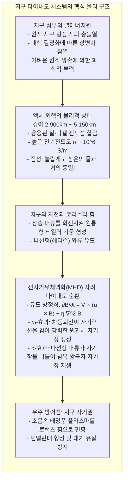
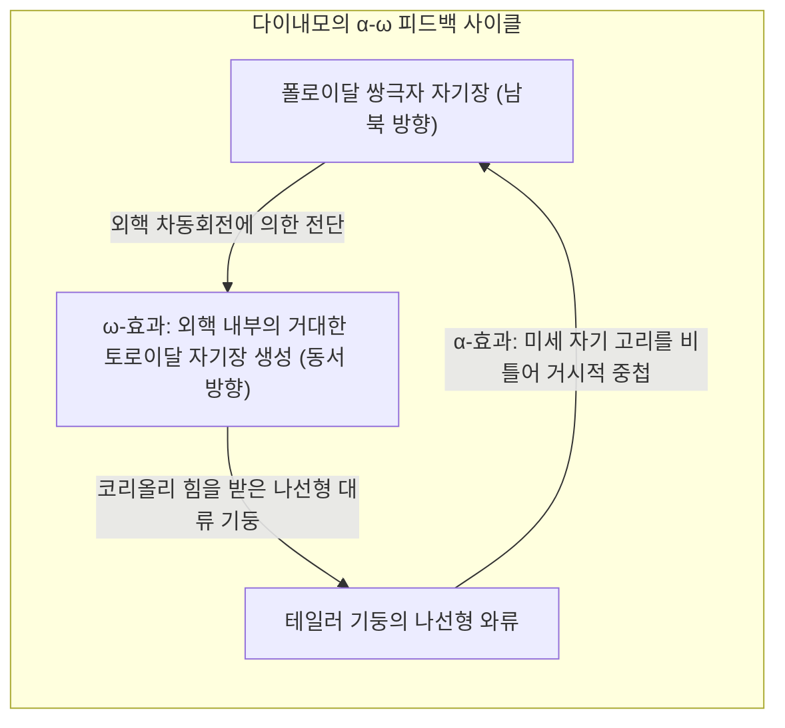

손바닥 위에 나침반을 올려놓으면, 가느다란 자침은 잠시 흔들리다 이내 정확히 북쪽을 가리킵니다. 인류는 수천 년 동안 이 보이지 않는 힘을 나침반 삼아 대양을 건넜고, 오늘날 스마트폰 역시 지자기 센서를 이용해 지도 위의 방향을 실시간으로 안내합니다. 우리는 너무나 자연스럽게 <strong>"지구 자체가 하나의 거대한 자석"</strong>이라는 사실을 받아들입니다.

하지만 물리학의 기본 원리로 한 걸음만 깊이 들어가 보면 심각한 모순에 부딪히게 됩니다: <strong>"지구 중심은 수천 도의 초고온인데, 어떻게 자석의 성질을 유지할 수 있는가?"</strong>

초등학교 과학 시간에는 지구 중심에 거대한 막대자석이 묻혀 있는 그림으로 비유하곤 합니다. 하지만 지구 내부로 들어갈수록 지온은 가파르게 상승하여, 지하 2,900km 아래의 핵 경계에서는 온도가 <strong>4,000K에서 5,000K</strong>에 이릅니다. 이는 태양 표면 온도에 맞먹는 작열하는 환경입니다.

응집물질물리학에 따르면, 철(Fe)이나 니켈 같은 모든 강자성체는 <strong>'퀴리 온도(Curie Temperature)'</strong>라는 절대적인 한계를 지닙니다. 순수한 철의 퀴리 온도는 <strong>770 ℃(약 1,043 K)</strong>에 불과합니다. 이 온도를 넘어서면 격렬한 열운동이 원자 스핀들의 양자역학적 정렬을 파괴하여 자성을 완전히 잃어버리고 상자성체로 변합니다.

지하 수십 킬로미터만 내려가도 온도가 1,000도를 훌쩍 넘어가므로, <strong>지구 부피의 99% 이상에는 영구자석이 단 1그램도 존재할 수 없습니다.</strong> 그렇다면 35억 년이 넘도록 지구 전체를 감싸고 있는 강력한 행성 자기장은 대체 어디에서 어떻게 만들어지는 것이며, 왜 수만~수십만 년마다 <strong>"남극과 북극이 완전히 뒤집히는 자극 역전"</strong>이 일어나는 것일까요?

---

## 1. 영구자석의 환상과 퀴리 온도의 벽

인류가 지구 자기장을 과학적으로 이해하기 시작한 것은 1600년 영국 엘리자베스 1세의 주치의였던 <strong>윌리엄 길버트(William Gilbert)</strong>의 저서 『자석론(*De Magnete*)』에서 출발했습니다. 길버트는 천연 자석으로 둥근 지구 모형인 '테렐라(Terrella)'를 만들어 복각과 편각을 측정함으로써 "지구 자체가 거대한 자석"임을 최초로 간파했습니다.

하지만 1895년 프랑스의 물리학자 <strong>피에르 퀴리(Pierre Curie)</strong>가 퀴리 온도를 발견하면서 영구자석 모델은 종말을 고했습니다. 지구 내부의 지온 상승률을 감안하면 지하 30~50km만 내려가도 암석 내 자성 광물의 퀴리 온도를 돌파합니다. 지구 내부 전체에서 검출되는 자기장은 영구자석이 아니라, <strong>거대한 전류가 지구 심부에서 흐르고 있기 때문에 유도되는 것</strong>입니다.

---

## 2. 외핵의 유체물리: 물처럼 찰랑이는 액체 금속의 바다

지진파 분석과 초고압 광물물리학 실험은 지구 중심에 다음과 같은 층이 있음을 밝혔습니다:
- <strong>고체 내핵(5,150~6,371km):</strong> 초고압으로 결정화된 철-니켈 덩어리.
- <strong>액체 외핵(2,900~5,150km):</strong> 두께 2,260km의 용융된 철-니켈 합금 바다.

외핵은 수백만 기압의 압력 속에 있지만, 온도가 4,000~5,000K에 달해 액체 상태를 유지합니다. 충격압축 실험과 분자동역학 시뮬레이션에 따르면, 외핵 용융 금속의 점성은 <strong>상온의 수돗물과 거의 같은 수준($\approx 10^{-6} \, \text{m}^2/\text{s}$)</strong>입니다. 외핵은 전기가 극도로 잘 통하는 전도성 액체 금속이 광활한 지하에서 거대한 소용돌이를 일으키고 있는 공간입니다.

---

## 3. 전자기유체역학(MHD)과 자려 다이내모 이론

도체 유체가 움직일 때 자기장이 스스로를 증폭시키는 메커니즘을 <strong>'자려 다이내모(Self-Excited Dynamo)'</strong>라고 합니다. 이를 기술하는 기본 수식은 맥스웰 방정식과 옴의 법칙을 결합한 <strong>자기유도 방정식(Induction Equation)</strong>입니다:

$$\frac{\partial \mathbf{B}}{\partial t} = \nabla \times (\mathbf{u} \times \mathbf{B}) + \eta \nabla^2 \mathbf{B}$$

여기서 $\eta = \frac{1}{\mu_0 \sigma}$는 자기확산율입니다. 우변의 첫째 항은 유체 흐름에 의해 자기력선이 포획되고 늘어나 증폭되는 항이며, 둘째 항은 전기저항으로 인해 옴 소산(Joule heat)으로 자기장이 사라지는 확산 항입니다.

외핵의 유동이 멈춘다면 지자기는 불과 <strong>2만 년</strong> 만에 완전히 사라지게 됩니다. 지자기가 수십억 년 동안 유지되는 이유는 외핵의 <strong>자기 레이놀즈수($R_m = \mu_0 \sigma U L$)가 100~1000 수준으로 매우 커서, 알프벤의 '자력선 동결 정리(Frozen-in Theorem)'가 성립하기 때문</strong>입니다. 자기력선은 유체에 꽁꽁 묶인 고무줄처럼 끌려다니며 끊임없이 늘어나고 증폭됩니다.

---

## 4. α-ω 효과: 자전과 코리올리 힘이 만드는 재생 순환

카울링의 반다이내모 정리에 따르면, 단순한 2차원 축대칭 유동은 자기장을 유지할 수 없습니다. 자기장이 영구히 재생되기 위해서는 3차원의 비대칭 나선 유동이 필요합니다.

1. <strong>$\omega$-효과(Omega Effect):</strong> 외핵의 회전 속도는 깊이와 위도에 따라 다릅니다(차동회전). 남북 방향의 폴로이달 자기력선이 동서 방향으로 팽팽하게 감겨 외핵 내부에 수백 가우스의 강력한 <strong>토로이달 자기장</strong>을 형성합니다.
2. <strong>$\alpha$-효과(Alpha Effect):</strong> 내핵의 냉각으로 가벼운 원소가 방출되며 강력한 상승 대류가 일어납니다. 이때 지구 자전에 따른 <strong>코리올리 힘</strong>에 의해 상승류가 회전하며 나선형 와류(<strong>테일러 기둥</strong>)를 형성합니다. 이 나선류가 동서 방향의 자기력선을 끌어올리고 90도 비틀어 남북 방향의 새로운 <strong>폴로이달 자기장</strong>을 재생합니다.

---

## 5. 암석에 새겨진 반전의 역사: 지자기 역전과 치바니안

화산에서 분출된 용암이 식을 때, 암석 속의 자성 광물은 퀴리 온도를 통과하는 순간 그 시대의 지구 자기장 방향을 그대로 기록합니다(<strong>열잔류자기 TRM</strong>).

1929년 일본 교토제국대학의 <strong>마쓰야마 모토노리(松山基範)</strong> 교수는 오래된 현무암들이 현재와 정반대 방향으로 자화되어 있음을 발견하고, <strong>"지구 자기장이 과거에 완전히 역전되었었다"</strong>는 가설을 세계 최초로 제기했습니다. 이는 1960년대 방사능 연대측정으로 입증되어 <strong>'마쓰야마 역자극기(Matsuyama Chron)'</strong>로 명명되었고, 대양저 확장설과 판구조론을 확증하는 결정적 증거가 되었습니다.

2020년, 일본 지바현 이치하라시 요로천의 지층 '지바 섹션'이 77만 4천 년 전 마지막 지자기 역전(<strong>마쓰야마-브륀스 경계 MBB</strong>)을 가장 정밀하게 연속 보존한 공인 모식지(GSSP)로 인정받아, 지질시대에 <strong>'치바니안(Chibanian)'</strong>이라는 공식 명칭이 붙게 되었습니다.

---

## 6. 슈퍼컴퓨터가 증명한 카오스 역전 메커니즘

1995년 개리 글래츠마이어와 폴 로버츠는 슈퍼컴퓨터를 이용해 외핵의 3차원 전자기유체역학 시뮬레이션을 수행했습니다.
외부의 충격이 전혀 없어도 외핵 유체 내부의 비선형 카오스 난류에 의해:
- 외핵 국소 부위에서 반대 방향의 자기 다발이 축적되고,
- 쌍극자 자기장이 평소의 10~20%로 급감하며 다극자 혼돈 상태로 전환된 뒤,
- 수천 년에 걸쳐 반대 극성의 쌍극자로 스스로 재조직화되어 복원되는 과정이 자연스럽게 재현되었습니다.

지자기 역전은 외핵 다이내모의 고유한 유체역학적 필연인 것입니다.

---

## 7. 생명을 지키는 우주의 방패: 자기권

지구 자기장이 없었다면 지구는 화성처럼 황폐해졌을 것입니다.

초속 수백 킬로미터로 쏟아지는 태양풍의 고에너지 하전입자들은 지구 자기장의 <strong>로런츠 힘($\mathbf{F} = q(\mathbf{v} \times \mathbf{B})$)</strong>에 의해 지표면 약 6만 5천 킬로미터 상공(자기권계면)에서 튕겨 나갑니다. 갇힌 입자들은 <strong>밴앨런대</strong>를 형성하고, 양극으로 유입된 일부 입자가 상층 대기와 충돌하여 신비로운 <strong>오로라</strong>를 만들어냅니다.

화성은 질량이 작아 내부 열이 식으며 다이내모가 40억 년 전에 정지했고, 자기장 방패를 잃은 탓에 태양풍에 대기와 바다를 모두 우주로 빼앗겨 붉은 불모의 사막이 되었습니다.

발밑 수천 킬로미터 깊은 어둠 속에서 소용돌이치는 4,000도의 액체 철 바다야말로, 지구의 모든 생명체를 우주의 맹독으로부터 지켜주는 보이지 않는 갑옷입니다.
