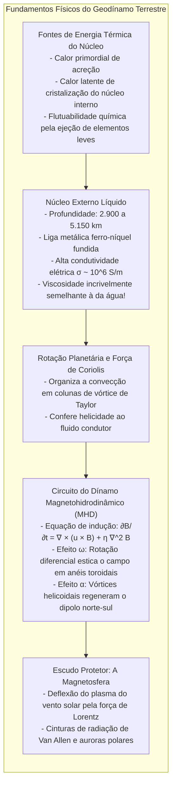
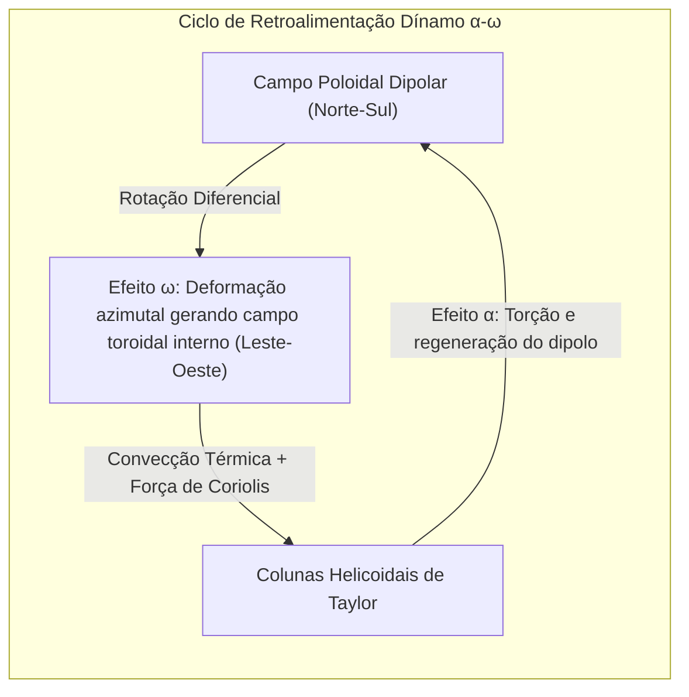

Coloque uma bússola na palma da sua mão e verá a agulha estabilizar-se com precisão rumo ao norte. Esta propriedade orientou expedições marítimas através dos séculos e hoje calibra os dispositivos digitais. Consideramos natural que <strong>a Terra seja um íman colossal</strong>.

Contudo, este facto encerra um enigma físico de primeira grandeza: <strong>como pode o interior da Terra sustentar um campo magnético?</strong>

Os manuais escolares ilustram por vezes a Terra com uma grande barra magnética no seu centro. No entanto, o calor sobe rapidamente com a profundidade: a 2.900 km, no limite do núcleo, as temperaturas atingem <strong>4.000 a 5.000 Kelvin</strong>, rivalizando com a superfície do Sol.

Na física da matéria condensada, todos os materiais ferromagnéticos perdem a sua magnetização espontânea ao atingir a <strong>temperatura de Curie ($T_C$)</strong>, que no ferro é de apenas <strong>770 °C</strong>. Acima deste patamar, a agitação térmica aniquila a ordem dos spins atómicos, tornando o metal paramagnético.

Com temperaturas superiores a 1.000 °C logo a algumas dezenas de quilómetros da superfície, <strong>mais de 99 % da Terra é quente demais para conter ímanes permanentes</strong>.

Como consegue o planeta gerar o seu campo magnético e por que razão os polos <strong>se inverteram centenas de vezes</strong> na história geológica?

---

## 1. O fim do íman permanente: Gilbert e o limite de Curie

Em 1600, <strong>William Gilbert</strong> publicou *De Magnete*, provando com uma esfera de magnetite (*terrella*) que a própria Terra atua como um íman esférico.

Em 1895, <strong>Pierre Curie</strong> revelou que acima de 770 °C o ferro perde as propriedades magnéticas. O geomagnetismo não resulta de rochas estáticas, mas sim de <strong>correntes elétricas dinâmicas colossais no núcleo profundo</strong>.

---

## 2. O núcleo externo: Um oceano metálico fluido como a água

A sismologia revelou a estrutura interna da Terra:
- <strong>Núcleo interno sólido</strong> (5.150 a 6.371 km): Esfera metálica cristalizada sob pressões descomunais;
- <strong>Núcleo externo líquido</strong> (2.900 a 5.150 km): Camada fundida de 2.260 km de espessura.

Sob milhões de atmosferas de pressão, o ferro líquido possui uma viscosidade de $10^{-6} \, \text{m}^2/\text{s}$, <strong>idêntica à da água potável</strong>. O núcleo externo é um tempestuoso mar metálico condutor em contínua agitação.

---

## 3. Magnetohidrodinâmica e o dínamo autoexcitado

O movimento do fluido condutor cria o <strong>geodínamo</strong>, expresso pela <strong>equação de indução magnética</strong>:

$$\frac{\partial \mathbf{B}}{\partial t} = \nabla \times (\mathbf{u} \times \mathbf{B}) + \eta \nabla^2 \mathbf{B}$$

onde $\eta = \frac{1}{\mu_0 \sigma}$ é a difusividade magnética.

Se a convecção parasse, o campo magnético extinguir-se-ia por calor de Joule em <strong>20.000 anos</strong>. Com um número de Reynolds magnético $R_m \sim 100 \text{ a } 1000 \gg 1$, o <strong>teorema das linhas congeladas de Alfvén</strong> garante que as linhas de força viajam arrastadas pelo fluido, sendo constantemente esticadas e revigoradas.

---

## 4. O ciclo $\alpha$-$\omega$: A rotação planetária como gerador

O teorema de Cowling dita que um fluxo perfeitamente axissimétrico não consegue sustentar um dínamo. A rotação da Terra força um escoamento helicoidal tridimensional:

1. <strong>Efeito $\omega$:</strong> A rotação diferencial estica as linhas de campo norte-sul ao longo do equador, formando um gigantesco <strong>campo toroidal</strong> interno de centenas de gauss.
2. <strong>Efeito $\alpha$:</strong> O calor ascensional sofre a <strong>força de Coriolis</strong>, formando vórtices helicoidais em saca-rolhas (<strong>colunas de Taylor</strong>). Estes redemoinhos torcem o campo toroidal em laços verticais, restaurando o <strong>campo dipolar poloidal</strong>.

---

## 5. Memória das rochas: Inversões magnéticas e o Chibaniano

Ao arrefecer abaixo do ponto de Curie, os minerais magnéticos da lava registam a orientação do campo magnético da Terra (<strong>magnetização termorremanescente</strong>).

Em 1929, o geofísico japonês <strong>Motonori Matsuyama</strong> descobriu rochas polarizadas em sentido inverso e declarou que <strong>o campo magnético da Terra inverteu a sua polaridade repetidas vezes</strong>. O intervalo entre há 774.000 e 2,58 milhões de anos é denominado <strong>Época de Matsuyama</strong>. O padrão de anomalias magnéticas nos fundos marinhos confirmou a tectónica de placas.

Em 2020, a IUGS ratificou o <strong>Chibaniano (Chibanian)</strong>: uma secção geológica em Chiba (Japão) que regista com admirável nitidez a última inversão completa (limite Matuyama-Brunhes há 774.000 anos).

---

## 6. O caos das simulações computacionais

Em 1995, Glatzmaier e Roberts simularam o geodínamo em supercomputadores. Provaram que as <strong>turbulências caóticas não-lineares</strong> do núcleo provocam espontaneamente o colapso do dipolo em 80-90 %, dando origem a uma fase multipolar errática antes de se reorganizar em polaridade oposta.

---

## 7. O escudo vital da magnetosfera

No espaço, a <strong>força de Lorentz $\mathbf{F} = q(\mathbf{v} \times \mathbf{B})$</strong> desvia o vento solar a cerca de 65.000 km da Terra. As partículas retidas formam as <strong>cinturas de Van Allen</strong> e originam as <strong>auroras polares</strong>.

Em <strong>Marte</strong>, cujo núcleo arrefeceu há 4 mil milhões de anos, o dínamo desligou-se. Sem escudo magnético, o vento solar expoliu a atmosfera e a água marcianas, gerando um deserto estéril.

O turbilhão de ferro incandescente nas entranhas da Terra é o protetor invisível que preserva a vida no nosso planeta.
