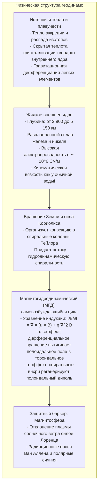
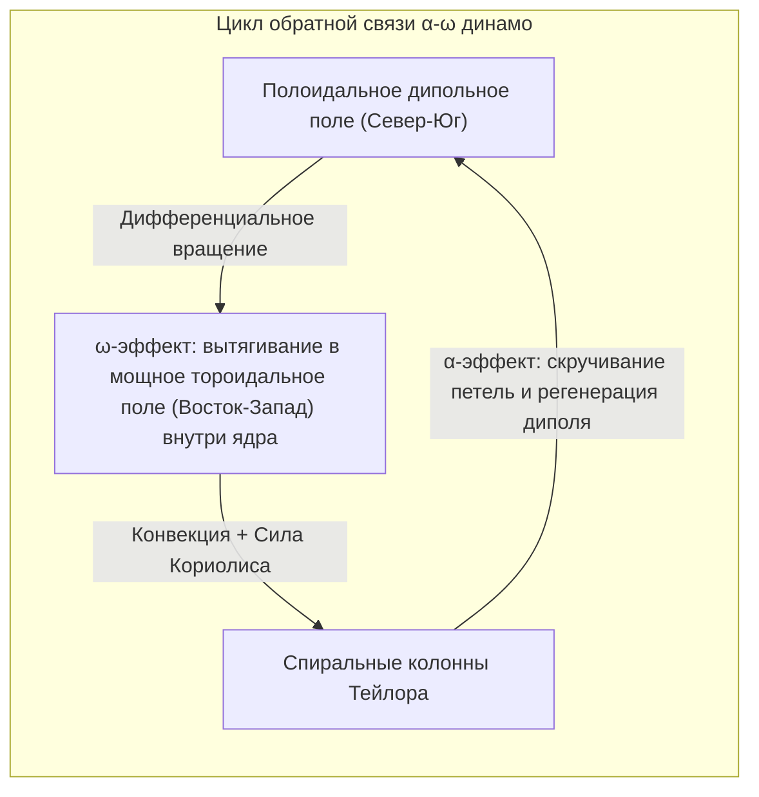

Положите компас на ладонь — и намагниченная стрелка, слегка качнувшись, замрет, указывая строго на север. Это свойство веками вело мореплавателей через неизведанные океаны, а сегодня направляет спутниковую навигацию. Мы привыкли считать само собой разумеющимся, что <strong>Земля — это огромный магнит</strong>.

Но с точки зрения фундаментальной физики здесь кроется ошеломляющий парадокс: <strong>почему недра нашей планеты вообще обладают магнитными свойствами?</strong>

Школьные учебники часто изображают внутри Земли гигантский полосовой магнит. Однако с глубиной температура растет катастрофически быстро: на границе земного ядра (глубина 2 900 км) она достигает <strong>от 4 000 до 5 000 Кельвинов</strong> — жара, сравнимого с поверхностью Солнца.

Все ферромагнетики (железо, никель, кобальт) подчиняются строгому закону физики: при нагревании выше <strong>точки Кюри ($T_C$)</strong> (для чистого железа это всего <strong>770 °C</strong>) тепловое движение полностью разрушает квантовое выстраивание электронных спинов. Вещество мгновенно теряет ферромагнетизм и переходит в немагнитное парамагнитное состояние.

Поскольку уже на глубине нескольких десятков километров температура превышает 1 000 °C, <strong>более 99% объема земного шара физически не способны содержать постоянные магниты</strong>.

Как же раскаленная планета порождает мощнейшее дипольное поле на протяжении 3,5 миллиардов лет? И почему ее магнитные полюса <strong>сотни раз менялись местами</strong> за геологическую историю?

---

## 1. Крушение гипотезы постоянного магнита: Гильберт и предел Кюри

В 1600 году английский ученый <strong>Уильям Гильберт</strong> в книге *De Magnete* («О магните») доказал на модели шара из магнитной руды («тереллы»), что Земля ведет себя как сферический магнит.

Однако в 1895 году <strong>Пьер Кюри</strong> установил, что выше температуры $T_C$ (770 °C для железа) спонтанное намагничивание исчезает. Земное поле не может создаваться холодными намагниченными породами — оно обязано своим существованием <strong>колоссальным электрическим токам, непрерывно циркулирующим в жидких недрах</strong>.

---

## 2. Жидкое внешнее ядро: Металлический океан с вязкостью воды

Сейсмология и физика сверхвысоких давлений делят ядро на две части:
- <strong>Твердое внутреннее ядро</strong> (5 150–6 371 км): кристаллический железо-никелевый шар под давлением более 3 млн атмосфер;
- <strong>Жидкое внешнее ядро</strong> (2 900–5 150 км): расплавленный металлический слой толщиной 2 260 км.

Вопреки стереотипу о густой магме, расчеты и ударно-волновые эксперименты показывают: кинематическая вязкость жидкого железа при давлении ядра составляет около $10^{-6} \, \text{м}^2/\text{с}$ — <strong>оно течет так же легко, как обычная вода</strong>. Внешнее ядро — это сверхпроводящий океан расплавленного металла, охваченный мощнейшей турбулентностью.

---

## 3. Магнитная гидродинамика и самовозбуждающееся геодинамо

Взаимодействие движущейся проводящей жидкости и магнитных полей описывается <strong>уравнением магнитной индукции</strong>:

$$\frac{\partial \mathbf{B}}{\partial t} = \nabla \times (\mathbf{u} \times \mathbf{B}) + \eta \nabla^2 \mathbf{B}$$

где $\eta = \frac{1}{\mu_0 \sigma}$ — магнитная вязкость (диффузность).

Без движения жидкости геомагнитное поле затухло бы из-за омического сопротивления всего за <strong>20 000 лет</strong>. Однако магнитное число Рейнольдса $R_m \sim 100\text{–}1000 \gg 1$. В этом режиме выполняется <strong>теорема Альфвена о вмороженности магнитных силовых линий</strong>: силовые линии буквально переносятся потоками жидкости, закручиваются и растягиваются, непрерывно усиливая поле.

---

## 4. Динамо-цикл $\alpha$-$\omega$: Роль вращения планеты

По теореме Каулинга, чисто осесимметричное движение не может поддерживать стационарное магнитное поле. Вращение Земли формирует трехмерные спиральные вихри:

1. <strong>$\omega$-эффект:</strong> Дифференциальное вращение слоев ядра закручивает полоидальные силовые линии вдоль параллелей, создавая колоссальное замкнутое <strong>тороидальное поле</strong> силой в сотни гаусс внутри ядра.
2. <strong>$\alpha$-эффект:</strong> Тепловые восходящие потоки под действием <strong>силы Кориолиса</strong> закручиваются в винтовые спирали (<strong>колонны Тейлора</strong>). Эти вихри приподнимают и поворачивают тороидальные трубки на 90 градусов, восстанавливая глобальное <strong>полоидальное поле диполя</strong>.

---

## 5. Летопись камня: Инверсии поля и ярус Чибаний

Остывая ниже точки Кюри, магнитные минералы в лаве навсегда запечатывают направление древнего геомагнитного поля (<strong>термоостаточная намагниченность</strong>).

В 1929 году японский геофизик <strong>Мотонори Мацуяма</strong> открыл, что древние базальты намагничены противоположно современному полю, и выдвинул гипотезу об <strong>инверсиях геомагнитного поля</strong>. Эпоха обратной полярности от 774 тысяч до 2,58 миллиона лет назад названа в его честь <strong>эпохой Мацуяма</strong>. Симметричные полосовые магнитные аномалии океанского дна доказали тектонику литосферных плит.

В 2020 году Международный союз геологических наук утвердил ярус <strong>Чибаний (Chibanian)</strong>: разрез в префектуре Тиба (Япония) с непревзойденной точностью зафиксировал последнюю смену полюсов (границу Мацуяма-Брюнес 774 000 лет назад).

---

## 6. Компьютерное моделирование хаоса

В 1995 году Гэри Глатцмайер и Пол Робертс воспроизвели на суперкомпьютере 300 000 лет эволюции внешнего ядра. Они доказали, что за счет <strong>нелинейной хаотической гидродинамической турбулентности</strong> диполь спонтанно ослабевает на 80–90%, поле распадается на хаотичные мультиполи и за несколько тысячелетий собирается заново с противоположной полярностью.

---

## 7. Щит жизни: Магнитосфера

В околоземном космосе <strong>сила Лоренца $\mathbf{F} = q(\mathbf{v} \times \mathbf{B})$</strong> отталкивает убийственный поток солнечного ветра на расстоянии около 65 000 км от Земли. Захваченные частицы формируют <strong>пояса Ван Аллена</strong> и озаряют небо <strong>полярными сияниями</strong>.

На <strong>Марсе</strong>, уступающем Земле по массе, недра быстро остыли, и динамо заглохло 4 миллиарда лет назад. Лишившись магнитного щита, Марс потерял плотную атмосферу и океаны под ударами солнечного ветра, превратившись в безжизненную пустыню.

Кипящий океан расплавленного железа на глубине тысяч километров под нашими ногами — это живое сердце Земли, оберегающее биосферу от космической радиации.
