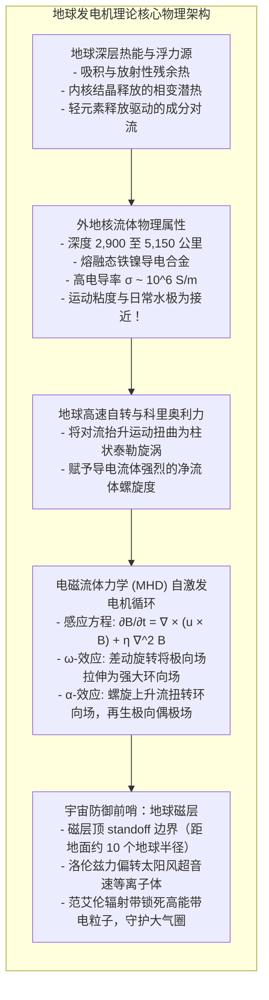
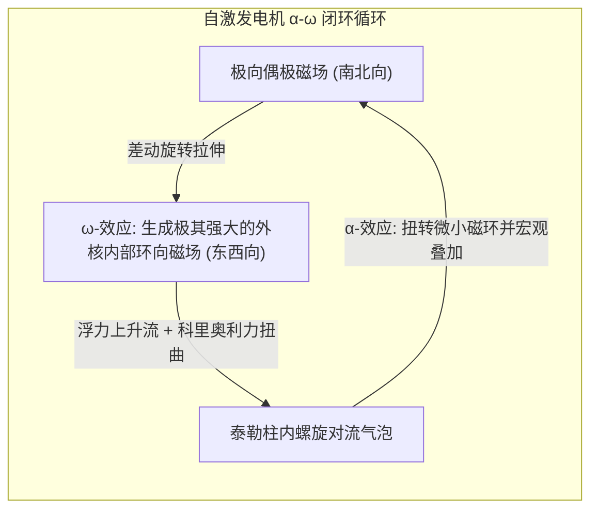

将一枚指南针托在掌心，纤细的磁针在经历轻微颤动后，总会沉稳而坚定地指向北极。千百年来，这股隐形的力量引导着探险家横渡惊涛骇浪，也在今天默默支撑着智能手机的导航芯片。我们习以为常地接受这个事实：<strong>地球是一块巨大的磁铁</strong>。

但如果从物理学深处探究，一个令人震惊的悖论便浮出水面：<strong>地球的核心为什么会有磁性？</strong>

中学课本常用“地球内部埋着一根巨大条形磁铁”来打比方。然而在真实的地球内部，地温随着深度急剧飙升。在地下 2,900 公里以下的地核边缘，温度高达 <strong>4,000 至 5,000 开尔文</strong>，几乎与太阳表面温度相当。

根据凝聚态物理学常识，所有强磁性金属（如铁、钴、镍）都存在一个严格的物理上限——<strong>居里温度（Curie Temperature）</strong>。对于金属铁，这一临界温度仅为 <strong>770 ℃（约 1,043 K）</strong>。一旦超过此阈值，强烈的热运动便会粉碎原子自旋的平行排列，强磁性彻底崩溃，物质将完全退化为无磁性的顺磁体。

既然地球深处根本不可能存在任何固态永久磁铁，那么这股维持了 35 亿年以上、强达数万纳特斯拉（nT）的行星磁场究竟因何而生？为什么这股磁场在历史上曾频繁发生<strong>“南北磁极彻底颠倒（地磁倒转）”</strong>？

---

## 1. 永磁体的幻灭：吉尔伯特与居里温度壁垒

人类对地磁的科学考察始于 1600 年英国女王伊丽莎白一世御医<strong>威廉·吉尔伯特（William Gilbert）</strong>出版的划时代巨著《论磁》（*De Magnete*）。吉尔伯特用天然磁石雕刻出小球模型“小地球”（Terrella），通过观测小磁针在球体表面的倾角分布，首次确立了“地球本身就是一块天然大磁石”的命题。

然而，1895 年法国物理学家<strong>皮埃尔·居里（Pierre Curie）</strong>的发现击碎了永久磁铁假说。在强磁性体中，相邻原子的未成对电子自旋通过量子交换相互作用自发取向一致，形成宏观磁畴。但随着温度升高，热涨落能（$k_B T$）逐渐压倒自旋耦合能，在居里点 $T_C$ 发生二级相变，磁畴瓦解，自发磁化强度归零。

地壳与上地幔在深达数十公里处温度即已破千，这证明：<strong>占地球体积 99% 以上的内部物质早已因极端高温而完全退磁</strong>。

地表检测到的地磁场，必然源于<strong>深部极其庞大的动态宏观环形电流</strong>。

---

## 2. 地球核心的物理本质：一汪像水一般流动的液态铁海

地球物理学与地震波断层成像技术揭示了地球核心的奇特结构：
- <strong>固态内地核</strong>（5,150 至 6,371 公里）：超高压下结晶的铁镍合金球；
- <strong>液态外地核</strong>（2,900 至 5,150 公里）：厚达 2,260 公里的熔融铁镍合金层。

在 130 万至 330 万个大气压的高压下，外核温度（4,000–5,000 K）高过铁的熔点，维持着纯液态。令人惊异的是，高压矿物实验与第一性原理量子分子动力学模拟表明，外核熔融金属的运动粘度约为：

$$\nu \approx 10^{-6} \, \text{m}^2/\text{s}$$

这与<strong>常温自来水的粘度完全相同</strong>！换言之，地球内部包裹着一汪导电性极高、粘度极低、像清泉般激荡翻滚的液态金属汪洋。

---

## 3. 电磁流体力学（MHD）与自激发电机理论

当高导电流体发生剧烈流动时，流体力学与麦克斯韦电磁学耦合构成了<strong>自激发电机（Self-Exciting Dynamo）</strong>。其核心数学规律是<strong>磁感应方程（Induction Equation）</strong>：

$$\frac{\partial \mathbf{B}}{\partial t} = \nabla \times (\mathbf{u} \times \mathbf{B}) + \eta \nabla^2 \mathbf{B}$$

其中 $\eta = \frac{1}{\mu_0 \sigma}$ 为磁扩散率。

方程右侧的物理竞争至关重要：
1. <strong>平流拉伸项 $\nabla \times (\mathbf{u} \times \mathbf{B})$</strong>：流体流动捕获并拉伸磁力线。当流管被拉细拉长时，由磁通守恒，局域磁感应强度呈指数级暴增；
2. <strong>欧姆耗散项 $\eta \nabla^2 \mathbf{B}$</strong>：流体电阻导致电流转化为焦耳热，使磁场逐渐耗散。

若外核流体停滞（$\mathbf{u} = 0$），地磁场的自然欧姆衰减寿命仅约 <strong>2 万年</strong>。地磁场历经数十亿年不灭，全因外核流体的剧烈运动持续战胜着欧姆衰减。

无量纲的<strong>磁雷诺数（Magnetic Reynolds Number）</strong>：

$$R_m = \frac{U L}{\eta} \sim 100 \text{ 至 } 1000 \gg 1$$

在 $R_m \gg 1$ 的极限下，<strong>阿尔芬“磁冻结定理”（Frozen-in Theorem）</strong>成立：磁力线仿佛被牢牢冻结在流体微元中，随流体的旋涡被任意扭曲、拉长和聚集。

---

## 4. α-ω 发电机循环：自转赋予的磁场再生闭环

1934 年考林反发电机定理（Cowling's Theorem）证明：轴对称流动无法维持稳态发电机。自激发电机必须依赖<strong>三维非轴对称螺旋流（Helical Flow）</strong>，这正是由地球自转带来的<strong>科里奥利力</strong>所促成。

1. <strong>ω-效应（Omega Effect）</strong>：外核深层与浅层自转角速度存在微小差异（差动旋转）。南北向的极向磁力线被东西向的差动剪切流缠绕拉伸，在地核内部聚集成数以百高斯的庞大<strong>环向磁场</strong>；
2. <strong>α-效应（Alpha Effect）</strong>：内地核结晶释放的潜热与轻元素驱动强大的对流上升流。在地球高速自转的科里奥利力作用下，上升流被迫旋转，形成平行的<strong>泰勒柱螺旋涡旋</strong>。这些螺旋涡流像开瓶器一样，将东西向的环向磁力线向上顶起并旋转 90 度，再生出新的南北向极向磁环，进而汇聚维持宏观偶极场。

---

## 5. 沉积物中的惊天秘密：地磁倒转与千叶阶（Chibanian）

地球磁场不是永恒不变的。岩石中的磁性矿物在冷却通过居里点时，会将当时的地球磁场矢量永久锁死在岩石中，这被称为<strong>热剩磁（TRM）</strong>。

1929 年，日本京都帝国大学地球物理学家<strong>松山基範（Motonori Matsuyama）</strong>通过分析日本与朝鲜半岛的玄武岩，世界首次提出<strong>“地球磁场曾在地质历史上发生南北完全逆转”</strong>的惊世假说。20 世纪中叶，全球同位素定年确凿证实了这一发现，距今约 77 万年以前的长达近 180 万年的倒转时期被国际地质学界正式命名为<strong>“松山倒转极性纪（Matsuyama Chron）”</strong>。

地磁倒转更是海底扩张与<strong>板块构造理论</strong>的决胜铁证（瓦因-马修斯假说）。大洋中脊喷涌凝固的洋壳如同一台天然磁带录音机，对称记录了交替出现的正反地磁条带。

2020 年，国际地质科学联合会（IUGS）正式批准日本千叶县市原市养老川沿岸的“千叶地层剖面”为中更新统全球标准层型剖面和点位（GSSP）。该处完好记录了约 77.4 万年前最近一次磁极倒转（<strong>松山-布容倒转边界 MBB</strong>），将距今 77.4 万年至 12.9 万年的地质年代正式命名为<strong>“千叶阶”（Chibanian）</strong>。

---

## 6. 超级计算机揭示的混沌倒转机制

1995 年，计算地球物理学家<strong>格拉茨迈尔（Gary Glatzmaier）与罗伯茨（Paul Roberts）</strong>首次在超级计算机上完成了外核电磁流体力学的三维全自洽数值模拟。

模拟历经 30 万年流体时间，在无需任何外来冲击下，纯粹由于外核流体非线性湍流的内在混沌性，自发出现了磁极倒转：
- 对流局域微小涡旋先在地核深处聚积反向磁通管；
- 主双极磁场剧烈瓦解衰减，场强暴跌 80% 至 90%；
- 地表磁场退化为多极复杂形态（四极、八极子），磁极在低纬度游移数千年；
- 随后，反向偶极矩自组织迅速崛起，重新恢复至满额场强。

这表明：<strong>地磁倒转是流动发电机固有的非线性混沌跃迁，是地球内在生命力激荡的自然展现。</strong>

---

## 7. 宇宙之盾：磁层守护下的宜居世界

若没有地磁场，地球将沦为如同火星般的死寂荒漠。

太阳以数百公里每秒向外喷发包含高速质子与电子的<strong>超音速太阳风等离子体</strong>。当等离子体冲向地球时，<strong>洛伦兹力 $\mathbf{F} = q(\mathbf{E} + \mathbf{v} \times \mathbf{B})$</strong> 迫使带电粒子沿磁力线打转，在距地表约 6.5 万公里处形成强大的阻隔界面（磁层顶），将太阳风粒子大部偏转绕行。

漏入磁层的极少数高能粒子被锁在<strong>范艾伦辐射带</strong>中，部分沿着磁力线坠入两极高空，轰击氧原子与氮分子释放出绚烂的<strong>极光</strong>。

火星由于体积较小，内部热量在数十亿年前散失殆尽，导致外核发电机停转、磁场消亡。失去磁屏障的火星在数亿年内被太阳风无情“剥蚀”扫光了大部大气与海洋。

正是我们足底数千公里深处奔流不息的液态金属发电机，为地表撑开了一柄无形的光之巨伞，呵护着这颗蓝色星球数亿年未曾中断的演化奇迹。
