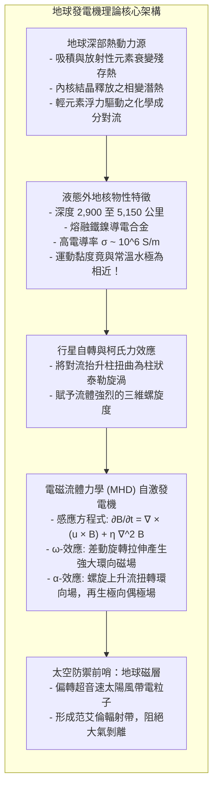
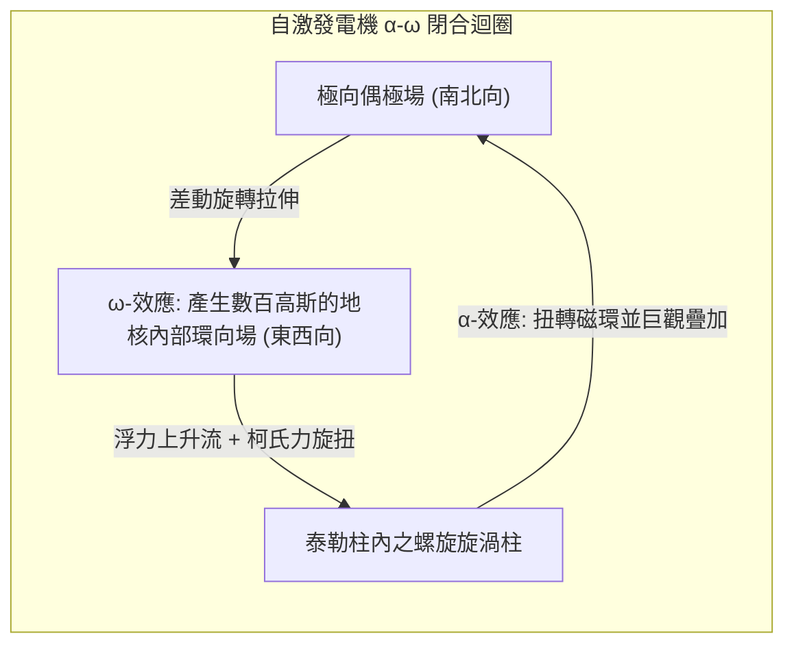

將一只指北針平置於手心，指針在微幅晃動後終將明確指向北方。數百年來，航海者憑此在汪洋中尋覓航道，而今日的智慧型手機亦依賴相同的物理原理感知方位。我們理所當然地接受：<strong>地球是一顆巨大的磁石</strong>。

然而，若從物質物理學深入審視，將浮現一個巨大的理論矛盾：<strong>地核深處怎麼可能存在磁鐵？</strong>

許多人誤以為地球內部埋藏著天然磁石。但隨著向地球深處推進，地溫急遽攀升，在地下 2,900 公里以下的地核邊界，溫度高達 <strong>4,000 至 5,000 開爾文</strong>，媲美太陽表面。

在凝態物理學中，所有鐵磁性材料皆受限於<strong>居禮溫度（Curie Temperature）</strong>——純鐵的居禮點僅約 <strong>770 ℃</strong>。一旦超越該溫度，劇烈的熱擾動將徹底摧毀電子自旋的有序排列，磁性瞬間蕩然無存，轉變為無磁性的順磁態。

既然地核不可能存在任何固態永久磁鐵，這股守護了地球超過 35 億年的巨大磁場從何而來？為何古地質記錄顯示，南北磁極在歷史上曾反覆發生<strong>「完全顛倒反轉（地磁倒轉）」</strong>？

---

## 1. 永磁假說的破滅：吉爾伯特與居禮點之牆

人類對地磁的科學奠基於 1600 年英國威廉·吉爾伯特（William Gilbert）的《論磁》（*De Magnete*）。他以天然磁石製成小球模型，證實地球本質是一顆大磁石。

但 1895 年皮埃爾·居禮（Pierre Curie）的研究揭示，鐵磁物質在達到居禮溫度 $T_C$（鐵為 770 ℃）時會因熱運動而瓦解自旋排列，徹底失去自發磁化強度。地表下僅數十公里處地溫即已突破千度，證明<strong>佔地球體積 99% 以上的深部物質早已完全退磁</strong>。

地球的磁場必然由<strong>地下深處規模龐大的流動電流</strong>所引發。

---

## 2. 地核的流體物理：如水般激盪的熔融金屬汪洋

地震學與高壓物理實驗證實：
- <strong>固態內核</strong>（5,150 至 6,371 公里）：極高壓下結晶的純鐵鎳球體；
- <strong>液態外核</strong>（2,900 至 5,150 公里）：厚達 2,260 公里的熔融金屬層。

在外核超過百萬大氣壓的高壓環境中，溫度凌駕於鐵的熔點之上。高壓物理運算顯示，熔融金屬鐵的運動黏度約為 $10^{-6} \, \text{m}^2/\text{s}$，<strong>與日常飲用水的黏度無異</strong>！外地核實質上是一片導電性極高、極易流動的超高溫液態金屬巨海。

---

## 3. 電磁流體力學（MHD）與自激發電機機制

導電流體的流動催生了<strong>自激發電機（Self-Excited Dynamo）</strong>，其運作遵循<strong>磁感應方程式</strong>：

$$\frac{\partial \mathbf{B}}{\partial t} = \nabla \times (\mathbf{u} \times \mathbf{B}) + \eta \nabla^2 \mathbf{B}$$

其中 $\eta = \frac{1}{\mu_0 \sigma}$ 為磁擴散率。

方程式右側代表兩種物理力量的角力：
1. <strong>平流拉伸項</strong>：流體流動捕捉並拉伸磁力線，由磁通量守恆，磁場強度得以呈指數級倍增；
2. <strong>歐姆擴散項</strong>：電阻將電能轉化為焦耳熱，導致磁場空間擴散耗散。

若外核流動停滯，地磁場將在短短 <strong>2 萬年</strong>內消散殆盡。因外核磁雷諾數 $R_m \sim 100 \text{ 至 } 1000 \gg 1$，<strong>阿爾芬磁凍結定理</strong>生效，磁力線如彈性線條般凍結於流體中隨之扭動伸長，使磁場持續獲得補強。

---

## 4. α-ω 發電機循環：自轉柯氏力賦予的再生引擎

依據考林定理，單純的軸對稱對流無法維持穩態磁場。外地核必須依靠自轉形成的<strong>三維螺旋流動</strong>：

1. <strong>ω-效應</strong>：外核角速度的差動剪切流將極向磁力線沿東西向強烈拉伸捲繞，於地核內部形成強大的<strong>環向磁場</strong>；
2. <strong>α-效應</strong>：地核熱浮力與成分浮力促成上升對流，在地球強大的<strong>柯氏力</strong>作用下扭曲成<strong>螺旋泰勒柱渦流</strong>。螺旋渦流像螺旋起子般將東西向磁環垂直扭轉 90 度，再生出宏觀的南北向<strong>極向偶極場</strong>，形成自持閉環。

---

## 5. 地質記錄的震撼：地磁倒轉與千葉階（Chibanian）

岩石在冷卻低於居禮點時會記錄當時的磁場方向，形成<strong>熱殘餘磁性（TRM）</strong>。

1929 年，京都帝國大學教授<strong>松山基範</strong>領先全球提出<strong>「地磁在歷史上曾多次南北大反轉」</strong>的開創性結論。距今約 77 萬年前至 258 萬年前的倒轉時期被正式命名為<strong>「松山逆磁極期（Matsuyama Chron）」</strong>。大洋中脊兩側對稱展開的海底磁條帶異常，更成為板塊構造學說的奠基證據。

2020 年，國際地質科學聯合會正式將日本千葉縣市原市養老川沿岸的地層剖面批准為全球標準層型剖面（GSSP），該處清晰記錄了 77.4 萬年前的最近一次反轉（松山-布容邊界），使該地質年代被永垂青史命名為<strong>「千葉階」（Chibanian）</strong>。

---

## 6. 電腦模擬解密：非線性混沌的必然結果

1995 年，格拉茨邁爾與羅伯茨於超級電腦上運行外核 30 萬年流動模擬，成功重現了純因<strong>流體非線性混沌湍流</strong>引發的自發性地磁倒轉：
- 主偶極矩在千百年間急速崩潰衰減 80% 至 90%；
- 地表顯現四極子、八極子等混亂多極磁場；
- 隨後於數千年間迅速自組織，重新凝結為穩固的反向雙極場。

這證明地磁倒轉非外部天體撞擊等偶然事故，而是流體發電機固有混沌性質的必然展現。

---

## 7. 太空屏障：磁層守護的宜居星球

高速超音速太陽風暴襲向地球時，磁場藉由<strong>勞侖茲力 $\mathbf{F} = q(\mathbf{v} \times \mathbf{B})$</strong> 在距地面約 6.5 萬公里處築起<strong>磁層頂</strong>，迫使絕大多數帶電粒子轉向繞行。

少數滲入粒子受困於<strong>范艾倫輻射帶</strong>，或循磁力線轟擊兩極高層大氣激發出瑰麗的<strong>極光</strong>。

火星因質量較小早早冷卻，發電機在四十億年前熄滅，大氣與海洋隨即遭到太陽風徹底剝蝕殆盡，淪為冰冷荒漠。

地球深處那片激盪翻湧的液態金屬海洋，正是維繫地表萬物生生不息的隱形防護罩。
