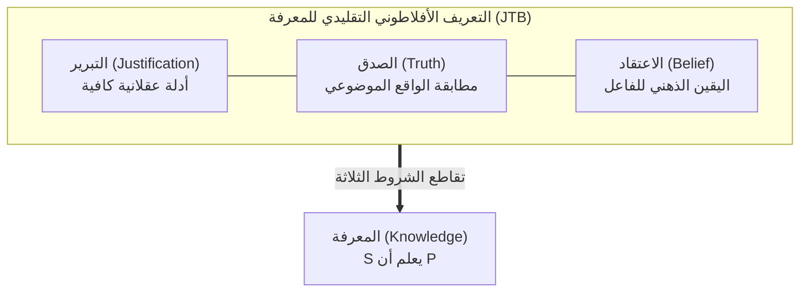

## مقدمة: الورقة ذات الصفحات الثلاث التي هزت صرح الفلسفة

في حياتنا اليومية، نستخدم كلمة «أعلم» بيقين مطلق:
- «أعلم أن السماء تمطر بالخارج» (لأنني أرى قطرات المطر تنهمر على النافذة)؛
- «أعلم أن الأرض تدور حول الشمس» (استناداً إلى الأدلة الفلكية القطعية)؛
- «أعلم أن $2 + 2 = 4$» (وفقاً لبديهيات الحساب).

ولكن من المنظور الفلسفي الصارم: <strong>ما الذي يعنيه تحديداً أن 'يعلم' كائن واعٍ قضية ما؟ ما هي الشروط الضرورية والكافية للمعرفة؟</strong>

منذ محاورات أفلاطون في *ثياتيتوس* و*مينون*، استقرت الفلسفة الغربية على تعريف <strong>الاعتقاد الصادق المبرر (Justified True Belief / JTB)</strong>:
يعلم الشخص $S$ القضية $P$ إذا وفقط إذا تحققت الشروط الثلاثة معاً:
1. <strong>الاعتقاد</strong>: أن يعتقد $S$ صدق $P$؛
2. <strong>الصدق</strong>: أن تكون $P$ صادقة موضوعياً في الواقع؛
3. <strong>التبرير</strong>: أن يمتلك $S$ أدلة عقلانية كافية لتبرير اعتقاده.

ظل هذا التعريف سائداً كحقيقة بديهية لأكثر من ألفي عام. ولكن في <strong>يونيو 1963</strong>، نشر أستاذ مغمور يُدعى <strong>إدموند غيتيه (1927–2021)</strong> ورقة من <strong>ثلاث صفحات فقط</strong> في مجلة *Analysis*: *«هل الاعتقاد الصادق المبرر هو المعرفة؟»*. قدّم غيتيه أمثلة مضادة محكمة برهنت أن الشروط الثلاثة قد تتحقق معاً دون أن يمتلك الشخص ذرة من المعرفة الحقيقية!

---

## 1. أمثلة غيتيه المضادة

### الحالة الأولى: سميث وجونز والقطع النقدية العشر
يتنافس سميث وجونز على وظيفة. يؤكد رئيس الشركة لسميث أن جونز سينال الوظيفة. وقبل قليل رأى سميث جونز يعد عشر قطع نقدية في جيبه. يستنتج سميث منطقياً:
> *(e) الرجل الذي سينال الوظيفة يملك عشر قطع نقدية في جيبه.*

تحدث المفاجأة: يتراجع مجلس الإدارة ويعين <strong>سميث نفسه</strong>! ودون أن يعلم سميث، كان في جيبه <strong>عشر قطع نقدية بالضبط أيضاً</strong>!
القضية صادقة، ومبررة، ومصدقة، ولكن هل كان سميث يعلم ذلك؟ <strong>كلا!</strong> لقد كان مجرد مصادفة عمياء.

---

## 2. جوهر المعضلة: الحظ المعرفي (Epistemic Luck)

تكشف حالات غيتيه عن خلل بنيوي ناتج عن <strong>الحظ المعرفي</strong>:
1. <strong>سوء الحظ</strong>: المقدمة التي استند إليها التبرير كاذبة في الأصل (جونز لم يوظف)؛
2. <strong>حسن الحظ</strong>: تدخل واقعي مستقل جعل النتيجة صادقة بالصدفة (سميث يملك العملات).
الحظ المعرفي يقطع الصلة الضرورية بين الجهد العقلاني للفاعل والواقع الوجودي للعالم.

---

## 3. البحث عن الشرط الرابع

- <strong>استبعاد المقدمات الكاذبة (No False Lemmas)</strong>: سقط أمام مثال <strong>الساعة المتوقفة</strong> (النظر إلى ساعة تعطلت قبل 24 ساعة بالضبط عند الساعة 8:20).
- <strong>النظرية السببية لغولدمان</strong>: دحضتها تجربة <strong>بلد الحظائر الزائفة (Fake Barn Country)</strong>.
- <strong>تتبع الحقيقة لنوزيك (Truth-Tracking)</strong>: اشترطت حساسية الاعتقاد للعوالم الممكنة: «لو لم تكن $P$ صادقة، لما اعتقد $S$ بها».

---

### 3.4 الانقسام بين النزعة الداخلية والخارجية

أدى انفجار معضلة غيتيه إلى انقسام إبستمولوجي جذري:
- <strong>النزعة الداخلية (Internalism)</strong>: تشترط أن تكون أسباب التبرير حاضرة في وعي الفاعل وقابلة للتأمل الباطني؛
- <strong>النزعة الخارجية (Externalism)</strong>: ترى أن المعرفة تعتمد على موثوقية العمليات المعرفية الموضوعية في العالم الخارجي، حتى لو لم يدرك الفاعل تفاصيلها الدقيقة.

### 3.5 المنعطف المعاصر: نظرية «أولوية المعرفة» لتيموثي ويليامسون

في مواجهة الجدل العقيم حول تعديل شروط المعرفة، طرح فيلسوف أكسفورد تيموثي ويليامسون في كتابه الشهير *المعرفة وحدودها* (2000) مقاربة ثورية تُعرف باسم «أولوية المعرفة» (Knowledge First). يرى ويليامسون أن المعرفة حالة ذهنية أصيلة أولية غير قابلة للاختزال إلى عناصر مثل الاعتقاد والتبرير. محاولة تركيب المعرفة من أجزاء أصغر تشبه محاولة جمع مفهوم مركب بطريقة خاطئة؛ بل إن الاعتقاد والأدلة هما اللذان يجب أن يُفهما انطلاقاً من مفهوم المعرفة ككل موحد.

## 4. إبستمولوجيا الفضيلة وتحدي الذكاء الاصطناعي

- <strong>نموذج AAA لإرنست سوسا</strong>: المعرفة مثل رمية السهم: صائبة (Accurate)، وماهرة (Adroit)، ومناسبة (Apt) — يجب أن يُعزى النجاح إلى مهارة الرامي لا إلى هبة ريح عابرة.
- <strong>النماذج اللغوية الكبيرة (LLM)</strong>: الذكاء الاصطناعي الذي يولد إجابات دقيقة بناءً على هلوسات داخلية هو آلة غيتيه عملاقة تفتقر إلى الفهم الحقيقي للواقع.

## خاتمة

تذكرنا معضلة غيتيه بهشاشة العقل البشري: إصابة الحقيقة بالمصادفة ليست معرفة. المعرفة الحقة إنجاز يتطلب طرد الحظ وتثبيت الوعي في صميم الواقع الموضوعي.
