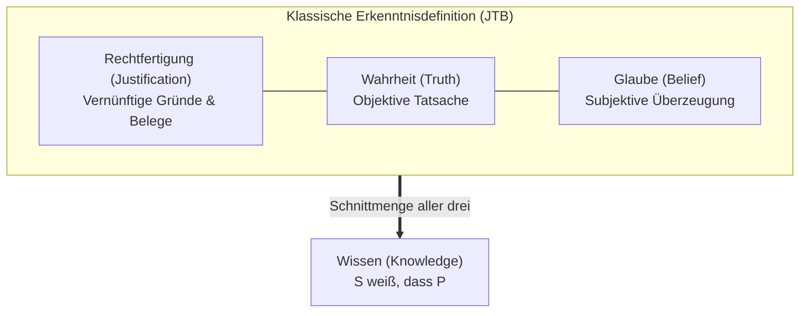

## Einleitung: Die Erschütterung eines antiken Fundaments

Im Alltag verwenden wir das Wort „Wissen“ mit unerschütterlicher Selbstverständlichkeit:
- „Ich weiß, dass es regnet“ (weil ich die Tropfen am Fenster sehe);
- „Ich weiß, dass Berlin die Hauptstadt Deutschlands ist“ (weil es eine verifizierte historische Tatsache ist);
- „Ich weiß, dass $2 + 2 = 4$ ist“ (weil es den Gesetzen der Arithmetik folgt).

Doch was bedeutet es philosophisch, wenn ein Subjekt $S$ eine Proposition $P$ wirklich <strong>weiß</strong>?
Seit Platons Dialogen *Theaitetos* und *Menon* galt in der Philosophie die scheinbar unantastbare <strong>JTB-Definition (Justified True Belief)</strong>: Wissen ist <strong>wahre, gerechtfertigte Meinung</strong>.

Drei Bedingungen galten als notwendig und hinreichend:
1. <strong>Meinungsbedingung (Belief)</strong>: $S$ glaubt, dass $P$;
2. <strong>Wahrheitsbedingung (Truth)</strong>: $P$ ist objektiv wahr;
3. <strong>Rechtfertigungsbedingung (Justification)</strong>: $S$ verfügt über adäquate rationale Gründe oder Belege für $P$.

Dieses Paradigma hielt über zwei Jahrtausende stand – bis im <strong>Juni 1963</strong> ein dreiseitiger Aufsatz des US-Philosophen <strong>Edmund L. Gettier (1927–2021)</strong> erschien: *„Is Justified True Belief Knowledge?“*. Mit bestechender formaler Logik bewies Gettier, dass eine Überzeugung gerechtfertigt und wahr sein kann, ohne dass Wissen vorliegt!

---

## 1. Gettiers klassische Gegenbeispiele

### Fall 1: Smith, Jones und die zehn Münzen
Smith bewirbt sich mit Jones um eine Stelle. Der Firmenchef versichert Smith persönlich: „Jones wird den Job bekommen.“ Kurz zuvor sah Smith, wie Jones zehn Münzen in seine Hosentasche steckte. Smith schließt logisch vollkommen korrekt:
> *(e) Der Mann, der den Job bekommt, hat zehn Münzen in der Tasche.*

Die Wendung: Die Firmenleitung ernennt überraschend <strong>Smith selbst</strong>. Und völlig unbewusst trägt Smith <strong>ebenfalls genau zehn Münzen</strong> in seiner Tasche!
Smiths Überzeugung *(e)* ist wahr, fest geglaubt und durch Zeugnis und Wahrnehmung gerechtfertigt. Doch wusste er es? <strong>Nein!</strong> Es war ein reiner Zufallstreffer.

---

## 2. Der Kern des Problems: Epistemischer Zufall (Epistemic Luck)

Gettier-Fälle beruhen auf einer doppelten Zufallsstruktur:
1. <strong>Pech</strong>: Die Rechtfertigungsbasis schlägt heimlich fehl (Jones bekommt den Job nicht);
2. <strong>Glück</strong>: Ein unabhängiger Umstand macht die Aussage dennoch wahr (Smith hat zehn Münzen).
Der epistemische Zufall entkoppelt die rationale Anstrengung des Geistes von der tatsächlichen Welt.

---

## 3. Der Kampf um die vierte Bedingung

- <strong>Keine falschen Prämissen (No False Lemmas)</strong>: Scheitert an direkten Wahrnehmungsfällen wie der <strong>stehen gebliebenen Uhr</strong> (eine seit 24 Stunden defekte Uhr, auf die man zufällig genau um 8:20 Uhr blickt).
- <strong>Goldmans Kausaltheorie</strong>: Verlangt eine ununterbrochene Kausalkette zwischen Fakt und Glaube. Wurde durch das Gedankenexperiment der <strong>Scheunen-Attrappen (Fake Barn Country)</strong> widerlegt, bei dem Henry zufällig auf die einzige echte Scheune inmitten von 999 Kulissen blickt.
- <strong>Nozicks Wahrheitstracking (Truth-Tracking)</strong>: Verlangt kontrafaktische Sensitivität: „Wäre $P$ falsch, würde $S$ nicht glauben, dass $P$.“

---

## 4. Tugenderkenntnistheorie und KI-Erkenntnis

- <strong>Ernest Sosas AAA-Modell</strong>: Wahres Wissen ist wie ein meisterhafter Bogenschuss: nicht nur *treffend* (Accurate) und *gekonnt* (Adroit), sondern *adäquat* (Apt) – der Treffer muss dem eigenen Können geschuldet sein, nicht einer Windböe oder einem glücklichen Vogelstoß.
- <strong>Große Sprachmodelle (LLMs)</strong>: Moderne KIs generieren oft sachlich korrekte Antworten auf der Basis halluzinierter Zwischenschritte. Sie sind monumentale Gettier-Maschinen, deren statistisches Gelingen noch lange kein Verständnis der Wirklichkeit bedeutet.

## Fazit

Gettiers drei Seiten beweisen die Zerbrechlichkeit menschlicher Gewissheit. Echtes Wissen verlangt mehr als bloßes Zutreffen; es erfordert eine robuste, vom Zufall befreite Bindung an die Realität.
