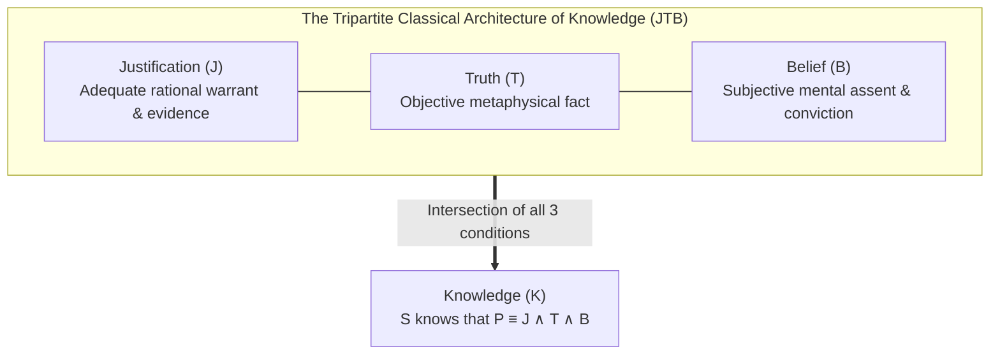
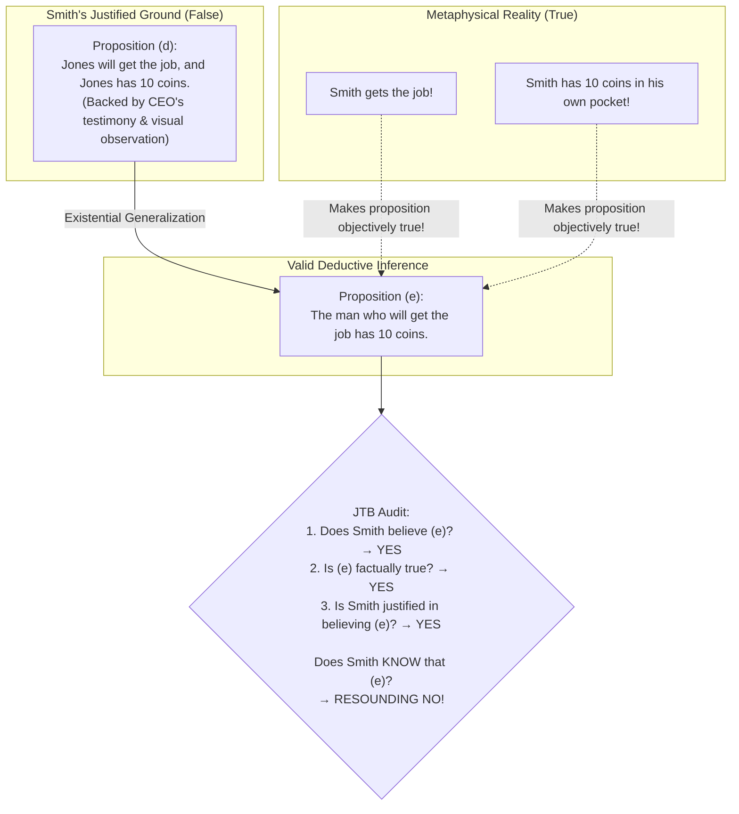
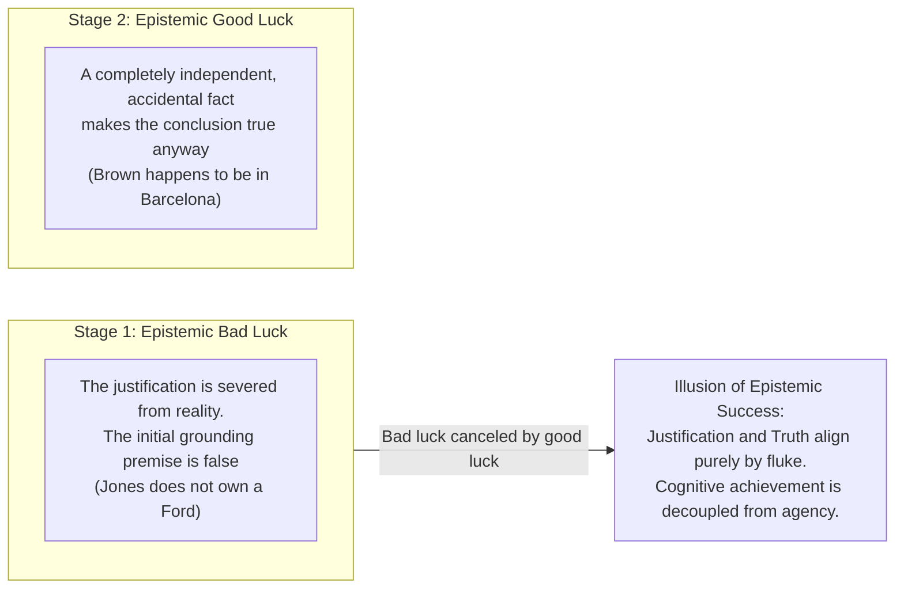
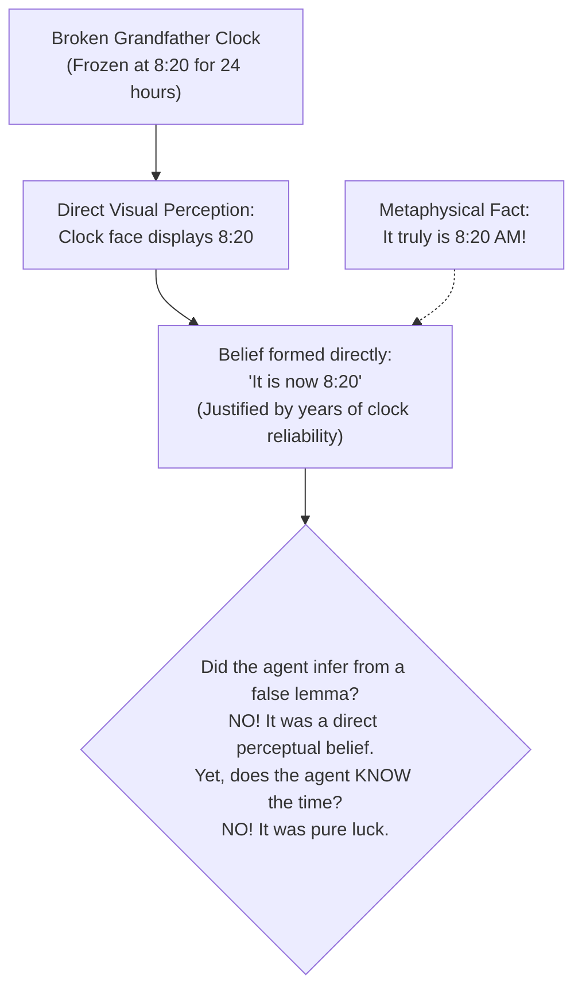
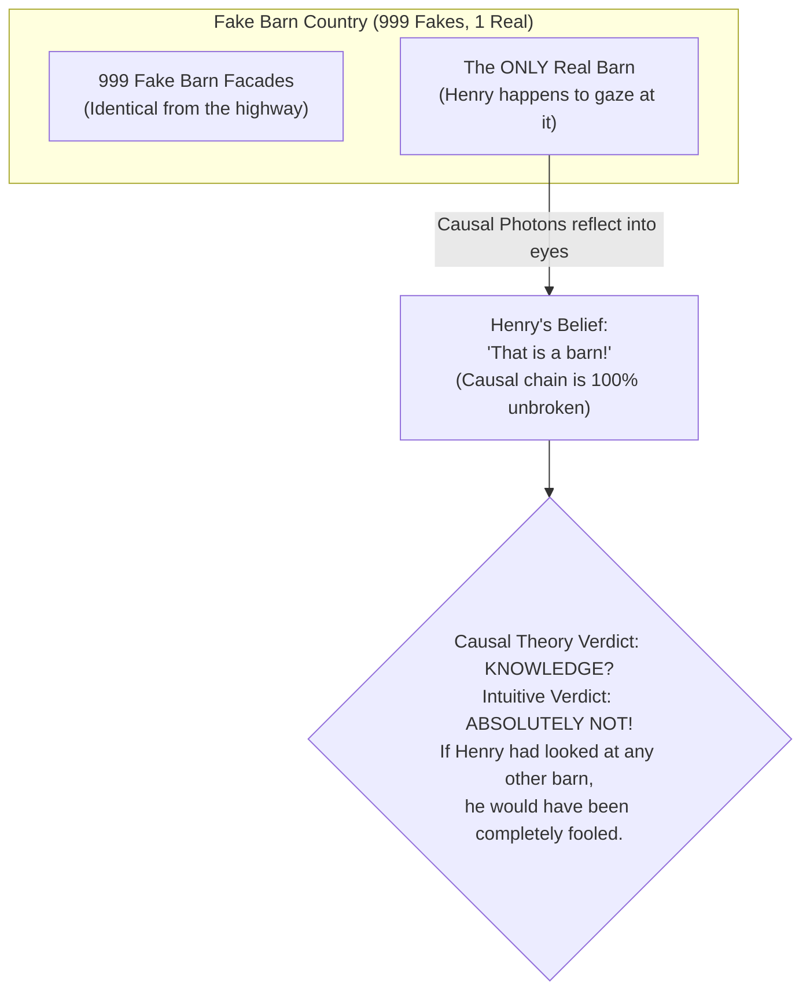
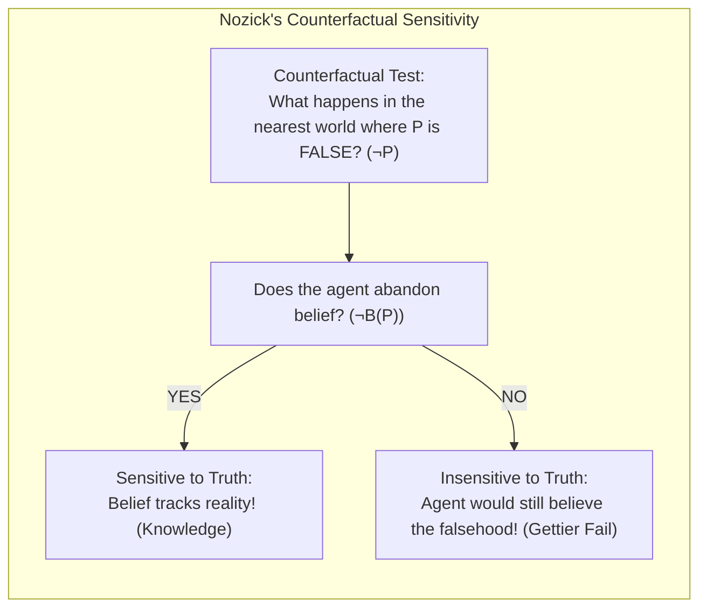
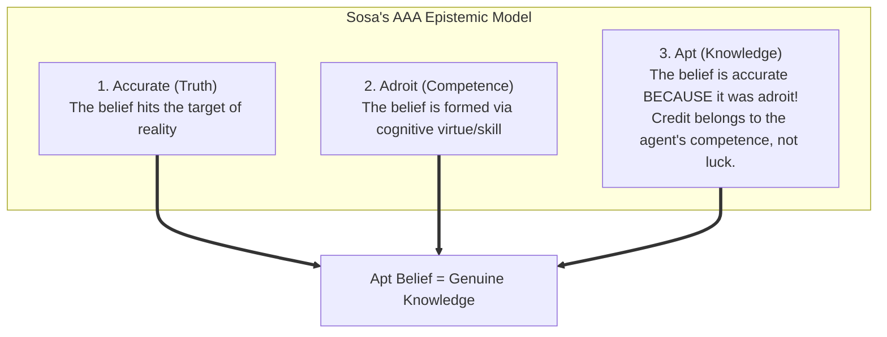
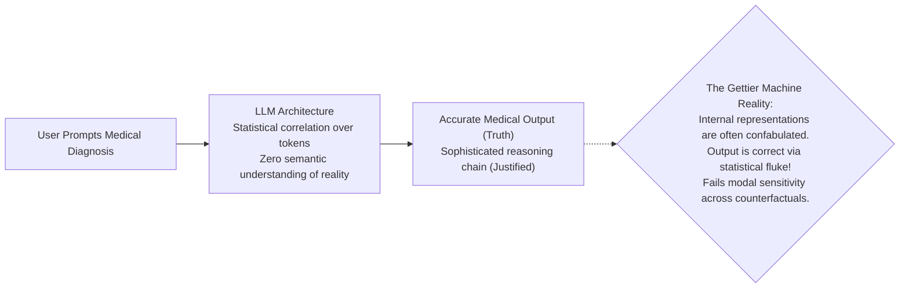

## Introduction: The Three-Page Paper That Shattered a 2,300-Year-Old Cathedral

In our daily lives, we deploy the verb "to know" with casual, unhesitating confidence:
- "I know that it is raining outside" (because I gaze through the windowpane and observe raindrops splashing against the asphalt).
- "I know that the square root of 64 is 8" (because I understand basic mathematical arithmetic and can verify the derivation).
- "I know that penicillin treats bacterial infections" (because medical science has empirically verified its efficacy across millions of clinical trials).

Yet, behind this familiar conversational reflex lies one of the most foundational and difficult questions in the history of human thought: <strong>What does it actually mean for a conscious mind to "know" something? What is the necessary and sufficient definition of knowledge?</strong>

For more than two millennia, Western philosophy believed it possessed an unshakeable, elegant answer. In ancient Greece, Plato—in his celebrated dialogues *Theaetetus* and *Meno*—sketched the conceptual architecture of what later philosophers formalized as the <strong>Justified True Belief (JTB)</strong> analysis of knowledge.

According to the classical JTB theory, an epistemic agent $S$ knows a given proposition $P$ (e.g., "It is raining outside") if and only if three fundamental conditions are <strong>simultaneously satisfied and jointly sufficient</strong>:
1. <strong>The Belief Condition</strong>: $S$ actually believes that $P$ is the case ($B_S(P)$).
2. <strong>The Truth Condition</strong>: $P$ is an objective, factual truth in the real world ($P = \text{True}$).
3. <strong>The Justification Condition</strong>: $S$ possesses adequate, rational, and appropriate evidence, perceptual warrant, or logical justification for believing $P$ ($J_S(P)$).

For centuries, this tripartite definition was revered as an intellectual masterpiece of conceptual analysis:
- A wild, unfounded guess (e.g., guessing that a flipped coin will land on heads, and it does) does not qualify as knowledge because it lacks <strong>Justification</strong>—it was merely a lucky hunch.
- A meticulously justified belief that happens to be factually false (e.g., ancient astronomers believing the Earth was stationary based on all available observations) does not qualify as knowledge because it lacks <strong>Truth</strong>.
- An objective truth that a person does not actually believe (or is completely unaware of) cannot be counted as that person's knowledge because it lacks <strong>Belief</strong>.

"Knowledge is Justified True Belief" ($K = JTB$). From Descartes to Kant, from John Locke to Bertrand Russell, this tripartite definition reigned as an undisputed axiom of Western epistemology.

Then, in <strong>June 1963</strong>, a minor academic journal titled *Analysis* published a paper that detonated like a conceptual atomic bomb beneath the foundations of philosophy. It was an astonishingly brief manuscript—barely <strong>three pages long, containing fewer than a thousand words</strong>, written by an obscure, unpublished assistant professor at Wayne State University named <strong>Edmund L. Gettier (1927–2021)</strong>. 

The paper's title was deceptively modest:
> <strong>"Is Justified True Belief Knowledge?"</strong>

In those three sparse pages, without resorting to esoteric jargon or complex mathematical apparatus, Gettier constructed two devastatingly simple, airtight counterexamples. He demonstrated scenarios where an individual holds a belief that is <strong>completely justified</strong>, <strong>undeniably true</strong>, and <strong>genuinely believed</strong>, yet where common sense and philosophical intuition scream in unison: <strong>the person does NOT know the proposition!</strong>

The JTB analysis was not merely wounded; it was dead. The shockwave that followed transformed modern philosophy, inaugurating the famous <strong>Gettier Problem</strong>. 

In this comprehensive academic treatise, we dissect the logical anatomy of Gettier's counterexamples, investigate why "epistemic luck" poisons genuine knowledge, examine the half-century war of epicycles (from Goldman's causal theory and Nozick's counterfactual tracking to virtue epistemology), and confront the contemporary crisis of artificial intelligence: Can a Large Language Model (LLM) that accidentally produces factually accurate answers ever be said to truly "know" the world?

---

## 1. The Logical Anatomy of Gettier's Original Counterexamples

To appreciate the lethal precision of Gettier's argument, one must examine how he exploited the formal rules of deductive logic to engineer his trap. Gettier based his counterexamples on two fundamental, universally accepted epistemic principles:

1. <strong>The Fallibility of Justification Principle</strong>: It is possible for an epistemic agent to be completely justified in believing a proposition that is, in fact, false. (Justification does not require infallible Cartesian certainty).
2. <strong>The Deductive Closure of Justification Principle</strong>: If an agent $S$ is justified in believing proposition $P$, and $S$ correctly and validly deduces proposition $Q$ from $P$, accepting $Q$ as a result of that deduction, then $S$ is equally justified in believing $Q$.

With these two innocent principles in hand, Gettier constructed his two masterstrokes.

### 1.1 Case I: Smith, Jones, and the Ten Coins

Two job applicants, Smith and Jones, are awaiting the decision of a hiring committee for a single vacant position.

Smith has overwhelming, impeccably justified evidence for the following conjunctive proposition $(d)$:
> <strong>$(d)$ Jones is the man who will get the job, and Jones has ten coins in his pocket.</strong>

Smith's justification for $(d)$ is rock-solid:
- The president of the company personally told Smith an hour ago: "We have decided to offer the position to Mr. Jones."
- Ten minutes prior, Smith watched Jones carefully count ten coins from his trouser pocket and slide them back into his pocket in front of his own eyes.

From proposition $(d)$, Smith applies the elementary logical rule of existential generalization (or simplification) to validly deduce proposition $(e)$:
> <strong>$(e)$ The man who will get the job has ten coins in his pocket.</strong>

Smith accepts and firmly believes $(e)$ based entirely on his deduction from $(d)$.

Now, the dramatic epistemic catastrophe unfolds:
1. In a shocking, last-minute reversal by the board of directors, the president's announcement is overruled. The job offer is awarded not to Jones, but to <strong>Smith himself</strong>!
2. Furthermore, completely unknown to Smith, he happens to have <strong>exactly ten coins in his own trouser pocket</strong> (a forgotten handful of loose change from his morning coffee purchase).

Let us audit Smith's epistemic status regarding proposition $(e)$ against the sacred JTB triad:
1. <strong>Is $(e)$ true?</strong> Yes! The man who gets the job (Smith) indeed has ten coins in his pocket.
2. <strong>Does Smith believe $(e)$?</strong> Yes! He explicitly deduced it and assented to it.
3. <strong>Is Smith justified in believing $(e)$?</strong> Yes! He deduced it via valid formal logic from $(d)$, for which he possessed immaculate testimonial and observational evidence.

Every condition of the classical definition of knowledge is satisfied to the letter. 

Yet, does Smith <strong>know</strong> that the man who gets the job has ten coins in his pocket?
<strong>Certainly not!</strong> 
Smith's belief was about *Jones*. The fact that proposition $(e)$ turned out to be true had nothing to do with Jones; it was true because of *Smith himself*, about whose coins and hiring success Smith was entirely ignorant. The truth of Smith's belief was an astonishing, blind <strong>accident of cosmic coincidence</strong>.

Therefore, Justified True Belief is <strong>NOT sufficient</strong> for knowledge!

---

### 1.2 Case II: The Ford Car and the Wanderer in Barcelona

Gettier's second counterexample is even more dazzling, exploiting the logical rule of <strong>Disjunction Introduction</strong> (if $P$ is true, then $P \lor Q$ is necessarily true, regardless of what $Q$ asserts).

Smith has strong, justifiable evidence for believing proposition $(f)$:
> <strong>$(f)$ Jones owns a Ford.</strong>

Smith's evidence: Jones has owned a Ford for as long as Smith has known him, and Jones just gave Smith a ride while driving a Ford car.

Smith has another friend named Brown, whose present whereabouts are utterly unknown to Smith. Relying on his justified belief in $(f)$, Smith constructs three disjunctive propositions:
- <strong>$(g)$ Either Jones owns a Ford, or Brown is in Boston.</strong>
- <strong>$(h)$ Either Jones owns a Ford, or Brown is in Barcelona.</strong>
- <strong>$(i)$ Either Jones owns a Ford, or Brown is in Brest-Litovsk.</strong>

By the laws of propositional logic ($P \implies P \lor Q$), Smith is fully justified in believing each of these statements. Smith chooses to assent to proposition $(h)$: "Either Jones owns a Ford, or Brown is in Barcelona."

Now, reality strikes:
1. Jones does not own a Ford. He was driving a rental car after selling his own vehicle the week before. Thus, proposition $(f)$ is <strong>completely false</strong>.
2. However, by an uncanny, astronomical stroke of luck, Brown—about whom Smith had no information whatsoever—<strong>happens to be precisely in Barcelona at that exact moment!</strong>

Proposition $(h)$ is:
- <strong>True</strong> (because the second disjunct is true);
- <strong>Believed by Smith</strong>;
- <strong>Justified</strong> (deduced from a justified premise).

Yet, Smith obviously did not "know" that either Jones owns a Ford or Brown is in Barcelona. He had no clue where Brown was. His belief was true purely by luck.

---

## 2. The Core Pathology: Epistemic Luck

What is the fundamental mechanism that breaks the machinery of knowledge in Gettier cases? In contemporary epistemology, the culprit has been identified as <strong>Epistemic Luck</strong>.

A Gettier-type counterexample invariably exhibits a <strong>two-stage cancellation structure</strong>:

1. <strong>The Component of Bad Luck</strong>: The agent's rational justification is, through no fault of their own, disconnected from the actual state of the world (e.g., Jones does not own the car; the clock stopped running yesterday).
2. <strong>The Component of Good Luck</strong>: An independent, serendipitous fact enters the picture, rescuing the proposition and rendering it true anyway (e.g., Brown is in Barcelona; the current time miraculously matches the stopped clock).

The good luck cancels out the bad luck, preserving the *truth* of the belief. But in doing so, it destroys the *epistemic integrity* of the belief. 

Genuine knowledge requires that a belief be true <strong>because of</strong> the agent's cognitive competence and proper contact with reality, rather than by a stroke of fortune. When truth and justification coincide merely by coincidence, the status of "knowledge" evaporates.

---

## 3. The Quest for the Fourth Condition: Half a Century of Philosophical War

The publication of Gettier's paper triggered an intellectual gold rush. Epistemologists worldwide scrambled to discover the missing <strong>"Fourth Condition $X$"</strong> that would repair the formula:
$$\text{Knowledge} = \text{Justified} + \text{True} + \text{Belief} + X$$

### 3.1 The "No False Lemmas" Proposal

The most immediate and obvious fix was proposed by Michael Clark (1963):
> <strong>Condition 4 (No False Lemmas)</strong>: An agent's belief $P$ must not be deduced from any <strong>false premise (false lemma)</strong>.

In Gettier's cases, Smith relied on the false lemma "Jones will get the job" or "Jones owns a Ford." If we ban false premises from the chain of justification, does the problem vanish?

#### The Collapse: Perceptual Gettier Cases
Unfortunately, this proposal collapsed almost immediately. Philosophers discovered that Gettier situations can occur <strong>without any deductive inference or intermediate lemmas whatsoever</strong>.

The classic counterexample is <strong>Bertrand Russell's Stopped Clock</strong> (originally conceived in 1948, but recognized as a pure perceptual Gettier case post-1963):
> You walk into a room and glance at an antique grandfather clock. The hands read <strong>8:20</strong>. The clock has been impeccably reliable for decades. You immediately form the belief: *"It is 8:20."*
> Unbeknownst to you, the clock stopped ticking <strong>exactly 24 hours ago</strong> at 8:20.
> However, at the precise moment you look at it, <strong>the current time is genuinely 8:20 AM!</strong>

Here, there is no conscious chain of deduction; you do not say "The clock is working, therefore it is 8:20." You form the belief directly upon perception. The belief is true, justified, and contains no explicit false lemma in its derivation—yet it is still an accidental fluke, not knowledge.

---

### 3.2 Alvin Goldman's Causal Theory of Knowing (1967)

Recognizing that purely logical criteria were insufficient, <strong>Alvin Goldman</strong> proposed shifting the focus from logic to physics and causality. In his landmark paper *"A Causal Theory of Knowing"*, Goldman declared:
> <strong>The Causal Condition</strong>: *An agent $S$ knows that $P$ if and only if the fact that $P$ is true is <strong>appropriately causally connected</strong> to $S$'s belief in $P$.*

Appropriate causal connections include direct perception (light reflecting from an object into the retina), memory traces, and unbroken chains of reliable testimony.

In Smith's coin case, the fact that *Smith had ten coins* was not the causal origin of Smith's belief; the belief was caused by looking at Jones. In the clock case, the fact that *it was 8:20* did not cause the hands to point to 8:20. The causal link was broken, explaining why neither case constitutes knowledge.

#### The Nightmare of the "Fake Barn Country"
Goldman's causal theory was hailed as a definitive triumph—until 1976, when Carl Ginet devised a thought experiment so devastating that Goldman himself conceded defeat. This scenario is known as <strong>Fake Barn Country</strong>:

> Henry is driving through a rural countryside. He looks out his car window, spots a large red barn standing in an open field, and forms the belief: *"There is a barn in that field."*
> The weather is clear, his vision is 20/20, and there is indeed a real, physical barn standing right there. The real barn reflects photons into Henry's eyes, causing his belief. The causal chain is pristine and unbroken.
>
> However, Henry is unaware of a bizarre local fact: The local county, for the purposes of a film production, has erected <strong>999 fake, hollow papier-mâché barn facades</strong> throughout the countryside. From the road, these facades are visually indistinguishable from real barns.
> Out of the 1,000 structures in the county, 999 are fakes. By sheer, miraculous chance, Henry happened to look at the <strong>one and only genuine barn</strong> in the entire region!

Henry's belief is:
- <strong>True</strong>;
- <strong>Believed</strong>;
- <strong>Justified</strong> by normal visual standards;
- <strong>Causally caused</strong> by the real barn itself!

Yet, does Henry <strong>know</strong> that he is looking at a barn? 
No! Had he glanced at any of the other 999 fields, he would have formed the exact same belief and been completely deceived. His success was an accident of <strong>environmental luck</strong>. Unbroken causality does not guarantee knowledge when the surrounding modal environment is treacherous.

---

### 3.3 Robert Nozick's Truth-Tracking Theory (1981)

In *Philosophical Explanations* (1981), Harvard philosopher <strong>Robert Nozick</strong> introduced modal logic and counterfactuals to formalize the intuition that knowledge must "track the truth."

Nozick argued that for a belief to count as knowledge, the agent's belief-forming mechanism must be sensitive to whether the proposition is true or false across <strong>close possible worlds</strong>. He formulated four conditions:

$$\text{S knows that } P \iff$$
1. $P$ is true.
2. $S$ believes $P$.
3. <strong>The Sensitivity Condition (Variation)</strong>: If $P$ were not true, $S$ would not believe that $P$ ($\neg P \mathbin{\Box\kern-1.5pt\rightarrow} \neg B_S(P)$).
4. <strong>The Adherence Condition</strong>: If $P$ were true (in slightly different circumstances), $S$ would still believe that $P$ ($P \mathbin{\Box\kern-1.5pt\rightarrow} B_S(P)$).

Let us apply Nozick's <strong>Sensitivity Condition</strong> to Fake Barn Country:
- Suppose $P$ ("That is a barn") were false—meaning Henry was looking at one of the 999 papier-mâché facades instead. Would Henry have refrained from believing it was a barn?
- <strong>No!</strong> Henry would have looked at the facade and cheerfully believed "That is a barn!" anyway.

Because Henry's belief fails the counterfactual sensitivity test, it fails to track the truth, and Nozick correctly diagnoses it as <strong>not knowledge</strong>.

#### The Fatal Cost of Sensitivity: The Failure of Epistemic Closure
While brilliant, Nozick's theory demanded an unbearable epistemological sacrifice: it forced the abandonment of the <strong>Principle of Epistemic Closure</strong>:
$$\text{If } S \text{ knows that } P, \text{ and } S \text{ knows that } P \implies Q, \text{ then } S \text{ knows that } Q.$$

Under Nozick's definition:
- You know that you have two hands (because in the nearest world where you lost a hand, you would see it and not believe you have two hands $\implies$ Sensitive).
- But you do NOT know that you are not a disembodied "Brain in a Vat" being stimulated by an evil scientist (because if you *were* a Brain in a Vat, you would still falsely believe you are not a Brain in a Vat $\implies$ Insensitive!).

Thus, according to Nozick, you can know you have hands, know that having hands implies you are not a brain in a vat, yet fail to know you are not a brain in a vat! Most epistemologists found this violation of closure too absurd to swallow.

---

## 4. Modern Epistemology: Virtues, Safety, and the Function of Knowledge

Frustrated by the endless cycle of proposed definitions and immediate counterexamples (dubbed the "Gettier Industry"), contemporary epistemology executed a series of radical paradigm shifts.

### 4.1 Virtue Epistemology: Sosa's AAA Model

Pioneered by <strong>Ernest Sosa</strong>, <strong>Linda Zagzebski</strong>, and <strong>John Greco</strong>, <strong>Virtue Epistemology</strong> relocated the primary locus of evaluation from the static proposition to the <strong>intellectual character and cognitive competence of the human agent</strong>.

Sosa formulated the famous <strong>AAA Archery Metaphor</strong>:
Consider an archer shooting an arrow at a target:
1. <strong>Accurate</strong>: Did the arrow hit the bullseye? (Corresponds to <strong>Truth</strong>).
2. <strong>Adroit</strong>: Was the shot taken with genuine skill, proper form, and competence? (Corresponds to <strong>Justification</strong>).
3. <strong>Apt</strong>: Did the arrow hit the target <strong>BECAUSE of</strong> the archer's skill?

Now consider a Gettier scenario in archery:
An archer shoots with world-class skill (Adroit). A freak gust of wind catches the arrow and knocks it completely off course (Bad Luck). But just before it hits the dirt, a stray goose flies into the arrow's path, deflecting it straight back into the bullseye (Good Luck)!

The shot was <strong>Accurate</strong> (it hit the mark), and it was <strong>Adroit</strong> (shot with skill), but it was emphatically <strong>NOT APT</strong>. The success is credited to the goose and the wind, not to the archer's competence.

According to Virtue Epistemology:
$$\text{Knowledge is Apt Belief.}$$
Knowledge is cognitive success attributable to the agent's intellectual virtues. This formulation effortlessly eliminates Gettier luck without falling into the trap of formalistic counterexamples.

### 4.2 Edward Craig and the Functional Approach: Why Do We Need "Knowledge"?

In 1990, British philosopher <strong>Edward Craig</strong> published a revolutionary book titled *Knowledge and the State of Nature*. Craig proposed abandoning the traditional search for necessary and sufficient conditions:
> *"Instead of asking what knowledge IS in the abstract, let us ask: <strong>Why did human language invent the concept of 'knowledge' in the first place? What practical function does it serve in human survival?</strong>"*

Craig argued that humans are social creatures who depend on pooled information for survival. When a tribal member returns from a scouting mission, the group needs to know: Is there water over the hill? Are there predators?

In this primitive state of nature, the community desperately requires a label to distinguish <strong>reliable informants</strong> from unreliable ones:
- A person who makes a wild guess, or who happens to be right by pure accident (a Gettier agent), cannot be trusted tomorrow.
- A person who possesses genuine cognitive competence, proper perceptual access, and reliable judgment CAN be trusted tomorrow.

The concept of <strong>"knowing"</strong> was forged as an <strong>epistemic seal of approval</strong>—a social mechanism to identify, certify, and recommend <strong>trustworthy informants</strong>. The intuitive revulsion we feel toward Gettier cases stems from the fact that a Gettierized person is an epistemic hazard: someone who got it right today by a fluke, but who will lead the tribe off a cliff tomorrow.

---

## 5. The Gettier Dilemma in the Age of Artificial Intelligence

In the 21st century, the Gettier Problem has transcended classical seminar rooms to become the defining theoretical crisis of <strong>Artificial Intelligence and Large Language Models (LLMs)</strong>.

Modern generative AI systems (such as GPT-4 or Gemini) do not possess conscious understanding, intentionality, or direct sensory grounding in the physical universe. They are probabilistic sequence predictors trained to maximize the likelihood of the next token based on cross-entropy loss over internet corpora.

When a user queries an LLM on an advanced medical diagnosis, a complex legal dispute, or an obscure quantum theorem, the AI frequently generates an answer that is <strong>100% factually accurate</strong>.

Yet, when we inspect the underlying mechanism, <strong>is the AI possessing knowledge, or is it a massive, automated Gettier Machine?</strong>

1. <strong>Hallucinatory Derivations with True Conclusions</strong>:
   LLMs frequently engage in internal hallucinations—confabulating fictitious case citations or non-existent chemical interactions—yet miraculously produce the correct final conclusion at the end of the text stream. This is the exact digital equivalent of Smith deducing a true conclusion from the false premise of Jones's pocket change.
2. <strong>Failure of Modal Safety and Robustness</strong>:
   If an adversarial prompt introduces a minor, irrelevant perturbation into the input, the LLM's confident factual answer often collapses into total nonsense. The AI fails Nozick's counterfactual tracking and Sosa's competence requirement; its correctness in any given instance is tainted by <strong>environmental epistemic luck</strong>.
3. <strong>The Explainable AI (XAI) Imperative</strong>:
   When an autonomous driving AI detects a pedestrian and applies the brakes, did it brake because it *knew* a human was in danger, or because the lighting angle triggered an edge-detection filter that happened to coincide with a pedestrian? In safety-critical engineering, the distinction between "apt knowledge" and "Gettier luck" is quite literally the boundary between life and death.

The entire endeavor of AI alignment, mechanistic interpretability, and formal verification is nothing less than a modern engineering campaign to <strong>exorcise Gettier luck from algorithmic intelligence</strong>.

---

## Conclusion: The Fragile Bridge Between Conviction and Reality

Edmund Gettier's three-page paper was never an empty linguistic puzzle or a trivial game of pedantic definitions. It was a profound, humbling revelation regarding <strong>the inherent vulnerability of human reason</strong>.

It exposed the terrifying truth that an epistemic agent can do everything right—gather evidence with utmost diligence, apply rigorous deductive logic, eliminate cognitive bias, and arrive at a belief that is objectively true—and yet still remain an unwitting hostage to pure chance. The bridge connecting our internal subjective convictions to the external objective truth of the cosmos is far more fragile and elusive than Plato ever dared to imagine.

Yet, this realization is not an invitation to nihilistic skepticism; rather, it is a call to epistemic humility and vigilance. To confront the Gettier Problem is to acknowledge that genuine knowledge is a rare, hard-won achievement. It demands that we look beyond superficial correctness and scrutinize the causal roots, the counterfactual resilience, and the cognitive virtues that bind our minds to reality.

In striving to purge luck from our beliefs—in science, in law, and in the silicon minds we build—we participate in humanity's most noble philosophical quest: the pursuit of truth that is not merely stumbled upon in the dark, but grasped in the enduring light of understanding.
