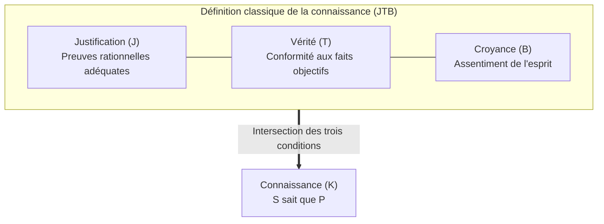

## Introduction : L'article de trois pages qui ébranla 2300 ans de philosophie

Dans notre quotidien, nous employons le verbe « savoir » avec une assurance absolue :
- « Je sais qu'il pleut dehors » (car je perçois les gouttes frapper les carreaux) ;
- « Je sais que la Terre tourne autour du Soleil » (car la science astronomique l'a rigoureusement prouvé) ;
- « Je sais que $2 + 3 = 5$ » (en vertu des axiomes élémentaires de l'arithmétique).

Cependant, sur le plan philosophique : <strong>que signifie exactement pour un être conscient le fait de « savoir » quelque chose ? Quels sont les critères nécessaires et suffisants de la connaissance ?</strong>

Depuis l'Antiquité grecque, Platon—notamment dans le *Théétète* et le *Ménon*—avait établi ce que l'histoire de la philosophie retiendra sous le nom de <strong>Croyance Vraie Justifiée (théorie JTB, pour Justified True Belief)</strong>.
Selon cette conception tripartite, un sujet $S$ sait que $P$ si et seulement si trois conditions sont simultanément satisfaites :
1. <strong>La croyance</strong> : $S$ croit que $P$ ($B_S(P)$) ;
2. <strong>La vérité</strong> : $P$ est objectivement vraie ($P = \text{Vrai}$) ;
3. <strong>La justification</strong> : $S$ dispose de raisons rationnelles ou de preuves suffisantes pour croire que $P$ ($J_S(P)$).

Pendant plus de deux mille ans, cette définition parut indestructible : deviner juste au hasard manque de justification (ce n'est qu'un coup de chance) ; se tromper sincèrement manque de vérité (c'est une erreur).

Puis, en <strong>juin 1963</strong>, un article de <strong>trois pages seulement</strong>, rédigé par un professeur inconnu de l'Université Wayne State, <strong>Edmund L. Gettier (1927–2021)</strong>, fit voler en éclats cet édifice millénaire : *« Is Justified True Belief Knowledge? »*. Gettier y exposa des situations où une croyance est parfaitement justifiée, incontestablement vraie, et sincèrement crue, mais où nul ne peut raisonnablement affirmer que le sujet « sait ».

---

## 1. Les contre-exemples originaux de Gettier

### Cas 1 : Smith, Jones et les dix pièces de monnaie
Smith et Jones postulent pour le même poste. Le directeur de l'entreprise assure formellement à Smith que Jones sera embauché. Dix minutes plus tôt, Smith a vu Jones compter dix pièces de monnaie et les ranger dans sa poche. Smith déduit alors logiquement :
> *(e) L'homme qui obtiendra le travail a dix pièces dans sa poche.*

Coup de théâtre : la direction change d'avis et embauche <strong>Smith lui-même</strong> ! Or, sans s'en douter, Smith possède <strong>lui aussi exactement dix pièces</strong> dans sa propre poche.
La proposition *(e)* est vraie, crue par Smith, et pleinement justifiée par des déductions logiques valides. Mais Smith le savait-il ? <strong>Non !</strong> Ce n'est qu'une pure coïncidence fortuite.

---

## 2. Le cœur du problème : La chance épistémique (Epistemic Luck)

Les situations de Gettier révèlent la pathologie de la <strong>chance épistémique</strong> :
1. <strong>Malchance initiale</strong> : la justification repose sur un fait erroné (Jones n'a pas le poste) ;
2. <strong>Bonne chance corrective</strong> : un fait indépendant et imprévu rend la conclusion vraie malgré tout (Smith a dix pièces).
La vérité n'étant qu'un coup de chance, le lien intime entre la compétence rationnelle du sujet et la réalité du monde est brisé.

---

## 3. La quête de la quatrième condition

- <strong>L'exclusion des lemmes faux (No False Lemmas)</strong> : Exiger qu'aucune prémisse fausse n'intervienne. Invalidée par le cas de <strong>l'horloge arrêtée</strong> (une montre arrêtée depuis 24 heures à 8h20 que l'on consulte par hasard pile à 8h20).
- <strong>La théorie causale de Goldman</strong> : Exiger une chaîne causale directe entre le fait et la croyance. Balayée par l'expérience de pensée du <strong>pays des fausses granges (Fake Barn Country)</strong>, où Henry observe par miracle la seule vraie grange au milieu de 999 décors en carton-pâte.
- <strong>Le suivi de la vérité de Nozick (Truth-Tracking)</strong> : Exiger que la croyance soit sensible aux contrefactuels : « Si $P$ était fausse, $S$ ne croirait pas que $P$ ».

---

## 4. Épistémologie des vertus et modèles d'IA

- <strong>Le modèle AAA d'Ernest Sosa</strong> : La connaissance est un tir à l'arc réussi : *précis* (Accurate), *compétent* (Adroit), et surtout *approprié* (Apt) – le succès doit découler du talent du tireur et non d'une bourrasque de vent bienveillante.
- <strong>Les grands modèles de langage (LLM)</strong> : Les IA modernes produisent régulièrement des conclusions médicales ou juridiques parfaitement exactes à partir de chaînes de raisonnement délirantes ou hallucinées. L'IA agit alors comme une formidable « machine de Gettier », privée de tout ancrage sémantique réel.

## Conclusion

Le problème de Gettier nous rappelle la fragilité de nos certitudes. Savoir ne consiste pas simplement à énoncer le vrai par accident, mais à ancrer notre esprit dans la réalité par un acte de rigueur intellectuelle libéré de l'illusion du hasard.
