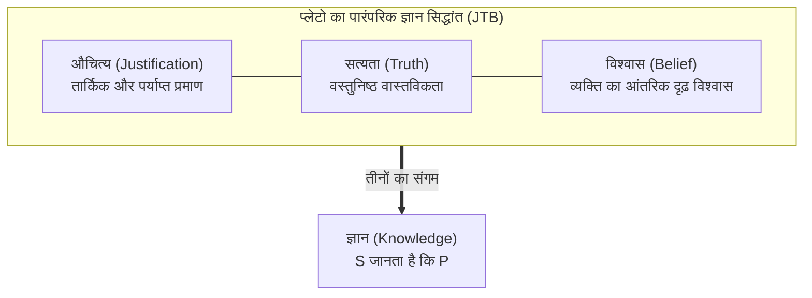

## प्रस्तावना: तीन पन्नों का वह शोधपत्र जिसने 2300 साल पुरानी दार्शनिक इमारत को ढहा दिया

दैनिक जीवन में हम 'जानना' शब्द का प्रयोग अत्यंत सहजता और आत्मविश्वास के साथ करते हैं:
- "मैं जानता हूँ कि बाहर बारिश हो रही है" (क्योंकि मैं खिड़की से पानी की बूंदें गिरती देख रहा हूँ);
- "मैं जानता हूँ कि पृथ्वी सूर्य की परिक्रमा करती है" (वैज्ञानिक प्रमाणों के आधार पर);
- "मैं जानता हूँ कि $2 + 2 = 4$ होता है" (अंकगणित के नियमों के अनुसार)।

परंतु दार्शनिक दृष्टिकोण से: <strong>किसी चेतन मस्तिष्क के लिए किसी बात को 'जानने' का वास्तविक अर्थ क्या है? ज्ञान की अनिवार्य और पर्याप्त शर्तें क्या हैं?</strong>

प्राचीन यूनानी दार्शनिक प्लेटो ने *थिएटेटस* और *मेनो* में इसका एक अत्यंत प्रभावशाली उत्तर दिया था, जिसे बाद में <strong>'न्यायसंगत सत्य विश्वास' (Justified True Belief / JTB सिद्धांत)</strong> के रूप में स्वीकार किया गया।
JTB सिद्धांत के अनुसार, एक व्यक्ति $S$ किसी कथन $P$ को केवल तभी 'जानता' है जब तीन शर्तें पूरी हों:
1. <strong>विश्वास (Belief)</strong>: $S$ यह मानता हो कि $P$ सत्य है;
2. <strong>सत्यता (Truth)</strong>: $P$ वास्तव में सत्य हो;
3. <strong>औचित्य/न्यायसंगतता (Justification)</strong>: $S$ के पास $P$ पर विश्वास करने के पर्याप्त और तार्किक कारण हों।

दो सहस्राब्दियों से भी अधिक समय तक यह परिभाषा अकाट्य मानी जाती रही। परंतु <strong>जून 1963</strong> में, वेन स्टेट यूनिवर्सिटी के एक अप्रसिद्ध सहायक प्रोफेसर <strong>एडमंड एल. गेत्तियर (1927–2021)</strong> ने *Analysis* पत्रिका में <strong>मात्र तीन पन्नों</strong> का एक अत्यंत संक्षिप्त शोधपत्र प्रकाशित किया: *«क्या न्यायसंगत सत्य विश्वास ही ज्ञान है?»*। गेत्तियर ने ऐसे अकाट्य उदाहरण प्रस्तुत किए जहाँ तीनों शर्तें पूरी होती हैं, फिर भी कोई भी विवेकशील व्यक्ति उसे ज्ञान मानने को तैयार नहीं होगा!

---

## 1. गेत्तियर के मूल प्रति-उदाहरण

### मामला 1: स्मिथ, जोन्स और जेब के दस सिक्के
स्मिथ और जोन्स एक ही नौकरी के लिए साक्षात्कार दे रहे हैं। कंपनी का अध्यक्ष स्मिथ से कहता है कि जोन्स को नौकरी मिलेगी। कुछ देर पहले स्मिथ ने जोन्स को अपनी जेब में दस सिक्के गिनते हुए देखा था। स्मिथ तार्किक निष्कर्ष निकालता है:
> *(e) जिस व्यक्ति को नौकरी मिलेगी, उसकी जेब में दस सिक्के हैं।*

अचानक पासा पलटता है: बोर्ड जोन्स के बजाय <strong>स्वयं स्मिथ को चुन लेता है</strong>! और स्मिथ को पता नहीं था कि उसकी अपनी जेब में भी <strong>संयोगवश ठीक दस सिक्के</strong> थे!
कथन *(e)* सत्य है, स्मिथ द्वारा माना गया है और तार्किक रूप से न्यायसंगत भी है। लेकिन क्या स्मिथ यह जानता था? <strong>बिल्कुल नहीं!</strong> यह मात्र एक अंधा संयोग था।

---

## 2. समस्या की जड़: संज्ञानात्मक भाग्य (Epistemic Luck)

गेत्तियर के मामलों में <strong>संज्ञानात्मक भाग्य</strong> का दोहरा तंत्र कार्य करता है:
1. <strong>दुर्भाग्य</strong>: औचित्य का आधार गलत निकलता है (जोन्स को नौकरी नहीं मिली);
2. <strong>भाग्य</strong>: एक अन्य असंबंधित संयोग निष्कर्ष को सत्य बना देता है (स्मिथ के पास सिक्के हैं)।
संयोग बुद्धि और वास्तविकता के बीच के अनिवार्य संबंध को तोड़ देता है।

---

## 3. चौथी शर्त की खोज

- <strong>झूठे आधारों का बहिष्कार (No False Lemmas)</strong>: यह <strong>बंद पड़ी घड़ी</strong> के मामले (24 घंटे पहले बंद हुई घड़ी को ठीक 8:20 पर देखना) में विफल हो गया।
- <strong>गोल्डमैन का कारण सिद्धांत (Causal Theory)</strong>: इसे <strong>नकली खलिहानों के देश (Fake Barn Country)</strong> के प्रयोग ने खारिज कर दिया।
- <strong>नोज़िक का सत्य-अनुगमन (Truth-Tracking)</strong>: इसने मांग की कि विश्वास वास्तविकता के प्रति संवेदनशील होना चाहिए: "यदि $P$ असत्य होता, तो $S$ उस पर विश्वास नहीं करता"।

---

## 4. सद्गुण ज्ञानमीमांसा और आधुनिक एआई

- <strong>अर्नेस्ट सोसा का AAA मॉडल</strong>: ज्ञान तीरंदाजी के सटीक निशाने जैसा है: वह सटीक (Accurate), कुशल (Adroit) और उपयुक्त (Apt) होना चाहिए — सफलता का श्रेय व्यक्ति के कौशल को जाना चाहिए, हवा के झोंके को नहीं।
- <strong>लार्ज लैंग्वेज मॉडल (LLM)</strong>: भ्रामक तर्कों (Hallucinations) के आधार पर सही उत्तर देने वाले आधुनिक एआई सिस्टम वास्तव में विशालकाय गेत्तियर मशीनें हैं, जिन्हें वास्तविक ज्ञान की श्रेणी में नहीं रखा जा सकता।

## निष्कर्ष

गेत्तियर समस्या हमें सिखाती है कि केवल संयोग से सही होना ज्ञान नहीं है। सच्चा ज्ञान भाग्य के अंधकार से मुक्त होकर यथार्थ की स्पष्ट समझ में निहित है।
