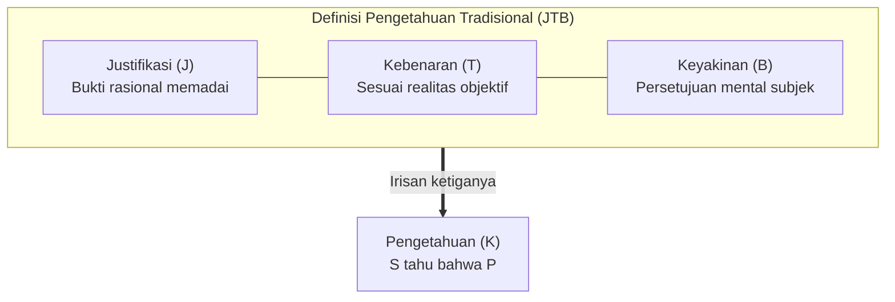

## Pendahuluan: Makalah Tiga Halaman yang Meruntuhkan Katedral Filsafat

Dalam keseharian, kita menggunakan kata "tahu" dengan keyakinan penuh:
- "Saya tahu di luar sedang hujan" (karena melihat tetesan air di jendela);
- "Saya tahu Bumi mengitari Matahari" (karena bukti sains astronomi);
- "Saya tahu $2 + 2 = 4$" (karena hukum aritmetika).

Namun, secara filosofis: <strong>apa arti sebenarnya ketika seseorang dikatakan 'mengetahui' sesuatu? Apa syarat mutlak dari pengetahuan?</strong>

Sejak zaman Plato dalam dialog *Theaetetus* dan *Meno*, epistemologi Barat mengadopsi definisi <strong>Keyakinan Benar Terjustifikasi (Justified True Belief / JTB)</strong>:
Subjek $S$ tahu bahwa $P$ jika dan hanya jika:
1. <strong>Keyakinan (Belief)</strong>: $S$ percaya bahwa $P$;
2. <strong>Kebenaran (Truth)</strong>: $P$ benar secara objektif;
3. <strong>Justifikasi (Justification)</strong>: $S$ memiliki bukti rasional yang memadai untuk meyakini $P$.

Definisi ini bertahan selama 2.300 tahun hingga <strong>Juni 1963</strong>, ketika seorang dosen muda bernama <strong>Edmund L. Gettier (1927–2021)</strong> menerbitkan makalah sepanjang <strong>hanya tiga halaman</strong> di jurnal *Analysis*: *«Is Justified True Belief Knowledge?»*. Gettier menyajikan contoh tandingan yang membuktikan bahwa ketiga syarat JTB dapat terpenuhi sempurna tanpa menghasilkan pengetahuan sejati!

---

## 1. Kasus Tandingan Orisinal Gettier

### Kasus 1: Smith, Jones, dan Sepuluh Koin
Smith dan Jones melamar pekerjaan yang sama. Direktur perusahaan memberi tahu Smith bahwa Jones yang akan diterima. Beberapa menit sebelumnya, Smith melihat Jones menghitung sepuluh koin di sakunya. Smith menyimpulkan secara logis:
> *(e) Orang yang akan mendapatkan pekerjaan memiliki sepuluh koin di sakunya.*

Tak terduga, direksi berubah pikiran dan menerima <strong>Smith sendiri</strong>. Tanpa disadari, di saku Smith <strong>kebetulan ada tepat sepuluh koin</strong>!
Pernyataan *(e)* bernilai benar, diyakini Smith, dan terjustifikasi penuh. Namun apakah Smith tahu? <strong>Tidak!</strong> Itu hanyalah kebetulan murni.

---

## 2. Akar Masalah: Keberuntungan Epistemik (Epistemic Luck)

Kasus Gettier memperlihatkan bekerjanya <strong>keberuntungan epistemik</strong>:
1. <strong>Nasib buruk</strong>: premis dasar justifikasi ternyata salah (Jones tidak diterima);
2. <strong>Nasib baik penyeimbang</strong>: peristiwa kebetulan lain membuat kesimpulan menjadi benar (Smith punya sepuluh koin).
Keberuntungan memutus hubungan intrinsik antara upaya rasional manusia dan kenyataan objektif.

---

## 3. Perburuan Syarat Keempat

- <strong>Tanpa Premis Palsu (No False Lemmas)</strong>: Runtuh oleh kasus <strong>jam dinding mati</strong> (melihat jam rusak 24 jam lalu tepat pada pukul 8:20).
- <strong>Teori Kausal Goldman</strong>: Tumbang oleh eksperimen pikiran <strong>negeri lumbung palsu (Fake Barn Country)</strong>.
- <strong>Pelacakan Kebenaran Nozick (Truth-Tracking)</strong>: Menuntut kepekaan kontrafaktual: "jika $P$ salah, $S$ tidak akan percaya $P$".

---

### 3.5 Paradigma Baru: 'Knowledge First' dari Timothy Williamson

Setelah perdebatan tanpa henti selama puluhan tahun, filsuf Oxford Timothy Williamson melalui buku monumentalnya *Knowledge and Its Limits* (2000) mengajukan pendekatan revolusioner: <strong>Knowledge First</strong>. Williamson berpendapat bahwa pengetahuan adalah kondisi mental yang paling mendasar dan tidak dapat direduksi menjadi komponen kepercayaan, kebenaran, dan justifikasi. Upaya membedah pengetahuan menjadi $JTB + X$ adalah kekeliruan metodologis; sebaliknya, kepercayaan dan bukti harus dipahami dari konsep pengetahuan itu sendiri.

## 4. Epistemologi Kebajikan dan AI

- <strong>Model AAA Ernest Sosa</strong>: Pengetahuan ibarat memanah: harus tepat (Accurate), terampil (Adroit), dan pas (Apt) — keberhasilan harus berasal dari kebajikan intelektual sang agen, bukan dorongan angin kebetulan.
- <strong>Model Bahasa Besar (LLM)</strong>: AI modern yang menghasilkan kesimpulan medis akurat dari premis-premis halusinasi adalah mesin Gettier raksasa yang menuntut pengujian verifikasi mendalam.

## Kesimpulan

Masalah Gettier membuktikan betapa rapuhnya kepastian manusia. Mengetahui bukan sekadar menebak benar secara kebetulan, melainkan menambatkan akal budi secara kokoh pada kebenaran sejati.
