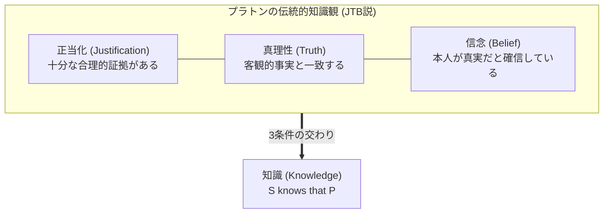
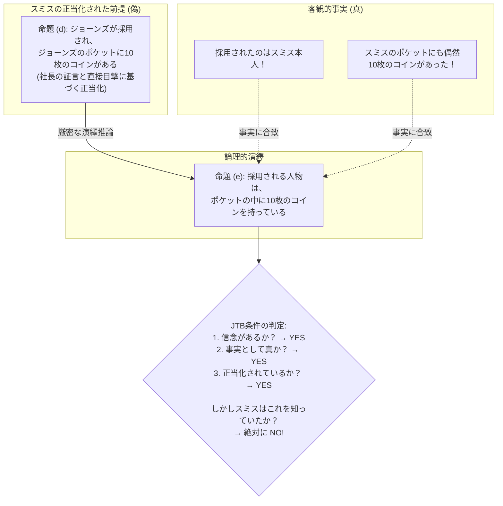
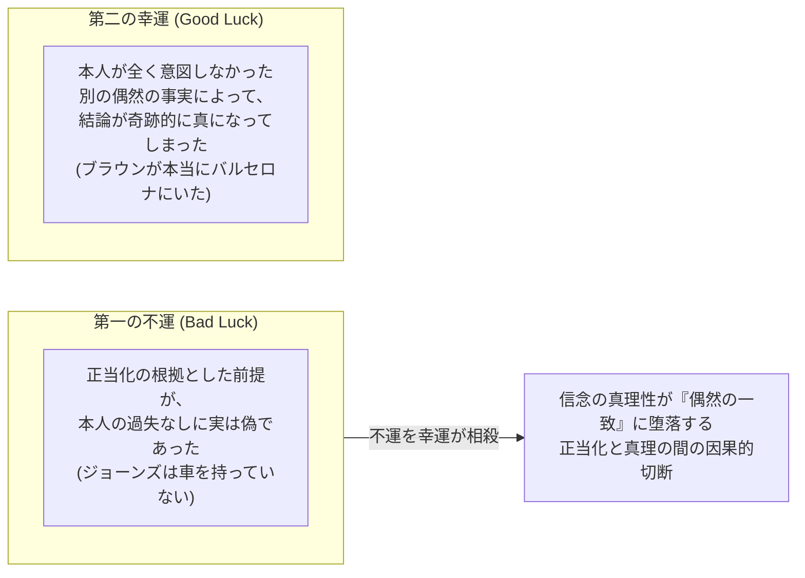
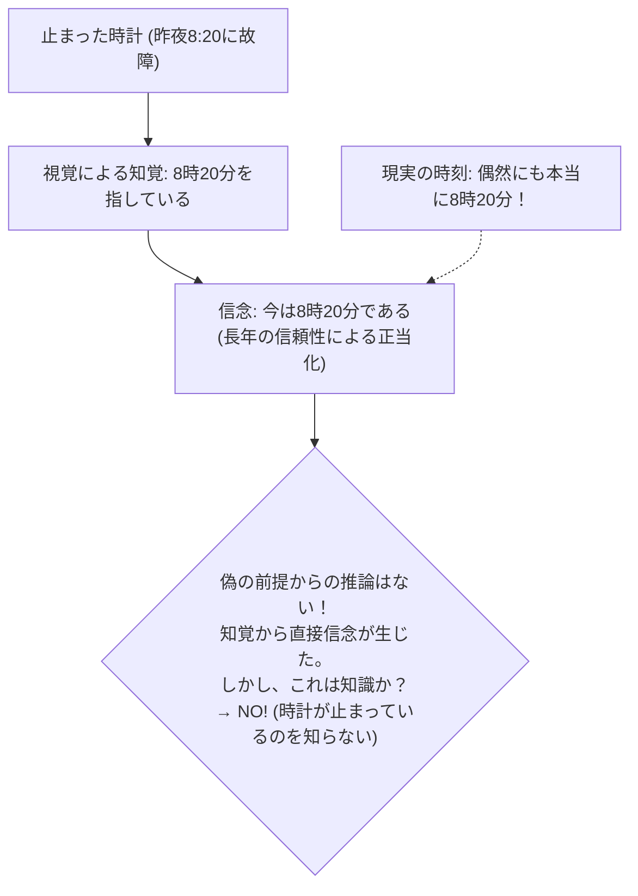
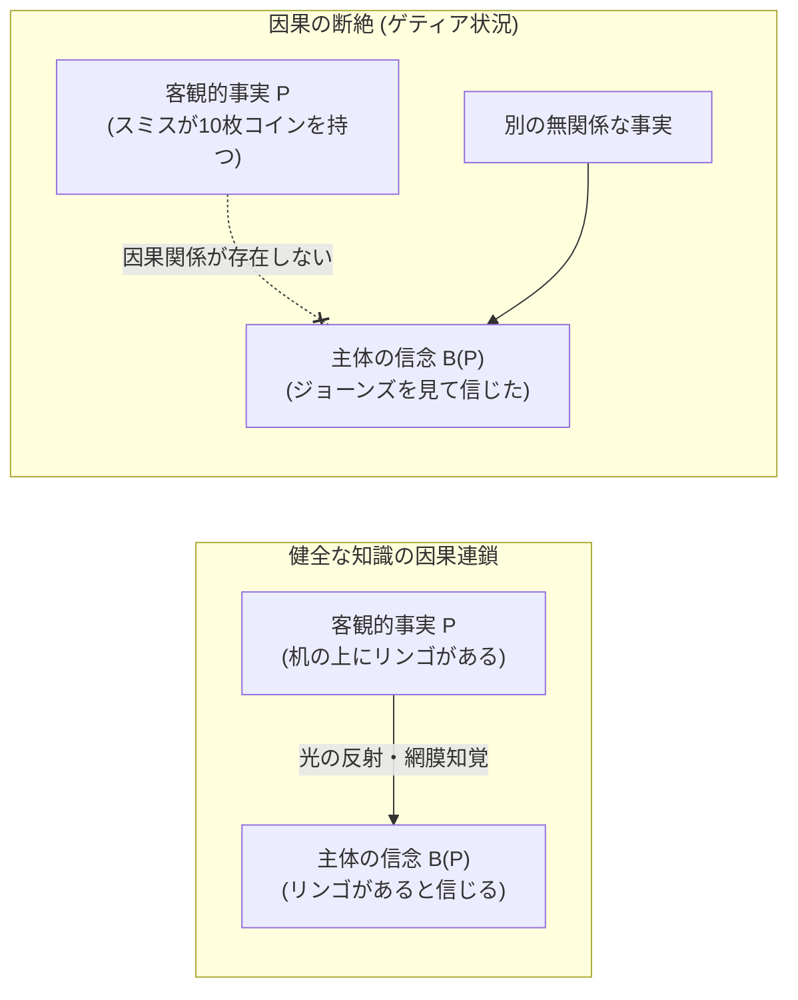
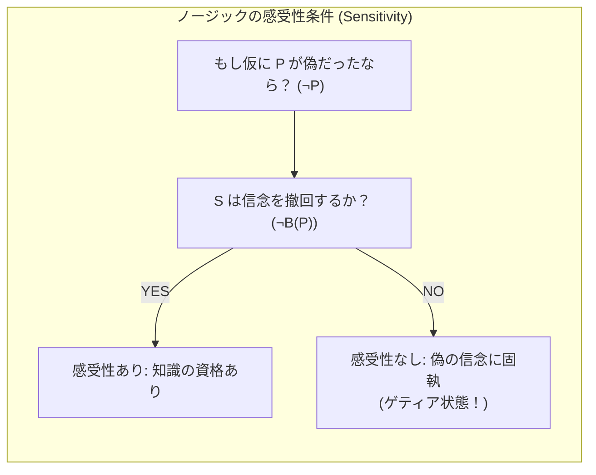
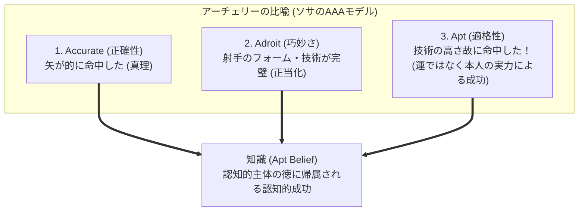
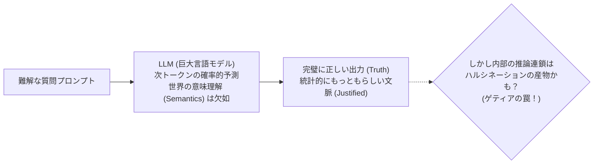

## 序論：2300年のドグマを打ち砕いた、わずか3ページの論文

日常会話の中で、私たちは「知っている（Know）」という言葉を何気なく使っています：
- 「外が雨であることを知っている（窓から雨粒が見えるから）」
- 「日本の首都が東京であることを知っている（教科書で学び、公的情報で確認できるから）」
- 「明日の朝、太陽が東から昇ることを知っている（天文学的法則と日常の経験則があるから）」

では、哲学的に<strong>「人が何かを知っている」とは、一体どのような状態を指すのでしょうか？</strong>

この問いに対し、古代ギリシャの哲学者プラトンは、対話篇『テアイテトス』や『メノン』において、ひとつの極めて強力で直観的に説得力のある解答の原型を提示しました。それは後世の哲学者たちによって整理され、<strong>「正当化された真なる信念（Justified True Belief / JTB説）」</strong>と呼ばれる認識論の絶対的な黄金律となりました。

JTB説によれば、ある人物 $S$ が命題 $P$（例：「外は雨が降っている」）を「知っている」と言えるためには、以下の3つの条件が<strong>すべて同時に満たされなければならず、かつそれで十分である</strong>とされました：
1. <strong>信念条件（Belief）</strong>：$S$ は $P$ であると心から信じていること。
2. <strong>真理性条件（Truth）</strong>：$P$ は客観的な客観的事実として真（True）であること。
3. <strong>正当化条件（Justification）</strong>：$S$ が $P$ を信じることには、適切な証拠、論理的推論、知覚といった<strong>正当な理由（Justification）</strong>が存在すること。

この3条件は、極めて美しく隙のない定義に見えました。
- 単なる当てずっぽうの思い込み（例：「なんとなく宝くじが当たる気がする」と言って本当に当たった場合）は、客観的証拠（正当化）を欠いているため「知識」ではなく「単なる幸運な勘」にすぎません。
- どんなに強固な証拠に基づいて信じていても、その内容が客観的に偽であれば（例：15世紀の人々が天動説を信じていたこと）、それは「知識」ではなく「誤謬」です。
- そして、本人がそもそも信じていない客観的事実は、本人の「知識」とは呼べません。

「知識とは、正当化された真なる信念である（$K = JTB$）」。
この定義は、デカルト、カント、ラッセルに至る西洋認識論の伝統において、2300年以上にわたり疑う余地のない自明の公理として君臨し続けました。

ところが<strong>1963年</strong>、アメリカの学術誌『Analysis』に掲載された、査読論文としては異例の<strong>わずか3ページ、本文わずか数千語の極めて短い論文</strong>が、この2300年の大聖堂を根底から粉砕しました。
執筆者の名は<strong>エドムンド・ゲティア（Edmund L. Gettier, 1927–2021）</strong>。当時ウェイン州立大学の無名の助教授であった彼が発表した論文のタイトルは、驚くほど飾り気のないものでした：
> <strong>『正当化された真なる信念は知識であるか？（Is Justified True Belief Knowledge?）』</strong>

ゲティアはこの短い論文の中で、<strong>「正当化の条件を完全に満たし、かつ客観的事実として真であり、本人が心から信じているにもかかわらず、直観的に誰が見ても『それを知っているとは絶対に言えない』」完璧な反例</strong>を突きつけたのです。

この反例は哲学界に巨大な震天動地を引き起こし、<strong>「ゲティア問題（Gettier Problem）」</strong>と命名されました。本稿では、ゲティアが提示した思考実験の解剖から、なぜ「認知的幸運」が知識を破壊するのか、ノージックの真理追跡説やゴールドマンの因果説、徳認識論が繰り広げた半世紀にわたる格闘、そして現代の生成AIが直面する「ハルシネーションと偶然の正解」の認識論的本質に至るまでを、徹底的に解明していきます。

---

## 1. ゲティアの2つの反例：完璧な論理の罠

ゲティアが提示した思考実験は、日常的で分かりやすい設定でありながら、形式論理学の最も厳密な推論規則に従って組み立てられています。論文に登場する2つの象徴的なケースを見てみましょう。

### 1.1 ケース1：スミスとジョーンズと10枚のコイン

ある会社で、スミスとジョーンズという2人の男がひとつの昇進ポストをめぐって面接を受けています。

スミスには、以下の命題 $(d)$ を信じるための極めて強力で正当な証拠（Justification）がありました：
> <strong>$(d)$ ジョーンズが採用される予定であり、かつジョーンズはポケットの中に10枚のコインを持っている。</strong>

なぜスミスがこれを信じたかといえば、会社の社長が直接スミスに向かって「今回はジョーンズ君を採用することにしたよ」と明言し、さらにスミスは10分前にジョーンズが自分の目の前でズボンのポケットから小銭を取り出し、10枚のコインを丁寧に数えて再びポケットにしまうのを直接視覚で確認していたからです。認識論的に、スミスの信念 $(d)$ は完璧に「正当化」されています。

ここでスミスは、命題 $(d)$ から論理学の厳密な演繹規則である「選言導入・存在汎化（連言から単一事実の推論）」を用いて、以下の命題 $(e)$ を論理的に導き出し、それを心から信じました：
> <strong>$(e)$ 採用される人物は、ポケットの中に10枚のコインを持っている。</strong>

さて、ここから運命の皮肉な展開が訪れます。
1. 社長の気まぐれ、あるいは役員会の土壇場の逆転により、採用通知を勝ち取ったのはジョーンズではなく、なんと<strong>スミス本人</strong>でした！
2. そして、スミス自身は全く気づいていませんでしたが、スミスのズボンのポケットの中にも、奇遇なことに<strong>偶然まったく同じ10枚のコインが入っていた</strong>のです！

この状況において、スミスの信念 $(e)$「採用される人物は、ポケットの中に10枚のコインを持っている」について、JTB説の3条件を判定してみましょう：
1. <strong>信念条件</strong>：スミスは $(e)$ を真実だと信じているか？ $\implies$ <strong>YES</strong>（論理的に演繹したのだから当然信じている）。
2. <strong>真理性条件</strong>：$(e)$ は客観的事実として真か？ $\implies$ <strong>YES</strong>（採用されたスミス本人のポケットに10枚のコインが実在するのだから、完全に真である）。
3. <strong>正当化条件</strong>：スミスは $(e)$ を信じる正当な理由を持っていたか？ $\implies$ <strong>YES</strong>（正当に信じられた前提 $(d)$ から、妥当な形式論理の規則に従って推論したのだから、完璧に正当化されている）。

<strong>スミスの信念 $(e)$ は、「正当化された真なる信念（JTB）」の条件を100%完璧に満たしています。</strong>

しかし、私たちはスミスが「採用される人物が10枚のコインを持っていることを知っていた」と言えるでしょうか？
絶対に言えません。なぜなら、スミスが $(e)$ を信じた理由は「ジョーンズが採用され、ジョーンズがコインを持っている」という点にあったのであり、彼自身の採用や彼自身のポケットのコインについては何も知らなかったからです。スミスの信念 $(e)$ がたまたま真実となったのは、<strong>悪魔のような二重の偶然（奇妙な運）</strong>の産物にすぎません。

したがって、<strong>JTB（正当化された真なる信念）を満たしているにもかかわらず、それは「知識」ではない！</strong> JTB条件は、知識であるための<strong>十分条件ではない</strong>ことが証明されてしまったのです。

---

### 1.2 ケース2：フォード車とバルセロナの友人

ゲティアが提示したもうひとつの反例は、論理学の「選言導入（Disjunction Introduction / $P$ ならば $P \lor Q$）」を用いたさらに鋭利なものです。

スミスには、同僚のジョーンズについて以下の命題を信じる十分な証拠がありました：
> <strong>$(f)$ ジョーンズはフォード社の車を所有している。</strong>

なぜなら、ジョーンズはこれまで記憶にある限りずっとフォード車を運転しており、スミスをフォード車の助手席に乗せてドライブしたことすらあったからです。

スミスにはもう一人、ブラウンという友人がいましたが、ブラウンが今どこにいるのか、スミスは全く見当もついていませんでした。そこでスミスは、正当に信じている命題 $(f)$ から、論理学の規則に従って以下の3つの選言命題を構成しました：
- <strong>$(g)$ ジョーンズがフォード車を所有しているか、またはブラウンはボストンにいる。</strong>
- <strong>$(h)$ ジョーンズがフォード車を所有しているか、またはブラウンはバルセロナにいる。</strong>
- <strong>$(i)$ ジョーンズがフォード車を所有しているか、またはブラウンはブレスト・リトフスクにいる。</strong>

形式論理学において、「$A$」が真であるならば、「$A$ または $B$」は $B$ の真偽にかかわらず常に真です。したがって、命題 $(f)$ を正当に信じているスミスにとって、命題 $(h)$ を信じることは完全に正当化されています。

しかし、現実は以下の通りでした：
1. 実はジョーンズは最近フォード車を手放しており、乗っていたのはレンタカーでした。つまり命題 $(f)$ は<strong>偽（False）</strong>でした。
2. 一方、スミスが全く居場所を知らず、適当に地名を選んだブラウンは、驚くべき奇跡的な偶然により、<strong>本当に今まさにスペインのバルセロナに滞在していた</strong>のです！

命題 $(h)$「ジョーンズがフォード車を所有しているか、またはブラウンはバルセロナにいる」は：
- スミスによって信じられており（<strong>Belief</strong>）、
- ブラウンが実際にバルセロナにいるため命題全体として真であり（<strong>Truth</strong>）、
- 信頼できる観察に基づき論理的に導かれたため正当化されている（<strong>Justified</strong>）。

しかし、スミスが「ブラウンがバルセロナにいること」を知っていたはずがありません。彼が当てたのは、宝くじに当たったような純粋な「まぐれ当たり」にすぎないのです。

---

## 2. ゲティア問題の本質：認知的幸運（Epistemic Luck）

ゲティアの反例が白日の下に晒した病弊の正体とは何でしょうか？
現代の認識論において、それは<strong>「認知的幸運（Epistemic Luck）」</strong>と呼ばれています。

ゲティア型反例は、常に以下の<strong>「二重のズレ（二段階の偶然）」</strong>という共通の構造を持っています：

1. <strong>第一段階（不運）</strong>：本人が正当な理由だと信じた根拠が、本人の合理的努力の及ばないところで、実は「偽」であった（または事実とずれていた）。
2. <strong>第二段階（幸運）</strong>：しかし、本人が想定していなかった全く別の偶然の事実が介入したことで、怪我の功名のように、結論としての命題が「たまたま真」になってしまった。

第一の不運を第二の幸運が打ち消し合うことによって、「正当化」と「真理性」がたまたま同じ場所に着地したにすぎません。
ここにあるのは、<strong>「正しい根拠に基づいて客観的真理を把握した」という認識論的達成ではなく、単なる「まぐれ当たり（Lucky Guess）」</strong>です。

どれほど精密な推論を行い、どれほど誠実に証拠を集めたとしても、そこに「認知的幸運」が介在している限り、人間はそれを「知っている（Knowledge）」と呼ぶことを直観的に拒絶します。知識とは、<strong>運に左右されない、認知的主体の実力によって真理を捉えた状態</strong>でなければならないからです。

---

## 3. 「第4の条件」をめぐる哲学者たちの死闘

ゲティア論文の発表以降、世界の認識論は蜂の巣をつついたような大騒ぎとなりました。「JTB（正当化された真なる信念）」に、あと<strong>どのような「第4の条件 $X$」を付け加えれば、$K = JTB + X$ として知識を完璧に定義できるのか？</strong>
この問いをめぐり、半世紀に及ぶ壮絶な知の闘争が幕を開けました。

### 3.1 「偽の前提の排除（No False Lemmas）」説

最も直観的な処方箋は、マイケル・クラーク（Michael Clark）らが提案した<strong>「偽の前提の排除」</strong>でした：
> <strong>条件4</strong>：$S$ の正当化の推論過程に、いかなる<strong>偽の前提（False Lemma）</strong>も含まれていてはならない。

スミスは「ジョーンズが採用される」という偽の前提、あるいは「ジョーンズがフォード車を持っている」という偽の前提から推論を出発させました。だからこそ誤ったのだから、「推論の鎖の中に一つでも嘘が混ざっていれば知識とは認めない」とすれば解決するように思えます。

#### 破綻：前提を経由しないゲティア反例
しかし、この素朴な修正はすぐに粉砕されました。アメリカの哲学者<strong>ギルバート・ハーマン（Gilbert Harman）</strong>や<strong>アルヴィン・ゴールドマン（Alvin Goldman）</strong>らは、<strong>推論（前提）を一切経由しない知覚的なゲティア反例</strong>を考案したのです。

それが有名な<strong>「止まった時計のパラドックス」</strong>（バートランド・ラッセルが原型を提示）です：
> あなたがふとリビングの古時計を見上げると、針は「8時20分」を指していました。あなたはその時計が何年間も狂いなく正確に動いてきた信頼できる時計であることを知っており、したがって「今は8時20分である」と正当に信じました。
> しかし、実はその時計は<strong>ちょうど24時間前の昨夜8時20分に電池が切れて完全に止まっていた</strong>のです！
> ところが、あなたがその時計を見たその瞬間、<strong>現実の時刻も奇跡的にぴったり「朝の8時20分」</strong>でした。

このケースでは、スミスのように「$A$ だから $B$ であり、したがって $C$ である」という多段階の推論を行っていません。時計を見るという直接知覚から「今は8時20分だ」という信念がダイレクトに生じています。
それにもかかわらず、本人は時間を「知っていた」とは言えません。「偽の前提を排除する」だけでは、ゲティアの亡霊を祓うことはできなかったのです。

---

### 3.2 アルヴィン・ゴールドマンの因果説（Causal Theory of Knowing）

1967年、<strong>アルヴィン・ゴールドマン（Alvin Goldman）</strong>は、推論の論理的妥当性ではなく、事実と信念を結ぶ<strong>「物理的・因果的なパイプ」</strong>に着目する画期的な<strong>「知識の因果説」</strong>を提唱しました：
> <strong>因果説のテーゼ</strong>：$S$ が命題 $P$ を知っていると言えるのは、$P$ という客観的事実そのものが、適切な因果の連鎖（知覚、記憶、信頼できる証言）を通じて、$S$ の中に「$P$ という信念」を直接引き起こした場合に限られる。

スミスの例では、「スミスが採用された」という事実や「スミスがコインを持っていた」という事実が、スミスの信念を生み出した直接の因果的要因ではありませんでした。時計の例でも、「今が8時20分である」という現在進行形の事実が光を反射して目に届いたのではなく、「昨日止まった針の位置」が原因でした。因果のパイプが切れているから知識ではないのだ、とゴールドマンは主張したのです。

#### 因果説を葬り去った「偽の納屋ファサード」
因果説はゲティア問題を一掃したかに見えました。しかし1976年、カール・ギネット（Carl Ginet）が考案し、ゴールドマン自身が引用して自説の敗北を認めた戦慄の思考実験が登場します。それが<strong>「偽の納屋の国（Barn Facade County）」</strong>です：

> ヘンリーは田舎道をドライブしています。彼は道路沿いに建っている、赤く塗られた典型的な木造の納屋（納屋A）を目撃しました。天候は快晴、視界は良好、視力も完璧です。ヘンリーは「あそこに納屋がある」と信じました。
> 実際にそこには本物の納屋が存在しており、その本物の納屋が太陽光を反射してヘンリーの網膜像を結び、信念を形成させました。因果のパイプは完璧に繋がっています。
> 
> しかし、ヘンリーが知らない戦慄の事実がありました。この地域一帯は映画のロケ地であり、住民たちが観光用のハリボテとして、<strong>外観だけ本物そっくりに作られた「偽物の納屋の前面板（ファサード）」を何千個も道路沿いに建て並べていた</strong>のです。
> 周囲にある999個の納屋はすべて中身のないハリボテでした。しかし、ヘンリーがたまたま車を走らせて目を留めた<strong>その1個だけが、奇跡的に地域唯一の「本物の納屋」</strong>だったのです！

ヘンリーの信念「あそこに納屋がある」は：
- 真実であり（<strong>Truth</strong>）、
- ヘンリーは信じており（<strong>Belief</strong>）、
- 快晴の知覚に基づき正当化されており（<strong>Justified</strong>）、
- そして本物の納屋との間に<strong>完璧な因果的連鎖（Causality）</strong>が存在しています。

しかし、ヘンリーはそこに納屋があることを「知っていた」と言えるでしょうか？
言えません。なぜなら、彼がもし数メートル手前か奥の別の納屋を見ていたとしても、全く同じように「あそこに納屋がある」と信じて騙されていたはずだからです。彼が本物の納屋を言い当てられたのは、<strong>純粋な環境的幸運（Environmental Luck）</strong>にすぎません。

因果関係が存在していても、周囲が欺瞞と偽物で満ち満ちている環境下では、知識は成立し得ないことが暴かれたのです。

---

### 3.3 ロバート・ノージックの真理追跡説（Truth-Tracking Theory）

1981年、政治哲学の名著『アナーキー・国家・ユートピア』でも知られる碩学<strong>ロバート・ノージック（Robert Nozick）</strong>は、様相論理学の「可能世界論（Possible Worlds）」と「反事実条件文（Counterfactual Conditionals）」を武器に、知識の全く新しい動的モデルを提唱しました。

ノージックによれば、信念とは客観的真理を柔軟に追尾するセンサーのようなものでなければなりません。彼は知識の条件として、以下の<strong>2つの反事実的条件</strong>をJTBに追加しました：

$$S \text{ knows that } P \iff$$
1. $P$ は真である。
2. $S$ は $P$ であると信じている。
3. <strong>感受性条件（Sensitivity）</strong>：もし仮に $P$ が偽であったならば、$S$ は $P$ であると信じなかっただろう（$\neg P \mathbin{\Box\kern-1.5pt\rightarrow} \neg B(P)$）。
4. <strong>安全性・追従条件（Adherence）</strong>：もし別の類似した状況下でも $P$ が真であるならば、$S$ はやはり $P$ であると信じるだろう（$P \mathbin{\Box\kern-1.5pt\rightarrow} B(P)$）。

この<strong>感受性条件（Sensitivity）</strong>を「偽の納屋」に適用してみましょう：
- もしヘンリーが見ている場所に本物の納屋がなかったとしたら（＝そこにあったのが周囲と同様のハリボテだったとしたら）、ヘンリーは「納屋がある」という信念を取り下げただろうか？
- 答えは明白に<strong>NO</strong>です。ヘンリーはハリボテを見ても全く疑わずに「あそこに納屋がある」と信じてしまったはずです。

したがって、ヘンリーの信念は「感受性条件」を満たしておらず、真理を追跡（Track）できていないため、「知識ではない」と鮮やかに判定されます。ゲティア問題も同様です。スミスのポケットにコインがなかったとしても、スミスはジョーンズのポケットを根拠にして依然として「採用者はコインを持っている」と信じ続けたでしょう。

ノージックの追跡説は、ゲティア問題に対する極めて強力な解法として称賛されましたが、今度は<strong>「知識の閉包性原理（Closure Principle）」</strong>——「もし $P$ を知っており、$P$ から論理的に $Q$ が導かれることを知っているなら、人は $Q$ も知っている」という論理学の根幹を放棄せざるを得ないという深刻な代償（懐疑論への脆弱性）を抱えることになりました。

---

### 3.5 現代の根本的転回：ウィリアムソンの『知識第一主義（Knowledge First）』

半世紀におよぶ「JTB＋第4の条件」をめぐる果てしない修正劇に対し、オックスフォード大学の哲学者<strong>ティモシー・ウィリアムソン（Timothy Williamson）</strong>は2000年の著書『知識とその限界（Knowledge and Its Limits）』において、コペルニクス的転回ともいうべき根源的な批判を突きつけました。それが<strong>「知識第一主義（Knowledge First Epistemology）」</strong>です。

ウィリアムソンはこう問いました：
> 「なぜ私たちは、『信念』というより不完全な心的状態を部品として、そこに『真理』や『正当化』を継ぎ接ぎして『知識』を定義できると思い込んできたのか？ そもそも『知識』こそが最も原初的・根源的な心的状態であり、むしろ『信念』や『証拠』の方こそが『知識』の概念から派生して理解されるべきではないか？」

ウィリアムソンの見解によれば、赤い色を「赤くない色＋赤さの成分」と分解できないのと同様に、知識もまた分析不可能な純粋な心の状態（Factive Mental State）です。「$K = JTB + X$」という探求そのものが、解けない方程式を解こうとしていたカテゴリー錯誤だったというこの指摘は、21世紀の認識論において最も影響力のあるパラダイムシフトとなっています。

## 4. 現代の潮流：徳認識論と知識の機能主義

20世紀末から21世紀にかけて、ゲティア問題との格闘は、単なる「条件のパズル解き」を超えて、認識論そのもののパラダイムシフトを引き起こしました。

#### 3.5 現代の根本的転回：ウィリアムソンの『知識第一主義（Knowledge First）』

半世紀におよぶ「JTB＋第4の条件」をめぐる果てしない修正劇に対し、オックスフォード大学の哲学者<strong>ティモシー・ウィリアムソン（Timothy Williamson）</strong>は2000年の著書『知識とその限界（Knowledge and Its Limits）』において、コペルニクス的転回ともいうべき根源的な批判を突きつけました。それが<strong>「知識第一主義（Knowledge First Epistemology）」</strong>です。

ウィリアムソンはこう問いました：
> 「なぜ私たちは、『信念』というより不完全な心的状態を部品として、そこに『真理』や『正当化』を継ぎ接ぎして『知識』を定義できると思い込んできたのか？ そもそも『知識』こそが最も原初的・根源的な心的状態であり、むしろ『信念』や『証拠』の方こそが『知識』の概念から派生して理解されるべきではないか？」

ウィリアムソンの見解によれば、赤い色を「赤くない色＋赤さの成分」と分解できないのと同様に、知識もまた分析不可能な純粋な心の状態（Factive Mental State）です。「$K = JTB + X$」という探求そのものが、解けない方程式を解こうとしていたカテゴリー錯誤だったというこの指摘は、21世紀の認識論において最も影響力のあるパラダイムシフトとなっています。

## 4.1 徳認識論（Virtue Epistemology）：成功としての知識

アーネスト・ソサ（Ernest Sosa）やジョン・グレコ（John Greco）、リンダ・ザグゼブスキ（Linda Zagzebski）らが主導する<strong>徳認識論</strong>は、「信念」という命題の内容を細かく分析するのをやめ、<strong>「信念を形成した人間（認知的主体）の知的卓越性（Intellectual Virtues）」</strong>へと焦点を移しました。

ソサは、知識の構造をアーチェリーの射手に例えた<strong>「AAA評価モデル」</strong>を提示しました：
1. <strong>正確性（Accurate）</strong>：矢が的（標的）の中心に命中したか？（信念が客観的に真であるか = Truth）
2. <strong>巧妙さ（Adroit）</strong>：矢を放った技術やフォームが、訓練された卓越した技能に基づいているか？（認知的能力が発揮されているか = Justification）
3. <strong>適格性（Apt）</strong>：矢が的に命中したのは、<strong>まさに射手の巧妙な技術のおかげ</strong>であるか？（真理の達成が、主体の知的徳に帰属できるか）

ゲティア状況において起きていたのは、射手が完璧な技術で矢を放ったものの、突風（不運）で矢の軌道が大きく逸れ、しかし偶然そこにいた別の鳥に跳ね返って奇跡的に的の真ん中に当たった（幸運）という事態です。
この射撃は「正確（Accurate）」であり「技術的（Adroit）」ですが、決して<strong>「適格（Apt）」ではありません</strong>。矢が当たった功績は射手の腕前ではなく、風と鳥という「認知的幸運」に帰属するからです。

徳認識論によれば、<strong>「知識とは、認知的主体が自らの知的能力・知的徳を発揮したことによって達成された認知的成功（Apt Belief）である」</strong>と定義されます。この定義は、ゲティア型の運を美しく排除することに成功しました。

#### 3.5 現代の根本的転回：ウィリアムソンの『知識第一主義（Knowledge First）』

半世紀におよぶ「JTB＋第4の条件」をめぐる果てしない修正劇に対し、オックスフォード大学の哲学者<strong>ティモシー・ウィリアムソン（Timothy Williamson）</strong>は2000年の著書『知識とその限界（Knowledge and Its Limits）』において、コペルニクス的転回ともいうべき根源的な批判を突きつけました。それが<strong>「知識第一主義（Knowledge First Epistemology）」</strong>です。

ウィリアムソンはこう問いました：
> 「なぜ私たちは、『信念』というより不完全な心的状態を部品として、そこに『真理』や『正当化』を継ぎ接ぎして『知識』を定義できると思い込んできたのか？ そもそも『知識』こそが最も原初的・根源的な心的状態であり、むしろ『信念』や『証拠』の方こそが『知識』の概念から派生して理解されるべきではないか？」

ウィリアムソンの見解によれば、赤い色を「赤くない色＋赤さの成分」と分解できないのと同様に、知識もまた分析不可能な純粋な心の状態（Factive Mental State）です。「$K = JTB + X$」という探求そのものが、解けない方程式を解こうとしていたカテゴリー錯誤だったというこの指摘は、21世紀の認識論において最も影響力のあるパラダイムシフトとなっています。

## 4.2 クレイグの機能主義：なぜ人類は「知っている」という概念を必要としたのか？

1990年、エドワード・クレイグ（Edward Craig）は著書『知識と自然状態』において、これまでの分析哲学が陥っていた「必要十分条件のパズル」に冷水を浴びせる革命的な視点を提示しました。
> <strong>「私たちは『知識』という言葉の厳密な論理的境界線を引こうと苦闘してきたが、そもそも原始以来の人類社会は、なぜ『知っている』という特別な言葉を発明し、必要としたのだろうか？」</strong>

クレイグの結論は極めてプラグマティックで明快でした：
人間は社会的動物であり、一人ではすべての情報を集められません。「あそこの森に猛獣がいるか」「あのキノコは食べられるか」を知るために、他者の言葉を頼る必要があります。
その際、集団の中で最も切実に必要とされたのは、<strong>「信頼できる情報源（Good Informant）を特定し、他者に推薦するためのラベル」</strong>でした。

- 当てずっぽうで言う人や、たまたま運良く当たっただけの人（ゲティア状況の人）は、明日は平気で間違った情報を伝えて部族を全滅させるかもしれません。
- だからこそ、人間社会は「偶然当たった人」を排除し、「次も同じように真実を伝えてくれる信頼に足る観察者」だけを厳選して讃えるために、<strong>「彼はそれを『知っている』」</strong>という強力な認識論的称号を与えたのです。

ゲティア問題が私たちに直観的な違和感を抱かせる根本的理由は、ゲティア状況に置かれた人物が<strong>「明日、別の状況で頼りにできる情報源失格の人物」</strong>だからに他なりません。

---

## 5. 人工知能の時代におけるゲティア問題：LLMは世界を「知って」いるか？

ゲティア問題は、21世紀の今日、最新の<strong>人工知能（AI）倫理と認知科学の最前線</strong>において、かつてない現実的かつ切実な問題として蘇りつつあります。

現代の大規模言語モデル（LLM）は、膨大なテキストの統計的相関に基づいて、もっともらしい回答を出力します。ユーザーが高度な医学的・法学的・科学的質問を投げかけたとき、AIはしばしば完璧に正しい答えを返します。

しかし、AIの内部で起きていることを見つめ直したとき、私たちはまさに<strong>超巨大なゲティア機械</strong>を目撃しているのではないでしょうか？

1. <strong>AIのハルシネーションと偶然の正解</strong>：
   LLMが全くデタラメな内部推論や事実誤認（ハルシネーション）を前提として計算していながら、出力された結論のテキストだけが偶然にも客観的真理と一致してしまう現象は日常茶飯事です。これはまさにスミスが「ジョーンズのコイン」から「採用者のコイン」を演繹して当てたケースそのものです。
2. <strong>正当化の欠如</strong>：
   深層ニューラルネットワークはブラックボックスであり、モデル自身が自らの結論を論理的に正当化する真の理由を持っていません。
3. <strong>感受性の欠如（ノージック的破綻）</strong>：
   もし現実世界の前提がわずかに変化していたとしても、プロンプトの統計的誘導に引きずられて同じ回答を自信満々に出力してしまう脆弱性（プロンプト攻撃に対する脆弱性）は、AIが真理を追跡（Track）していない決定的な証拠です。

自動運転車のAIが交差点で歩行者を認識して停止したとき、AIは本当に歩行者がいることを「知って」止まったのか、それとも道路脇の看板の影を歩行者と誤認した結果、たまたま歩行者の直前で止まるという「ゲティア的幸運」に恵まれただけなのか？
後者であれば、次の交差点で大惨事が起きることは防げません。

AIの安全性を保証するアライメント論や説明可能性（XAI）の追求とは、本質的に<strong>「AIの知能からゲティア的幸運をいかに排除し、真の適格な知識（Apt Knowledge）へと昇華させるか」という認識論的闘争</strong>そのものなのです。

---

## 結語：確信と真理のあいだに架かる脆い橋

エドムンド・ゲティアが残した3ページの論文は、単なる哲学者たちの重箱の隅をつつく言葉遊びではありませんでした。
それは、<strong>「人間が世界を正しく捉えているという確信がいかに脆く、いかに容易に純粋な幸運の産物へとすり替わってしまうか」</strong>を白日の下に晒した、人間理性の限界に対する最も痛烈な告発でした。

私たちは、自分が「知っている」と思っていることの何割について、真に正当な実力でそれを把握していると言えるでしょうか？
たまたま読んだニュースが偏向しておらず事実を伝えていた幸運、たまたま受けた教育が迷信ではなかった幸運、たまたま自分が信じた理論が観測データと符合した環境的幸運——私たちの知識の大半は、薄氷のような「認知的幸運」の連鎖の上に、かろうじてバランスを保って乗っかっているにすぎないのかもしれません。

それでもなお、人類は偶然の当たりに甘んじることなく、推論の鎖を検証し、反事実的な問いを投げかけ、認知的な誠実さを研ぎ澄ますことによって、運の霧を払いのけようと抗い続けてきました。ゲティア問題という終わりのない問いと向き合い続けること——それ自体が、私たちが単に「信じる存在」から、真に「知る存在」へと脱皮するための、最も気高い知的な歩みなのです。
