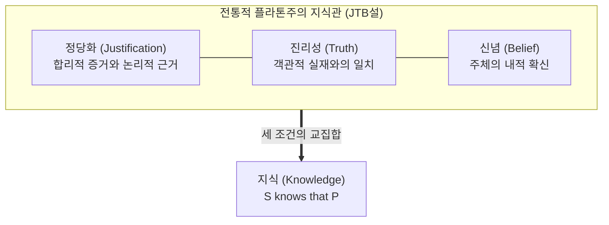

## 서론: 2300년의 철학적 성채를 무너뜨린 3쪽짜리 논문

일상 속에서 우리는 '안다(Know)'라는 표현을 너무나 자연스럽게 사용합니다:
- "창밖에 비가 내리고 있음을 안다" (빗방울을 직접 보고 있기 때문);
- "지구가 태양 주위를 공전함을 안다" (현대 천문학의 확고한 관측 증거가 있기 때문);
- "대한민국의 수도가 서울임을 안다" (공적 지리 정보와 사회적 합의가 있기 때문).

그렇다면 철학적으로 <strong>"한 인간이 어떤 명제를 진정으로 '알고 있다'는 것"은 정확히 어떤 상태를 뜻할까요? 지식의 필요충분조건은 무엇일까요?</strong>

고대 그리스의 철학자 플라톤은 『테아이테토스』와 『메논』에서 매우 직관적이고 강력한 답의 원형을 제시했고, 이는 후대 철학자들에 의해 <strong>'정당화된 참된 신념(Justified True Belief, 약칭 JTB설)'</strong>이라는 전통적 인식론의 황금률로 확립되었습니다.

JTB설에 따르면, 주체 $S$가 명제 $P$를 알기 위해서는 다음 세 가지 조건이 <strong>동시에 충족되어야 하며, 그것으로 충분합니다</strong>:
1. <strong>신념 조건(Belief)</strong>: $S$는 $P$가 참이라고 진심으로 믿어야 한다 ($B_S(P)$).
2. <strong>진리 조건(Truth)</strong>: $P$는 객관적 사실로서 실제로 참이어야 한다 ($P = \text{True}$).
3. <strong>정당화 조건(Justification)</strong>: $S$가 $P$를 믿는 데에는 합리적인 증거, 지각적 근거, 논리적 추론 등 <strong>정당한 이유(Justification)</strong>가 있어야 한다 ($J_S(P)$).

이 3조건은 오랫동안 완벽해 보였습니다. 근거 없는 요행(복권 당첨을 무작정 확신했다가 우연히 맞은 경우)은 정당화가 없으므로 지식이 아니고, 확신했으나 틀린 믿음(과거의 천동설)은 진리성이 없으므로 오류일 뿐입니다.

그러나 <strong>1963년</strong>, 미국의 철학 학술지 『Analysis』에 게재된 <strong>단 3쪽, 1천 단어 미만의 극도로 짧은 논문</strong> 하나가 이 2300년의 성채를 일격에 무너뜨렸습니다. 논문의 저자는 당시 웨인 주립대학교의 무명 조교수였던 <strong>에드문드 게티어(Edmund L. Gettier, 1927–2021)</strong>였으며, 논문 제목은 담담하게도 『정당화된 참된 신념은 지식인가?』였습니다.

게티어는 주체의 믿음이 <strong>완벽하게 정당화되었고</strong>, <strong>실제로 참이며</strong>, <strong>진심으로 믿었음에도 불구하고</strong>, 상식적인 직관상 <strong>결코 지식이라고 부를 수 없는</strong> 결정적인 반례들을 제시했습니다.

---

## 1. 게티어의 반례: 완벽한 논리적 함정

### 1.1 사례 1: 스미스와 존스, 그리고 주머니 속 10개의 동전
스미스와 존스가 한 회사의 일자리를 두고 면접을 보고 있습니다.
스미스는 사장으로부터 "우리는 존스를 채용하기로 결정했네"라는 말을 직접 들었고, 10분 전 존스가 주머니에서 10개의 동전을 꺼내 세는 것을 똑똑히 목격했습니다.
따라서 스미스는 다음 전제를 정당하게 확신했습니다:
> <strong>(d) 존스가 채용될 것이며, 존스의 주머니에는 10개의 동전이 있다.</strong>

스미스는 이 전제로부터 타당한 연역 논리 규칙에 따라 다음 결론을 도출하고 이를 믿었습니다:
> <strong>(e) 채용될 사람은 주머니에 10개의 동전이 있다.</strong>

그런데 극적인 반전이 일어납니다:
1. 사장의 결정이 번복되어 최종 채용된 사람은 존스가 아니라 <strong>스미스 본인</strong>이었습니다!
2. 그리고 스미스 자신은 까맣게 잊고 있었지만, 스미스의 바지 주머니에도 <strong>우연히 정확히 10개의 동전</strong>이 들어 있었습니다!

명제 (e)를 검토해 봅시다:
- 스미스는 (e)를 진심으로 믿었습니다 (<strong>신념 조건 만족</strong>).
- 채용된 사람(스미스)의 주머니에 실제로 10개의 동전이 있으므로 (e)는 객관적 사실입니다 (<strong>진리 조건 만족</strong>).
- 사장의 증언과 직접 목격에 기초한 타당한 논리 연역을 거쳤으므로 정당합니다 (<strong>정당화 조건 만족</strong>).

그러나 스미스가 이 사실을 "알고 있었다"고 할 수 있을까요? <strong>결코 아닙니다.</strong> 스미스의 믿음이 들어맞은 것은 완전히 기괴한 <strong>우연과 행운의 산물</strong>에 불과합니다!

---

## 2. 게티어 문제의 본질: 인지적 행운 (Epistemic Luck)

게티어 반례들의 핵심 구조는 <strong>'불운'과 '행운'이 맞물리는 2단계 상쇄 기제</strong>에 있습니다:
1. <strong>1단계 (불운)</strong>: 주체가 정당화의 근거로 삼았던 전제가 사실은 거짓이었다 (존스는 채용되지 않음).
2. <strong>2단계 (행운)</strong>: 주체가 전혀 알지 못했던 엉뚱한 독립적 사실이 개입하여 결론을 우연히 참으로 만들어 버렸다 (스미스 자신이 채용되고 동전 10개를 가짐).

이처럼 <strong>'인지적 행운'</strong>이 개입하여 우연히 사실과 맞아떨어진 믿음은, 정당화와 진리 사이의 인과적 결속이 끊어져 있기 때문에 결코 지식이 될 수 없습니다.

---

## 3. 제4의 조건을 향한 50년의 철학적 투쟁

- <strong>거짓 전제 배제설 (No False Lemmas)</strong>: 추론 과정에 어떤 거짓 전제도 없어야 한다는 제안. 그러나 '멈춰 선 시계'(24시간 전 8:20에 멈춘 시계를 우연히 정확히 8:20에 바라본 경우)처럼 전제 추론이 없는 지각적 게티어 상황을 설명하지 못해 파탄남.
- <strong>골드만의 인과설 (Causal Theory)</strong>: 사실 자체가 믿음의 원인이 되어야 한다는 설. 그러나 999개의 가짜 헛간 모형 사이에 우연히 1개뿐인 진짜 헛간을 바라본 <strong>'가짜 헛간의 나라(Fake Barn Country)'</strong> 역설에 의해 무너짐.
- <strong>노직의 진리추적설 (Truth-Tracking)</strong>: 반사실적 조건문을 도입하여 "만약 $P$가 거짓이었다면 믿지 않았을 것(민감성 조건)"을 요구함.

---

### 3.5 현대 인식론의 코페르니쿠스적 전환: 윌리엄슨의 『지식 우선주의(Knowledge First)』

반세기 동안 이어진 'JTB + 제4조건' 수정 전쟁에 대해 옥스퍼드 대학교의 티모시 윌리엄슨(Timothy Williamson)은 2000년 저서 『지식과 그 한계』를 통해 인식론의 근본적 패러다임을 뒤흔들었습니다. 윌리엄슨은 지식이란 '신념'에 다른 조건을 덧붙여 환원될 수 있는 복합물이 아니라, 그 자체로 가장 원초적이고 분석 불가능한 심적 상태(Factive Mental State)라고 주장했습니다. 지식을 조립하려는 시도 자체가 오류였다는 이 '지식 우선주의'는 21세기 인식론의 가장 지배적인 이론 중 하나로 자리 잡았습니다.

### 3.6 던컨 프리차드의 『반행운 인식론(Anti-Luck Epistemology)』

에든버러 대학교의 던컨 프리차드(Duncan Pritchard) 교수는 게티어 문제를 해결하기 위해 '반행운 인식론'을 정립했습니다. 프리차드는 지식이 '개입적 행운'(표준 게티어 사례)과 '환경적 행운'(가짜 헛간 사례)이라는 두 가지 서로 다른 인지적 행운을 동시에 배제해야 한다고 역설했습니다. 지식은 주체의 인지적 역량(Ability)과 가능세계에서의 안전성(Safety)이라는 독립된 두 기둥 위에 서 있을 때에만 성립합니다.

## 4. 덕 인식론과 인공지능 시대의 함의

- <strong>에르네스트 소사의 덕 인식론</strong>: 지식을 양궁의 '적격한 명중(Apt Belief)'에 비유. 지식이란 요행이 아니라 주체의 지적 능력과 탁월성에 기인한 성공이어야 함.
- <strong>LLM(거대언어모델)의 게티어 역설</strong>: 현대 AI는 그럴듯한 환각(Hallucination)에 기반해 추론하면서도 우연히 정답을 맞히는 경우가 허다합니다. 참된 지식과 단순한 통계적 요행을 구별하는 것은 인공지능 신뢰성과 정렬(Alignment)의 최전선 과제입니다.

## 결론

게티어 문제는 정당한 확신조차 우연의 장난에 휘둘릴 수 있다는 인간 이성의 취약성을 일깨워 줍니다. 요행을 걷어내고 실재와 진정으로 닿아 있는 참된 앎을 추구하는 것, 그것이 게티어가 현대 지성사에 남긴 가장 위대한 유산입니다.
