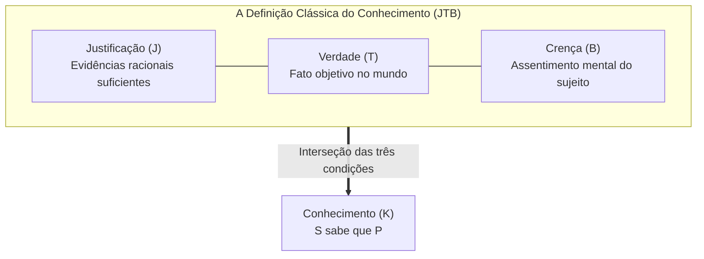

## Introdução: O artigo de três páginas que abalou 2300 anos de história

No dia a dia, empregamos a palavra «saber» com absoluta naturalidade:
- «Eu sei que está chovendo» (porque vejo a chuva pela janela);
- «Eu sei que a Terra orbita o Sol» (graças à física e à astronomia);
- «Eu sei que $2 + 2 = 4$» (pelas leis da lógica matemática).

Porém, sob o olhar da epistemologia: <strong>o que significa rigorosamente para uma mente consciente 'saber' algo? Quais são os requisitos definitivos do conhecimento?</strong>

Desde os diálogos platônicos *Teeteto* e *Mênon*, a tradição ocidental acolheu a clássica definição tripartite da <strong>Crença Verdadeira Justificada (JTB, Justified True Belief)</strong>:
Um sujeito $S$ sabe que $P$ se e somente se:
1. <strong>Crença</strong>: $S$ crê genuinamente que $P$ ($B_S(P)$);
2. <strong>Verdade</strong>: $P$ é um fato objetivo na realidade ($P = \text{Verdadeiro}$);
3. <strong>Justificação</strong>: $S$ possui evidências racionais e adequadas para crer que $P$ ($J_S(P)$).

Por mais de dois milênios, essa fórmula foi considerada indiscutível. Mas em <strong>junho de 1963</strong>, um jovem professor da Wayne State University, <strong>Edmund L. Gettier (1927–2021)</strong>, publicou um artigo de apenas <strong>três páginas</strong> na revista *Analysis*: *«Is Justified True Belief Knowledge?»*. Gettier apresentou contraexemplos irrefutáveis demonstrando que as três condições da JTB podem ser plenamente satisfeitas sem que haja qualquer conhecimento genuíno!

---

## 1. Os contraexemplos originais de Gettier

### Caso 1: Smith, Jones e as dez moedas
Smith e Jones competem por uma vaga de emprego. O diretor da empresa afirma a Smith que Jones será contratado. Minutos antes, Smith viu Jones colocar dez moedas no bolso. Smith deduz formalmente:
> *(e) O homem que conseguirá o emprego tem dez moedas no bolso.*

A reviravolta: a diretoria contrata <strong>Smith</strong>. E sem que Smith soubesse, ele próprio carregava <strong>exatamente dez moedas</strong> no bolso.
A proposição *(e)* é verdadeira, acreditada por Smith e plenamente justificada. Contudo, Smith sabia disso? <strong>Não!</strong> Foi um mero golpe de sorte.

---

## 2. A raiz do problema: Sorte epistêmica (Epistemic Luck)

Os casos de Gettier operam por um mecanismo de duplo acaso:
1. <strong>Má sorte inicial</strong>: a justificação apoia-se num fato falso (Jones não é contratado);
2. <strong>Boa sorte corretiva</strong>: uma coincidência cósmica independente torna a proposição verdadeira (Smith tem dez moedas).
A sorte epistêmica rompe a ligação essencial entre a competência intelectual do indivíduo e a realidade dos fatos.

---

## 3. A batalha pela quarta condição

- <strong>Eliminação de premissas falsas (No False Lemmas)</strong>: Ruptura diante do caso do <strong>relógio parado</strong> (olhar às 8h20 para um relógio quebrado há 24 horas exatamente às 8h20).
- <strong>Teoria causal de Goldman</strong>: Exigência de cadeia causal direta, desfeita pelo paradoxo do <strong>país dos celeiros falsos (Fake Barn Country)</strong>.
- <strong>Rastreamento da verdade de Nozick (Truth-Tracking)</strong>: Demanda sensibilidade contrafactual: «se $P$ não fosse verdade, $S$ não acreditaria que $P$».

---

## 4. Epistemologia das virtudes e IA

- <strong>O modelo AAA de Ernest Sosa</strong>: O conhecimento assemelha-se ao tiro com arco: deve ser preciso (Accurate), hábil (Adroit) e, sobretudo, apropriado (Apt) — a vitória deve provir da virtude do agente, não do acaso.
- <strong>Modelos de linguagem (LLM)</strong>: IAs que deduzem conclusões corretas a partir de premissas alucinadas comportam-se como autênticas máquinas de Gettier, desafiando a engenharia de alinhamento e explicabilidade.

## Conclusão

O problema de Gettier demonstra a vulnerabilidade da razão: acertar por acaso não é saber. O conhecimento autêntico é uma conquista árdua, que exige erradicar a sorte e ancorar o espírito na verdade ontológica da realidade.
