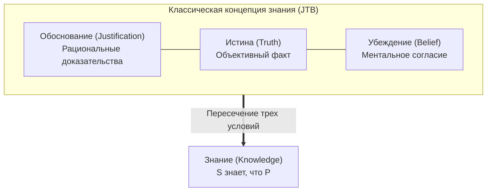

## Введение: Статья на трех страницах, потрясшая двухтысячелетнее здание философии

В повседневной речи мы используем глагол «знать» с безоговорочной уверенностью:
- «Я знаю, что на улице идет дождь» (потому что вижу капли на стекле);
- «Я знаю, что Земля вращается вокруг Солнца» (благодаря астрономическим доказательствам);
- «Я знаю, что $2 + 2 = 4$» (по законам элементарной арифметики).

Но что с философской точки зрения означает для субъекта $S$ по-настоящему <strong>знать</strong> нечто? Каковы необходимые и достаточные условия знания?

Со времен Платона (в диалогах «Теэтет» и «Менон») классическая эпистемология опиралась на трехчастную формулу <strong>обоснованного истинного убеждения (Justified True Belief, JTB)</strong>:
Субъект $S$ знает пропозицию $P$ тогда и только тогда, когда:
1. <strong>Убеждение (Belief)</strong>: $S$ искренне верит, что $P$;
2. <strong>Истина (Truth)</strong>: $P$ объективно истинно в реальности;
3. <strong>Обоснование (Justification)</strong>: $S$ обладает достаточными рациональными свидетельствами в пользу $P$.

Эта концепция казалась нерушимой 2300 лет. Однако в <strong>июне 1963 года</strong> никому не известный доцент Эдмунд Геттиер (1927–2021) опубликовал в журнале *Analysis* статью объемом всего <strong>в три страницы</strong>: *«Является ли обоснованное истинное убеждение знанием?»*. Геттиер привел неопровержимые контрпримеры, доказавшие: можно иметь обоснованное истинное убеждение, которое, тем не менее, знанием не является!

---

## 1. Контрпримеры Геттиера

### Случай 1: Смит, Джонс и десять монет
Смит и Джонс претендуют на одну должность. Директор компании лично заверяет Смита, что работу получит Джонс. Минутами ранее Смит видел, как Джонс пересчитал десять монет и убрал их в карман. Смит логически выводит:
> *(e) Человек, который получит работу, имеет десять монет в кармане.*

Внезапно совет директоров решает нанять <strong>самого Смита</strong>. И по невероятному совпадению в кармане у самого Смита <strong>тоже лежит ровно десять монет</strong>!
Убеждение *(e)* истинно, искренне разделяется Смитом и безупречно обосновано. Но знал ли Смит об этом? <strong>Нет!</strong> Это была чистая слепая случайность.

---

## 2. Суть проблемы: Эпистемическая удача (Epistemic Luck)

Контрпримеры Геттиера разоблачают паразитический механизм <strong>эпистемической удачи</strong>:
1. <strong>Неудача</strong>: обоснование отталкивается от ложного факта (Джонс не нанят);
2. <strong>Удача</strong>: независимое совпадение случайно спасает истинность вывода (у Смита десять монет).
Удача разрывает необходимую связь между познавательными усилиями человека и реальностью мира.

---

## 3. Битва за четвертое условие

- <strong>Исключение ложных посылок (No False Lemmas)</strong>: пало под ударом примера со <strong>стоящими часами</strong> (случайный взгляд на сломанные сутки назад часы ровно в 8:20).
- <strong>Каузальная теория Голдмана</strong>: требование прямой причинной связи, опровергнутое мысленным экспериментом о <strong>бутафорских амбарах (Fake Barn Country)</strong>.
- <strong>Отслеживание истины Нозика (Truth-Tracking)</strong>: требование контрфактической чувствительности: «если бы $P$ было ложным, $S$ не верил бы, что $P$».

---

## 4. Эпистемология добродетелей и ИИ

- <strong>Модель AAA Эрнеста Сосы</strong>: знание подобно выстрелу из лука: оно должно быть метким (Accurate), умелым (Adroit) и состоятельным (Apt) — успех должен принадлежать мастерству стрелка, а не порыву попутного ветра.
- <strong>Языковые модели (LLM)</strong>: современные нейросети, выдающие верные ответы на основе галлюцинированных фактов, представляют собой гигантские машины Геттиера, требующие строгой эпистемической верификации.

## Заключение

Проблема Геттиера напоминает о хрупкости человеческой рациональности: случайно угадать правду — не значит познать ее. Подлинное знание требует освобождения от иллюзий случайности и установления прочной связи с объективной реальностью.
