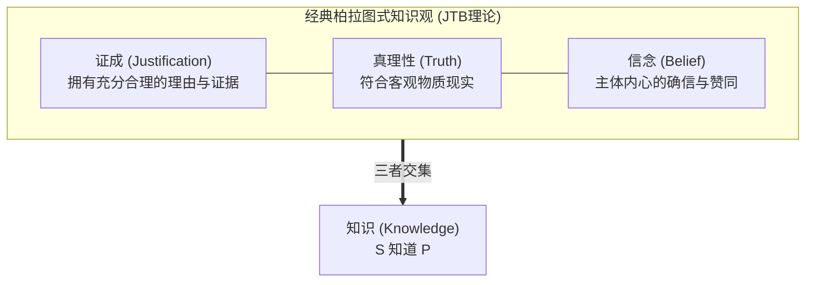
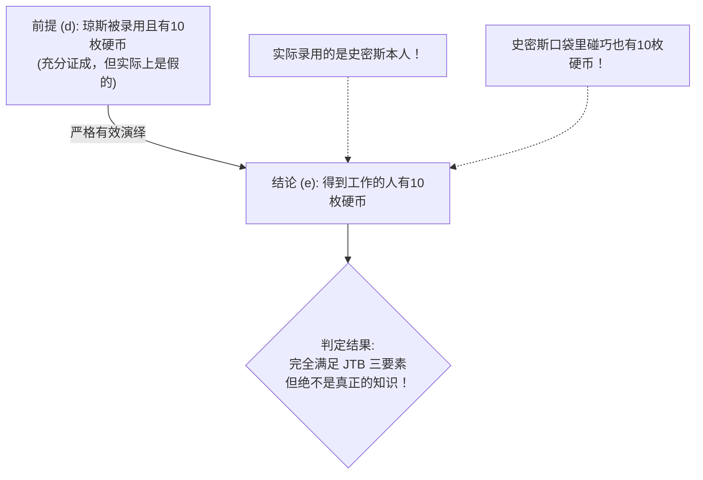

## 引言：摧毁2300年哲学圣殿的3页论文

在日常生活中，我们极为频繁且自信地使用“知道（Know）”这个词：
- “我知道外面正在下雨”（因为我亲眼看到雨滴打在窗玻璃上）；
- “我知道地球围绕太阳公转”（因为现代天文学提供了压倒性的科学观测证据）；
- “我知道明天星期三”（因为日历与社会时间法则明确规定）。

然而，如果从哲学与认识论的至高维度发问：<strong>一个人究竟在何种条件下，才能被严格地判定为“知道了”某件事？知识的本质与充分必要条件究竟是什么？</strong>

对此，古希腊哲学家柏拉图在《泰阿泰德篇》与《美诺篇》中勾勒出了一种极具说服力的回答，并在后世被确立为认识论的无上教条——<strong>“证成的真信念（Justified True Belief，简称 JTB 理论）”</strong>。

JTB 理论指出，认识主体 $S$ 知道命题 $P$，当且仅当以下三个条件<strong>同时满足且充分</strong>：
1. <strong>信念条件（Belief）</strong>：$S$ 真心相信 $P$ 是真的；
2. <strong>真理性条件（Truth）</strong>：$P$ 在客观现实世界中确实是真的；
3. <strong>证成条件（Justification）</strong>：$S$ 拥有充分、合理的证据或理由（知觉经验、逻辑演绎、可靠证言等）来相信 $P$。

两千年来，这一定义被视为分析哲学的完美典范：瞎蒙猜中（如胡乱买彩票偶然中奖）缺乏“证成”，因而不是知识；确信不疑但事实为假（如古代人坚信地心说）缺乏“真理性”，因而是谬误；至于客观存在但主体未曾听闻的事实则缺乏“信念”。

然而，<strong>1963年</strong>，美国学者<strong>埃德蒙·盖梯尔（Edmund Gettier, 1927–2021）</strong>在《Analysis》期刊上发表了一篇<strong>全文仅3页、不足千字</strong>的超短论文——《证成的真信念是知识吗？》（*Is Justified True Belief Knowledge?*）。这篇论文如同一枚概念核弹，彻底将两千多年的 JTB 大厦炸得粉碎。

盖梯尔构建了极其严密的反例：在这些场景中，主体的信念<strong>完全满足了证成性</strong>，而且<strong>事实证明完全是真的</strong>，主体也<strong>确实深信不疑</strong>，但任何具备基本理智的人都会斩钉截铁地判定：<strong>主体根本就不知道该命题！</strong>

---

## 1. 盖梯尔的反例：无懈可击的逻辑陷阱

### 1.1 案例一：史密斯、琼斯与口袋里的硬币

史密斯和琼斯竞争同一个公司职位。史密斯掌握了极强的合理证据相信以下前提 $(d)$：
> <strong>$(d)$ 琼斯将会得到这份工作，并且琼斯的口袋里有10枚硬币。</strong>

其证据极其充分：公司总裁刚刚亲自拍着史密斯的肩膀说“我们决定录用琼斯”，且史密斯几分钟前刚亲眼看着琼斯数了10枚硬币放进裤兜。

基于前提 $(d)$，史密斯根据经典演绎逻辑的形式规则，严密推导出了命题 $(e)$ 并深信不疑：
> <strong>$(e)$ 最终获得这份工作的人，口袋里有10枚硬币。</strong>

然而，戏剧性的命运发生了逆转：
1. 董事会最后关头推翻了总裁的决定，最终获得职位的不是琼斯，而是<strong>史密斯本人</strong>！
2. 史密斯完全不知道的是，他自己的口袋里碰巧也<strong>装着正好10枚硬币</strong>！

审视史密斯的信念 $(e)$：
- 他真心相信 $(e)$（<strong>信念条件满足</strong>）；
- 获得工作的人（史密斯）口袋里确实有10枚硬币，$(e)$ 是客观真理（<strong>真理性条件满足</strong>）；
- 他是通过严密的有效逻辑推理，从充分证据推导出的（<strong>证成条件满足</strong>）。

然而，史密斯真的“知道”获得职位的人口袋有10枚硬币吗？<strong>绝对不知道！</strong> 他的判断之所以正确，完全是因为一连串荒谬而离奇的<strong>巧合与运气</strong>。

---

## 2. 盖梯尔问题的核心病理：认知运气（Epistemic Luck）

盖梯尔反例之所以致命，是因为它揭示了<strong>“认知运气（Epistemic Luck）”</strong>对知识的侵蚀。

其结构具有固定的“两阶段抵消机制”：
1. <strong>第一阶段（恶运）</strong>：主体所依赖的证成基础其实偏离了真相（琼斯并未得到工作）；
2. <strong>第二阶段（好运）</strong>：另一个主体完全未察觉的偶然事实介入，歪打正着地使结论变成了真话（史密斯恰好被录用且也有10枚硬币）。

这种“靠运气猜中”的真理，切断了主体的认知努力与现实事实之间的必然纽带。

---

## 3. 寻找“第四条件”：认识论半个世纪的浴血奋战

盖梯尔发表论文后，全球哲学家开启了长达半个世纪的“修补 JTB”运动，试图寻找知识的第4个必备条件：$\text{知识} = \text{JTB} + X$。

### 3.1 排除假前提理论（No False Lemmas）
最初的方案认为只需规定：推理过程中<strong>不得包含任何虚假的前提</strong>。
然而这一修补迅速被<strong>“停走的钟”</strong>反例推翻：一个人抬头看一只停走在 8:20 的故障挂钟，而此时现实时间恰好真的是 8:20。这里没有中间假前提推理，属于直接知觉，但依然不算知识！

### 3.2 戈德曼的因果论（Causal Theory）与假谷仓陷阱
阿尔文·戈德曼（Alvin Goldman）提出：事实本身必须与信念之间存在<strong>适当的因果链条</strong>。
然而，著名的<strong>“假谷仓之乡（Fake Barn Country）”</strong>思想实验摧毁了因果论：亨利在路上看到一座真正的红谷仓并相信那是谷仓，光线反射建立起完美因果链。但他不知道周围平原上被剧组搭建了999座一模一样的纸糊假谷仓！亨利恰好看到唯一真谷仓纯属环境运气，他根本无法区分真假，因而无法构成知识。

### 3.3 诺齐克的真理追踪论（Truth-Tracking）
罗伯特·诺齐克引入可能世界反事实条件句，提出<strong>敏感性条件（Sensitivity）</strong>：如果 $P$ 为假，主体就不会相信 $P$。在假谷仓之乡中，即便那是假谷仓，亨利依旧会相信它是谷仓，因此无法追踪真理，被成功排除在知识之外。

---

### 3.5 现代理论转向：威廉姆森的『知识优先（Knowledge First）』

面对半个世纪以来修补 JTB 的无休止争论，牛津大学哲学家蒂莫西·威廉姆森（Timothy Williamson）在2000年出版的《知识及其极限》中提出了颠覆性的“知识优先”理论。威廉姆森指出：试图用信念、真理和辩护去机械拼装“知识”，本身就是一种方向性的错误。知识是不可还原的原初心理状态（Factive Mental State），恰恰相反，证据和信念才是根据知识派生出来的。这一转向彻底重构了当代认知哲学的讨论范式。

### 3.6 邓肯·普里查德的『反运气认识论（Anti-Luck Epistemology）』

爱丁堡大学哲学家邓肯·普里查德（Duncan Pritchard）进一步深化了这一讨论，提出了双重反运气理论：真正的知识必须同时排除“介入性运气”（如标准盖梯尔案例）与“环境性运气”（如假谷仓案例）。知识包含两个不可互相化约的核心维度：认知能力（Ability）与安全性（Safety）。只有当主体的信念在绝大多数邻近可能世界中均不轻易沦为虚妄时，它才配得上知识的尊严。

## 4. 德性认识论与知识的功能主义

- <strong>索萨的德性认识论（Virtue Epistemology）</strong>：将知识比作射箭的“AAA模型”（Accurate 命中、Adroit 技艺精湛、Apt 适格）。知识是<strong>归因于主体智识德性与能力的认知成功</strong>，彻底排除了借由外力运气获得的正确。
- <strong>爱德华·克雷格的功能主义</strong>：人类社会之所以发明“知道”这个词，是为了在群体中识别并标记<strong>“可靠的信息提供者（Good Informant）”</strong>。盖梯尔式的人物在未来无法重复提供可信情报，因此被语言共同体剥夺了“知识”这一荣誉称号。

---

## 5. 人工智能时代的盖梯尔困境：大模型真的“懂”世界吗？

在以 GPT-4、Gemini 为代表的生成式 AI 时代，盖梯尔问题正在演变为最紧迫的技术现实问题：
1. <strong>幻觉与偶然正确的推理</strong>：LLM 内部推理链条常常充满胡编乱造的虚假事实，但最终输出的答案文本却碰巧完全正确；
2. <strong>缺乏反事实鲁棒性</strong>：稍加轻微误导提示词，AI 的正确信念就会瞬间崩溃，表明其并未建立起与物理世界锚定的真实因果纽带。

如何让 AI 从依靠统计概率“偶然猜中”的盖梯尔机器，进化为具备因果反思与真正认知能力的智能体，正是当代可解释性 AI（XAI）与对齐理论的核心使命。

## 结语

盖梯尔用短短三页纸给人类狂妄的理性泼了一盆冰水：即使我们证据确凿且言中事实，我们也可能依然置身于运气的迷雾之中。直面盖梯尔问题，不仅是对知识定义的严密追求，更是人类在浩瀚宇宙中不断驱逐侥幸、追寻确定性真理的永恒精神证明。
