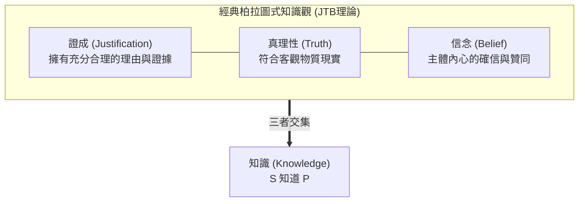

## 引言：摧毀2300年哲學聖殿的3頁論文

在日常生活中，我們極為頻繁且自信地使用「知道（Know）」這個詞：
- 「我知道外面正在下雨」（因為我親眼看到雨滴打在窗玻璃上）；
- 「我知道地球圍繞太陽公轉」（因為現代天文學提供了壓倒性的科學觀測證據）；
- 「我知道明天星期三」（因為日曆與社會時間法則明確規定）。

然而，如果從哲學與認識論的至高維度發問：<strong>一個人究竟在何種條件下，才能被嚴格地判定為「知道了」某件事？知識的本質與充分必要條件究竟是什麼？</strong>

對此，古希臘哲學家柏拉圖在《泰阿泰德篇》與《美諾篇》中勾勒出了一種極具說服力的回答，並在後世被確立為認識論的無上教條——<strong>「證成的真信念（Justified True Belief，簡稱 JTB 理論）」</strong>。

JTB 理論指出，認識主體 $S$ 知道命題 $P$，當且僅當以下三個條件<strong>同時滿足且充分</strong>：
1. <strong>信念條件（Belief）</strong>：$S$ 真心相信 $P$ 是真的；
2. <strong>真理性條件（Truth）</strong>：$P$ 在客觀現實世界中確實是真的；
3. <strong>證成條件（Justification）</strong>：$S$ 擁有充分、合理的證據或理由（知覺經驗、邏輯演繹、可靠證言等）來相信 $P$。

兩千年來，這一定義被視為分析哲學的完美典範：瞎蒙猜中（如胡亂買彩券偶然中獎）缺乏「證成」，因而不是知識；確信不疑但事實為假（如古代人堅信地心說）缺乏「真理性」，因而是謬誤；至於客觀存在但主體未曾聽聞的事實則缺乏「信念」。

然而，<strong>1963年</strong>，美國學者<strong>埃德蒙·蓋梯爾（Edmund Gettier, 1927–2021）</strong>在《Analysis》期刊上發表了一篇<strong>全文僅3頁、不足千字</strong>的超短論文——《證成的真信念是知識嗎？》（*Is Justified True Belief Knowledge?*）。這篇論文如同一枚概念核彈，徹底將兩千多年的 JTB 大廈炸得粉碎。

蓋梯爾構建了極其嚴密的反例：在這些場景中，主體的信念<strong>完全滿足了證成性</strong>，而且<strong>事實證明完全是真的</strong>，主體也<strong>確實深信不疑</strong>，但任何具備基本理智的人都會斬釘截鐵地判定：<strong>主體根本就不知道該命題！</strong>

---

## 1. 蓋梯爾的反例：無懈可擊的邏輯陷阱

### 1.1 案例一：史密斯、瓊斯與口袋裡的硬幣

史密斯和瓊斯競爭同一個公司職位。史密斯掌握了極強的合理證據相信以下前提 $(d)$：
> <strong>$(d)$ 瓊斯將會得到這份工作，並且瓊斯的口袋裡有10枚硬幣。</strong>

其證據極其充分：公司總裁剛剛親自拍著史密斯的肩膀說「我們決定錄用瓊斯」，且史密斯幾分鐘前剛親眼看著瓊斯數了10枚硬幣放進褲兜。

基於前提 $(d)$，史密斯根據經典演繹邏輯的形式規則，嚴密推導出了命題 $(e)$ 並深信不疑：
> <strong>$(e)$ 最終獲得這份工作的人，口袋裡有10枚硬幣。</strong>

然而，戲劇性的命運發生了逆轉：
1. 董事會最後關頭推翻了總裁的決定，最終獲得職位的不是瓊斯，而是<strong>史密斯本人</strong>！
2. 史密斯完全不知道的是，他自己的口袋裡碰巧也<strong>裝著正好10枚硬幣</strong>！

審視史密斯的信念 $(e)$：
- 他真心相信 $(e)$（<strong>信念條件滿足</strong>）；
- 獲得工作的人（史密斯）口袋裡確實有10枚硬幣，$(e)$ 是客觀真理（<strong>真理性條件滿足</strong>）；
- 他是通過嚴密的有效邏輯推理，從充分證據推導出的（<strong>證成條件滿足</strong>）。

然而，史密斯真的「知道」獲得職位的人口袋有10枚硬幣嗎？<strong>絕對不知道！</strong> 他的判斷之所以正確，完全是因為一連串荒謬而離奇的<strong>巧合與運氣</strong>。

---

## 2. 蓋梯爾問題的核心病理：認知運氣（Epistemic Luck）

蓋梯爾反例之所以致命，是因為它揭示了<strong>「認知運氣（Epistemic Luck）」</strong>對知識的侵蝕。

其結構具有固定的「兩階段抵消機制」：
1. <strong>第一階段（惡運）</strong>：主體所依賴的證成基礎其實偏離了真相（瓊斯並未得到工作）；
2. <strong>第二階段（好運）</strong>：另一個主體完全未察覺的偶然事實介入，歪打正著地使結論變成了真話（史密斯恰好被錄用且也有10枚硬幣）。

這種「靠運氣猜中」的真理，切斷了主體的認知努力與現實事實之間的必然紐帶。

---

## 3. 尋找「第四條件」：認識論半個世紀的浴血奮戰

蓋梯爾發表論文後，全球哲學家開啟了長達半個世紀的「修補 JTB」運動，試圖尋找知識的第4個必備條件：$\text{知識} = \text{JTB} + X$。

### 3.1 排除假前提理論（No False Lemmas）
最初的方案認為只需規定：推理過程中<strong>不得包含任何虛假的前提</strong>。
然而這一修補迅速被<strong>「停走的鐘」</strong>反例推翻：一個人抬頭看一隻停走在 8:20 的故障掛鐘，而此時現實時間恰好真的是 8:20。這裡沒有中間假前提推理，屬於直接知覺，但依然不算知識！

### 3.2 戈德曼的因果論（Causal Theory）與假谷倉陷阱
阿爾文·戈德曼（Alvin Goldman）提出：事實本身必須與信念之間存在<strong>適當的因果鏈條</strong>。
然而，著名的<strong>「假谷倉之鄉（Fake Barn Country）」</strong>思想實驗摧毀了因果論：亨利在路上看到一座真正的紅谷倉並相信那是谷倉，光線反射建立起完美因果鏈。但他不知道周圍平原上被劇組搭建了999座一模一樣的紙糊假谷倉！亨利恰好看到唯一真谷倉純屬環境運氣，他根本無法區分真假，因而無法構成知識。

### 3.3 諾齊克的真理追蹤論（Truth-Tracking）
羅伯特·諾齊克引入可能世界反事實條件句，提出<strong>敏感性條件（Sensitivity）</strong>：如果 $P$ 為假，主體就不會相信 $P$。在假谷倉之鄉中，即便那是假谷倉，亨利依舊會相信它是谷倉，因此無法追蹤真理，被成功排除在知識之外。

---

### 3.4 內在主義與外在主義的世紀大分裂

蓋梯爾問題的爆發，直接撕裂了現代認識論並催生了兩大陣營的對立：
- <strong>內在主義（Internalism）</strong>：堅持主體必須能夠通過理性反省「在意識內部直接通達」證成理由；
- <strong>外在主義（Externalism）</strong>：主張證成取決於主體外部客觀認知環境的可靠性（如可靠主義 Reliabilism）。主體無需在心靈內部明白所有因果細節，只要其信念是由可靠的認知機制所產生的即可。這一分裂至今仍在深深塑造著認知科學與心靈哲學的版圖。

### 3.5 現代理論轉向：威廉姆森的『知識優先（Knowledge First）』

面對半個世紀以來修補 JTB 的無休止爭論，牛津大學哲學家蒂莫西·威廉姆森（Timothy Williamson）在2000年出版的《知識及其極限》中提出了顛覆性的「知識優先」理論。威廉姆森指出：試圖用信念、真理和辯護去機械拼裝「知識」，本身就是一種方向性的錯誤。知識是不可還原的原初心裡狀態（Factive Mental State），恰恰相反，證據和信念才是根據知識派生出來的。這一轉向徹底重構了當代認知哲學的討論範式。

### 3.6 鄧肯·普里查德的『反運氣認識論（Anti-Luck Epistemology）』

愛丁堡大學哲學家鄧肯·普里查德（Duncan Pritchard）進一步深化了這一討論，提出了雙重反運氣理論：真正的知識必須同時排除「介入性運氣」（如標準蓋梯爾案例）與「環境性運氣」（如假谷倉案例）。知識包含兩個不可互相化約的核心維度：認知能力（Ability）與安全性（Safety）。只有當主體的信念在絕大多數鄰近可能世界中均不輕易淪為虛妄時，它才配得上知識的尊嚴。

## 4. 德性認識論與知識的功能主義

- <strong>索薩的德性認識論（Virtue Epistemology）</strong>：將知識比作射箭的「AAA模型」（Accurate 命中、Adroit 技藝精湛、Apt 適格）。知識是<strong>歸因於主體智識德性與能力的認知成功</strong>，徹底排除了借由外力運氣獲得的正確。
- <strong>愛德華·克雷格的功能主義</strong>：人類社會之所以發明「知道」這個詞，是為了在群體中識別並標記<strong>「可靠的信息提供者（Good Informant）」</strong>。蓋梯爾式的人物在未來無法重複提供可信情報，因此被語言共同體剝奪了「知識」這一榮譽稱號。

---

## 5. 人工智慧時代的蓋梯爾困境：大模型真的「懂」世界嗎？

在以 GPT-4、Gemini 為代表的生成式 AI 時代，蓋梯爾問題正在演變為最緊迫的技術現實問題：
1. <strong>幻覺與偶然正確的推理</strong>：LLM 內部推理鏈條常常充滿胡編亂造的虛假事實，但最終輸出的答案文本卻碰巧完全正確；
2. <strong>缺乏反事實魯棒性</strong>：稍加輕微誤導提示詞，AI 的正確信念就會瞬間崩潰，表明其並未建立起與物理世界錨定的真實因果紐帶。

如何讓 AI 從依靠統計機率「偶然猜中」的蓋梯爾機器，進化為具備因果反思與真正認知能力的主體，正是當代可解釋性 AI（XAI）與對齊理論的核心使命。

## 結語

蓋梯爾用短短三頁紙給人類狂妄的理性潑了一盆冰水：即使我們證據確鑿且言中事實，我們也可能依然置身於運氣的迷霧之中。直面蓋梯爾問題，不僅是對知識定義的嚴密追求，更是人類在浩瀚宇宙中不斷驅逐僥倖、追尋確定性真理的永恆精神證明。
