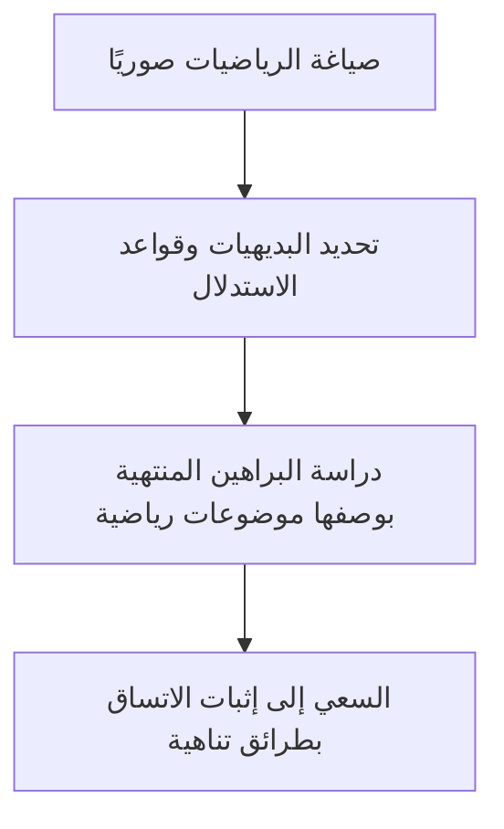
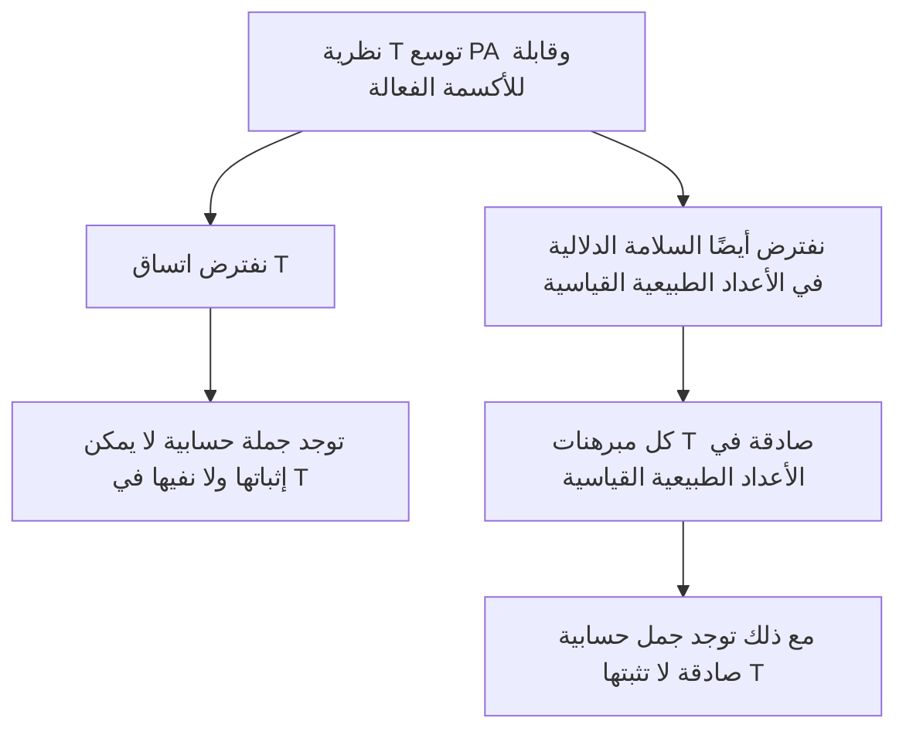
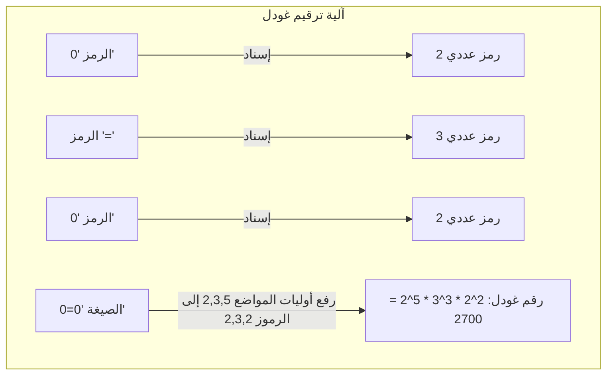
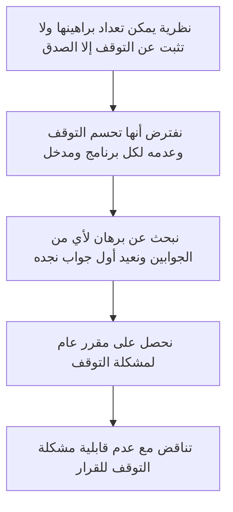

إذا اخترنا نسقًا من البديهيات وراكمنا البراهين وفق قواعد آلية، فهل نستطيع الإجابة عن كل سؤال يتعلق بالأعداد الطبيعية؟ تبين مبرهنات غودل لعدم الاكتمال أن هذا الحل الشامل غير ممكن في النظريات التي تستوفي شروطًا محددة.

المهم هو تحديد <strong>النظرية التي يتعذر الإثبات داخلها</strong>. لا تعني المبرهنات وجود حقائق يستحيل إثباتها مهما كانت البديهيات المختارة. سنميز بين الاتساق والسلامة الدلالية وقابلية الأكسمة الفعالة، ثم نوضح الترميز والإحالة إلى الذات ونطاق انطباق المبرهنات.

---

## 1. برنامج هيلبرت وثلاثة أسئلة مختلفة

سعى [ديفيد هيلبرت](/ar/p/hilbert/) وآخرون إلى ترسيخ أسس الرياضيات بصياغتها في أنساق بديهية صورية وإثبات اتساقها بطرائق تناهية. ينبغي التمييز بين صوغ الرياضيات صوريًا ودراسة براهينها من خارج النسق. ووصف البرنامج بأنه محاولة لجعل النسق يضمن كل شيء من داخله وحده ليس وصفًا دقيقًا.

ينبغي أيضًا التمييز بين الخصائص الثلاث الآتية:

- <strong>الاتساق</strong>: ألا تثبت النظرية جملة $A$ ونفيها $\neg A$ معًا.
- <strong>اكتمال النظرية</strong>: أن تثبت النظرية، لكل جملة $A$ في لغتها، إما $A$ وإما $\neg A$. المقصود هنا هو الاكتمال النحوي.
- <strong>قابلية القرار</strong>: وجود خوارزمية تتوقف دائمًا وتقرر ما إذا كانت الجملة المعطاة مبرهنة في النظرية.

يختلف الاكتمال عن السلامة الدلالية، أي صدق جميع مبرهنات النظرية في التفسير المقصود. كما أن مبرهنة اكتمال منطق الرتبة الأولى لا تعني الشيء نفسه الذي يعنيه اكتمال نظرية حسابية معينة.

## 2. الأنساق الصورية وحساب بيانو

نحدد في النسق الصوري الرموز وطرائق بناء الصيغ والبديهيات وقواعد الاستدلال. ويمكن فصل العمل النحوي، أي فحص التزام برهان منته بالقواعد، عن العمل الدلالي، أي السؤال عما إذا كانت الصيغة صادقة في تفسير معين. والقول إن فحص الرموز لا يحتاج إلى معناها لا يعني الاستغناء عن المعنى في الرياضيات.

من الأمثلة البارزة حساب بيانو من الرتبة الأولى (PA). وهو يتناول الأعداد الطبيعية، بما فيها الصفر، وعملية الخلف والجمع والضرب، ويشمل مخطط بديهيات الاستقراء. والجملة $1+1=2$ مثلًا تُستنتج من هذه البديهيات والقواعد.

سنستخدم فيما يأتي شرطًا كافيًا سهل العرض، فنركز على النظريات القابلة للأكسمة الفعالة التي تحتوي على PA. لا ندعي أن هذه أضعف شروط عدم الاكتمال؛ فللمبرهنة الأولى صيغ تستند إلى حساب أضعف من PA.

## 3. مبرهنة عدم الاكتمال الأولى: جمل لا تحسمها النظرية

نعرض نتيجة [كورت غودل](/ar/p/godel/) بالصيغة الآتية، التي تشمل تحسين روسر:

> في كل نظرية متسقة قابلة للأكسمة الفعالة وتحتوي على PA، توجد جملة حسابية لا يمكن إثباتها ولا نفيها داخل تلك النظرية.

تعني الأكسمة الفعالة هنا إمكان تعداد البديهيات والبراهين بإجراء آلي. وعدم قابلية الإثبات نسبي إلى النظرية المختارة، ولا يعني استحالة الإثبات في نظرية نضيف إليها بديهيات أخرى. فلا بد من التمييز بين الصدق في الأعداد الطبيعية القياسية وقابلية الإثبات داخل نظرية ثابتة.

إذا رسمنا مجموعة الجمل القابلة للإثبات داخل مجموعة الجمل الصادقة في الأعداد الطبيعية القياسية، وجب افتراض <strong>السلامة الدلالية</strong>، وهي أقوى من الاتساق. فالاتساق يمنع إثبات جملة ونفيها معًا، لكنه وحده لا يضمن صدق كل مبرهنة في الأعداد الطبيعية القياسية.

### بناء الإحالة إلى الذات في جملة حسابية دون إدخال تناقض

قد يساعد التشابه مع جملة الكذاب «هذه الجملة كاذبة» على تكوين حدس أولي. لكن بناء غودل لا يُدخل تناقضًا إلى الرياضيات، بل يرمز الجمل والبراهين بأعداد ويعبر حسابيًا عن <strong>قابلية الإثبات في نظرية محددة</strong>.

لتكن النظرية $T$، وليكن $\operatorname{Prov}_T(y)$ محمول الإثبات المعتاد الذي يعبر عن وجود برهان في $T$ للجملة ذات الرقم $y$. ويمثل $\ulcorner G_T\urcorner$ الاسم العددي لرمز الجملة $G_T$. تتيح لمّة النقطة الثابتة بناء جملة يمكن إثبات التكافؤ الآتي لها داخل النظرية:

$$
T\vdash G_T\leftrightarrow\neg\operatorname{Prov}_T(\ulcorner G_T\urcorner)
$$

يعني $T\vdash A$ أن «$T$ تثبت $A$». وهذا بناء يستخدم الترميز والتعويض، وليس مجرد اتخاذ جملة من اللغة الطبيعية بديهية.

لو وُجد برهان للجملة $G_T$ في $T$، لأمكن التعبير حسابيًا عن وجود ذلك البرهان المنتهي، ولأثبتت $T$ الجملة $\operatorname{Prov}_T(\ulcorner G_T\urcorner)$. لكنها ستثبت نفيها أيضًا انطلاقًا من التكافؤ السابق ومن $G_T$. لذلك، إذا كانت $T$ متسقة، فلا يمكن إثبات $G_T$ فيها.

بما أن محمول الإثبات المعتاد يمثل البراهين المنتهية الفعلية تمثيلًا صحيحًا في الأعداد الطبيعية القياسية، فإن عدم قابلية الإثبات هذا يبين أن $G_T$ صادقة في تلك الأعداد. وتتضمن هذه الحجة الخارجية افتراض اتساق $T$؛ ولا تعني أن الإنسان يستطيع تلقائيًا معرفة اتساق أي نظرية.

ولا تكفي الحجة السابقة لاستنتاج أن مجرد الاتساق يمنع أيضًا إثبات نفي الجملة نفسها $G_T$. إذا افترضنا السلامة الدلالية مثلًا، استحال إثبات نفي الجملة الصادقة $G_T$. استخدم برهان غودل الأصلي للاستقلال الاتساق من نوع $\omega$، بينما بنى روسر جملة مختلفة ليحصل، بافتراض الاتساق العادي وحده، على عدم إمكان الإثبات أو النفي.

## 4. ترقيم غودل: تمثيل سلاسل الرموز والبراهين بأعداد

ترقيم غودل طريقة لإسناد رموز عددية طبيعية إلى الرموز والصيغ وسلاسل الصيغ المنتهية التي تشكل البراهين. في المثال التعليمي الآتي، يأخذ الرمز نفسه العدد الصحيح الموجب نفسه، بينما تقابل مواضع الرموز في السلسلة أعداد أولية مختلفة. لا نحاول إعادة إنتاج الترقيم الوارد في الورقة الأصلية حرفيًا.

إذا كان رمز «0» هو 2 ورمز «=» هو 3، فإن «0=0» تقابل السلسلة 2، 3، 2. نرفع الأعداد الأولية الخاصة بالمواضع، وهي 2 و3 و5، إلى هذه الأسس على الترتيب ثم نضرب، فنحصل على 2700. ويسمح تفرد التحليل إلى عوامل أولية للأعداد الصحيحة التي لا تقل عن 2 باستعادة سلسلة الرموز في هذا المثال.

المهم ليس إنتاج أعداد ضخمة في حد ذاته، بل تمثيل بنية الصيغ والتعويض وفحص البراهين المنتهية بعلاقات بين الأعداد. مثلًا، نميز بين العلاقة «العدد $p$ يرمز برهانًا للجملة ذات الرقم $q$» وقابلية الإثبات التي تقول «يوجد عدد $p$ بهذه الخاصية».

فحص مرشح واحد لبرهان منته يختلف عن تقرير عدم وجود أي برهان. ولا يجعل الترميز وحده جميع مسائل قابلية الإثبات قابلة للقرار.

## 5. مبرهنة عدم الاكتمال الثانية: إثبات الاتساق داخل النظرية

نعرض المبرهنة الثانية أيضًا تحت شروط كافية محددة:

> لا تستطيع نظرية متسقة قابلة للأكسمة الفعالة وتوسع PA أن تثبت داخلها اتساقها، عندما يُصاغ الاتساق باستخدام محمول الإثبات المعتاد.

نختار مثلًا الجملة $0=1$ للتعبير عن تناقض، ونصوغ الاتساق كما يأتي:

$$
\operatorname{Con}(T)
\equiv\neg\operatorname{Prov}_T(\ulcorner 0=1\urcorner)
$$

هذه جملة حسابية تقول إنه «لا يوجد في $T$ برهان على التناقض». لا يكفي إطلاق اسم «الاتساق» على أي صيغة للحصول على النتيجة نفسها؛ فصياغة محمول الإثبات وشروط الاشتقاق أمران أساسيان.

قد يدعونا مثال الشخص الذي يقول «أنا لا أكذب» إلى التفكير في أساس الثقة بالبرهان، لكنه ليس برهانًا على المبرهنة الثانية. وكذلك فإن إمكان إثبات أي شيء في نظرية متناقضة لا يكفي وحده لاستنتاج عدم قابلية الإثبات في نظرية متسقة.

نميز هنا أيضًا بين الاتساق والسلامة الدلالية، أي صدق جميع المبرهنات في التفسير المقصود. ولا تُستبعد إمكانية إثبات اتساق النظرية الأصلية داخل نظرية أقوى. كما أن المبرهنة لا تنطبق دون شروط على البشر أو المؤسسات أو كل البرامج.

## 6. سوء الفهم الشائع ونطاق الانطباق

### لا تعني المبرهنات انهيار الرياضيات

عدم الاكتمال ليس نفيًا للاتساق، بل يعني وجود جمل لا تحسمها نظرية ثابتة. وعند إضافة بديهيات، ينبغي إعادة بحث أسباب اختيارها واتساق النظرية الموسعة وغيرها من الخصائص. لا تختفي كل المشكلات بمجرد إضافة بديهيات.

### لا تستنتج المبرهنات تفوق الإنسان على الآلة

حتى الحجة الخارجية التي تثبت صدق جملة غودل تفترض أمورًا مثل اتساق النظرية المعنية. ولا تتضمن المبرهنة أن الإنسان يستطيع التحقق من هذه الافتراضات لأي نظرية. ينبغي فصل النقاش الفلسفي بشأن العقل البشري والذكاء الاصطناعي عن النتائج الرياضية المعروضة هنا.

### ليست كل نظرية غير مكتملة

تتوقف النتيجة على اللغة والبديهيات والفعالية والقدرة على التعبير عن الحساب. فمثلًا، نظرية الحقول المغلقة حقيقيًا من الرتبة الأولى، بلغة الصفر والواحد والجمع والضرب والترتيب، مكتملة وقابلة للقرار. وتتيح إزالة المكممات الوصول إلى إجراء للقرار.

هذا لا يعني حل «كل الرياضيات المتعلقة بالأعداد الحقيقية»، بما فيها الدوال والمجموعات الاعتباطية، آليًا. ولا يعني إمكان معالجة حساب الأعداد الطبيعية بالطريقة نفسها. وكذلك فإن القول باكتمال الهندسة الإقليدية يتطلب تحديد الصياغة الصورية واللغة المقصودتين.

## 7. الصلة بمشكلة التوقف

تقرر نتيجة [مشكلة التوقف](/ar/p/halting-problem/) عدم وجود خوارزمية عامة تتوقف دائمًا وتعطي الجواب الصحيح عن توقف أي برنامج مع مدخل محدد أو عدم توقفه. نموذج تورينج للحساب نموذج رياضي، وليس مجرد استبدال نسق صوري بآلة مادية.

لفهم إحدى الصلات، نأخذ نظرية يمكن تعداد براهينها آليًا ولا تثبت عن التوقف وعدم التوقف إلا عبارات صادقة. لو أمكنها إثبات التوقف أو عدمه لكل برنامج ومدخل، لأمكننا تعداد البراهين حتى نجد أحد الجوابين، ثم إرجاعه. وهذا سيجعل مشكلة التوقف قابلة للقرار.

تستخدم هذه الحجة افتراضًا قويًا هو السلامة الدلالية فيما يخص التوقف. وهي ليست عرضًا لأضعف شروط مبرهنات غودل ولا برهانًا كاملًا عليها. كما ينبغي التمييز بين قابلية الحساب والتعقيد الحسابي الذي يدرس الزمن والذاكرة اللازمين للحساب.

## 8. الخلاصة: تحديد النظرية والافتراضات

تصف مبرهنات عدم الاكتمال حدود الإثبات في نظرية ثابتة تستوفي شروطًا محددة. ففي نظرية حسابية متسقة قابلة للأكسمة الفعالة وقوية بما يكفي، توجد جمل لا يمكن إثباتها ولا نفيها داخلها. وتحت الشروط الكافية، لا تستطيع النظرية إثبات اتساقها المصوغ بالشكل المعتاد داخلها أيضًا.

قد تصبح جملة لا تحسمها نظرية ما قابلة للإثبات بعد إضافة بديهيات جديدة. لكن إذا استوفت النظرية الموسعة الشروط نفسها، ظهر عدم الاكتمال فيها أيضًا. ويختلف النظر في مجموعة جميع الحقائق الحسابية عن إعطائها نسقًا بديهيًا يمكن تعداده آليًا.

لا تنتج عن هذه المبرهنات وحدها استنتاجات بانهيار الرياضيات أو تفوق الإنسان على الآلات أو حد عام لقدرات كل أشكال الذكاء الاصطناعي. الأسئلة الأساسية هي: ما النظرية المختارة؟ وما الافتراضات المستخدمة؟ وهل نميز بين الصدق وقابلية الإثبات؟

### المراجع

- [Open Logic Project: Incompleteness and Computability](https://ic.openlogicproject.org/ic-screen.pdf) — مادة تعليمية عن الترميز ولمّة النقطة الثابتة ونتائج غودل وروسر وشروط محمول الإثبات.
- [UCLA: Incompleteness and Undecidability](https://www.math.ucla.edu/~dam/220b.1.11w/220notes4.pdf) — التمثيل الحسابي للرموز والبراهين، والتمييز بين صيغة المبرهنة الأولى بافتراض السلامة الدلالية وصيغة روسر.
- [Richard Zach: The Practice of Finitism](https://arxiv.org/abs/math/0102189) — بحث في الأكسمة وبراهين الاتساق التناهية في برنامج هيلبرت.
- [Jindřich Zapletal: Elements of Set Theory](https://people.clas.ufl.edu/zapletal/files/notesset.pdf) — لغة الرتبة الأولى للحقول المغلقة حقيقيًا وإزالة المكممات؛ انظر المبرهنة 6.3.12 في القسم 6.3.
