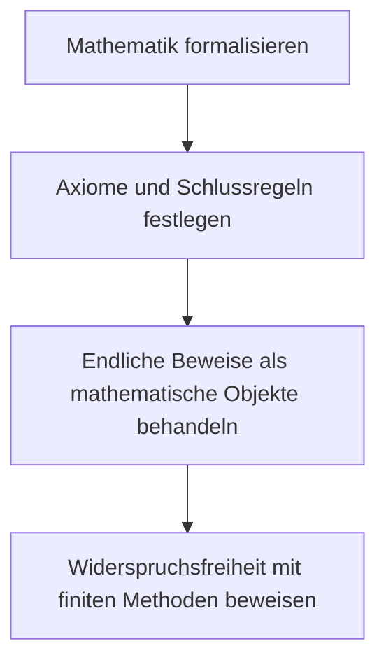
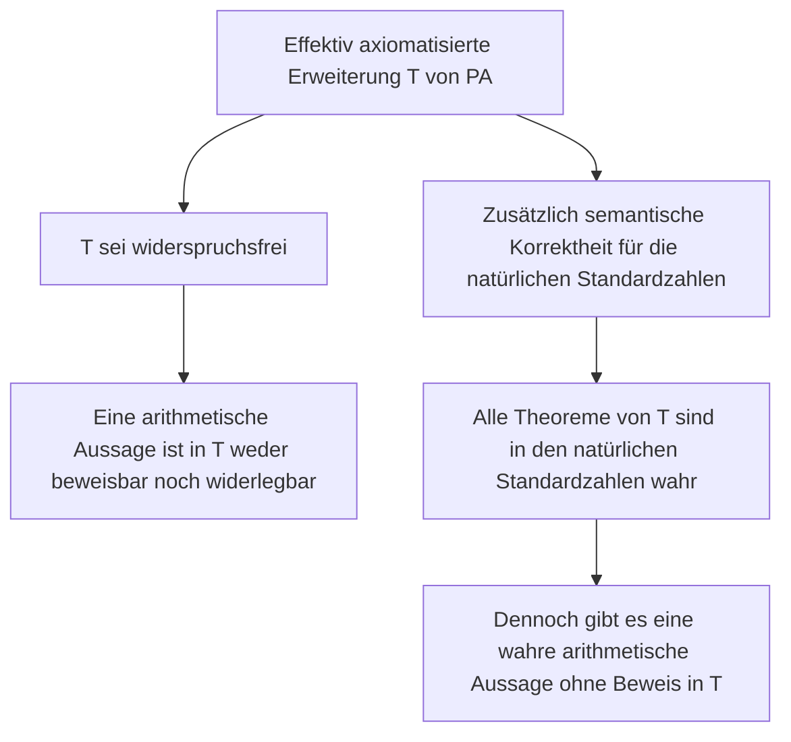
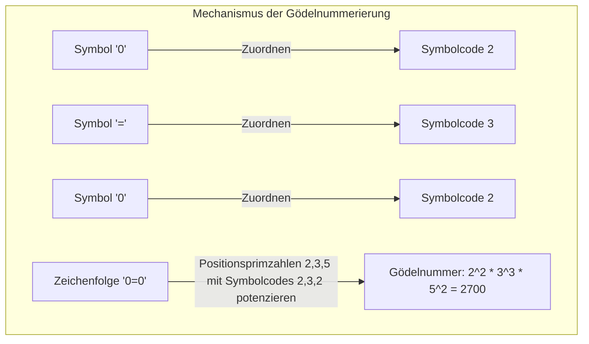
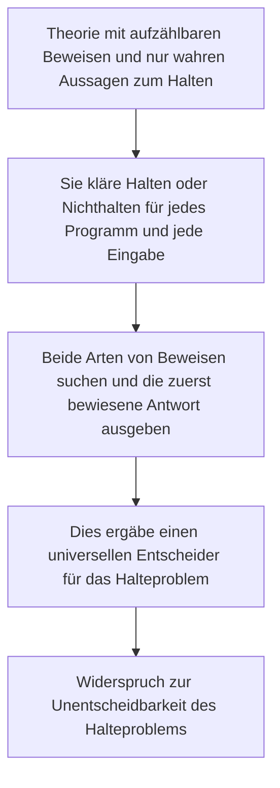

Können wir alle Fragen über natürliche Zahlen beantworten, wenn wir ein Axiomensystem wählen und nach mechanischen Regeln Beweise aufbauen? Gödels Unvollständigkeitssätze zeigen, dass Theorien, die bestimmte Voraussetzungen erfüllen, keine solche vollständige Lösung liefern können.

Entscheidend ist, <strong>in welcher Theorie eine Aussage nicht beweisbar ist</strong>. Das Ergebnis besagt nicht, dass es Wahrheiten gibt, die unabhängig von jeder Wahl der Axiome unbeweisbar bleiben. Wir unterscheiden Widerspruchsfreiheit, semantische Korrektheit und effektive Axiomatisierung und betrachten dabei Kodierung, Selbstbezug und den Geltungsbereich der Sätze.

---

## 1. Hilberts Programm und drei verschiedene Fragen

Um die Grundlagen der Mathematik zu sichern, verfolgten [David Hilbert](/de/p/hilbert/) und andere das Programm, Mathematik durch formale Axiomensysteme zu beschreiben und deren Widerspruchsfreiheit mit finiten Methoden zu beweisen. Die Formalisierung der Mathematik und die Untersuchung ihrer Beweise von außen sind verschiedene Aufgaben. Die Beschreibung „Ein System garantiert von innen alles über sich selbst“ gibt dieses Programm nicht angemessen wieder.

Auch die folgenden drei Eigenschaften sind zu unterscheiden.

- <strong>Widerspruchsfreiheit</strong>: Die Theorie beweist nicht sowohl eine Aussage $A$ als auch ihre Negation $\neg A$.
- <strong>Vollständigkeit einer Theorie</strong>: Für jede Aussage $A$ ihrer Sprache beweist die Theorie $A$ oder $\neg A$. Gemeint ist syntaktische Vollständigkeit.
- <strong>Entscheidbarkeit</strong>: Ein stets terminierender Algorithmus kann feststellen, ob eine vorgelegte Aussage ein Theorem der Theorie ist.

Vollständigkeit unterscheidet sich von semantischer Korrektheit, nach der alle Theoreme in der beabsichtigten Interpretation wahr sind. Auch der Vollständigkeitssatz der Logik erster Stufe bedeutet etwas anderes als die Vollständigkeit einer bestimmten arithmetischen Theorie.

## 2. Formale Systeme und Peano-Arithmetik

Ein formales System legt Symbole, Regeln zur Bildung von Formeln, Axiome und Schlussregeln fest. Die syntaktische Prüfung, ob ein endlicher Beweis den Regeln folgt, lässt sich von der semantischen Frage trennen, ob eine Formel in einer Interpretation wahr ist. Dass die Beweisprüfung keine Betrachtung der Bedeutung erfordert, heißt nicht, dass Bedeutung für die Mathematik unwichtig wäre.

Ein übliches Beispiel ist die Peano-Arithmetik erster Stufe (PA). Sie behandelt Null, Nachfolger, Addition und Multiplikation natürlicher Zahlen und enthält ein Induktionsaxiomenschema. Auch $1+1=2$ ist eine Aussage, die aus diesen Axiomen und Regeln hergeleitet wird.

Zur übersichtlichen Darstellung betrachten wir hauptsächlich effektiv axiomatisierte Theorien, die PA enthalten, als hinreichenden Rahmen. Das sind nicht die schwächsten möglichen Voraussetzungen: Formen des ersten Satzes gelten auch über schwächeren arithmetischen Theorien.

## 3. Der erste Unvollständigkeitssatz: Aussagen, die eine Theorie nicht klärt

Wir formulieren [Kurt Gödels](/de/p/godel/) Unvollständigkeitsergebnis in der folgenden Form, die Rossers Verbesserung einbezieht.

> Jede widerspruchsfreie, effektiv axiomatisierte Theorie, die PA enthält, besitzt eine arithmetische Aussage, die sie weder beweisen noch widerlegen kann.

„Effektiv axiomatisiert“ bedeutet, dass sich Axiome und Beweise durch ein mechanisches Verfahren aufzählen lassen. Unbeweisbarkeit bezieht sich auf die gewählte Theorie. Sie bedeutet nicht, dass die Aussage auch in einer anderen Theorie mit zusätzlichen Axiomen unbeweisbar bleiben muss. Wahrheit in den natürlichen Standardzahlen und Beweisbarkeit in einer festen Theorie sind zu unterscheiden.

Um die Menge beweisbarer Aussagen als Teilmenge der in den natürlichen Standardzahlen wahren Aussagen darzustellen, benötigen wir die stärkere Voraussetzung der <strong>semantischen Korrektheit</strong>. Widerspruchsfreiheit schließt lediglich aus, eine Aussage und ihre Negation zu beweisen. Sie allein macht nicht jedes Theorem in den natürlichen Standardzahlen wahr.

### Selbstbezug als Arithmetik konstruieren, nicht als Widerspruch

Die Ähnlichkeit mit dem Lügnersatz „Dieser Satz ist falsch“ kann die Anschauung unterstützen. Gödels Konstruktion führt aber keinen Widerspruch in die Mathematik ein. Sie kodiert Aussagen und Beweise durch Zahlen und drückt die <strong>Beweisbarkeit in einer bestimmten Theorie</strong> arithmetisch aus.

Die Theorie sei $T$, und $\operatorname{Prov}_T(y)$ sei das übliche Beweisbarkeitsprädikat, das ausdrückt, dass die Aussage mit dem Code $y$ einen Beweis in $T$ besitzt. $\ulcorner G_T\urcorner$ bezeichnet das Numeral für den Code der Aussage $G_T$. Mit dem Fixpunktlemma lässt sich eine Aussage konstruieren, für die die Theorie folgende Äquivalenz beweist:

$$
T\vdash G_T\leftrightarrow\neg\operatorname{Prov}_T(\ulcorner G_T\urcorner)
$$

Dabei bedeutet $T\vdash A$, dass $T$ die Aussage $A$ beweist. Diese Konstruktion verwendet Kodierung und Substitution, statt einfach einen natürlichsprachlichen Satz als Axiom anzunehmen.

Hätte $T$ einen Beweis von $G_T$, ließe sich die Existenz dieses endlichen Beweises auch arithmetisch ausdrücken. Daher würde $T$ die Aussage $\operatorname{Prov}_T(\ulcorner G_T\urcorner)$ beweisen. Aus der angezeigten Äquivalenz und $G_T$ folgte jedoch auch ihre Negation. Ist $T$ widerspruchsfrei, kann sie $G_T$ also nicht beweisen.

In den natürlichen Standardzahlen beschreibt das übliche Beweisbarkeitsprädikat die tatsächlich vorhandenen endlichen Beweise korrekt. Mithilfe dieser Tatsache folgt aus dem Fehlen eines Beweises, dass $G_T$ in den natürlichen Standardzahlen wahr ist. Dieses externe Argument enthält die Annahme, dass $T$ widerspruchsfrei ist. Es besagt nicht, dass Menschen die Widerspruchsfreiheit jeder beliebigen Theorie automatisch erkennen können.

Aus diesem Argument allein darf man nicht schließen, dass bloße Widerspruchsfreiheit auch einen Beweis der Negation desselben $G_T$ ausschließt. Semantische Korrektheit schließt beispielsweise aus, die Negation der wahren Aussage $G_T$ zu beweisen. Gödels ursprünglicher Unabhängigkeitsbeweis verwendete $\omega$-Widerspruchsfreiheit. Rosser konstruierte eine andere Aussage und erhielt Unbeweisbarkeit und Unwiderlegbarkeit allein aus gewöhnlicher Widerspruchsfreiheit.

## 4. Gödelnummerierung: Zeichenfolgen und Beweise durch Zahlen kodieren

Die Gödelnummerierung ordnet Symbolen, Formeln und endlichen Beweisfolgen natürliche Zahlen als Codes zu. In unserem Lehrbeispiel erhält jedes Vorkommen desselben Symbols dieselbe positive ganze Zahl, während unterschiedlichen Positionen einer Zeichenfolge unterschiedliche Primzahlen zugeordnet werden. Dies ist keine wörtliche Wiedergabe der Nummerierung aus der ursprünglichen Arbeit.

Das Symbol „0“ erhalte den Code 2 und „=“ den Code 3. Die Zeichenfolge „0=0“ hat damit die Codefolge 2, 3, 2. Werden die Positionsprimzahlen 2, 3, 5 mit diesen Exponenten potenziert und die Ergebnisse multipliziert, ergibt sich 2700. Die Eindeutigkeit der Primfaktorzerlegung für ganze Zahlen ab zwei ermöglicht in diesem Beispiel die Wiederherstellung der ursprünglichen Codefolge.

Wichtig ist nicht die Erzeugung riesiger Zahlen, sondern dass sich Syntax, Substitution und die Prüfung endlicher Beweise als Beziehungen zwischen Zahlen behandeln lassen. Beispielsweise ist die Beziehung „Die Zahl $p$ kodiert einen Beweis der Aussage mit dem Code $q$“ von der Beweisbarkeit zu unterscheiden, die die Existenz eines solchen $p$ behauptet.

Einen endlichen Beweiskandidaten zu prüfen ist etwas anderes, als zu entscheiden, dass überhaupt kein Beweis existiert. Kodierung allein macht nicht alle Fragen der Beweisbarkeit entscheidbar.

## 5. Der zweite Unvollständigkeitssatz: Widerspruchsfreiheit innerhalb einer Theorie beweisen

Auch den zweiten Unvollständigkeitssatz erläutern wir unter folgenden hinreichenden Voraussetzungen.

> Eine widerspruchsfreie, effektiv axiomatisierte Erweiterung von PA kann ihre eigene Widerspruchsfreiheit, ausgedrückt mit dem üblichen Beweisbarkeitsprädikat, nicht innerhalb ihrer selbst beweisen.

Wählen wir etwa $0=1$ als Widerspruch und drücken die Widerspruchsfreiheit so aus:

$$
\operatorname{Con}(T)
\equiv\neg\operatorname{Prov}_T(\ulcorner 0=1\urcorner)
$$

Dies ist eine arithmetische Aussage, nach der $T$ keinen Beweis eines Widerspruchs besitzt. Einer beliebigen Formel den Namen „Widerspruchsfreiheit“ zu geben, liefert nicht dasselbe Ergebnis. Die Formalisierung des Beweisbarkeitsprädikats und seine Ableitbarkeitsbedingungen sind wesentlich.

Die Analogie zu einer Person, die behauptet „Ich lüge nie“, kann Fragen nach der Grundlage eines Beweises anregen. Sie ist kein Beweis des zweiten Satzes. Auch die Tatsache, dass eine widersprüchliche Theorie alles beweist, zeigt für sich genommen noch keine Unbeweisbarkeit in einer widerspruchsfreien Theorie.

Widerspruchsfreiheit ist hier von semantischer Korrektheit zu unterscheiden, also davon, dass jedes Theorem in der beabsichtigten Interpretation wahr ist. Das Ergebnis schließt nicht aus, die Widerspruchsfreiheit der ursprünglichen Theorie in einer stärkeren Theorie zu beweisen. Es gilt auch nicht ohne Voraussetzungen für Menschen, Organisationen oder sämtliche Softwaresysteme.

## 6. Missverständnisse und Geltungsbereich

### Die Mathematik ist nicht zusammengebrochen

Unvollständigkeit ist nicht die Verneinung von Widerspruchsfreiheit. Sie besagt, dass eine feste Theorie manche Aussagen offenlässt. Fügt man Axiome hinzu, muss man die Gründe für ihre Wahl und Fragen wie die Widerspruchsfreiheit der Erweiterung prüfen. Zusätzliche Axiome beseitigen nicht automatisch alle Schwierigkeiten.

### Der Satz beweist keine Überlegenheit des Menschen über Maschinen

Selbst das externe Argument für die Wahrheit einer Gödel-Aussage setzt Bedingungen wie die Widerspruchsfreiheit der Theorie voraus. Der Satz besagt nicht, dass Menschen diese Voraussetzungen für jede Theorie überprüfen können. Philosophische Argumente über menschliche Vernunft oder KI sind von den hier dargestellten mathematischen Folgerungen zu trennen.

### Nicht jede Theorie ist unvollständig

Sprache, Axiome, Effektivität und die Stärke zur Darstellung von Arithmetik sind entscheidend. Beispielsweise ist die Theorie erster Stufe der reell abgeschlossenen Körper, die reelle Zahlen mit Null, Eins, Addition, Multiplikation und Ordnung behandelt, vollständig und entscheidbar. Quantorenelimination bietet einen Weg zur Entscheidung ihrer Aussagen.

Das bedeutet nicht, dass sich sämtliche Mathematik über reelle Zahlen mit beliebigen Funktionen oder Mengen automatisch lösen lässt. Es liefert auch nicht dasselbe Ergebnis für die Arithmetik natürlicher Zahlen. Auch die Behauptung „Die euklidische Geometrie ist vollständig“ erfordert die Angabe der Formalisierung und der Sprache.

## 7. Der Zusammenhang mit dem Halteproblem

Das [Halteproblem](/de/p/halting-problem/) besagt, dass es keinen universellen Algorithmus gibt, der stets terminiert und korrekt beantwortet, ob ein beliebiges Programm bei einer gegebenen Eingabe anhält. Turings Modell ist mathematisch. Es handelt sich nicht einfach darum, ein formales System durch eine physische Maschine zu ersetzen.

Ein möglicher Zugang zum Zusammenhang betrachtet eine Theorie, deren Beweise mechanisch aufzählbar sind und die nur wahre Aussagen über Halten und Nichthalten beweist. Könnte sie für jedes Programm und jede Eingabe Halten oder Nichthalten beweisen, könnten wir die Beweise aufzählen und die Antwort zurückgeben, für die wir einen Beweis finden. Damit wäre das Halteproblem entscheidbar.

Diese Erklärung verwendet die starke Voraussetzung semantischer Korrektheit hinsichtlich des Haltens. Sie gibt weder die schwächsten Voraussetzungen noch einen vollständigen Beweis der einzelnen Gödel-Sätze an. Berechenbarkeit ist außerdem von Komplexität zu unterscheiden, die den benötigten Zeit- und Speicheraufwand untersucht.

## 8. Fazit: Theorie und Voraussetzungen benennen

Die Unvollständigkeitssätze beschreiben Grenzen von Beweisen in einer festen Theorie unter bestimmten Voraussetzungen. Eine widerspruchsfreie, effektiv axiomatisierte arithmetische Theorie der erforderlichen Stärke besitzt Aussagen, die sie weder beweisen noch widerlegen kann. Unter hinreichenden Bedingungen kann sie außerdem ihre eigene Widerspruchsfreiheit in der üblichen Formalisierung nicht beweisen.

Eine in einer Theorie offene Aussage kann nach dem Hinzufügen neuer Axiome beweisbar werden. Erfüllt die Erweiterung weiterhin dieselben Voraussetzungen, ist aber auch sie unvollständig. Die Menge aller arithmetischen Wahrheiten zu betrachten ist etwas anderes, als eine mechanisch aufzählbare Axiomatisierung dieser Menge anzugeben.

Ein Zusammenbruch der Mathematik, eine Überlegenheit des Menschen über Maschinen oder pauschale Grenzen aller KI folgen nicht allein aus diesen Sätzen. Zu prüfen ist, welche Theorie gewählt wurde, welche Voraussetzungen gelten und ob Wahrheit von Beweisbarkeit unterschieden wird.

### Literatur

- [Open Logic Project: Incompleteness and Computability](https://ic.openlogicproject.org/ic-screen.pdf) — Lehrbuch zu Kodierung, Fixpunkten, den Ergebnissen von Gödel und Rosser sowie den Bedingungen an Beweisbarkeitsprädikate.
- [UCLA: Incompleteness and Undecidability](https://www.math.ucla.edu/~dam/220b.1.11w/220notes4.pdf) — Arithmetisierung von Symbolen und Beweisen; unterscheidet den ersten Satz unter semantischer Korrektheit von Rossers Form.
- [Richard Zach: The Practice of Finitism](https://arxiv.org/abs/math/0102189) — Forschung zu Axiomatisierung und finiten Widerspruchsfreiheitsbeweisen in Hilberts Programm.
- [Jindřich Zapletal: Elements of Set Theory](https://people.clas.ufl.edu/zapletal/files/notesset.pdf) — Sprache erster Stufe reell abgeschlossener Körper und Quantorenelimination; siehe Satz 6.3.12 in Abschnitt 6.3.
