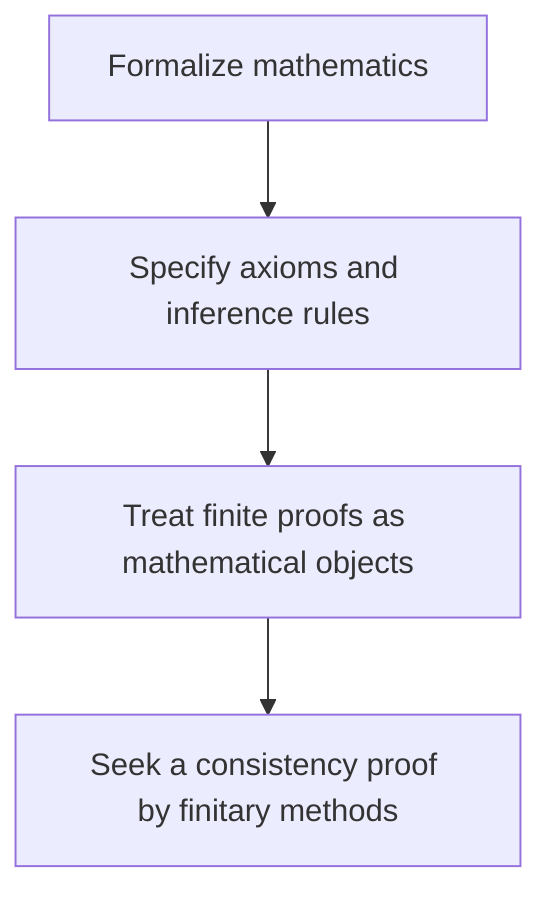
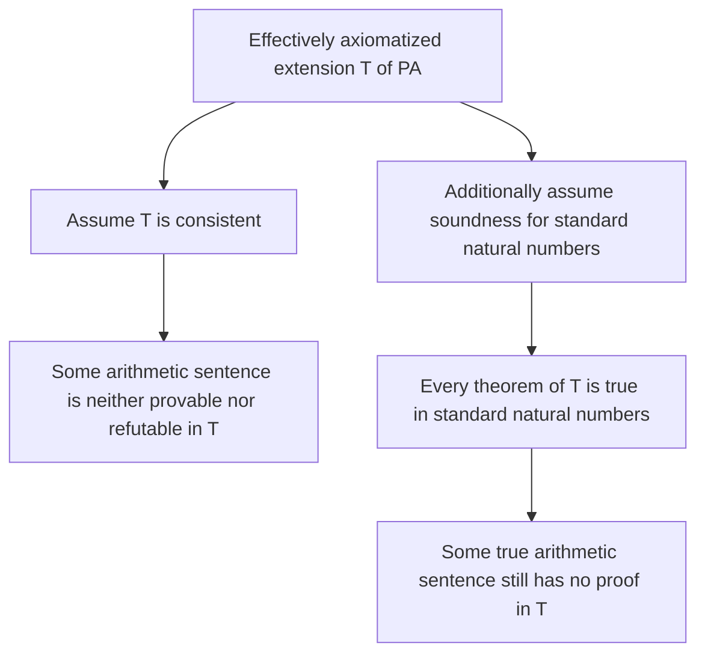
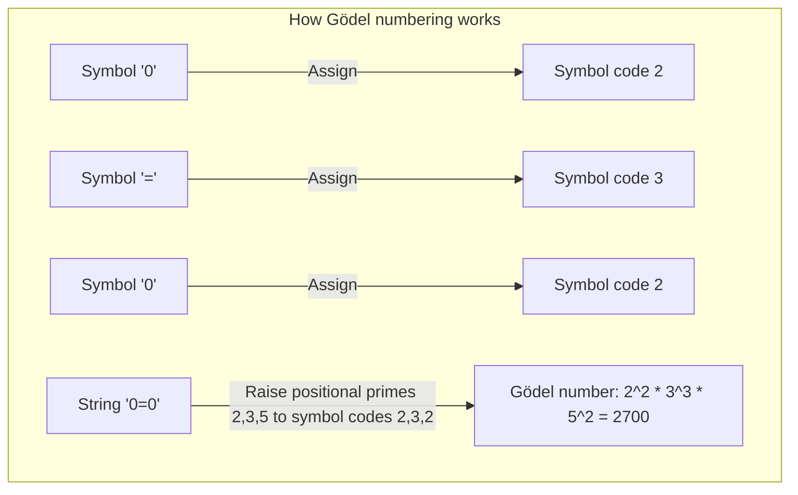
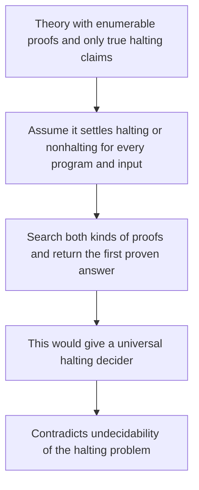

If we choose one set of axioms and build proofs using mechanical rules, can we answer every question about natural numbers? Gödel’s incompleteness theorems show that theories satisfying certain conditions cannot provide such a complete solution.

The crucial question is <strong>within which theory a statement cannot be proved</strong>. The result does not say that some truths remain unprovable no matter what axioms we use. We will distinguish consistency, soundness, and effective axiomatization while examining coding, self-reference, and the scope of the theorems.

---

## 1. Hilbert’s program and three different questions

To place mathematics on secure foundations, [David Hilbert](/en/p/hilbert/) and his collaborators pursued a program of formalizing mathematics in axiomatic systems and proving their consistency by finitary methods. Formalizing mathematics and studying its proofs from outside the system are different tasks. Describing the program merely as “a system guaranteeing everything about itself from within” is inaccurate.

We must also distinguish three properties.

- <strong>Consistency</strong>: the theory does not prove both a sentence $A$ and its negation $\neg A$.
- <strong>Completeness of a theory</strong>: for each sentence $A$ in its language, the theory proves $A$ or $\neg A$. This is syntactic completeness.
- <strong>Decidability</strong>: an algorithm that always terminates can determine whether a given sentence is a theorem of the theory.

Completeness differs from soundness, which says that all theorems are true in the intended interpretation. The completeness theorem for first-order logic also means something different from the completeness of a particular arithmetic theory.

## 2. Formal systems and Peano arithmetic

A formal system specifies symbols, rules for forming formulas, axioms, and inference rules. Checking syntactically whether a finite proof follows the rules can be separated from the semantic question of whether a formula is true in an interpretation. Saying that proof checking does not require meaning does not mean that meaning is irrelevant to mathematics.

A standard example is first-order Peano arithmetic (PA). It deals with zero, successor, addition, and multiplication of natural numbers, and includes an induction axiom schema. Even $1+1=2$ is a sentence derived from these axioms and rules.

For clarity, we will mainly consider effectively axiomatized theories containing PA as a sufficient setting. These are not the weakest possible assumptions: forms of the first theorem also apply over weaker arithmetic.

## 3. The first incompleteness theorem: sentences a theory cannot settle

We state [Kurt Gödel](/en/p/godel/)’s incompleteness result in the following form, incorporating Rosser’s improvement.

> Every consistent, effectively axiomatized theory containing PA has an arithmetic sentence that it can neither prove nor refute.

“Effectively axiomatized” means that axioms and proofs can be enumerated by a mechanical procedure. Unprovability is relative to the chosen theory. It does not mean that a statement must remain unprovable in another theory with additional axioms. Truth in the standard natural numbers must be distinguished from provability in a fixed theory.

To draw the set of provable sentences as a subset of the sentences true in the standard natural numbers, we need the stronger assumption of <strong>soundness</strong>. Consistency only rules out proving both a sentence and its negation; by itself it does not make every theorem true in the standard natural numbers.

### Constructing self-reference as arithmetic, not a contradiction

The resemblance to the liar sentence “This sentence is false” can help intuition. But Gödel’s construction does not introduce a contradiction into mathematics. It encodes sentences and proofs as numbers and expresses <strong>provability in a particular theory</strong> in arithmetic.

Let the theory be $T$, and let $\operatorname{Prov}_T(y)$ be the usual provability predicate expressing that the sentence with code $y$ has a proof in $T$. The notation $\ulcorner G_T\urcorner$ denotes the numeral for the code of the sentence $G_T$. The fixed-point lemma lets us construct a sentence for which the theory proves the following equivalence:

$$
T\vdash G_T\leftrightarrow\neg\operatorname{Prov}_T(\ulcorner G_T\urcorner)
$$

Here $T\vdash A$ means that $T$ proves $A$. This construction uses coding and substitution, rather than simply adopting a natural-language sentence as an axiom.

If $T$ had a proof of $G_T$, the existence of that finite proof could itself be expressed in arithmetic, so $T$ would prove $\operatorname{Prov}_T(\ulcorner G_T\urcorner)$. Yet the displayed equivalence together with $G_T$ would also yield its negation. Thus, if $T$ is consistent, it cannot prove $G_T$.

In the standard natural numbers, the usual provability predicate correctly describes actual finite proofs. Using this fact, the absence of a proof establishes that $G_T$ is true in the standard natural numbers. This external argument includes the assumption that $T$ is consistent. It does not mean that humans can automatically recognize the consistency of any theory.

This argument alone does not allow us to infer from mere consistency that the same theory also cannot prove the negation of $G_T$. Soundness, for example, rules out proving the negation of the true sentence $G_T$. Gödel’s original independence proof used $\omega$-consistency; Rosser constructed a different sentence to obtain unprovability and unrefutability from ordinary consistency alone.

## 4. Gödel numbering: encoding strings and proofs as numbers

Gödel numbering assigns natural-number codes to symbols, formulas, and finite proof sequences. As an instructional example, we assign the same positive integer to each occurrence of a symbol, and different primes to positions in a string. This is not a literal reproduction of the numbering used in the original paper.

Give the symbol “0” code 2 and “=” code 3. The string “0=0” then has the code sequence 2, 3, 2. Raising the positional primes 2, 3, 5 to those exponents and multiplying gives 2700. Unique prime factorization for integers at least two allows the original code sequence to be recovered in this example.

The important point is not producing huge numbers, but treating syntax, substitution, and finite-proof checking as relations on numbers. For example, distinguish the relation “number $p$ encodes a proof of the sentence with code $q$” from provability, the assertion that such a $p$ exists.

Checking one finite proof candidate is different from deciding that no proof exists. Coding alone does not make all questions of provability decidable.

## 5. The second incompleteness theorem: proving consistency within a theory

We also explain the second incompleteness theorem under the following sufficient assumptions.

> A consistent, effectively axiomatized extension of PA cannot prove within itself its own consistency expressed using the usual provability predicate.

For example, choose $0=1$ as a contradiction and express consistency as:

$$
\operatorname{Con}(T)
\equiv\neg\operatorname{Prov}_T(\ulcorner 0=1\urcorner)
$$

This is an arithmetic sentence saying that $T$ has no proof of a contradiction. Merely naming an arbitrary formula “consistency” does not give the same result: the formalization of the provability predicate and its derivability conditions matter.

The analogy of someone claiming “I never lie” can prompt questions about the grounds for a proof. It is not a proof of the second theorem. The fact that an inconsistent theory proves everything also does not, by itself, establish unprovability in a consistent theory.

Consistency here is distinct from soundness, the truth of every theorem in the intended interpretation. The result does not exclude proving the original theory’s consistency in a stronger theory. Nor does it apply unconditionally to people, organizations, or all software systems.

## 6. Common misunderstandings and the scope of the result

### Mathematics has not collapsed

Incompleteness is not the negation of consistency. It says that a particular fixed theory leaves some sentences unsettled. When adding axioms, we must consider why we choose them and assess matters such as the consistency of the extension. Adding axioms does not make every difficulty disappear.

### The theorem does not show that humans transcend machines

Even the external argument that a Gödel sentence is true assumes conditions such as the consistency of the theory. The theorem does not say that humans can establish those assumptions for any theory. Philosophical arguments about human reason or AI should not be confused with the mathematical conclusions stated here.

### Not every theory is incomplete

The language, axioms, effectiveness, and strength to express arithmetic matter. For example, the first-order theory of real closed fields, describing real numbers using zero, one, addition, multiplication, and order, is complete and decidable. Quantifier elimination provides a route to deciding its sentences.

This does not mean that all mathematics involving real numbers, arbitrary functions, or sets can be solved automatically. Nor does it give the same result for natural-number arithmetic. Claims that “Euclidean geometry is complete” likewise need to specify the formalization and language.

## 7. The connection with the halting problem

The [halting problem](/en/p/halting-problem/) states that no universal algorithm always terminates and correctly answers whether any program halts on a fixed input. Turing’s model is mathematical; this is not simply an argument that replaces a formal system with a physical machine.

One way to see the connection is to consider a theory whose proofs can be mechanically enumerated and which proves only true claims about halting and nonhalting. If it proved halting or nonhalting for every program and input, we could enumerate proofs and return whichever answer we found a proof for, thereby deciding the halting problem.

This explanation uses the strong assumption of soundness about halting. It is not a statement of the weakest assumptions or a complete proof of Gödel’s individual theorems. Computability must also be distinguished from complexity, which studies the time and memory needed for computation.

## 8. Conclusion: specify the theory and assumptions

The incompleteness theorems describe limits on proofs in a fixed theory satisfying certain conditions. A consistent, effectively axiomatized arithmetic theory of the required strength has sentences that it can neither prove nor refute. Under sufficient conditions, it also cannot prove its own consistency in the usual formalization.

A sentence unsettled in one theory may become provable after new axioms are added. If the extension still satisfies the same conditions, however, it too is incomplete. Considering the set of all arithmetic truths is also different from providing a mechanically enumerable axiomatization of that set.

The collapse of mathematics, human superiority over machines, and blanket limits on all AI do not follow from these theorems alone. The questions to ask are: which theory has been chosen, what assumptions are being made, and whether truth is being distinguished from provability.

### References

- [Open Logic Project: Incompleteness and Computability](https://ic.openlogicproject.org/ic-screen.pdf) — a textbook on coding, fixed points, Gödel’s and Rosser’s results, and the conditions on provability predicates.
- [UCLA: Incompleteness and Undecidability](https://www.math.ucla.edu/~dam/220b.1.11w/220notes4.pdf) — arithmetization of symbols and proofs, distinguishing the soundness-based first theorem from Rosser’s form.
- [Richard Zach: The Practice of Finitism](https://arxiv.org/abs/math/0102189) — research on axiomatization and finitary consistency proofs in Hilbert’s program.
- [Jindřich Zapletal: Elements of Set Theory](https://people.clas.ufl.edu/zapletal/files/notesset.pdf) — the first-order language of real closed fields and quantifier elimination; see Theorem 6.3.12 in Section 6.3.
