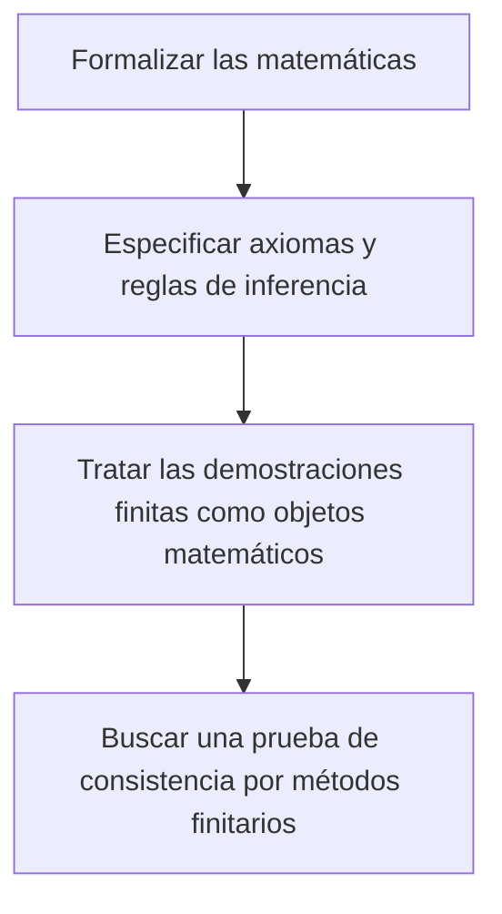
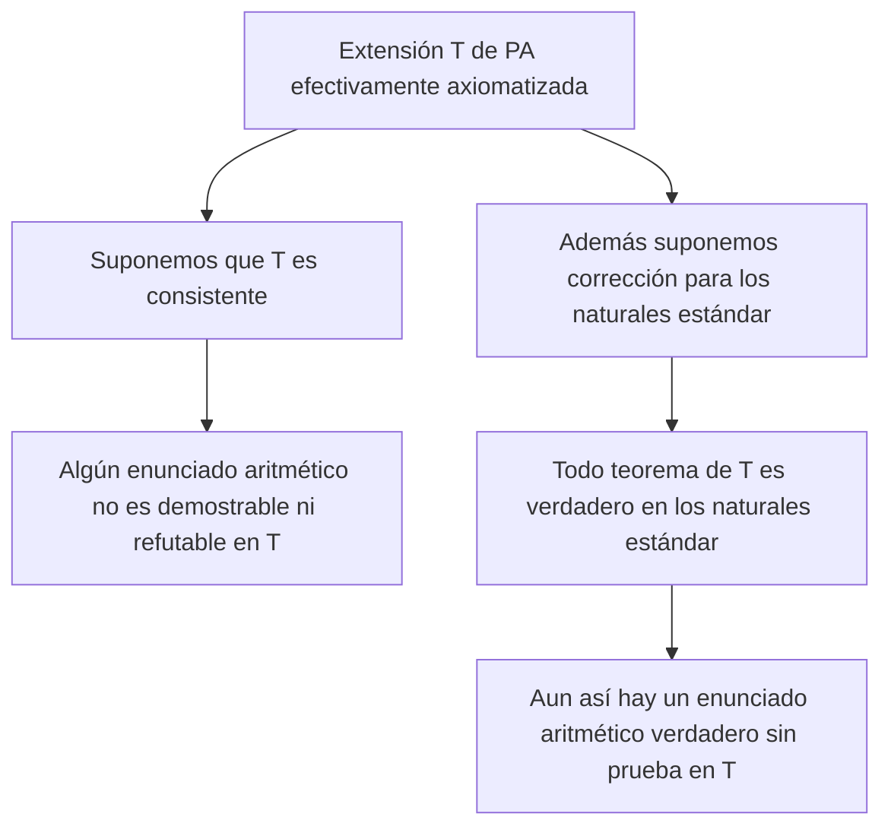
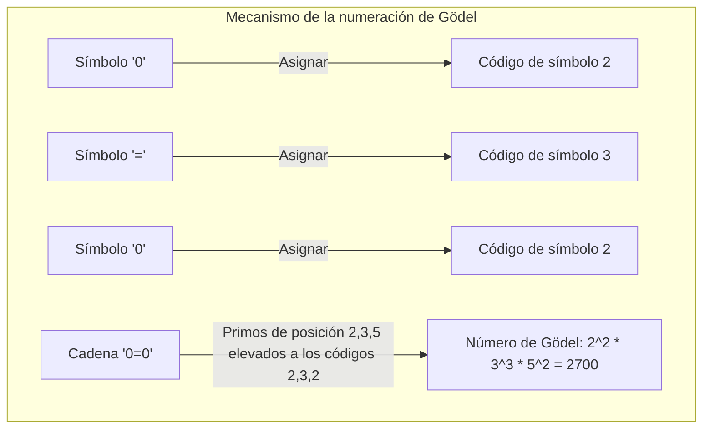
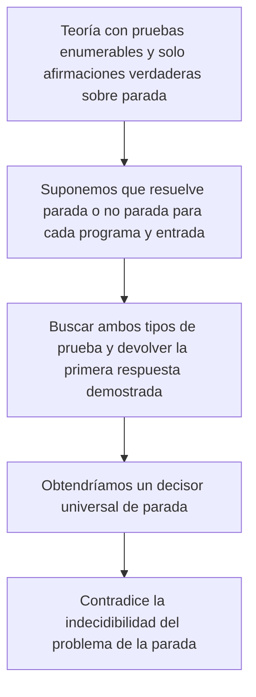

Si elegimos un conjunto de axiomas y construimos demostraciones mediante reglas mecánicas, ¿podemos responder a todas las preguntas sobre los números naturales? Los teoremas de incompletitud de Gödel muestran que las teorías que satisfacen ciertas condiciones no pueden ofrecer esa solución completa.

Lo crucial es precisar <strong>en qué teoría no puede demostrarse un enunciado</strong>. El resultado no afirma que existan verdades indemostrables con independencia de los axiomas que utilicemos. Distinguiremos consistencia, corrección semántica y axiomatización efectiva al examinar la codificación, la autorreferencia y el alcance de los teoremas.

---

## 1. El programa de Hilbert y tres preguntas diferentes

Para dar una base firme a las matemáticas, [David Hilbert](/es/p/hilbert/) y otros propusieron describirlas mediante sistemas axiomáticos formales y demostrar su consistencia por métodos finitarios. Formalizar las matemáticas y estudiar sus demostraciones desde fuera del sistema son tareas distintas. Describir el programa simplemente como «un sistema que garantiza todo sobre sí mismo desde su interior» no es exacto.

También debemos distinguir tres propiedades.

- <strong>Consistencia</strong>: la teoría no demuestra a la vez un enunciado $A$ y su negación $\neg A$.
- <strong>Completitud de una teoría</strong>: para cada enunciado $A$ de su lenguaje, la teoría demuestra $A$ o $\neg A$. Se trata de completitud sintáctica.
- <strong>Decidibilidad</strong>: un algoritmo que siempre termina puede determinar si un enunciado dado es un teorema de la teoría.

La completitud difiere de la corrección semántica, que exige que todos los teoremas sean verdaderos en la interpretación prevista. El teorema de completitud de la lógica de primer orden tampoco significa lo mismo que la completitud de una teoría aritmética concreta.

## 2. Sistemas formales y aritmética de Peano

Un sistema formal especifica símbolos, reglas para formar fórmulas, axiomas y reglas de inferencia. Comprobar sintácticamente si una demostración finita sigue las reglas puede separarse de la pregunta semántica de si una fórmula es verdadera en una interpretación. Que la comprobación de una demostración no requiera atender al significado no implica que el significado sea irrelevante para las matemáticas.

Un ejemplo habitual es la aritmética de Peano de primer orden (PA). Trata el cero, el sucesor, la suma y la multiplicación de números naturales, e incluye un esquema de axiomas de inducción. Incluso $1+1=2$ es un enunciado que se deriva de esos axiomas y reglas.

Por claridad, consideraremos principalmente teorías efectivamente axiomatizadas que contienen PA, como un marco suficiente. Estas no son las hipótesis más débiles posibles: hay formas del primer teorema que se aplican sobre aritméticas más débiles.

## 3. El primer teorema de incompletitud: enunciados que una teoría no resuelve

Presentamos el resultado de incompletitud de [Kurt Gödel](/es/p/godel/) en la siguiente forma, que incorpora la mejora de Rosser.

> Toda teoría consistente y efectivamente axiomatizada que contiene PA tiene un enunciado aritmético que no puede demostrar ni refutar.

«Efectivamente axiomatizada» significa que sus axiomas y demostraciones pueden enumerarse mediante un procedimiento mecánico. La indemostrabilidad es relativa a la teoría elegida. No significa que el enunciado deba seguir siendo indemostrable en otra teoría con axiomas adicionales. Hay que distinguir la verdad en los números naturales estándar de la demostrabilidad en una teoría fija.

Para dibujar el conjunto de enunciados demostrables como un subconjunto de los verdaderos en los números naturales estándar, necesitamos la hipótesis más fuerte de <strong>corrección semántica</strong>. La consistencia solo excluye demostrar un enunciado y su negación; por sí sola no hace que todos los teoremas sean verdaderos en los números naturales estándar.

### Construir autorreferencia aritmética, no una contradicción

La semejanza con el enunciado del mentiroso «Esta oración es falsa» puede ayudar a la intuición. Pero la construcción de Gödel no introduce una contradicción en las matemáticas. Codifica enunciados y demostraciones como números, y expresa aritméticamente la <strong>demostrabilidad en una teoría concreta</strong>.

Sea $T$ la teoría, y sea $\operatorname{Prov}_T(y)$ el predicado habitual de demostrabilidad, que expresa que el enunciado con código $y$ tiene una demostración en $T$. La notación $\ulcorner G_T\urcorner$ representa el numeral del código del enunciado $G_T$. El lema del punto fijo permite construir un enunciado para el que la teoría demuestra esta equivalencia:

$$
T\vdash G_T\leftrightarrow\neg\operatorname{Prov}_T(\ulcorner G_T\urcorner)
$$

Aquí $T\vdash A$ significa que $T$ demuestra $A$. La construcción utiliza codificación y sustitución, en lugar de adoptar directamente una oración del lenguaje natural como axioma.

Si $T$ tuviera una demostración de $G_T$, la existencia de esa demostración finita podría expresarse también en aritmética, de modo que $T$ demostraría $\operatorname{Prov}_T(\ulcorner G_T\urcorner)$. Sin embargo, la equivalencia anterior junto con $G_T$ daría también su negación. Por tanto, si $T$ es consistente, no puede demostrar $G_T$.

En los números naturales estándar, el predicado habitual de demostrabilidad describe correctamente las demostraciones finitas que realmente existen. Usando este hecho, la ausencia de demostración permite concluir que $G_T$ es verdadero en los números naturales estándar. Este argumento externo incluye la hipótesis de que $T$ es consistente. No significa que los seres humanos puedan reconocer automáticamente la consistencia de cualquier teoría.

Este argumento por sí solo no permite inferir, a partir de la mera consistencia, que la misma teoría tampoco pueda demostrar la negación de $G_T$. La corrección semántica, por ejemplo, excluye demostrar la negación del enunciado verdadero $G_T$. La prueba original de independencia de Gödel utilizaba la $\omega$-consistencia; Rosser construyó un enunciado diferente para obtener indemostrabilidad e irrefutabilidad a partir de la consistencia ordinaria.

## 4. Numeración de Gödel: codificar cadenas y demostraciones como números

La numeración de Gödel asigna códigos naturales a símbolos, fórmulas y secuencias finitas de demostración. Como ejemplo didáctico, asignaremos el mismo entero positivo a cada aparición de un símbolo y distintos primos a las posiciones de una cadena. No se trata de reproducir literalmente la numeración del artículo original.

Asignemos el código 2 al símbolo «0» y el código 3 a «=». La cadena «0=0» tiene entonces la secuencia de códigos 2, 3, 2. Elevar los primos de posición 2, 3, 5 a esos exponentes y multiplicar da 2700. La unicidad de la factorización prima de los enteros mayores o iguales que dos permite recuperar la secuencia original en este ejemplo.

Lo importante no es producir números enormes, sino tratar la sintaxis, la sustitución y la comprobación de demostraciones finitas como relaciones entre números. Por ejemplo, hay que distinguir la relación «el número $p$ codifica una demostración del enunciado con código $q$» de la demostrabilidad, que afirma que existe tal $p$.

Comprobar un candidato finito a demostración es distinto de decidir que no existe ninguna demostración. La codificación, por sí sola, no vuelve decidibles todas las preguntas de demostrabilidad.

## 5. El segundo teorema de incompletitud: demostrar consistencia dentro de una teoría

También explicaremos el segundo teorema de incompletitud bajo las siguientes hipótesis suficientes.

> Una extensión de PA consistente y efectivamente axiomatizada no puede demostrar dentro de sí misma su propia consistencia expresada mediante el predicado habitual de demostrabilidad.

Por ejemplo, elijamos $0=1$ como contradicción y expresemos la consistencia así:

$$
\operatorname{Con}(T)
\equiv\neg\operatorname{Prov}_T(\ulcorner 0=1\urcorner)
$$

Este es un enunciado aritmético que afirma que $T$ no tiene una demostración de una contradicción. Llamar «consistencia» a una fórmula arbitraria no produce el mismo resultado: importan la formalización del predicado de demostrabilidad y sus condiciones de derivabilidad.

La analogía de alguien que afirma «Yo nunca miento» puede llevarnos a preguntar por los fundamentos de una prueba. No es una demostración del segundo teorema. El hecho de que una teoría inconsistente demuestre todo tampoco establece, por sí solo, la indemostrabilidad en una teoría consistente.

La consistencia se distingue aquí de la corrección semántica, es decir, de que cada teorema sea verdadero en la interpretación prevista. El resultado no excluye demostrar la consistencia de la teoría original en otra más fuerte. Tampoco se aplica sin condiciones a personas, organizaciones o todos los sistemas de software.

## 6. Malentendidos y alcance del resultado

### Las matemáticas no se han derrumbado

La incompletitud no es la negación de la consistencia. Afirma que una teoría fija deja algunos enunciados sin resolver. Al añadir axiomas, debemos considerar por qué los elegimos y examinar cuestiones como la consistencia de la extensión. Añadir axiomas no elimina automáticamente todas las dificultades.

### El teorema no demuestra que los humanos superen a las máquinas

Incluso el argumento externo que establece la verdad de un enunciado de Gödel presupone condiciones como la consistencia de la teoría. El teorema no afirma que los humanos puedan verificar esas hipótesis para cualquier teoría. Los argumentos filosóficos sobre la razón humana o la IA deben distinguirse de las conclusiones matemáticas expuestas aquí.

### No toda teoría es incompleta

Importan el lenguaje, los axiomas, la efectividad y la capacidad para expresar aritmética. Por ejemplo, la teoría de primer orden de los cuerpos reales cerrados, que describe los números reales mediante cero, uno, suma, multiplicación y orden, es completa y decidible. La eliminación de cuantificadores proporciona una vía para decidir sus enunciados.

Esto no significa que pueda resolverse automáticamente toda la matemática que involucra números reales, funciones arbitrarias o conjuntos. Tampoco da el mismo resultado para la aritmética de los naturales. Afirmar que «la geometría euclidiana es completa» también requiere especificar la formalización y el lenguaje.

## 7. La relación con el problema de la parada

El [problema de la parada](/es/p/halting-problem/) establece que no existe un algoritmo universal que siempre termine y responda correctamente si un programa cualquiera se detiene con una entrada dada. El modelo de Turing es matemático; no se trata simplemente de sustituir un sistema formal por una máquina física.

Una manera de ver la relación es considerar una teoría cuyas demostraciones puedan enumerarse mecánicamente y que solo demuestre afirmaciones verdaderas sobre parada y no parada. Si demostrase la parada o la no parada para cada programa y entrada, podríamos enumerar las demostraciones y devolver la respuesta para la que encontrásemos una prueba, decidiendo así el problema de la parada.

Esta explicación usa la hipótesis fuerte de corrección semántica respecto de la parada. No enuncia las hipótesis más débiles ni constituye una demostración completa de cada teorema de Gödel. La computabilidad también debe distinguirse de la complejidad, que estudia el tiempo y la memoria necesarios para calcular.

## 8. Conclusión: especificar la teoría y las hipótesis

Los teoremas de incompletitud describen límites de las demostraciones en una teoría fija que satisface ciertas condiciones. Una teoría aritmética consistente, efectivamente axiomatizada y con la fuerza requerida tiene enunciados que no puede demostrar ni refutar. Bajo condiciones suficientes, tampoco puede demostrar su propia consistencia en la formalización habitual.

Un enunciado sin resolver en una teoría puede volverse demostrable al añadir nuevos axiomas. Sin embargo, si la extensión sigue satisfaciendo las mismas condiciones, también será incompleta. Considerar el conjunto de todas las verdades aritméticas es distinto de proporcionar una axiomatización mecánicamente enumerable de ese conjunto.

El derrumbe de las matemáticas, la superioridad humana sobre las máquinas y los límites indiscriminados para toda IA no se deducen de estos teoremas por sí solos. Debemos preguntar qué teoría se ha elegido, qué hipótesis se adoptan y si se distingue la verdad de la demostrabilidad.

### Referencias

- [Open Logic Project: Incompleteness and Computability](https://ic.openlogicproject.org/ic-screen.pdf) — manual sobre codificación, puntos fijos, resultados de Gödel y Rosser, y condiciones de los predicados de demostrabilidad.
- [UCLA: Incompleteness and Undecidability](https://www.math.ucla.edu/~dam/220b.1.11w/220notes4.pdf) — aritmetización de símbolos y demostraciones, distinguiendo el primer teorema basado en corrección semántica de la forma de Rosser.
- [Richard Zach: The Practice of Finitism](https://arxiv.org/abs/math/0102189) — investigación sobre axiomatización y pruebas finitarias de consistencia en el programa de Hilbert.
- [Jindřich Zapletal: Elements of Set Theory](https://people.clas.ufl.edu/zapletal/files/notesset.pdf) — lenguaje de primer orden de los cuerpos reales cerrados y eliminación de cuantificadores; véase el teorema 6.3.12 de la sección 6.3.
