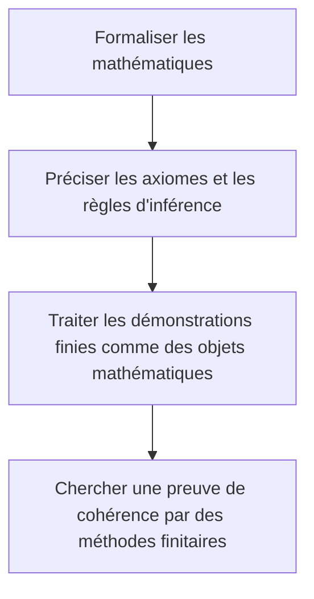
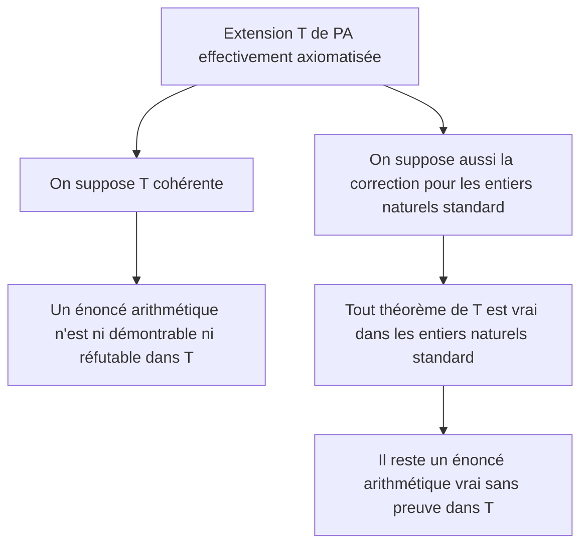
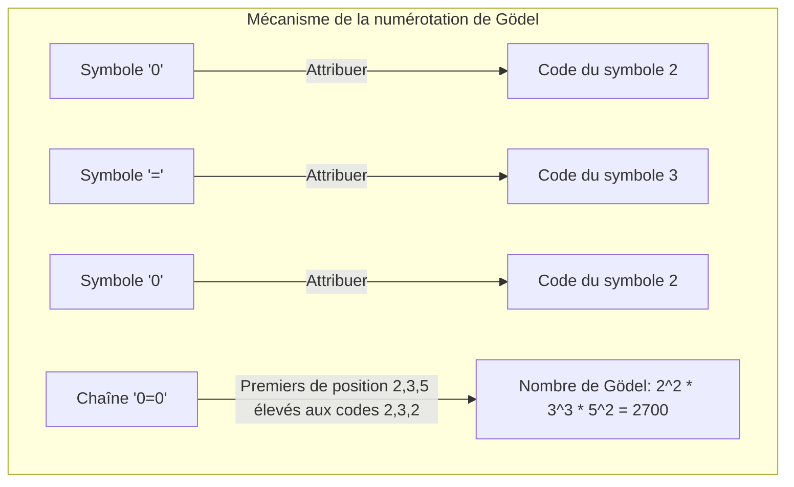
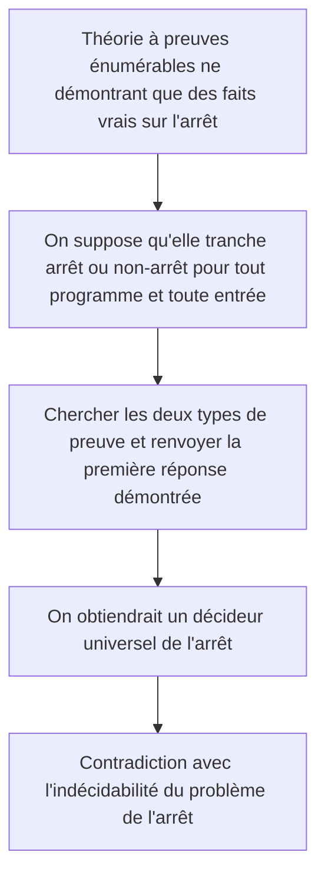

Si nous choisissons un ensemble d'axiomes et construisons des démonstrations selon des règles mécaniques, pouvons-nous répondre à toutes les questions sur les entiers naturels ? Les théorèmes d'incomplétude de Gödel montrent que les théories satisfaisant certaines conditions ne peuvent pas fournir une telle solution complète.

L'essentiel est de préciser <strong>dans quelle théorie un énoncé ne peut pas être démontré</strong>. Le résultat n'affirme pas qu'il existe des vérités indémontrables quels que soient les axiomes utilisés. Nous distinguerons cohérence, correction sémantique et axiomatisation effective en examinant le codage, l'autoréférence et la portée des théorèmes.

---

## 1. Le programme de Hilbert et trois questions différentes

Pour donner des bases solides aux mathématiques, [David Hilbert](/fr/p/hilbert/) et d'autres ont proposé de les décrire par des systèmes axiomatiques formels et d'en démontrer la cohérence par des méthodes finitaires. Formaliser les mathématiques et étudier leurs démonstrations depuis l'extérieur du système sont deux tâches différentes. Réduire ce programme à « un système garantissant tout sur lui-même depuis son intérieur » n'est pas exact.

Il faut également distinguer trois propriétés.

- <strong>Cohérence</strong> : la théorie ne démontre pas à la fois un énoncé $A$ et sa négation $\neg A$.
- <strong>Complétude d'une théorie</strong> : pour chaque énoncé $A$ de son langage, la théorie démontre $A$ ou $\neg A$. Il s'agit de la complétude syntaxique.
- <strong>Décidabilité</strong> : un algorithme qui termine toujours peut déterminer si un énoncé donné est un théorème de la théorie.

La complétude diffère de la correction sémantique, qui exige que tous les théorèmes soient vrais dans l'interprétation visée. Le théorème de complétude de la logique du premier ordre ne signifie pas non plus la même chose que la complétude d'une théorie arithmétique particulière.

## 2. Systèmes formels et arithmétique de Peano

Un système formel précise les symboles, les règles de formation des formules, les axiomes et les règles d'inférence. Vérifier syntaxiquement qu'une démonstration finie respecte les règles peut être séparé de la question sémantique de savoir si une formule est vraie dans une interprétation. Dire que la vérification d'une démonstration n'exige pas de prendre en compte le sens ne signifie pas que le sens soit sans importance en mathématiques.

Un exemple classique est l'arithmétique de Peano du premier ordre (PA). Elle traite de zéro, du successeur, de l'addition et de la multiplication des entiers naturels, et comprend un schéma d'axiomes de récurrence. Même $1+1=2$ est un énoncé dérivé de ces axiomes et règles.

Pour simplifier l'exposé, nous considérerons principalement les théories effectivement axiomatisées contenant PA, comme cadre suffisant. Ce ne sont pas les hypothèses les plus faibles possibles : certaines formes du premier théorème s'appliquent à des arithmétiques plus faibles.

## 3. Le premier théorème d'incomplétude : des énoncés qu'une théorie ne tranche pas

Nous présentons le résultat d'incomplétude de [Kurt Gödel](/fr/p/godel/) sous la forme suivante, qui intègre l'amélioration de Rosser.

> Toute théorie cohérente, effectivement axiomatisée et contenant PA possède un énoncé arithmétique qu'elle ne peut ni démontrer ni réfuter.

« Effectivement axiomatisée » signifie que ses axiomes et ses démonstrations peuvent être énumérés par un procédé mécanique. L'indémontrabilité est relative à la théorie choisie. Elle ne signifie pas que l'énoncé doive rester indémontrable dans une autre théorie munie d'axiomes supplémentaires. Il faut distinguer la vérité dans les entiers naturels standard de la démontrabilité dans une théorie fixée.

Pour représenter l'ensemble des énoncés démontrables comme un sous-ensemble des énoncés vrais dans les entiers naturels standard, il faut l'hypothèse plus forte de <strong>correction sémantique</strong>. La cohérence exclut seulement de démontrer un énoncé et sa négation ; à elle seule, elle ne rend pas tous les théorèmes vrais dans les entiers naturels standard.

### Construire une autoréférence arithmétique, pas une contradiction

La ressemblance avec la phrase du menteur « Cette phrase est fausse » peut aider l'intuition. Mais la construction de Gödel n'introduit pas de contradiction dans les mathématiques. Elle code les énoncés et les démonstrations par des nombres et exprime arithmétiquement la <strong>démontrabilité dans une théorie particulière</strong>.

Soit $T$ la théorie et soit $\operatorname{Prov}_T(y)$ le prédicat usuel de démontrabilité, exprimant que l'énoncé de code $y$ possède une démonstration dans $T$. La notation $\ulcorner G_T\urcorner$ désigne le numéral représentant le code de l'énoncé $G_T$. Le lemme du point fixe permet de construire un énoncé pour lequel la théorie démontre l'équivalence suivante :

$$
T\vdash G_T\leftrightarrow\neg\operatorname{Prov}_T(\ulcorner G_T\urcorner)
$$

Ici, $T\vdash A$ signifie que $T$ démontre $A$. Cette construction utilise le codage et la substitution, plutôt que d'adopter directement une phrase du langage naturel comme axiome.

Si $T$ possédait une démonstration de $G_T$, l'existence de cette démonstration finie pourrait elle-même être exprimée en arithmétique, et $T$ démontrerait $\operatorname{Prov}_T(\ulcorner G_T\urcorner)$. Mais l'équivalence affichée, jointe à $G_T$, donnerait aussi sa négation. Ainsi, si $T$ est cohérente, elle ne peut pas démontrer $G_T$.

Dans les entiers naturels standard, le prédicat usuel de démontrabilité décrit correctement les démonstrations finies qui existent réellement. En utilisant ce fait, l'absence de démonstration permet de conclure que $G_T$ est vrai dans les entiers naturels standard. Cet argument externe inclut l'hypothèse que $T$ est cohérente. Il ne signifie pas que les humains puissent reconnaître automatiquement la cohérence de n'importe quelle théorie.

Cet argument seul ne permet pas de déduire de la simple cohérence que la même théorie ne peut pas non plus démontrer la négation de $G_T$. Par exemple, la correction sémantique exclut de démontrer la négation de l'énoncé vrai $G_T$. La preuve originale d'indépendance de Gödel utilisait l'$\omega$-cohérence ; Rosser a construit un autre énoncé pour obtenir l'indémontrabilité et l'irréfutabilité à partir de la seule cohérence ordinaire.

## 4. Numérotation de Gödel : coder les chaînes et les démonstrations par des nombres

La numérotation de Gödel attribue des codes entiers naturels aux symboles, aux formules et aux suites finies constituant des démonstrations. Dans notre exemple pédagogique, chaque occurrence d'un même symbole reçoit le même entier strictement positif, tandis que les positions d'une chaîne reçoivent des nombres premiers différents. Ce n'est pas une reproduction littérale de la numérotation de l'article original.

Attribuons le code 2 au symbole « 0 » et le code 3 à « = ». La chaîne « 0=0 » possède alors la suite de codes 2, 3, 2. Élever les nombres premiers de position 2, 3, 5 à ces exposants, puis les multiplier, donne 2700. L'unicité de la décomposition en facteurs premiers des entiers supérieurs ou égaux à deux permet de retrouver la suite initiale dans cet exemple.

L'important n'est pas de produire des nombres énormes, mais de traiter la syntaxe, la substitution et la vérification des démonstrations finies comme des relations entre nombres. Il faut par exemple distinguer la relation « le nombre $p$ code une démonstration de l'énoncé de code $q$ » de la démontrabilité, qui affirme qu'un tel $p$ existe.

Vérifier un candidat fini à une démonstration diffère de décider qu'aucune démonstration n'existe. Le codage seul ne rend pas décidables toutes les questions de démontrabilité.

## 5. Le second théorème d'incomplétude : démontrer la cohérence dans une théorie

Nous expliquons également le second théorème d'incomplétude sous les hypothèses suffisantes suivantes.

> Une extension de PA cohérente et effectivement axiomatisée ne peut pas démontrer en son sein sa propre cohérence exprimée à l'aide du prédicat usuel de démontrabilité.

Choisissons par exemple $0=1$ comme contradiction et exprimons la cohérence ainsi :

$$
\operatorname{Con}(T)
\equiv\neg\operatorname{Prov}_T(\ulcorner 0=1\urcorner)
$$

Il s'agit d'un énoncé arithmétique affirmant que $T$ ne possède pas de démonstration d'une contradiction. Donner le nom « cohérence » à une formule arbitraire ne produit pas le même résultat : la formalisation du prédicat de démontrabilité et ses conditions de dérivabilité sont importantes.

L'analogie d'une personne affirmant « Je ne mens jamais » peut inciter à s'interroger sur les fondements d'une preuve. Elle ne constitue pas une démonstration du second théorème. Le fait qu'une théorie incohérente démontre tout n'établit pas non plus, à lui seul, l'indémontrabilité dans une théorie cohérente.

La cohérence se distingue ici de la correction sémantique, c'est-à-dire du fait que chaque théorème est vrai dans l'interprétation visée. Le résultat n'exclut pas de démontrer la cohérence de la théorie initiale dans une théorie plus forte. Il ne s'applique pas non plus sans conditions aux personnes, aux organisations ou à tous les systèmes logiciels.

## 6. Malentendus et portée du résultat

### Les mathématiques ne se sont pas effondrées

L'incomplétude n'est pas la négation de la cohérence. Elle affirme qu'une théorie fixée laisse certains énoncés en suspens. Lorsqu'on ajoute des axiomes, il faut examiner les raisons de ce choix et des questions comme la cohérence de l'extension. Ajouter des axiomes ne supprime pas automatiquement toutes les difficultés.

### Le théorème ne démontre pas que les humains dépassent les machines

Même l'argument externe établissant la vérité d'un énoncé de Gödel suppose des conditions comme la cohérence de la théorie. Le théorème n'affirme pas que les humains puissent vérifier ces hypothèses pour n'importe quelle théorie. Les arguments philosophiques sur la raison humaine ou l'IA doivent être distingués des conclusions mathématiques présentées ici.

### Toutes les théories ne sont pas incomplètes

Le langage, les axiomes, l'effectivité et la capacité à exprimer l'arithmétique comptent. Par exemple, la théorie du premier ordre des corps réels clos, qui décrit les réels à l'aide de zéro, un, l'addition, la multiplication et l'ordre, est complète et décidable. L'élimination des quantificateurs fournit une voie pour décider ses énoncés.

Cela ne signifie pas que toutes les mathématiques faisant intervenir des réels, des fonctions arbitraires ou des ensembles puissent être résolues automatiquement. Cela ne donne pas non plus le même résultat pour l'arithmétique des entiers naturels. Affirmer que « la géométrie euclidienne est complète » exige également de préciser la formalisation et le langage.

## 7. Le lien avec le problème de l'arrêt

Le [problème de l'arrêt](/fr/p/halting-problem/) établit qu'il n'existe pas d'algorithme universel qui termine toujours et réponde correctement à la question de savoir si un programme quelconque s'arrête sur une entrée donnée. Le modèle de Turing est mathématique ; il ne s'agit pas simplement de remplacer un système formel par une machine physique.

Une façon de comprendre le lien consiste à considérer une théorie dont les démonstrations peuvent être énumérées mécaniquement et qui ne démontre que des affirmations vraies sur l'arrêt et le non-arrêt. Si elle démontrait l'arrêt ou le non-arrêt pour chaque programme et chaque entrée, nous pourrions énumérer les démonstrations et renvoyer la réponse dont nous aurions trouvé une preuve, décidant ainsi le problème de l'arrêt.

Cette explication utilise l'hypothèse forte de correction sémantique concernant l'arrêt. Elle n'énonce pas les hypothèses les plus faibles et ne constitue pas une démonstration complète de chacun des théorèmes de Gödel. Il faut aussi distinguer la calculabilité de la complexité, qui étudie le temps et la mémoire nécessaires au calcul.

## 8. Conclusion : préciser la théorie et les hypothèses

Les théorèmes d'incomplétude décrivent les limites des démonstrations dans une théorie fixée satisfaisant certaines conditions. Une théorie arithmétique cohérente, effectivement axiomatisée et suffisamment forte possède des énoncés qu'elle ne peut ni démontrer ni réfuter. Sous des conditions suffisantes, elle ne peut pas non plus démontrer sa propre cohérence dans la formalisation usuelle.

Un énoncé laissé en suspens dans une théorie peut devenir démontrable après l'ajout de nouveaux axiomes. Mais si l'extension satisfait encore les mêmes conditions, elle est elle aussi incomplète. Considérer l'ensemble de toutes les vérités arithmétiques diffère de fournir une axiomatisation mécaniquement énumérable de cet ensemble.

L'effondrement des mathématiques, la supériorité humaine sur les machines et des limites générales imposées à toute IA ne découlent pas de ces seuls théorèmes. Il faut se demander quelle théorie a été choisie, quelles hypothèses sont faites et si l'on distingue la vérité de la démontrabilité.

### Références

- [Open Logic Project: Incompleteness and Computability](https://ic.openlogicproject.org/ic-screen.pdf) — manuel sur le codage, les points fixes, les résultats de Gödel et Rosser et les conditions des prédicats de démontrabilité.
- [UCLA: Incompleteness and Undecidability](https://www.math.ucla.edu/~dam/220b.1.11w/220notes4.pdf) — arithmétisation des symboles et des démonstrations, distinguant le premier théorème fondé sur la correction sémantique de la forme de Rosser.
- [Richard Zach: The Practice of Finitism](https://arxiv.org/abs/math/0102189) — recherche sur l'axiomatisation et les preuves finitaires de cohérence dans le programme de Hilbert.
- [Jindřich Zapletal: Elements of Set Theory](https://people.clas.ufl.edu/zapletal/files/notesset.pdf) — langage du premier ordre des corps réels clos et élimination des quantificateurs ; voir le théorème 6.3.12 de la section 6.3.
