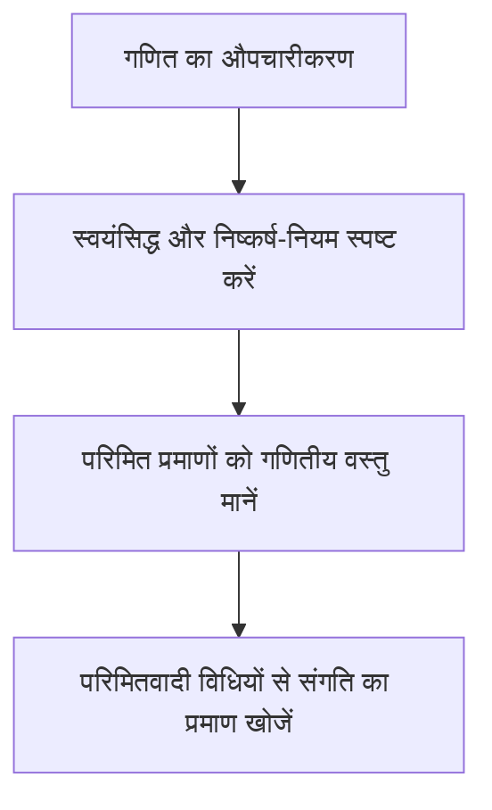
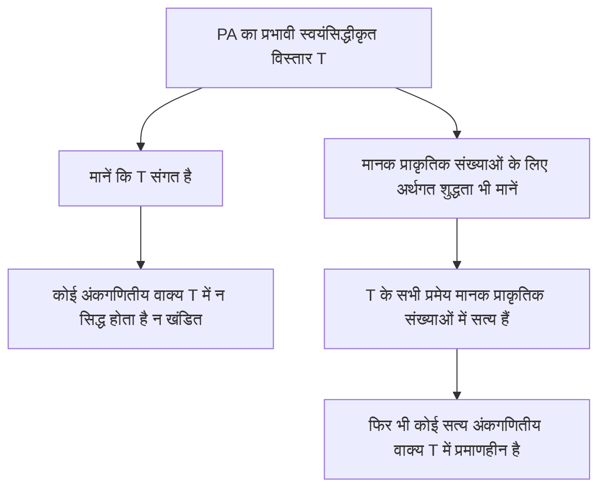
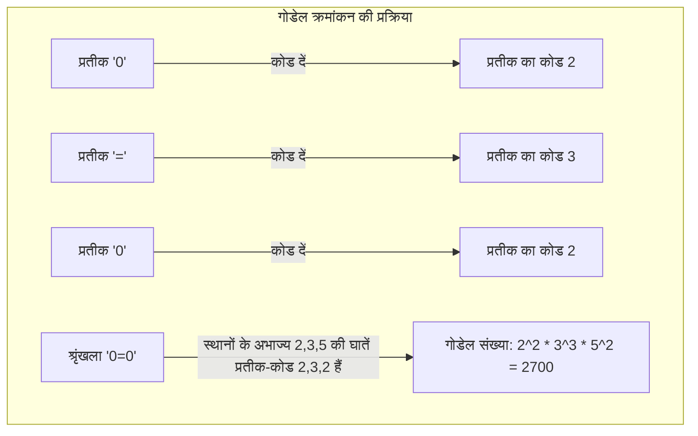
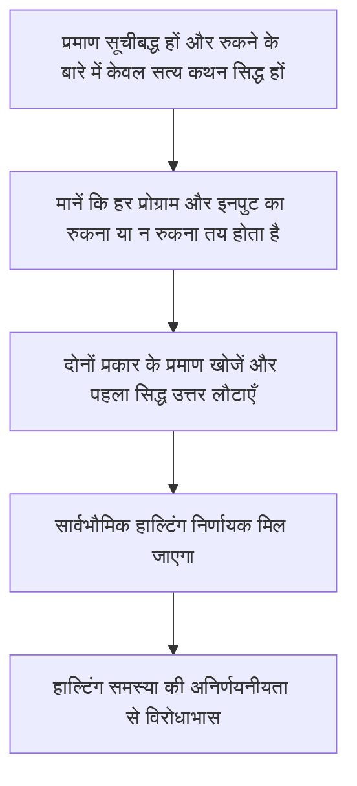

यदि हम स्वयंसिद्धों का एक समूह चुनें और यांत्रिक नियमों से प्रमाण बनाते जाएँ, तो क्या प्राकृतिक संख्याओं से जुड़े सभी प्रश्नों के उत्तर मिल सकते हैं? गोडेल के अपूर्णता प्रमेय बताते हैं कि कुछ शर्तें पूरी करने वाले सिद्धांत ऐसा पूर्ण समाधान नहीं दे सकते।

मुख्य बात यह स्पष्ट करना है कि <strong>किस सिद्धांत में कोई वाक्य सिद्ध नहीं किया जा सकता</strong>। इसका अर्थ यह नहीं कि कुछ सत्य ऐसे हैं जिन्हें किसी भी स्वयंसिद्ध का उपयोग करके कभी सिद्ध नहीं किया जा सकता। हम संगति, अर्थगत शुद्धता और प्रभावी स्वयंसिद्धीकरण को अलग रखते हुए कूटलेखन, स्व-संदर्भ और प्रमेयों का दायरा समझेंगे।

---

## 1. हिल्बर्ट का कार्यक्रम और तीन अलग प्रश्न

गणित की नींव को मजबूत बनाने के लिए [डेविड हिल्बर्ट](/hi/p/hilbert/) और अन्य गणितज्ञों ने गणित को औपचारिक स्वयंसिद्ध प्रणालियों में व्यक्त करने और उनकी संगति को परिमितवादी विधियों से सिद्ध करने का कार्यक्रम प्रस्तावित किया। गणित को औपचारिक बनाना और उसके प्रमाणों का प्रणाली के बाहर से अध्ययन करना अलग कार्य हैं। इसे केवल “एक प्रणाली अपने भीतर से अपने बारे में सब कुछ सुनिश्चित करती है” कहना सही विवरण नहीं है।

इन तीन गुणों में भी अंतर करना आवश्यक है।

- <strong>संगति</strong>: सिद्धांत किसी वाक्य $A$ और उसके निषेध $\neg A$ दोनों को सिद्ध नहीं करता।
- <strong>सिद्धांत की पूर्णता</strong>: उसकी भाषा के हर वाक्य $A$ के लिए सिद्धांत $A$ या $\neg A$ को सिद्ध करता है। यहाँ यह वाक्य-विन्यासगत पूर्णता है।
- <strong>निर्णयनीयता</strong>: हमेशा समाप्त होने वाला एल्गोरिथ्म तय कर सकता है कि दिया गया वाक्य उस सिद्धांत का प्रमेय है या नहीं।

पूर्णता अर्थगत शुद्धता से अलग है; अर्थगत शुद्धता का अर्थ है कि सभी प्रमेय अभिप्रेत व्याख्या में सत्य हों। प्रथम-क्रम तर्क का पूर्णता प्रमेय और किसी विशेष अंकगणितीय सिद्धांत की पूर्णता भी एक ही बात नहीं हैं।

## 2. औपचारिक प्रणाली और पियानो अंकगणित

औपचारिक प्रणाली में प्रतीक, सूत्र बनाने के नियम, स्वयंसिद्ध और निष्कर्ष-नियम निर्धारित होते हैं। किसी परिमित प्रमाण के नियमों का पालन करने की वाक्य-विन्यासगत जाँच को, किसी व्याख्या में सूत्र के सत्य होने के अर्थगत प्रश्न से अलग किया जा सकता है। प्रमाण की जाँच में अर्थ पर विचार करना आवश्यक न होने का मतलब यह नहीं कि गणित में अर्थ महत्वहीन है।

एक सामान्य उदाहरण प्रथम-क्रम पियानो अंकगणित (PA) है। इसमें शून्य, उत्तरवर्ती संख्या, प्राकृतिक संख्याओं का जोड़ और गुणा तथा आगमन का स्वयंसिद्ध-स्कीमा शामिल हैं। इस लेख में प्राकृतिक संख्याओं में शून्य को शामिल किया गया है। $1+1=2$ भी इन्हीं स्वयंसिद्धों और नियमों से निकाला गया वाक्य है।

सरल पर्याप्त शर्तों के रूप में हम मुख्यतः प्रभावी ढंग से स्वयंसिद्धीकृत उन सिद्धांतों पर विचार करेंगे जिनमें PA शामिल है। ये सबसे कमजोर संभव शर्तें नहीं हैं; पहले प्रमेय के कुछ रूप PA से कमजोर अंकगणित पर भी लागू होते हैं।

## 3. पहला अपूर्णता प्रमेय: वे वाक्य जिन्हें सिद्धांत तय नहीं कर पाता

हम [कर्ट गोडेल](/hi/p/godel/) के अपूर्णता परिणाम को रोसर के सुधार सहित इस रूप में प्रस्तुत करते हैं।

> PA को शामिल करने वाले हर संगत और प्रभावी ढंग से स्वयंसिद्धीकृत सिद्धांत में ऐसा अंकगणितीय वाक्य होता है जिसे वह न सिद्ध कर सकता है, न खंडित कर सकता है।

“प्रभावी ढंग से स्वयंसिद्धीकृत” होने का अर्थ है कि स्वयंसिद्धों और प्रमाणों को यांत्रिक प्रक्रिया से सूचीबद्ध किया जा सकता है। असिद्धेयता चुने हुए सिद्धांत के सापेक्ष है। इसका अर्थ यह नहीं कि अतिरिक्त स्वयंसिद्ध वाले दूसरे सिद्धांत में भी वह वाक्य सिद्ध नहीं हो सकता। मानक प्राकृतिक संख्याओं में सत्यता और निश्चित सिद्धांत में सिद्धेयता को अलग रखना चाहिए।

सिद्ध किए जा सकने वाले वाक्यों के समुच्चय को मानक प्राकृतिक संख्याओं में सत्य वाक्यों का उपसमुच्चय दिखाने के लिए <strong>अर्थगत शुद्धता</strong> की अधिक मजबूत धारणा चाहिए। संगति केवल एक वाक्य और उसके निषेध दोनों के प्रमाण को रोकती है; अकेली संगति से सभी प्रमेय मानक प्राकृतिक संख्याओं में सत्य नहीं हो जाते।

### विरोधाभास नहीं, अंकगणितीय स्व-संदर्भ का निर्माण

“यह वाक्य असत्य है” जैसे झूठे के वाक्य से समानता अंतर्ज्ञान में मदद कर सकती है। लेकिन गोडेल का निर्माण गणित में विरोधाभास नहीं डालता। वह वाक्यों और प्रमाणों को संख्याओं से कूटबद्ध करके <strong>किसी विशेष सिद्धांत में सिद्धेयता</strong> को अंकगणित में व्यक्त करता है।

सिद्धांत को $T$ कहें और $\operatorname{Prov}_T(y)$ को सामान्य सिद्धेयता-विधेय मानें, जिसका अर्थ है कि कोड $y$ वाले वाक्य का $T$ में प्रमाण है। $\ulcorner G_T\urcorner$ वाक्य $G_T$ के कोड को दर्शाने वाला संख्या-पद है। स्थिर-बिंदु उपप्रमेय से ऐसा वाक्य बनाया जा सकता है जिसके लिए सिद्धांत निम्न तुल्यता सिद्ध करता है:

$$
T\vdash G_T\leftrightarrow\neg\operatorname{Prov}_T(\ulcorner G_T\urcorner)
$$

यहाँ $T\vdash A$ का अर्थ है कि $T$, $A$ को सिद्ध करता है। यह निर्माण कूटलेखन और प्रतिस्थापन का उपयोग करता है, किसी प्राकृतिक भाषा के वाक्य को सीधे स्वयंसिद्ध नहीं बना देता।

यदि $T$ में $G_T$ का प्रमाण होता, तो उस परिमित प्रमाण के अस्तित्व को अंकगणित में भी व्यक्त किया जा सकता, और $T$, $\operatorname{Prov}_T(\ulcorner G_T\urcorner)$ को सिद्ध करता। लेकिन ऊपर की तुल्यता और $G_T$ से उसका निषेध भी मिल जाता। इसलिए यदि $T$ संगत है, तो वह $G_T$ को सिद्ध नहीं कर सकता।

मानक प्राकृतिक संख्याओं में सामान्य सिद्धेयता-विधेय वास्तव में मौजूद परिमित प्रमाणों को सही ढंग से व्यक्त करता है। इस तथ्य का उपयोग करके, प्रमाण न होने से पता चलता है कि $G_T$ मानक प्राकृतिक संख्याओं में सत्य है। इस बाहरी तर्क में $T$ की संगति की धारणा शामिल है। इसका अर्थ यह नहीं कि मनुष्य किसी भी सिद्धांत की संगति अपने-आप पहचान सकते हैं।

केवल इस तर्क से यह निष्कर्ष नहीं निकाला जा सकता कि साधारण संगति के कारण वही सिद्धांत $G_T$ का निषेध भी सिद्ध नहीं कर सकता। उदाहरण के लिए, अर्थगत शुद्धता सत्य वाक्य $G_T$ के निषेध के प्रमाण को रोकती है। गोडेल के मूल स्वतंत्रता-प्रमाण में $\omega$-संगति का उपयोग हुआ था। रोसर ने अलग वाक्य बनाया और केवल साधारण संगति से उसके न सिद्ध किए जा सकने और न खंडित किए जा सकने का परिणाम प्राप्त किया।

## 4. गोडेल क्रमांकन: प्रतीक-श्रृंखलाओं और प्रमाणों को संख्याओं में कूटबद्ध करना

गोडेल क्रमांकन प्रतीकों, सूत्रों और परिमित प्रमाण-श्रृंखलाओं को प्राकृतिक संख्या के कोड देता है। शिक्षण के इस उदाहरण में एक ही प्रतीक की हर उपस्थिति को एक ही धनात्मक पूर्णांक दिया जाता है, जबकि श्रृंखला के अलग स्थानों को अलग अभाज्य संख्याएँ दी जाती हैं। यह मूल शोधपत्र के क्रमांकन की हूबहू पुनरावृत्ति नहीं है।

प्रतीक “0” को कोड 2 और “=” को कोड 3 दें। तब “0=0” की कोड-श्रृंखला 2, 3, 2 है। स्थानों की अभाज्य संख्याओं 2, 3, 5 की इन घातों का गुणनफल 2700 है। दो या उससे बड़े पूर्णांकों के अभाज्य गुणनखंडन की अद्वितीयता के कारण इस उदाहरण में मूल कोड-श्रृंखला वापस प्राप्त की जा सकती है।

महत्वपूर्ण बात बहुत बड़ी संख्याएँ बनाना नहीं, बल्कि वाक्य-विन्यास, प्रतिस्थापन और परिमित प्रमाण की जाँच को संख्याओं के बीच संबंधों के रूप में देखना है। उदाहरण के लिए, “संख्या $p$, कोड $q$ वाले वाक्य के प्रमाण को कूटबद्ध करती है” वाले संबंध और “ऐसा $p$ मौजूद है” वाली सिद्धेयता में अंतर है।

किसी एक परिमित संभावित प्रमाण की जाँच करना और यह तय करना कि कोई प्रमाण मौजूद ही नहीं है, अलग कार्य हैं। केवल कूटलेखन से सिद्धेयता के सभी प्रश्न निर्णयनीय नहीं हो जाते।

## 5. दूसरा अपूर्णता प्रमेय: सिद्धांत के भीतर संगति का प्रमाण

दूसरे अपूर्णता प्रमेय को भी हम निम्न पर्याप्त शर्तों के अंतर्गत समझाते हैं।

> PA का कोई संगत और प्रभावी ढंग से स्वयंसिद्धीकृत विस्तार, सामान्य सिद्धेयता-विधेय द्वारा व्यक्त अपनी संगति को अपने भीतर सिद्ध नहीं कर सकता।

उदाहरण के लिए, विरोधाभास के रूप में $0=1$ चुनें और संगति को इस तरह लिखें:

$$
\operatorname{Con}(T)
\equiv\neg\operatorname{Prov}_T(\ulcorner 0=1\urcorner)
$$

यह अंकगणितीय वाक्य कहता है कि $T$ में विरोधाभास का प्रमाण मौजूद नहीं है। किसी मनमाने सूत्र को “संगति” नाम देने से वही परिणाम नहीं मिलता; सिद्धेयता-विधेय का औपचारीकरण और उसकी व्युत्पादनीयता की शर्तें महत्वपूर्ण हैं।

“मैं कभी झूठ नहीं बोलता” कहने वाले व्यक्ति की उपमा प्रमाण के आधार पर सोचने को प्रेरित कर सकती है। लेकिन वह दूसरे प्रमेय का प्रमाण नहीं है। असंगत सिद्धांत में सब कुछ सिद्ध हो सकता है—यह तथ्य अकेले किसी संगत सिद्धांत में असिद्धेयता स्थापित नहीं करता।

यहाँ संगति अर्थगत शुद्धता से अलग है, जिसमें हर प्रमेय अभिप्रेत व्याख्या में सत्य होता है। यह परिणाम अधिक मजबूत सिद्धांत में मूल सिद्धांत की संगति सिद्ध करने की संभावना को नहीं रोकता। न ही यह मनुष्यों, संगठनों या सभी सॉफ्टवेयर प्रणालियों पर बिना शर्त लागू होता है।

## 6. गलतफहमियाँ और परिणाम का दायरा

### गणित का पतन नहीं हुआ है

अपूर्णता संगति का निषेध नहीं है। इसका अर्थ है कि कोई निश्चित सिद्धांत कुछ वाक्यों को तय नहीं कर पाता। नए स्वयंसिद्ध जोड़ते समय उनके चयन के कारण और विस्तारित सिद्धांत की संगति जैसे प्रश्नों की जाँच करनी चाहिए। स्वयंसिद्ध जोड़ने भर से सभी कठिनाइयाँ नहीं मिटतीं।

### प्रमेय मनुष्यों की मशीनों पर श्रेष्ठता सिद्ध नहीं करता

बाहर से गोडेल वाक्य की सत्यता का तर्क देते समय भी सिद्धांत की संगति जैसी शर्तें मानी जाती हैं। प्रमेय यह नहीं कहता कि मनुष्य किसी भी सिद्धांत के लिए इन धारणाओं की पुष्टि कर सकते हैं। मानव विवेक या AI पर दार्शनिक तर्कों को यहाँ बताए गए गणितीय निष्कर्षों से अलग रखना चाहिए।

### हर सिद्धांत अपूर्ण नहीं होता

भाषा, स्वयंसिद्ध, प्रभावशीलता और अंकगणित व्यक्त करने की क्षमता महत्वपूर्ण हैं। उदाहरण के लिए, शून्य, एक, जोड़, गुणा और क्रम द्वारा वास्तविक संख्याओं का वर्णन करने वाला वास्तविक बंद क्षेत्रों का प्रथम-क्रम सिद्धांत पूर्ण और निर्णयनीय है। परिमाणक उन्मूलन उसके वाक्यों को तय करने का एक तरीका देता है।

इसका अर्थ यह नहीं कि वास्तविक संख्याओं, मनमाने फलनों या समुच्चयों से जुड़े सभी गणितीय प्रश्न स्वतः हल किए जा सकते हैं। न ही प्राकृतिक संख्याओं के अंकगणित के लिए यही परिणाम मिलता है। “यूक्लिडीय ज्यामिति पूर्ण है” कहने पर भी औपचारीकरण और भाषा स्पष्ट करनी चाहिए।

## 7. हाल्टिंग समस्या से संबंध

[हाल्टिंग समस्या](/hi/p/halting-problem/) बताती है कि ऐसा सार्वभौमिक एल्गोरिथ्म नहीं है जो हमेशा समाप्त हो और किसी भी प्रोग्राम तथा दिए गए इनपुट के लिए सही बताए कि प्रोग्राम रुकता है या नहीं। ट्यूरिंग का मॉडल गणितीय है; यह केवल औपचारिक प्रणाली को भौतिक मशीन से बदल देने का तर्क नहीं है।

संबंध समझने का एक तरीका ऐसा सिद्धांत लेना है जिसके प्रमाण यांत्रिक रूप से सूचीबद्ध किए जा सकते हों और जो रुकने तथा न रुकने के बारे में केवल सत्य कथन सिद्ध करता हो। यदि वह हर प्रोग्राम और इनपुट के लिए रुकना या न रुकना सिद्ध कर सकता, तो हम प्रमाणों को सूचीबद्ध करके जिस उत्तर का प्रमाण मिले उसे लौटाते। इस प्रकार हाल्टिंग समस्या तय हो जाती।

यह व्याख्या रुकने के बारे में अर्थगत शुद्धता की मजबूत धारणा का उपयोग करती है। यह सबसे कमजोर शर्तों का कथन या गोडेल के प्रत्येक प्रमेय का पूरा प्रमाण नहीं है। संगणनीयता को संगणन में लगने वाले समय और स्मृति का अध्ययन करने वाली जटिलता से भी अलग रखना चाहिए।

## 8. निष्कर्ष: सिद्धांत और धारणाएँ स्पष्ट करें

अपूर्णता प्रमेय कुछ शर्तों को पूरा करने वाले निश्चित सिद्धांत में प्रमाण की सीमाएँ बताते हैं। पर्याप्त क्षमता वाले संगत और प्रभावी ढंग से स्वयंसिद्धीकृत अंकगणितीय सिद्धांत में ऐसे वाक्य होते हैं जिन्हें वह न सिद्ध कर सकता है, न खंडित कर सकता है। पर्याप्त शर्तों के अंतर्गत वह सामान्य औपचारीकरण में अपनी संगति भी सिद्ध नहीं कर सकता।

किसी सिद्धांत में अनिर्णीत वाक्य नए स्वयंसिद्ध जोड़ने पर सिद्ध हो सकता है। लेकिन विस्तारित सिद्धांत भी वही शर्तें पूरी करता हो तो वह भी अपूर्ण होगा। सभी अंकगणितीय सत्यों के समुच्चय पर विचार करना और उसके लिए यांत्रिक रूप से सूचीबद्ध किया जा सकने वाला स्वयंसिद्धीकरण देना अलग बातें हैं।

गणित का पतन, मशीनों पर मनुष्य की श्रेष्ठता और सभी AI की क्षमताओं पर व्यापक सीमाएँ केवल इन प्रमेयों से नहीं निकलतीं। जाँचना चाहिए कि कौन-सा सिद्धांत चुना गया है, क्या धारणाएँ हैं और सत्यता तथा सिद्धेयता में अंतर रखा गया है या नहीं।

### संदर्भ

- [Open Logic Project: Incompleteness and Computability](https://ic.openlogicproject.org/ic-screen.pdf) — कूटलेखन, स्थिर-बिंदु, गोडेल और रोसर के परिणाम तथा सिद्धेयता-विधेय की शर्तों पर पाठ्यपुस्तक।
- [UCLA: Incompleteness and Undecidability](https://www.math.ucla.edu/~dam/220b.1.11w/220notes4.pdf) — प्रतीकों और प्रमाणों का अंकगणितीकरण; अर्थगत शुद्धता वाले पहले प्रमेय और रोसर के रूप में अंतर।
- [Richard Zach: The Practice of Finitism](https://arxiv.org/abs/math/0102189) — हिल्बर्ट के कार्यक्रम में स्वयंसिद्धीकरण और परिमितवादी संगति-प्रमाणों पर शोध।
- [Jindřich Zapletal: Elements of Set Theory](https://people.clas.ufl.edu/zapletal/files/notesset.pdf) — वास्तविक बंद क्षेत्रों की प्रथम-क्रम भाषा और परिमाणक उन्मूलन; खंड 6.3 का प्रमेय 6.3.12 देखें।
