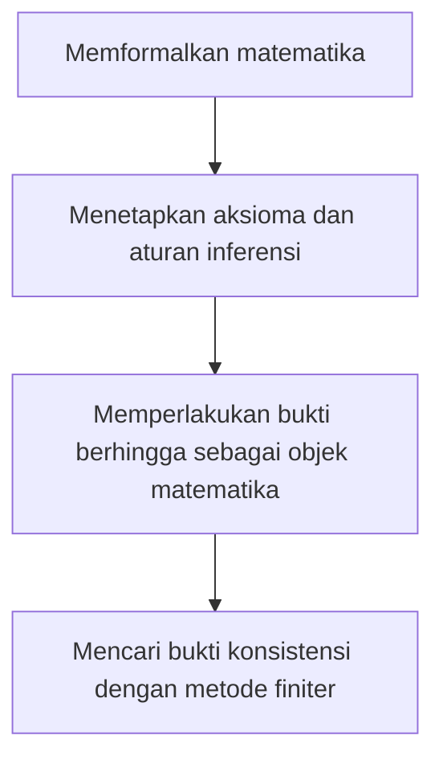
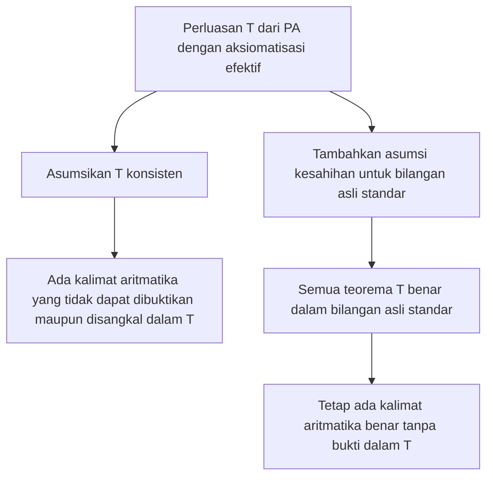
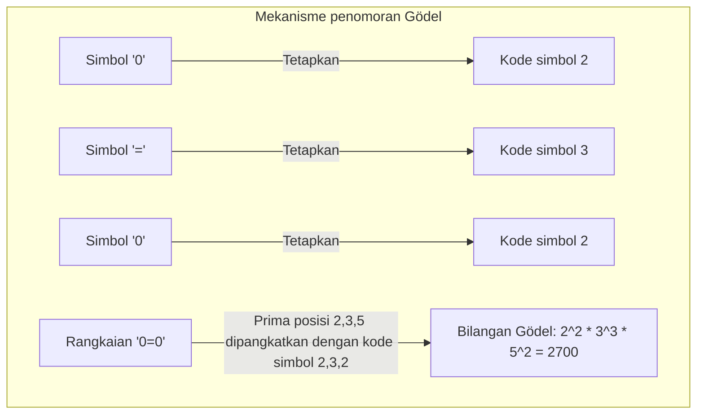
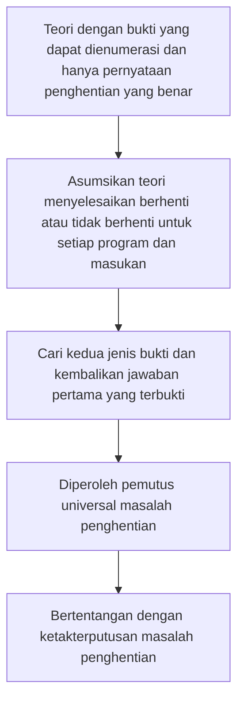

Jika kita memilih satu sistem aksioma lalu menyusun bukti menurut aturan mekanis, dapatkah kita menjawab semua pertanyaan tentang bilangan asli? Teorema ketidaklengkapan Gödel menunjukkan bahwa teori yang memenuhi syarat tertentu tidak dapat memberikan penyelesaian selengkap itu.

Hal terpenting adalah memperjelas <strong>dalam teori mana suatu kalimat tidak dapat dibuktikan</strong>. Hasil ini tidak mengatakan bahwa ada kebenaran yang mustahil dibuktikan dengan pilihan aksioma apa pun. Kita akan membedakan konsistensi, kesahihan semantik, dan aksiomatisasi efektif sambil membahas pengodean, referensi diri, serta cakupan teorema.

---

## 1. Program Hilbert dan tiga pertanyaan berbeda

Untuk memperkuat landasan matematika, [David Hilbert](/id/p/hilbert/) dan tokoh lain mengusulkan program untuk mendeskripsikan matematika melalui sistem aksioma formal dan membuktikan konsistensinya dengan metode finiter. Memformalkan matematika dan mempelajari buktinya dari luar sistem merupakan dua pekerjaan berbeda. Menggambarkan program ini hanya sebagai “sistem yang menjamin segala sesuatu tentang dirinya dari dalam” tidaklah tepat.

Tiga sifat berikut juga perlu dibedakan.

- <strong>Konsistensi</strong>: teori tidak membuktikan sekaligus suatu kalimat $A$ dan negasinya $\neg A$.
- <strong>Kelengkapan teori</strong>: untuk setiap kalimat $A$ dalam bahasanya, teori membuktikan $A$ atau $\neg A$. Ini adalah kelengkapan sintaktis.
- <strong>Keterputusan</strong>: algoritma yang selalu berhenti dapat menentukan apakah suatu kalimat yang diberikan merupakan teorema dari teori tersebut.

Kelengkapan berbeda dari kesahihan semantik, yang menyatakan bahwa semua teorema benar dalam interpretasi yang dimaksud. Teorema kelengkapan logika orde pertama juga berbeda maknanya dari kelengkapan suatu teori aritmatika tertentu.

## 2. Sistem formal dan aritmatika Peano

Sistem formal menetapkan simbol, aturan pembentukan rumus, aksioma, dan aturan inferensi. Pemeriksaan sintaktis apakah suatu bukti berhingga mengikuti aturan dapat dipisahkan dari pertanyaan semantik apakah suatu rumus benar dalam suatu interpretasi. Bahwa pemeriksaan bukti tidak memerlukan penafsiran makna bukan berarti makna tidak penting dalam matematika.

Contoh yang umum adalah aritmatika Peano orde pertama (PA). Teori ini membahas nol, penerus, penjumlahan, dan perkalian bilangan asli, serta mencakup skema aksioma induksi. Dalam pembahasan ini, bilangan asli mencakup nol. Bahkan $1+1=2$ merupakan kalimat yang diturunkan dari aksioma dan aturan tersebut.

Agar mudah diikuti, kita terutama mempertimbangkan teori yang dapat diaksiomatisasi secara efektif dan memuat PA sebagai syarat yang cukup. Ini bukan syarat paling lemah: ada bentuk teorema pertama yang berlaku atas aritmatika yang lebih lemah.

## 3. Teorema ketidaklengkapan pertama: kalimat yang tidak diselesaikan oleh teori

Kita menyatakan hasil ketidaklengkapan [Kurt Gödel](/id/p/godel/) dalam bentuk berikut, yang mencakup penyempurnaan Rosser.

> Setiap teori yang konsisten, dapat diaksiomatisasi secara efektif, dan memuat PA memiliki kalimat aritmatika yang tidak dapat dibuktikan maupun disangkal di dalam teori itu.

“Dapat diaksiomatisasi secara efektif” berarti aksioma dan bukti dapat dienumerasi dengan prosedur mekanis. Ketakterbuktian bersifat relatif terhadap teori yang dipilih. Ini tidak berarti kalimat tersebut harus tetap tidak dapat dibuktikan dalam teori lain dengan aksioma tambahan. Kebenaran dalam bilangan asli standar harus dibedakan dari keterbuktian dalam teori yang tetap.

Untuk menggambarkan himpunan kalimat yang dapat dibuktikan sebagai bagian dari himpunan kalimat yang benar dalam bilangan asli standar, diperlukan asumsi yang lebih kuat, yaitu <strong>kesahihan semantik</strong>. Konsistensi hanya meniadakan pembuktian sekaligus suatu kalimat dan negasinya; konsistensi saja tidak menjadikan semua teorema benar dalam bilangan asli standar.

### Membangun referensi diri secara aritmetis, bukan kontradiksi

Kemiripannya dengan kalimat pembohong “Kalimat ini salah” dapat membantu intuisi. Namun, konstruksi Gödel tidak memasukkan kontradiksi ke dalam matematika. Konstruksi itu mengodekan kalimat dan bukti sebagai bilangan, lalu menyatakan <strong>keterbuktian dalam teori tertentu</strong> melalui aritmatika.

Misalkan teorinya adalah $T$, dan $\operatorname{Prov}_T(y)$ adalah predikat keterbuktian yang lazim, yang menyatakan bahwa kalimat berkode $y$ memiliki bukti dalam $T$. Notasi $\ulcorner G_T\urcorner$ menyatakan numeral untuk kode kalimat $G_T$. Lemma titik tetap memungkinkan kita membangun kalimat yang memenuhi ekuivalensi berikut, yang dapat dibuktikan oleh teori:

$$
T\vdash G_T\leftrightarrow\neg\operatorname{Prov}_T(\ulcorner G_T\urcorner)
$$

Di sini $T\vdash A$ berarti bahwa $T$ membuktikan $A$. Konstruksi ini memakai pengodean dan substitusi, bukan langsung menjadikan kalimat bahasa sehari-hari sebagai aksioma.

Jika $T$ memiliki bukti untuk $G_T$, keberadaan bukti berhingga itu juga dapat dinyatakan dalam aritmatika, sehingga $T$ akan membuktikan $\operatorname{Prov}_T(\ulcorner G_T\urcorner)$. Namun, ekuivalensi di atas bersama $G_T$ juga menghasilkan negasinya. Jadi, jika $T$ konsisten, teori itu tidak dapat membuktikan $G_T$.

Dalam bilangan asli standar, predikat keterbuktian yang lazim menggambarkan dengan benar bukti berhingga yang benar-benar ada. Dengan menggunakan fakta ini, ketiadaan bukti menunjukkan bahwa $G_T$ benar dalam bilangan asli standar. Argumen eksternal ini memuat asumsi bahwa $T$ konsisten. Ini tidak berarti manusia dapat secara otomatis mengenali konsistensi teori apa pun.

Argumen ini saja tidak membolehkan kita menyimpulkan dari konsistensi semata bahwa teori yang sama juga tidak dapat membuktikan negasi $G_T$. Misalnya, kesahihan semantik meniadakan pembuktian negasi kalimat benar $G_T$. Bukti independensi asli Gödel memakai $\omega$-konsistensi; Rosser membangun kalimat berbeda untuk memperoleh ketakterbuktian dan ketakterbantahan hanya dari konsistensi biasa.

## 4. Penomoran Gödel: mengodekan rangkaian simbol dan bukti sebagai bilangan

Penomoran Gödel memberikan kode bilangan asli kepada simbol, rumus, dan rangkaian bukti berhingga. Sebagai contoh pembelajaran, kita memberi bilangan bulat positif yang sama kepada setiap kemunculan simbol yang sama, sedangkan posisi yang berbeda dalam rangkaian diberi bilangan prima berbeda. Ini bukan reproduksi persis penomoran dalam makalah aslinya.

Berikan kode 2 kepada simbol “0” dan kode 3 kepada “=”. Rangkaian “0=0” memiliki urutan kode 2, 3, 2. Memangkatkan bilangan prima posisi 2, 3, 5 dengan eksponen tersebut lalu mengalikannya menghasilkan 2700. Keunikan faktorisasi prima untuk bilangan bulat paling sedikit dua memungkinkan kita memulihkan urutan kode semula dalam contoh ini.

Yang penting bukan menghasilkan bilangan raksasa, melainkan memperlakukan sintaksis, substitusi, dan pemeriksaan bukti berhingga sebagai relasi antarbilangan. Misalnya, bedakan relasi “bilangan $p$ mengodekan bukti bagi kalimat berkode $q$” dari keterbuktian, yaitu pernyataan bahwa ada $p$ seperti itu.

Memeriksa satu calon bukti berhingga berbeda dari memutuskan bahwa tidak ada bukti sama sekali. Pengodean saja tidak menjadikan semua pertanyaan tentang keterbuktian dapat diputuskan.

## 5. Teorema ketidaklengkapan kedua: membuktikan konsistensi di dalam teori

Kita juga menjelaskan teorema ketidaklengkapan kedua dengan syarat cukup berikut.

> Perluasan PA yang konsisten dan dapat diaksiomatisasi secara efektif tidak dapat membuktikan di dalam dirinya sendiri konsistensinya yang dinyatakan dengan predikat keterbuktian yang lazim.

Sebagai contoh, pilih $0=1$ sebagai kontradiksi dan nyatakan konsistensi sebagai berikut:

$$
\operatorname{Con}(T)
\equiv\neg\operatorname{Prov}_T(\ulcorner 0=1\urcorner)
$$

Ini merupakan kalimat aritmatika yang menyatakan bahwa $T$ tidak memiliki bukti kontradiksi. Memberi nama “konsistensi” kepada sembarang rumus tidak menghasilkan kesimpulan yang sama: formalisasi predikat keterbuktian dan syarat-syarat derivabilitasnya penting.

Analogi seseorang yang berkata “Saya tidak pernah berbohong” dapat mengajak kita mempertanyakan dasar suatu bukti. Namun, analogi itu bukan bukti teorema kedua. Fakta bahwa teori yang tidak konsisten dapat membuktikan segalanya juga tidak dengan sendirinya menunjukkan ketakterbuktian dalam teori yang konsisten.

Konsistensi di sini berbeda dari kesahihan semantik, yaitu bahwa setiap teorema benar dalam interpretasi yang dimaksud. Hasil tersebut tidak meniadakan kemungkinan membuktikan konsistensi teori awal dalam teori yang lebih kuat. Hasil ini juga tidak berlaku tanpa syarat untuk manusia, organisasi, atau semua sistem perangkat lunak.

## 6. Kesalahpahaman dan cakupan hasil

### Matematika tidak runtuh

Ketidaklengkapan bukan negasi dari konsistensi. Hasilnya mengatakan bahwa teori yang tetap tidak menyelesaikan sebagian kalimat. Ketika menambahkan aksioma, kita perlu mempertimbangkan alasan memilihnya dan menelaah hal-hal seperti konsistensi teori perluasan. Menambahkan aksioma tidak otomatis menghilangkan semua kesulitan.

### Teorema ini tidak membuktikan bahwa manusia melampaui mesin

Bahkan argumen eksternal bahwa kalimat Gödel benar mengandaikan syarat seperti konsistensi teorinya. Teorema tersebut tidak mengatakan bahwa manusia dapat memastikan asumsi itu untuk teori apa pun. Argumen filosofis tentang akal manusia atau AI perlu dibedakan dari kesimpulan matematis yang dinyatakan di sini.

### Tidak semua teori tidak lengkap

Bahasa, aksioma, efektivitas, dan kekuatan untuk menyatakan aritmatika menentukan cakupannya. Misalnya, teori orde pertama medan tertutup real, yang membahas bilangan real menggunakan nol, satu, penjumlahan, perkalian, dan urutan, lengkap serta dapat diputuskan. Eliminasi kuantor memberikan jalan untuk memutuskan kalimat-kalimatnya.

Ini tidak berarti semua matematika yang melibatkan bilangan real, fungsi sembarang, atau himpunan dapat diselesaikan secara otomatis. Ini juga tidak memberikan hasil yang sama untuk aritmatika bilangan asli. Pernyataan “geometri Euklides lengkap” juga harus menyebutkan formalisasi dan bahasa yang digunakan.

## 7. Hubungan dengan masalah penghentian

[Masalah penghentian](/id/p/halting-problem/) menyatakan bahwa tidak ada algoritma universal yang selalu berhenti dan menjawab dengan benar apakah sembarang program berhenti pada masukan tertentu. Model Turing bersifat matematis; ini bukan sekadar mengganti sistem formal dengan mesin fisik.

Salah satu cara melihat hubungannya adalah mempertimbangkan teori yang buktinya dapat dienumerasi secara mekanis dan hanya membuktikan pernyataan benar tentang berhenti maupun tidak berhenti. Jika teori itu dapat membuktikan berhenti atau tidak berhenti untuk setiap program dan masukan, kita dapat mengenumerasi bukti lalu mengembalikan jawaban yang buktinya ditemukan, sehingga masalah penghentian dapat diputuskan.

Penjelasan ini memakai asumsi kuat berupa kesahihan semantik tentang penghentian. Ini bukan pernyataan syarat paling lemah maupun bukti lengkap untuk masing-masing teorema Gödel. Komputabilitas juga perlu dibedakan dari kompleksitas, yang mempelajari waktu dan memori yang diperlukan untuk komputasi.

## 8. Kesimpulan: nyatakan teori dan asumsinya

Teorema ketidaklengkapan menjelaskan batas pembuktian dalam teori yang tetap dan memenuhi syarat tertentu. Teori aritmatika yang konsisten, dapat diaksiomatisasi secara efektif, dan cukup kuat memiliki kalimat yang tidak dapat dibuktikan maupun disangkal di dalamnya. Dengan syarat yang cukup, teori itu juga tidak dapat membuktikan konsistensinya sendiri dalam formalisasi yang lazim.

Kalimat yang tidak diselesaikan oleh suatu teori mungkin menjadi dapat dibuktikan setelah aksioma baru ditambahkan. Namun, jika teori perluasan masih memenuhi syarat yang sama, teori itu juga tidak lengkap. Mempertimbangkan himpunan semua kebenaran aritmatika berbeda dari memberikan aksiomatisasi yang dapat dienumerasi secara mekanis untuk himpunan itu.

Keruntuhan matematika, keunggulan manusia atas mesin, dan batas menyeluruh untuk semua AI tidak mengikuti dari teorema-teorema ini saja. Pertanyaan yang perlu diajukan adalah teori mana yang dipilih, asumsi apa yang digunakan, dan apakah kebenaran dibedakan dari keterbuktian.

### Referensi

- [Open Logic Project: Incompleteness and Computability](https://ic.openlogicproject.org/ic-screen.pdf) — buku tentang pengodean, titik tetap, hasil Gödel dan Rosser, serta syarat predikat keterbuktian.
- [UCLA: Incompleteness and Undecidability](https://www.math.ucla.edu/~dam/220b.1.11w/220notes4.pdf) — aritmetisasi simbol dan bukti; membedakan teorema pertama yang memakai kesahihan semantik dari bentuk Rosser.
- [Richard Zach: The Practice of Finitism](https://arxiv.org/abs/math/0102189) — penelitian tentang aksiomatisasi dan bukti konsistensi finiter dalam program Hilbert.
- [Jindřich Zapletal: Elements of Set Theory](https://people.clas.ufl.edu/zapletal/files/notesset.pdf) — bahasa orde pertama medan tertutup real dan eliminasi kuantor; lihat Teorema 6.3.12 pada Bagian 6.3.
