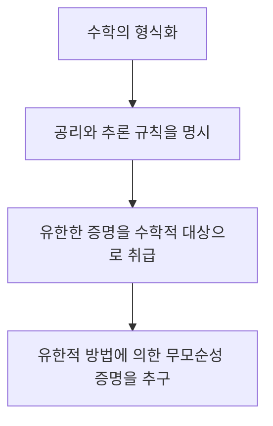
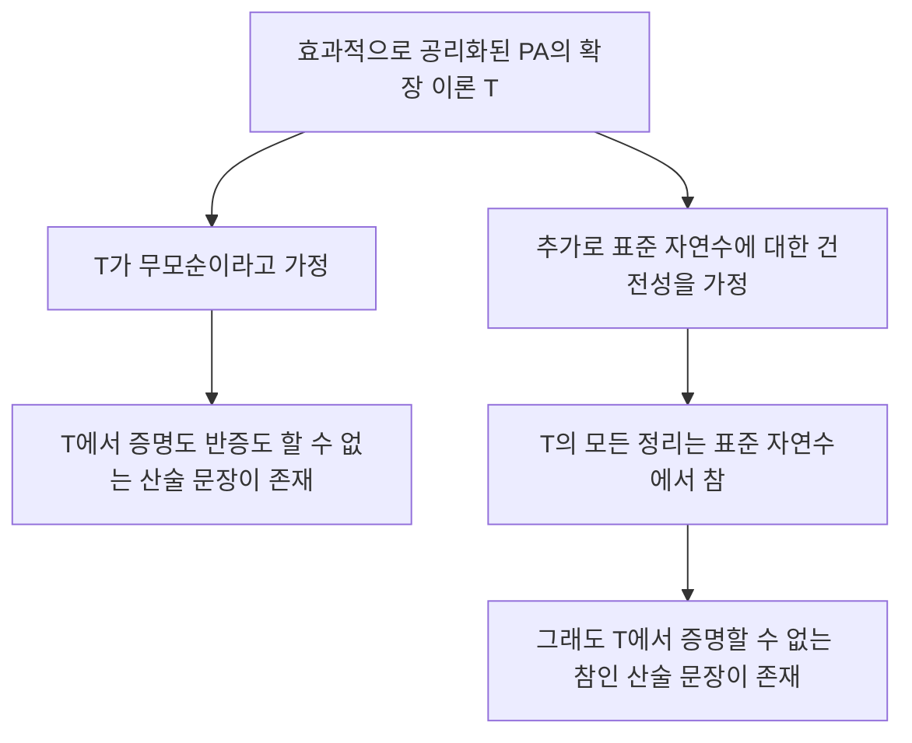
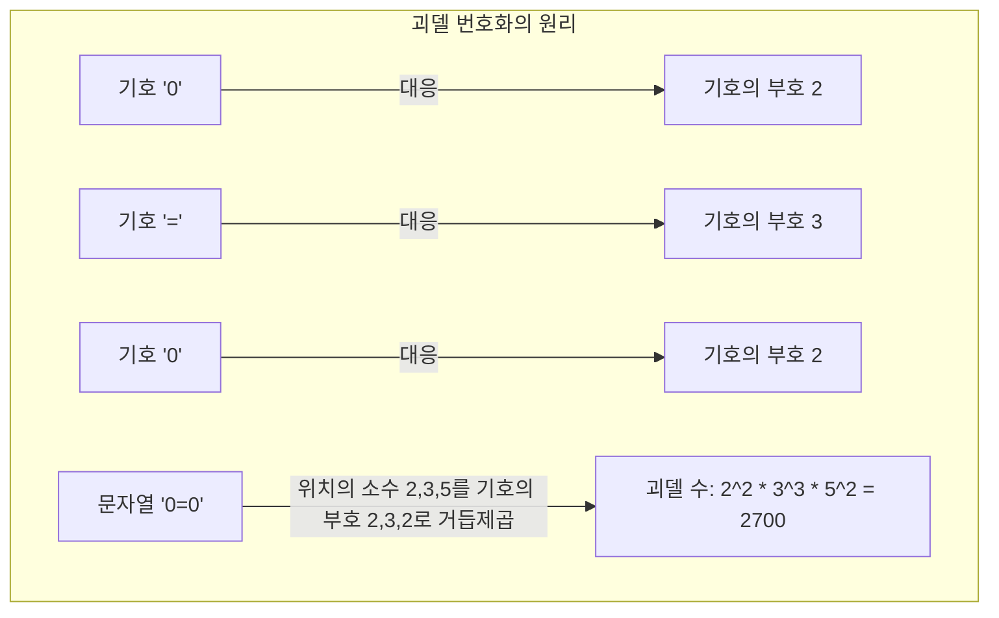
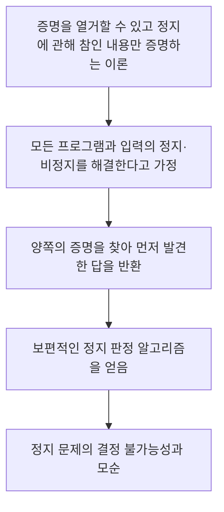

하나의 공리계를 선택하고 기계적인 규칙으로 증명을 쌓아 가면 자연수에 관한 모든 질문에 답할 수 있을까요? 괴델의 불완전성 정리는 일정한 조건을 만족하는 이론이 그러한 완전한 해결책을 제공할 수 없음을 보여 줍니다.

핵심은 <strong>어느 이론에서 증명할 수 없는지</strong>를 명확히 하는 것입니다. 어떤 공리를 사용해도 절대로 증명할 수 없는 진리가 있다는 뜻은 아닙니다. 무모순성, 건전성, 효과적 공리화를 구분하면서 부호화와 자기 지시의 구성, 정리의 적용 범위를 살펴보겠습니다.

---

## 1. 힐베르트 프로그램과 서로 다른 세 가지 질문

수학의 기초를 확고히 하기 위해 [다비트 힐베르트](/ko/p/hilbert/) 등은 수학을 형식적 공리계로 기술하고 그 무모순성을 유한적 방법으로 증명하는 계획을 추진했습니다. 수학을 형식화하는 일과 그 증명을 체계 밖에서 연구하는 일은 구분해야 합니다. 단순히 “체계가 자기 내부에서 자신의 모든 것을 보증한다”라고 설명하는 것은 이 계획을 정확히 나타내지 못합니다.

다음 세 가지 성질도 구분해야 합니다.

- <strong>무모순성</strong>: 이론이 동일한 문장 $A$와 그 부정 $\neg A$를 모두 증명하지 않는 성질입니다.
- <strong>이론의 완전성</strong>: 그 언어의 각 문장 $A$에 대해 이론이 $A$ 또는 $\neg A$를 증명하는 성질입니다. 여기서는 구문적 완전성을 뜻합니다.
- <strong>결정 가능성</strong>: 항상 종료하는 알고리즘으로 주어진 문장이 그 이론의 정리인지 판정할 수 있는 성질입니다.

완전성은 모든 정리가 의도한 해석에서 참이라는 건전성과 다릅니다. 1차 논리의 “완전성 정리”와 특정 산술 이론의 완전성도 같은 뜻이 아닙니다.

## 2. 형식 체계와 페아노 산술

형식 체계는 사용할 기호, 식의 구성 규칙, 공리와 추론 규칙을 정합니다. 유한한 증명이 규칙을 따르는지 확인하는 구문적 작업과 식이 어떤 해석에서 참인지 묻는 의미론적 작업은 구분할 수 있습니다. 증명 검사가 의미를 요구하지 않는다는 말은 수학에서 의미를 생각할 필요가 없다는 뜻이 아닙니다.

대표적인 예가 1차 페아노 산술(PA)입니다. 자연수의 영, 후속자, 덧셈, 곱셈 등을 다루며 귀납법 공리 도식을 포함합니다. 예를 들어 $1+1=2$도 이러한 공리와 규칙에서 도출하는 문장입니다.

아래에서는 이해하기 쉬운 충분조건으로 PA를 포함하고 효과적으로 공리화된 이론을 주로 생각합니다. 이것이 가장 약한 조건이라는 뜻은 아닙니다. 제1정리에는 PA보다 약한 산술을 바탕으로 하는 형태도 있습니다.

## 3. 제1불완전성 정리: 이론 안에서 해결되지 않는 문장

여기서는 로서의 개선을 포함하는 다음 형태로 [쿠르트 괴델](/ko/p/godel/)의 불완전성 결과를 서술합니다.

> PA를 포함하고 효과적으로 공리화된 무모순인 이론에는, 그 이론에서 증명도 반증도 할 수 없는 산술 문장이 존재한다.

“효과적으로 공리화된다”는 것은 공리와 증명을 기계적인 절차로 열거할 수 있다는 뜻입니다. 증명 불가능성은 선택한 이론에 상대적입니다. 다른 공리를 추가한 이론에서도 절대로 증명할 수 없다는 뜻이 아닙니다. 표준 자연수에서의 진리와 고정된 이론 안에서의 증명 가능성을 구분해야 합니다.

증명 가능한 문장들의 집합을 표준 자연수에서 참인 문장들의 집합의 부분집합으로 그리려면, 무모순성보다 강한 <strong>건전성</strong>을 가정해야 합니다. 무모순성은 한 문장과 그 부정을 동시에 증명하는 일을 배제할 뿐이며, 그것만으로 모든 정리가 표준 자연수에서 참이 되는 것은 아닙니다.

### 모순이 아니라 산술 문장으로 자기 지시를 구성하기

“이 문장은 거짓이다”라는 거짓말쟁이 문장과의 유사성은 직관에 도움이 됩니다. 하지만 괴델의 구성은 수학 안에 모순을 도입하는 것이 아닙니다. 문장과 증명을 수로 부호화하고, <strong>특정 이론에서의 증명 가능성</strong>을 산술로 표현합니다.

이론을 $T$라 하고, $\operatorname{Prov}_T(y)$를 “번호 $y$의 문장에 $T$에서의 증명이 존재한다”라고 표현하는 통상적인 증명 가능성 술어라고 합시다. $\ulcorner G_T\urcorner$는 문장 $G_T$의 부호를 나타내는 수사입니다. 고정점 보조정리에 따라, 이론 안에서 다음 동치를 증명할 수 있는 문장을 구성할 수 있습니다.

$$
T\vdash G_T\leftrightarrow\neg\operatorname{Prov}_T(\ulcorner G_T\urcorner)
$$

여기서 $T\vdash A$는 $T$가 $A$를 증명한다는 뜻입니다. 이 구성은 자연어 문장을 그대로 공리로 삼는 것이 아니라 부호화와 대입을 이용합니다.

만약 $T$에 $G_T$의 증명이 있다면 그 유한한 증명의 존재도 산술로 표현할 수 있으므로 $T$는 $\operatorname{Prov}_T(\ulcorner G_T\urcorner)$를 증명합니다. 그런데 위 동치와 $G_T$로부터 그 부정도 증명하게 됩니다. 따라서 $T$가 무모순이라면 $G_T$를 증명할 수 없습니다.

표준 자연수에서 통상적인 증명 가능성 술어가 실제 유한 증명을 올바르게 표현한다는 사실을 사용하면, 증명이 없다는 것으로부터 $G_T$가 표준 자연수에서 참임을 알 수 있습니다. 이 외부 논증에는 $T$가 무모순이라는 가정이 포함됩니다. 인간이 임의의 이론의 무모순성을 자동으로 알아낼 수 있다는 뜻은 아닙니다.

이 논증만으로 단순한 무모순성에서 같은 $G_T$의 부정도 증명할 수 없다고 결론 내려서는 안 됩니다. 예를 들어 건전성을 가정하면 참인 문장 $G_T$의 부정을 증명할 수 없습니다. 괴델의 원래 독립성 증명은 $\omega$-무모순성을 사용했습니다. 로서는 다른 문장을 구성하여 통상적인 무모순성만으로 증명도 반증도 할 수 없다는 결과를 얻었습니다.

## 4. 괴델 번호화: 문자열과 증명을 수로 부호화하기

괴델 번호화는 기호, 식, 유한한 증명열에 자연수 부호를 대응시키는 방법입니다. 여기서는 교육용 예시로 같은 기호의 각 출현에는 같은 양의 정수 부호를 부여하고, 문자열의 서로 다른 위치에는 서로 다른 소수를 대응시킵니다. 원논문의 번호 체계를 그대로 재현한 것은 아닙니다.

기호 “0”의 부호를 2, “=”의 부호를 3으로 정하면 문자열 “0=0”의 부호열은 2, 3, 2입니다. 위치에 대응하는 소수 2, 3, 5를 각각 이 지수로 거듭제곱하여 곱하면 2700이 됩니다. 2 이상의 정수에 대한 소인수분해의 유일성에 따라, 이 예에서는 원래 부호열을 복원할 수 있습니다.

중요한 것은 큰 수를 만드는 일 자체가 아니라 구문, 대입, 유한한 증명 검사를 수에 관한 관계로 다룰 수 있다는 점입니다. 예를 들어 “수 $p$는 번호 $q$의 문장의 증명을 부호화한다”라는 관계와, “그러한 $p$가 존재한다”라는 증명 가능성을 구분해야 합니다.

하나의 유한한 증명 후보를 검사하는 것과 증명이 전혀 존재하지 않음을 판정하는 것은 다릅니다. 부호화만으로 모든 증명 가능성 문제가 결정 가능해지는 것은 아닙니다.

## 5. 제2불완전성 정리: 이론 내부에서의 무모순성 증명

제2불완전성 정리도 여기서는 다음 충분조건 아래에서 설명합니다.

> 효과적으로 공리화된 무모순인 PA의 확장 이론은 통상적인 증명 가능성 술어로 표현한 자신의 무모순성을 그 이론 내부에서 증명할 수 없다.

예를 들어 모순을 나타내는 문장으로 $0=1$을 선택하고 무모순성을 다음과 같이 표현합니다.

$$
\operatorname{Con}(T)
\equiv\neg\operatorname{Prov}_T(\ulcorner 0=1\urcorner)
$$

이는 $T$에 모순의 증명이 존재하지 않는다는 산술 문장입니다. 임의의 식에 “무모순성”이라는 이름을 붙인다고 같은 결과가 나오지는 않습니다. 증명 가능성 술어의 형식화와 유도 가능성 조건이 중요합니다.

“나는 거짓말하지 않는다”라고 말하는 사람의 비유는 증명의 근거를 생각하는 계기가 될 수 있습니다. 그러나 제2정리의 증명은 아닙니다. 모순된 이론에서는 무엇이든 증명할 수 있다는 사실만으로 무모순인 이론에서의 증명 불가능성이 도출되는 것도 아닙니다.

여기서 무모순성은 모든 정리가 의도한 해석에서 참이라는 건전성과 다릅니다. 더 강한 이론에서 원래 이론의 무모순성을 증명할 가능성은 배제되지 않습니다. 또한 이 정리는 인간, 조직, 모든 소프트웨어에 조건 없이 적용되지 않습니다.

## 6. 흔한 오해와 적용 범위

### 수학이 무너졌다는 뜻은 아닙니다

불완전성은 무모순성의 부정이 아닙니다. 어떤 고정된 이론으로 해결되지 않는 문장이 있다는 결과입니다. 공리를 추가할 때는 그 공리를 선택하는 이유와 확장 이론의 무모순성 등을 검토해야 합니다. 공리를 추가한다고 모든 문제가 사라지는 것은 아닙니다.

### 인간이 기계를 뛰어넘는다는 결론은 아닙니다

외부에서 괴델 문장이 참이라고 논증할 때도 대상 이론의 무모순성 같은 조건을 가정합니다. 인간이 임의의 이론에 대해 그 가정을 확인할 수 있다는 주장은 정리에 포함되지 않습니다. 인간의 이성이나 AI에 관한 철학적 논의를 여기서 설명한 수학적 결론과 구분해야 합니다.

### 모든 이론이 불완전한 것은 아닙니다

언어와 공리, 효과성, 산술을 표현할 수 있는 강도가 중요합니다. 예를 들어 영, 일, 덧셈, 곱셈, 순서로 실수를 다루는 실폐체의 1차 이론은 완전하고 결정 가능합니다. 양화사 제거를 통해 문장의 판정으로 이어질 수 있습니다.

이는 임의의 함수나 집합을 포함하는 “실수에 관한 모든 수학”을 자동으로 해결할 수 있다는 뜻이 아닙니다. 자연수 산술에도 같은 결과가 적용된다는 뜻도 아닙니다. “유클리드 기하학은 완전하다”라고 말할 때도 어떤 형식화와 언어를 사용하는지 명시해야 합니다.

## 7. 정지 문제와의 관계

[정지 문제](/ko/p/halting-problem/)는 임의의 프로그램과 주어진 입력에 대해 항상 종료하면서 올바른 정지·비정지 답을 내는 보편적인 알고리즘이 존재하지 않는다는 결과입니다. 튜링의 계산 모형은 수학적 모형입니다. 형식 체계를 단순히 물리적 기계로 바꾸기만 한 논증이 아닙니다.

관계를 이해하는 한 가지 방법으로, 증명을 기계적으로 열거할 수 있고 정지·비정지에 관해 참인 내용만 증명하는 이론을 생각해 봅시다. 모든 프로그램과 입력에 대해 정지 또는 비정지를 증명할 수 있다면, 증명을 차례로 열거하여 먼저 증명을 찾은 쪽의 답을 반환함으로써 정지 문제를 결정할 수 있게 됩니다.

이 설명에는 정지에 관한 건전성이라는 강한 가정이 들어 있습니다. 괴델의 각 정리의 가장 약한 조건을 서술하거나 완전한 증명을 제시한 것이 아닙니다. 계산 가능성은 계산에 필요한 시간과 메모리를 연구하는 계산 복잡도와도 구분해야 합니다.

## 8. 결론: 이론과 가정을 명시하기

불완전성 정리는 일정한 조건을 만족하는 고정된 이론 안에서의 증명의 한계를 설명합니다. 필요한 강도를 갖추고 효과적으로 공리화된 무모순인 산술 이론에는 증명도 반증도 할 수 없는 문장이 존재합니다. 충분한 조건 아래에서는 통상적인 방식으로 표현한 자신의 무모순성도 내부에서 증명할 수 없습니다.

어떤 이론에서 해결되지 않는 문장을 새 공리를 추가한 이론에서는 증명할 수 있습니다. 다만 확장된 이론도 같은 적용 조건을 만족하면 역시 불완전합니다. 모든 산술적 진리의 집합을 생각하는 것과 그 집합을 기계적으로 열거할 수 있는 공리계로 제시하는 것도 별개의 일입니다.

수학의 붕괴, 기계에 대한 인간의 우월성, 모든 AI의 능력에 관한 포괄적 한계는 이 정리만으로 도출되지 않습니다. 어떤 이론을 선택했는지, 무엇을 가정했는지, 참이라는 것과 증명 가능하다는 것을 구분하는지 확인해야 합니다.

### 참고 문헌

- [Open Logic Project: Incompleteness and Computability](https://ic.openlogicproject.org/ic-screen.pdf) — 부호화, 고정점, 괴델과 로서의 결과 및 증명 가능성 술어의 조건을 다루는 교재입니다.
- [UCLA: Incompleteness and Undecidability](https://www.math.ucla.edu/~dam/220b.1.11w/220notes4.pdf) — 기호와 증명의 산술화, 건전성을 사용하는 제1정리와 로서 형태의 구분을 설명합니다.
- [Richard Zach: The Practice of Finitism](https://arxiv.org/abs/math/0102189) — 힐베르트 프로그램의 공리화와 유한적 무모순성 증명에 관한 연구입니다.
- [Jindřich Zapletal: Elements of Set Theory](https://people.clas.ufl.edu/zapletal/files/notesset.pdf) — 실폐체의 1차 언어와 양화사 제거를 다룹니다. 6.3절의 정리 6.3.12를 참조하세요.
