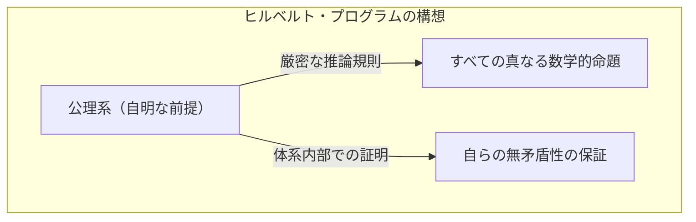
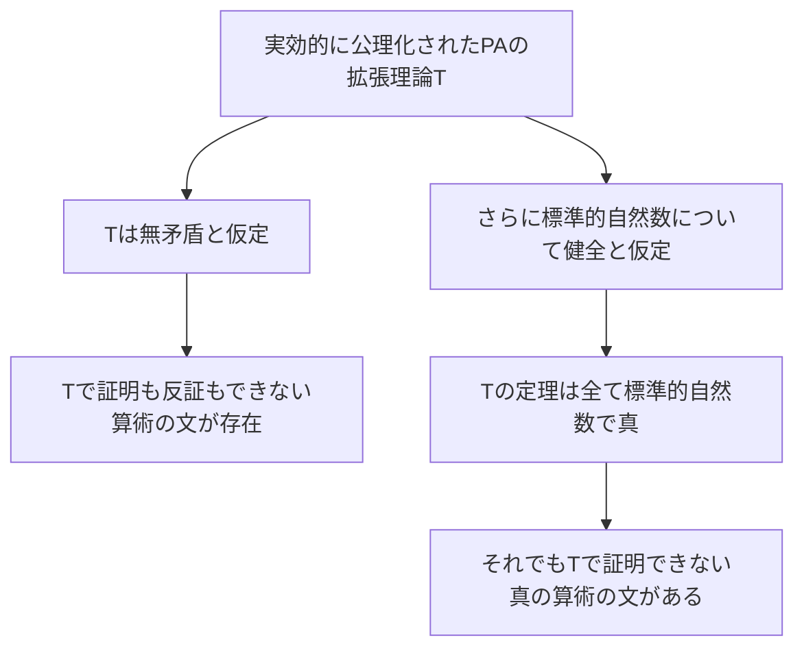
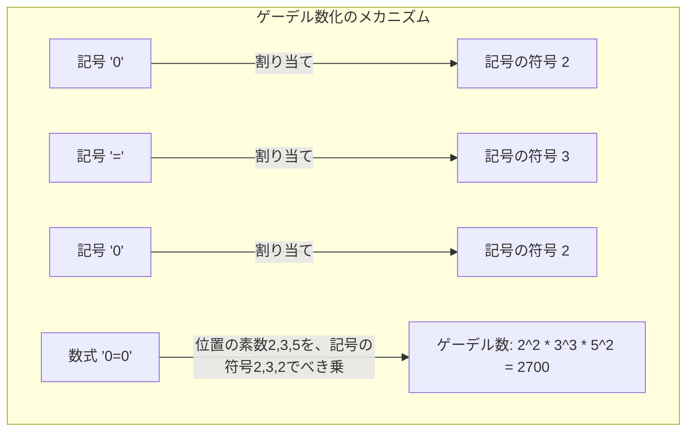
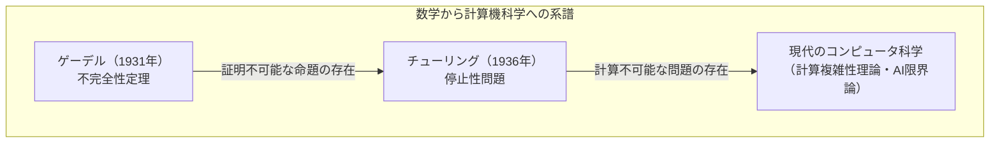

「数学は絶対的に正しい」──誰もが一度はそう考えたことがあるでしょう。しかし、1931年に若き数学者[クルト・ゲーデル](https://kenji.blog/p/godel/)が発表した一つの論文が、その常識を根底から覆しました。それが **[ゲーデルの不完全性定理](https://kenji.blog/p/godels-incompleteness-theorems/)** です。

本記事では、「絶対に証明できない真理」が存在するという、この衝撃的な定理について、その意味や証明の仕組みを具体例や図解を交えて徹底的に解説します。

---

## 1. 舞台背景：[ヒルベルト](https://kenji.blog/p/hilbert/)・プログラムと数学の危機

19世紀末から20世紀初頭にかけて、数学の世界は「集合論のパラドックス（ラッセルのパラドックスなど）」に直面し、その土台が揺らいでいました。この「数学の危機」を救うために立ち上がったのが、当時の数学界の最高権威である[ダフィット・ヒルベルト](https://kenji.blog/p/hilbert/)です。

[ヒルベルト](https://kenji.blog/p/hilbert/)は、数学のすべての推論を完全に記号化し、機械的なルールだけで数学を再構築しようと試みました。彼が提唱した「[ヒルベルト](https://kenji.blog/p/hilbert/)・プログラム」が目指したのは、数学の形式的体系（Formal System）において、以下の3つの性質を証明することでした。

1. **無矛盾性** （Consistency）：体系内に矛盾（ある命題 $P$ とその否定 $\neg P$ が両方証明されること）が存在しないこと。
2. **完全性** （Completeness）：どんな数学的命題も、その体系内で真か偽のどちらかとして必ず証明できること。
3. **決定可能性** （Decidability）：任意の命題が与えられたとき、それが証明可能かどうかを判定する機械的な手順が存在すること。

[ヒルベルト](https://kenji.blog/p/hilbert/)は、「我々は知らねばならない、我々は知るであろう（Wir müssen wissen. Wir werden wissen.）」という有名な言葉を残し、数学がすべてを解決できる完璧な論理の城になることを信じて疑いませんでした。

## 2. 形式的体系とペアノ算術

[ゲーデル](https://kenji.blog/p/godel/)の定理を理解するために、まずは「形式的体系」と「基本算術」について触れておきましょう。

形式的体系とは、あらかじめ決められた文字列（記号）と、それらを操作するパズル・ルール（推論規則）のセットです。そこには「意味」は必要なく、単なる記号の変形ゲームとして数学を捉えます。

[ゲーデル](https://kenji.blog/p/godel/)の定理の対象となるのは、「自然数の足し算と掛け算」を含む体系です。その代表例が **ペアノ算術** （Peano Arithmetic, PA）と呼ばれる公理系です。ペアノ算術では、「0は自然数である」「ある自然数 $x$ には、その次の数 $S(x)$ が存在する」といった基本的なルール（公理）からスタートします。

たとえば、「 $1 + 1 = 2$ 」という誰もが知る事実も、ペアノ算術という形式的体系の中では、記号の操作によって機械的に導き出される一つの「定理」に過ぎません。

[ヒルベルト](https://kenji.blog/p/hilbert/)は、このような形式的体系を巨大化させていけば、いつかすべての数学的真理を網羅できると考えたのです。

## 3. 第一[不完全性定理](https://kenji.blog/p/godels-incompleteness-theorems/)の衝撃：「真だが証明できない」命題

しかし1931年、当時わずか25歳だった[クルト・ゲーデル](https://kenji.blog/p/godel/)は、ヒルベルトの夢を粉々に打ち砕く論文を発表しました。それが **第一[不完全性定理](https://kenji.blog/p/godels-incompleteness-theorems/)** です。

>  **第一[不完全性定理](https://kenji.blog/p/godels-incompleteness-theorems/)** 
> ペアノ算術を含む、実効的に公理化された無矛盾な理論には、その理論内では証明も反証もできない算術の文が存在する（ゲーデル＝ロッサーの形）。

ここで「実効的に公理化」とは、公理や証明を機械的な手続きで列挙できることを意味します。証明できないという主張は、選んだ理論に相対的です。別の公理を加えた理論でも絶対に証明できない、という意味ではありません。標準的な自然数についての真理と、固定した理論内での証明可能性を区別する必要があります。

「証明できる文の集合が、標準的な自然数で真である文の集合に含まれる」という図を描くなら、無矛盾性より強い<strong>健全性</strong>を仮定する必要があります。無矛盾性は、ある文とその否定を両方証明しないという条件であり、それだけで全ての定理が標準的な自然数について真になるわけではありません。

### 自己言及を矛盾ではなく算術の文として作る

嘘つきの文「この文は偽である」との類似は直感の助けになります。しかしゲーデルの構成は、数学の内部に矛盾を持ち込むものではありません。文や証明を数で符号化し、<strong>特定の理論で証明できるか</strong>を算術で表します。

理論を $T$ とし、$\operatorname{Prov}_T(y)$ を「番号 $y$ の文に $T$ での証明が存在する」と表す通常の証明述語とします。$\ulcorner G_T\urcorner$ は、文 $G_T$ の符号を表す数詞です。固定点補題により、次の同値を理論内で証明できる文を構成できます。

$$
T\vdash G_T\leftrightarrow\neg\operatorname{Prov}_T(\ulcorner G_T\urcorner)
$$

$T\vdash A$ は「$T$ が $A$ を証明する」という意味です。これは自然言語の文をそのまま公理にする操作ではなく、符号化と代入を使った構成です。

もし $T$ に $G_T$ の証明があれば、その有限の証明の存在を算術でも表せるため、$T$ は $\operatorname{Prov}_T(\ulcorner G_T\urcorner)$ を証明します。一方、上の同値と $G_T$ から、その否定も証明してしまいます。従って、$T$ が無矛盾なら $G_T$ は $T$ で証明できません。

標準的な自然数で通常の証明述語が実際の有限証明を正しく表すことを使うと、この非証明可能性から $G_T$ が標準的な自然数で真であると分かります。この外部からの議論には、$T$ が無矛盾だという仮定が含まれます。どんな理論の無矛盾性も、人間が自動的に見抜けるという意味ではありません。

ここまでの議論だけで、単なる無矛盾性から同じ $G_T$ の否定も証明できないと結論してはいけません。例えば健全性を仮定すれば、真である $G_T$ の否定は証明できません。ゲーデルの元の独立性の証明は $\omega$ 無矛盾性を用い、ロッサーは別の文を構成して、通常の無矛盾性だけで証明も反証もできないという結果を得ました。

## 4. [ゲーデル](https://kenji.blog/p/godel/)数化：数式を数に変換する天才的アイデア

「この命題は証明できない」という日本語の文を、足し算や掛け算しか持たないペアノ算術の中でどうやって表現するのでしょうか。ここで[ゲーデル](https://kenji.blog/p/godel/)が発明したのが **[ゲーデル](https://kenji.blog/p/godel/)数化** （Gödel numbering）という手法です。

[ゲーデル](https://kenji.blog/p/godel/)は、数式で使われる記号に数を対応させ、式や証明を自然数で符号化しました。以下は仕組みを示す教材用の例であり、原論文の番号付けをそのまま再現したものではありません。同じ記号には同じ正整数の符号を使い、文字列内の位置に異なる素数を対応させます。そして、素因数分解の一意性（2以上の整数は、因子の順序を除いて素数の積に一意に分解できるという性質）を利用して、数式の文字列を一つの巨大な自然数に変換しました。

この手法を使えば、「数式 $A$ が数式 $B$ の証明になっている」というような「証明のプロセス」全体すらも、巨大な数の性質（ある数が別の数で割り切れるか、など）という単なる算術の問題にすり替えることができます。

つまり、数学が「自分自身の証明」について語る（自己言及する）ための言語を、自然数の性質の中に隠し込んでしまったのです。これは、現代のコンピュータが画像やプログラムをすべて「0と1の数字の列」にエンコードして処理しているのと同じ発想であり、[ゲーデル](https://kenji.blog/p/godel/)はコンピュータが誕生するはるか前にこの概念に到達していました。

## 5. 第二不完全性定理：体系内での無矛盾性の証明

第一[不完全性定理](https://kenji.blog/p/godels-incompleteness-theorems/)だけでも数学界を震撼させましたが、ゲーデルの論文にはさらに恐ろしい結論が含まれていました。それが **第二[不完全性定理](https://kenji.blog/p/godels-incompleteness-theorems/)** です。

>  **第二[不完全性定理](https://kenji.blog/p/godels-incompleteness-theorems/)** 
> 実効的に公理化された無矛盾なペアノ算術の拡張理論は、通常の証明述語を用いて表した自分自身の無矛盾性を、その理論内では証明できない。

[ヒルベルト](https://kenji.blog/p/hilbert/)は、数学が無矛盾であることを、数学自身の力を使って証明しようとしていました（ヒルベルト・プログラムの最重要課題）。第二不完全性定理は、上記の条件を満たす理論と、その証明可能性を適切に表す算術の式についての結果です。人間、組織、あらゆるソフトウェアを含む「どんなシステム」にも無条件で適用できるわけではありません。

これを直感的に理解するために、次のように考えてみましょう。
もし、ある人が「私は絶対に嘘をつかない！」と主張したとします。しかし、私たちはその人の言葉だけを根拠にして「この人は嘘つきではない」と証明することはできません。なぜなら、もしその人が嘘つきであれば、「私は絶対に嘘をつかない」という発言自体が嘘かもしれないからです。

数学もこれと同じで、ある公理系が「私は無矛盾である（ $Con(F)$ ）」という数式を自ら導き出せたとしても、もしその体系がすでに矛盾していれば、あらゆる命題（正しいことも間違っていることも）が証明できてしまうため、その「私は無矛盾である」という証明には何の価値もありません。

ただし、この嘘つきの比喩や「矛盾した理論なら何でも証明できる」という事実だけで、第二不完全性定理が証明できるわけではありません。証明可能性を表す述語の導出条件などを使う形式的な議論が必要です。ここでの無矛盾性は「全ての定理が意図した解釈で真である」という健全性とも区別します。より強い理論で元の理論の無矛盾性を証明する可能性は、この定理によって排除されません。

## 6. [不完全性定理](https://kenji.blog/p/godels-incompleteness-theorems/)に関するよくある誤解

[ゲーデルの不完全性定理](https://kenji.blog/p/godels-incompleteness-theorems/)は、そのドラマチックな名称から、しばしば哲学や思想、オカルト的な文脈で誤用されることがあります。ここでは代表的な誤解を解いておきましょう。

-  **誤解1：「数学は破綻してしまった」** 
  -  **事実** ：[不完全性定理](https://kenji.blog/p/godels-incompleteness-theorems/)は数学の破綻を意味しません。むしろ「特定の固定された公理系だけでは、すべての真理を捉えきれない」という形式論理の性質を明らかにしたものです。数学者たちは、必要に応じて新しい公理（例えば「[選択公理](https://kenji.blog/p/axiom-of-choice-and-zorns-lemma/)」や「巨大基数公理」など）を追加することで、より強力な体系を作り出し、研究を発展させ続けています。
-  **誤解2：「人間の理性には限界がある」** 
  -  **事実** ：定理が限界を示しているのは、「あらかじめ決められた機械的なルールに従うシステム（形式的体系）」についてです。第一[不完全性定理](https://kenji.blog/p/godels-incompleteness-theorems/)において、私たちは外側の視点から命題 $G$ が「真である」と見抜くことができました。これは、人間の理性が機械的な形式的体系を超えた「意味（セマンティクス）」を理解する能力を持っている証拠だ、と捉える学者（ロジャー・ペンローズなど）もいます。
-  **誤解3：「どんなことでも証明できないことがある」** 
  -  **事実** ：[不完全性定理](https://kenji.blog/p/godels-incompleteness-theorems/)が適用されるのは「自然数の足し算と掛け算（ペアノ算術）」を含む十分に複雑な体系だけです。例えば、「[ユークリッド](https://kenji.blog/p/euclid/)幾何学」や「実数の一次理論」などは完全であり、真である命題はすべて証明可能です。対象が十分に複雑な構造（自己言及を可能にする構造）を持ったときにのみ、不完全性が生じます。

## 7. [チューリング](https://kenji.blog/p/turing/)マシンへのバトン：計算機科学の幕開け

[ゲーデル](https://kenji.blog/p/godel/)の定理がもたらした影響は、数学の枠にとどまりませんでした。1936年、イギリスの数学者アラン・チューリングは、ゲーデルの「形式的体系」の概念を物理的な計算プロセスに置き換え、「[チューリング](https://kenji.blog/p/turing/)マシン」という仮想の計算機モデルを考案しました。

[チューリング](https://kenji.blog/p/turing/)は、ゲーデルの不完全性定理を計算機の世界に応用し、「どんなコンピュータのプログラムにも、永遠に計算が終わらないかどうかをあらかじめ判定する万能なアルゴリズムは存在しない」ことを証明しました。これが有名な **停止性問題** （[Halting Problem](/p/halting-problem/)）です。

「証明できない真理がある」という数学の限界は、「計算できない問題がある」というコンピュータの限界へと見事に形を変え、現代のプログラミングやアルゴリズム理論の基礎として生き続けています。

## 8. 結論：「知る」ことの果てしない旅

[ダフィット・ヒルベルト](https://kenji.blog/p/hilbert/)が夢見た「すべてを自動で証明できる完璧な数学の機械」は、[ゲーデルの不完全性定理](https://kenji.blog/p/godels-incompleteness-theorems/)によって幻に終わりました。しかし、それは決して数学の敗北を意味するものではありません。

もし数学が完全に機械化可能であれば、数学者の仕事は単なる作業になり、いつかは終わりを迎えていたでしょう。しかし、[ゲーデル](https://kenji.blog/p/godel/)が示した「証明できないが真である命題」の存在は、数学という宇宙が私たちが想像するよりもはるかに豊かで、汲めども尽きぬ奥深さを持っていることを証明しました。

「絶対に証明できない真理」の存在を、最も厳密な論理である数学自身の手によって **証明** してしまった[クルト・ゲーデル](https://kenji.blog/p/godel/)。彼の[不完全性定理](https://kenji.blog/p/godels-incompleteness-theorems/)は、人間の「知る」ことへの探求が永遠に続く終わりのない旅であることを、私たちに教えてくれているのです。

