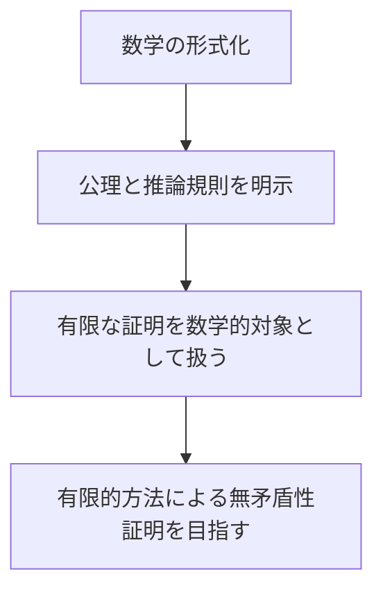
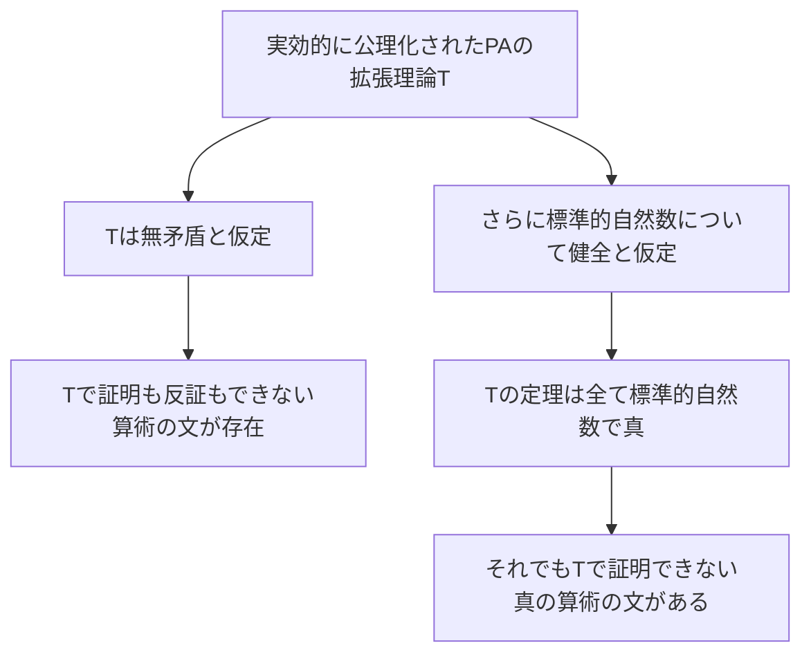
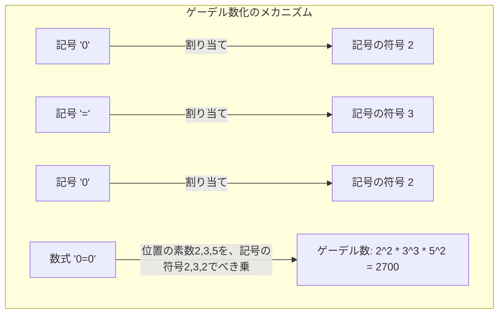
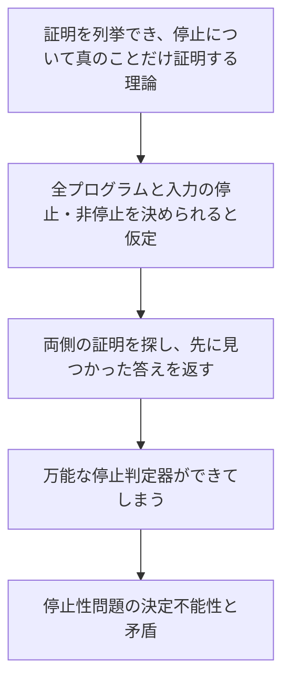

一つの公理系を選び、機械的な規則で証明を積み重ねれば、自然数についての全ての問いに答えられるのでしょうか。ゲーデルの不完全性定理は、一定の条件を満たす理論について、そのような完全な解決ができないことを示します。

大切なのは、<strong>どの理論で証明できないのか</strong>を明確にすることです。「どのような公理を使っても絶対に証明できない真理がある」という意味ではありません。無矛盾性、健全性、実効的な公理化を区別しながら、符号化と自己言及の仕組み、そして定理の適用範囲を見ていきます。

---

## 1. ヒルベルト・プログラムと三つの異なる問い

数学の基礎を確かなものにするため、[ダフィット・ヒルベルト](/p/hilbert/)らは、数学を形式的な公理系として記述し、その無矛盾性を有限的な方法で証明する計画を進めました。数学を形式化することと、その証明について外側から調べることは区別します。「対象の体系が、自分の内部で全てを保証する」という説明だけでは、この計画を正確に表せません。

以下の三つの性質も区別が必要です。

- <strong>無矛盾性</strong>：同じ文 $A$ とその否定 $\neg A$ の両方を証明しないこと。
- <strong>理論の完全性</strong>：その言語の各文 $A$ について、$A$ または $\neg A$ を理論内で証明できること。ここでは構文的な完全性を指します。
- <strong>決定可能性</strong>：与えられた文が理論の定理かどうかを、必ず停止するアルゴリズムで判定できること。

完全性は、全ての定理が意図した解釈で真であるという健全性とは別です。また、一階述語論理の「完全性定理」と、ある算術の理論が完全であることも同じ意味ではありません。

## 2. 形式的体系とペアノ算術

形式的体系では、使用する記号、式の作り方、公理、推論規則を指定します。有限な証明が規則に従っているかを調べる構文上の作業と、その式がある解釈で真かを問う意味論上の作業を分けられます。「意味が不要」とは、数学で意味を考えなくてよいということではありません。

代表的な例が、一階のペアノ算術（PA）です。自然数のゼロ、後者、加法、乗法などを扱い、帰納法の公理図式を含みます。例えば $1+1=2$ も、これらの公理と規則から導く文です。

以下では分かりやすい十分条件として、PAを含む実効的に公理化された理論を主に考えます。不完全性の最弱の条件を述べているわけではなく、第一定理にはPAより弱い算術を基礎にした形もあります。

## 3. 第一不完全性定理：理論内で決まらない文

[クルト・ゲーデル](/p/godel/)の不完全性定理を、ここではロッサーによる改良を含む次の形で述べます。

> PAを含む、実効的に公理化された無矛盾な理論には、その理論内では証明も反証もできない算術の文が存在する。

ここで「実効的に公理化」とは、公理や証明を機械的な手続きで列挙できることを意味します。証明できないという主張は、選んだ理論に相対的です。別の公理を加えた理論でも絶対に証明できない、という意味ではありません。標準的な自然数についての真理と、固定した理論内での証明可能性を区別する必要があります。

「証明できる文の集合が、標準的な自然数で真である文の集合に含まれる」という図を描くなら、無矛盾性より強い<strong>健全性</strong>を仮定する必要があります。無矛盾性は、ある文とその否定を両方証明しないという条件であり、それだけで全ての定理が標準的な自然数について真になるわけではありません。

### 自己言及を矛盾ではなく算術の文として作る

嘘つきの文「この文は偽である」との類似は直感の助けになります。しかしゲーデルの構成は、数学の内部に矛盾を持ち込むものではありません。文や証明を数で符号化し、<strong>特定の理論で証明できるか</strong>を算術で表します。

理論を $T$ とし、$\operatorname{Prov}_T(y)$ を「番号 $y$ の文に $T$ での証明が存在する」と表す通常の証明述語とします。$\ulcorner G_T\urcorner$ は、文 $G_T$ の符号を表す数詞です。固定点補題により、次の同値を理論内で証明できる文を構成できます。

$$
T\vdash G_T\leftrightarrow\neg\operatorname{Prov}_T(\ulcorner G_T\urcorner)
$$

$T\vdash A$ は「$T$ が $A$ を証明する」という意味です。これは自然言語の文をそのまま公理にする操作ではなく、符号化と代入を使った構成です。

もし $T$ に $G_T$ の証明があれば、その有限の証明の存在を算術でも表せるため、$T$ は $\operatorname{Prov}_T(\ulcorner G_T\urcorner)$ を証明します。一方、上の同値と $G_T$ から、その否定も証明してしまいます。従って、$T$ が無矛盾なら $G_T$ は $T$ で証明できません。

標準的な自然数で通常の証明述語が実際の有限証明を正しく表すことを使うと、この非証明可能性から $G_T$ が標準的な自然数で真であると分かります。この外部からの議論には、$T$ が無矛盾だという仮定が含まれます。どんな理論の無矛盾性も、人間が自動的に見抜けるという意味ではありません。

ここまでの議論だけで、単なる無矛盾性から同じ $G_T$ の否定も証明できないと結論してはいけません。例えば健全性を仮定すれば、真である $G_T$ の否定は証明できません。ゲーデルの元の独立性の証明は $\omega$ 無矛盾性を用い、ロッサーは別の文を構成して、通常の無矛盾性だけで証明も反証もできないという結果を得ました。

## 4. ゲーデル数化：記号列と証明を数で表す

ゲーデル数化は、記号、式、有限な証明列に自然数の符号を対応させる方法です。以下では仕組みを示す教材用の例として、同じ記号には同じ正整数の符号を使い、文字列内の位置に異なる素数を対応させます。原論文の番号付けをそのまま再現したものではありません。

記号「0」の符号を2、「=」の符号を3とすると、文字列「0=0」は符号列2, 3, 2になります。位置の素数2, 3, 5をそれぞれの符号でべき乗して掛けた値は2700です。2以上の整数の素因数分解の一意性により、この例では元の符号列を復元できます。

重要なのは巨大な数を作ること自体ではなく、式の構文、代入、有限な証明の検査を数についての関係として扱えることです。例えば「数 $p$ は、番号 $q$ の文の証明を符号化している」という関係と、「そのような $p$ が存在する」という証明可能性を区別します。

一つの有限な証明候補の検査と、証明が存在しないことの判定は別の問題です。符号化しただけで、全ての証明可能性が決定できるようになるわけではありません。

## 5. 第二不完全性定理：体系内での無矛盾性の証明

第二不完全性定理についても、ここでは次の十分条件のもとで説明します。

> 実効的に公理化された無矛盾なPAの拡張理論は、通常の証明述語を用いて表した自分自身の無矛盾性を、その理論内では証明できない。

例えば、矛盾を表す文として $0=1$ を選び、無矛盾性を次のように表します。

$$
\operatorname{Con}(T)
\equiv\neg\operatorname{Prov}_T(\ulcorner 0=1\urcorner)
$$

これは「$T$ に矛盾の証明が存在しない」という算術の文です。任意の式に「無矛盾性」という名前を付ければ同じ結果になるわけではなく、証明述語の形式化と導出条件が重要です。

「自分は嘘をつかないと言う人の言葉だけを信用できるか」という比喩は、証明の根拠を考えるきっかけにはなります。しかし、第二定理の証明ではありません。矛盾した理論なら何でも証明できるという事実だけでも、無矛盾な理論での非証明可能性は導けません。

ここでの無矛盾性は、全ての定理が意図した解釈で真であるという健全性とも区別します。より強い理論で元の理論の無矛盾性を証明する可能性は排除されません。また、人間、組織、あらゆるソフトウェアに無条件で当てはまる定理でもありません。

## 6. よくある誤解と、適用範囲

### 数学が破綻したという意味ではない

不完全性は無矛盾性の否定ではありません。ある固定した理論で決まらない文があるという結果です。新しい公理を加える場合には、その公理を選ぶ理由と、拡張した理論の無矛盾性などを改めて検討します。公理を加えるだけで、全ての問題が消えるわけではありません。

### 人間が機械を超えるという結論ではない

外側からゲーデル文が真だと論じる際にも、対象理論の無矛盾性などを仮定しています。人間が任意の理論についてその仮定を確かめられることは、定理には含まれません。人間の理性やAIについての哲学的な議論を、ここで述べた数学的結論と混同しないようにします。

### どんな理論も不完全になるわけではない

対象の言語と公理、実効性、算術を表せる強さが重要です。例えば、実数をゼロ・一・加法・乗法・順序で扱う実閉体の一階理論は、完全であり決定可能です。量化記号の消去によって判定に結び付けられます。

これは、任意の関数や集合を含む「実数に関する全ての数学」を自動で解けるという意味ではありません。また、自然数の算術を同じように扱えるという意味でもありません。「ユークリッド幾何学は完全」と述べる場合も、どの形式化や言語を指すかを指定する必要があります。

## 7. 停止性問題との関係

[停止性問題](/p/halting-problem/)は、任意のプログラムと固定された入力について、必ず終了して正しい停止・非停止の答えを返す万能なアルゴリズムがない、という結果です。チューリングの計算モデルは数学的なものであり、形式的体系を単に物理的な機械へ置き換えただけの議論ではありません。

関係を見る一つの方法として、証明を機械的に列挙でき、停止・非停止について真のことだけを証明する理論を考えます。もし全てのプログラムと入力について停止か非停止のどちらかを証明できれば、証明を順番に探し、見つかった側を返すことで停止性問題を決定できてしまいます。

この説明には、停止についての健全性という強い仮定があります。ゲーデルの各定理の最弱の条件や完全な証明そのものではありません。また、計算可能性と、計算に要する時間やメモリを調べる計算量の問題も区別します。

## 8. 結論：理論と仮定を明示する

不完全性定理が述べるのは、一定の条件を満たす固定された理論における証明の限界です。実効的に公理化された無矛盾な算術の理論には、その内部では証明も反証もできない文があります。また、十分な条件のもとでは、通常の形で表した自分自身の無矛盾性も内部では証明できません。

ある理論で決まらない文を、新しい公理を加えた理論で証明できることはあります。ただし、拡張した理論も同じ適用条件を満たすなら、そこでまた不完全性が生じます。全ての算術的真理を集めた集合を考えることと、それを機械的に列挙できる公理系として与えることも別です。

数学の破綻、人間の機械に対する優越、あらゆるAIの能力の上限は、この定理だけからは導けません。読者が確かめるべきなのは、「どの理論を選んだか」「何を仮定したか」「真であるという意味と、証明できるという意味を区別しているか」です。

### 参考文献

- [Open Logic Project: Incompleteness and Computability](https://ic.openlogicproject.org/ic-screen.pdf) — 符号化、固定点補題、ゲーデルとロッサーの結果、証明述語の条件を学ぶための教材。
- [UCLA: Incompleteness and Undecidability](https://www.math.ucla.edu/~dam/220b.1.11w/220notes4.pdf) — 記号や証明の算術化、健全性を用いる第一定理とロッサーの形の区別。
- [Richard Zach: The Practice of Finitism](https://arxiv.org/abs/math/0102189) — ヒルベルトの計画における公理化と有限的な無矛盾性証明の研究。
- [Jindřich Zapletal: Elements of Set Theory](https://people.clas.ufl.edu/zapletal/files/notesset.pdf) — 実閉体の一階言語と量化記号消去。第6.3節の定理6.3.12を参照。
