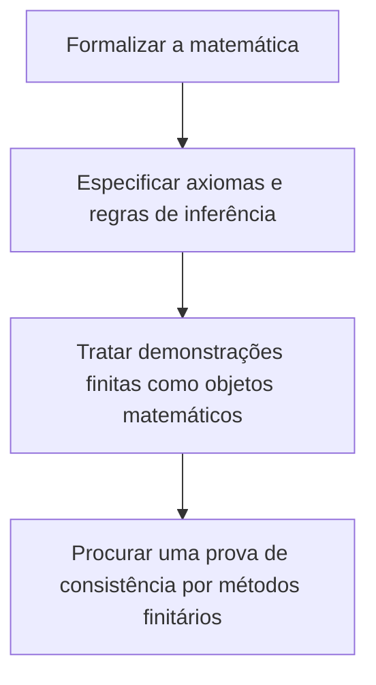
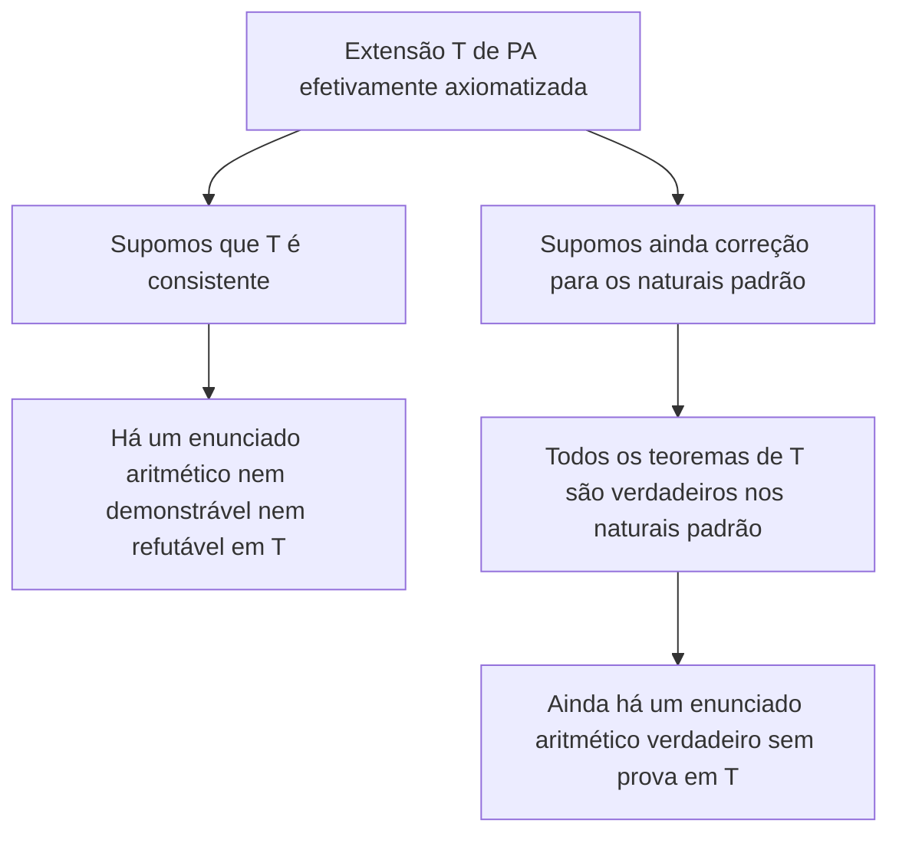
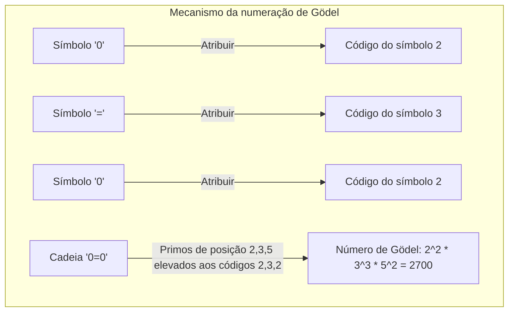
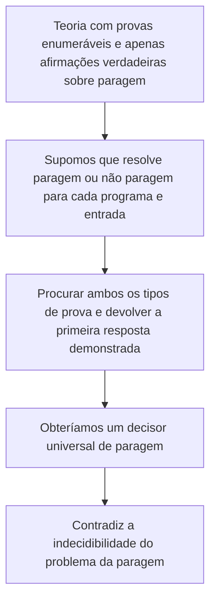

Se escolhermos um conjunto de axiomas e construirmos demonstrações por regras mecânicas, conseguiremos responder a todas as perguntas sobre os números naturais? Os teoremas da incompletude de Gödel mostram que teorias que satisfazem certas condições não podem oferecer essa solução completa.

O essencial é precisar <strong>em que teoria um enunciado não pode ser demonstrado</strong>. O resultado não afirma que existam verdades indemonstráveis independentemente dos axiomas utilizados. Vamos distinguir consistência, correção semântica e axiomatização efetiva ao examinar a codificação, a autorreferência e o alcance dos teoremas.

---

## 1. O programa de Hilbert e três perguntas diferentes

Para estabelecer bases firmes para a matemática, [David Hilbert](/pt/p/hilbert/) e outros propuseram descrevê-la por sistemas axiomáticos formais e demonstrar a sua consistência por métodos finitários. Formalizar a matemática e estudar as suas demonstrações a partir do exterior do sistema são tarefas diferentes. Descrever o programa apenas como «um sistema que garante tudo sobre si próprio a partir do seu interior» não é exato.

Também é necessário distinguir três propriedades.

- <strong>Consistência</strong>: a teoria não demonstra simultaneamente um enunciado $A$ e a sua negação $\neg A$.
- <strong>Completude de uma teoria</strong>: para cada enunciado $A$ da sua linguagem, a teoria demonstra $A$ ou $\neg A$. Trata-se de completude sintática.
- <strong>Decidibilidade</strong>: um algoritmo que termina sempre consegue determinar se um enunciado dado é um teorema da teoria.

A completude difere da correção semântica, que exige que todos os teoremas sejam verdadeiros na interpretação pretendida. O teorema da completude da lógica de primeira ordem também não significa o mesmo que a completude de uma teoria aritmética específica.

## 2. Sistemas formais e aritmética de Peano

Um sistema formal especifica símbolos, regras de formação de fórmulas, axiomas e regras de inferência. A verificação sintática de que uma demonstração finita segue as regras pode ser separada da questão semântica de saber se uma fórmula é verdadeira numa interpretação. Dizer que verificar uma demonstração não exige considerar o significado não implica que o significado seja irrelevante para a matemática.

Um exemplo habitual é a aritmética de Peano de primeira ordem (PA). Trata do zero, do sucessor, da adição e da multiplicação de números naturais, e inclui um esquema de axiomas de indução. Até $1+1=2$ é um enunciado derivado desses axiomas e regras.

Por clareza, consideraremos sobretudo teorias efetivamente axiomatizadas que contêm PA, como um conjunto de condições suficientes. Não são as hipóteses mais fracas possíveis: há formas do primeiro teorema que se aplicam sobre aritméticas mais fracas.

## 3. O primeiro teorema da incompletude: enunciados que uma teoria não resolve

Apresentamos o resultado de incompletude de [Kurt Gödel](/pt/p/godel/) na seguinte forma, que incorpora o aperfeiçoamento de Rosser.

> Toda a teoria consistente e efetivamente axiomatizada que contém PA tem um enunciado aritmético que não consegue demonstrar nem refutar.

«Efetivamente axiomatizada» significa que os axiomas e as demonstrações podem ser enumerados por um procedimento mecânico. A indemonstrabilidade é relativa à teoria escolhida. Não significa que o enunciado tenha de continuar indemonstrável noutra teoria com axiomas adicionais. É necessário distinguir a verdade nos números naturais padrão da demonstrabilidade numa teoria fixa.

Para representar o conjunto dos enunciados demonstráveis como um subconjunto dos que são verdadeiros nos números naturais padrão, precisamos da hipótese mais forte de <strong>correção semântica</strong>. A consistência apenas exclui demonstrar um enunciado e a sua negação; por si só, não torna todos os teoremas verdadeiros nos números naturais padrão.

### Construir autorreferência aritmética, não uma contradição

A semelhança com a frase do mentiroso «Esta frase é falsa» pode ajudar a intuição. Mas a construção de Gödel não introduz uma contradição na matemática. Codifica enunciados e demonstrações como números e expressa aritmeticamente a <strong>demonstrabilidade numa teoria específica</strong>.

Seja $T$ a teoria e seja $\operatorname{Prov}_T(y)$ o predicado habitual de demonstrabilidade, que expressa que o enunciado com código $y$ tem uma demonstração em $T$. A notação $\ulcorner G_T\urcorner$ representa o numeral do código do enunciado $G_T$. O lema do ponto fixo permite construir um enunciado para o qual a teoria demonstra esta equivalência:

$$
T\vdash G_T\leftrightarrow\neg\operatorname{Prov}_T(\ulcorner G_T\urcorner)
$$

Aqui, $T\vdash A$ significa que $T$ demonstra $A$. A construção utiliza codificação e substituição, em vez de adotar diretamente uma frase da linguagem natural como axioma.

Se $T$ tivesse uma demonstração de $G_T$, a existência dessa demonstração finita também poderia ser expressa em aritmética, pelo que $T$ demonstraria $\operatorname{Prov}_T(\ulcorner G_T\urcorner)$. Porém, a equivalência acima, juntamente com $G_T$, daria também a sua negação. Assim, se $T$ for consistente, não pode demonstrar $G_T$.

Nos números naturais padrão, o predicado habitual de demonstrabilidade descreve corretamente as demonstrações finitas que realmente existem. Usando esse facto, a ausência de demonstração permite concluir que $G_T$ é verdadeiro nos números naturais padrão. Este argumento externo inclui a hipótese de que $T$ é consistente. Não significa que os seres humanos consigam reconhecer automaticamente a consistência de qualquer teoria.

Este argumento, por si só, não permite inferir da mera consistência que a mesma teoria também não possa demonstrar a negação de $G_T$. A correção semântica, por exemplo, exclui demonstrar a negação do enunciado verdadeiro $G_T$. A prova original de independência de Gödel utilizava a $\omega$-consistência; Rosser construiu um enunciado diferente para obter indemonstrabilidade e irrefutabilidade apenas a partir da consistência habitual.

## 4. Numeração de Gödel: codificar cadeias e demonstrações como números

A numeração de Gödel atribui códigos naturais a símbolos, fórmulas e sequências finitas de demonstração. Como exemplo didático, atribuímos o mesmo inteiro positivo a cada ocorrência de um símbolo e primos diferentes às posições de uma cadeia. Não se trata de reproduzir literalmente a numeração do artigo original.

Atribuamos o código 2 ao símbolo «0» e o código 3 a «=». A cadeia «0=0» tem então a sequência de códigos 2, 3, 2. Elevar os primos de posição 2, 3, 5 a esses expoentes e multiplicar dá 2700. A unicidade da fatorização prima dos inteiros maiores ou iguais a dois permite recuperar a sequência original neste exemplo.

O importante não é produzir números enormes, mas tratar a sintaxe, a substituição e a verificação de demonstrações finitas como relações entre números. Por exemplo, devemos distinguir a relação «o número $p$ codifica uma demonstração do enunciado com código $q$» da demonstrabilidade, que afirma que existe tal $p$.

Verificar um candidato finito a demonstração é diferente de decidir que não existe nenhuma demonstração. A codificação, por si só, não torna decidíveis todas as questões de demonstrabilidade.

## 5. O segundo teorema da incompletude: demonstrar consistência dentro de uma teoria

Também explicaremos o segundo teorema da incompletude sob as seguintes hipóteses suficientes.

> Uma extensão de PA consistente e efetivamente axiomatizada não pode demonstrar dentro de si própria a sua consistência expressa pelo predicado habitual de demonstrabilidade.

Por exemplo, escolhamos $0=1$ como contradição e expressemos a consistência assim:

$$
\operatorname{Con}(T)
\equiv\neg\operatorname{Prov}_T(\ulcorner 0=1\urcorner)
$$

Este é um enunciado aritmético que afirma que $T$ não tem uma demonstração de uma contradição. Dar o nome «consistência» a uma fórmula arbitrária não produz o mesmo resultado: importam a formalização do predicado de demonstrabilidade e as suas condições de derivabilidade.

A analogia de alguém que afirma «Eu nunca minto» pode levar-nos a perguntar pelos fundamentos de uma prova. Não é uma demonstração do segundo teorema. O facto de uma teoria inconsistente demonstrar tudo também não estabelece, por si só, a indemonstrabilidade numa teoria consistente.

A consistência distingue-se aqui da correção semântica, isto é, de todos os teoremas serem verdadeiros na interpretação pretendida. O resultado não exclui demonstrar a consistência da teoria original noutra mais forte. Também não se aplica sem condições a pessoas, organizações ou todos os sistemas de software.

## 6. Mal-entendidos e alcance do resultado

### A matemática não ruiu

A incompletude não é a negação da consistência. Afirma que uma teoria fixa deixa alguns enunciados por resolver. Ao acrescentar axiomas, precisamos de considerar por que motivo os escolhemos e examinar questões como a consistência da extensão. Acrescentar axiomas não elimina automaticamente todas as dificuldades.

### O teorema não demonstra que os humanos superem as máquinas

Mesmo o argumento externo que estabelece a verdade de um enunciado de Gödel pressupõe condições como a consistência da teoria. O teorema não afirma que os humanos consigam verificar essas hipóteses para qualquer teoria. Os argumentos filosóficos sobre a razão humana ou a IA devem ser distinguidos das conclusões matemáticas expostas aqui.

### Nem todas as teorias são incompletas

Importam a linguagem, os axiomas, a efetividade e a capacidade de expressar aritmética. Por exemplo, a teoria de primeira ordem dos corpos reais fechados, que descreve os números reais por meio de zero, um, adição, multiplicação e ordem, é completa e decidível. A eliminação de quantificadores proporciona uma via para decidir os seus enunciados.

Isto não significa que toda a matemática que envolva números reais, funções arbitrárias ou conjuntos possa ser resolvida automaticamente. Também não dá o mesmo resultado para a aritmética dos naturais. Afirmar que «a geometria euclidiana é completa» também exige especificar a formalização e a linguagem.

## 7. A relação com o problema da paragem

O [problema da paragem](/pt/p/halting-problem/) estabelece que não existe um algoritmo universal que termine sempre e responda corretamente se um programa qualquer termina com uma entrada dada. O modelo de Turing é matemático; não se trata simplesmente de substituir um sistema formal por uma máquina física.

Uma maneira de compreender a relação é considerar uma teoria cujas demonstrações possam ser enumeradas mecanicamente e que só demonstre afirmações verdadeiras sobre paragem e não paragem. Se demonstrasse a paragem ou a não paragem para cada programa e entrada, poderíamos enumerar as demonstrações e devolver a resposta para a qual encontrássemos uma prova, decidindo assim o problema da paragem.

Esta explicação usa a hipótese forte de correção semântica quanto à paragem. Não enuncia as hipóteses mais fracas nem constitui uma demonstração completa de cada teorema de Gödel. A computabilidade também deve ser distinguida da complexidade, que estuda o tempo e a memória necessários para calcular.

## 8. Conclusão: especificar a teoria e as hipóteses

Os teoremas da incompletude descrevem limites das demonstrações numa teoria fixa que satisfaz certas condições. Uma teoria aritmética consistente, efetivamente axiomatizada e com a força necessária tem enunciados que não consegue demonstrar nem refutar. Sob condições suficientes, também não consegue demonstrar a sua própria consistência na formalização habitual.

Um enunciado por resolver numa teoria pode tornar-se demonstrável ao acrescentar novos axiomas. Contudo, se a extensão continuar a satisfazer as mesmas condições, também será incompleta. Considerar o conjunto de todas as verdades aritméticas é diferente de fornecer uma axiomatização mecanicamente enumerável desse conjunto.

A ruína da matemática, a superioridade humana sobre as máquinas e limites indiscriminados para toda a IA não decorrem destes teoremas por si só. Devemos perguntar que teoria foi escolhida, que hipóteses se adotam e se estamos a distinguir a verdade da demonstrabilidade.

### Referências

- [Open Logic Project: Incompleteness and Computability](https://ic.openlogicproject.org/ic-screen.pdf) — manual sobre codificação, pontos fixos, resultados de Gödel e Rosser e condições dos predicados de demonstrabilidade.
- [UCLA: Incompleteness and Undecidability](https://www.math.ucla.edu/~dam/220b.1.11w/220notes4.pdf) — aritmetização de símbolos e demonstrações, distinguindo o primeiro teorema baseado na correção semântica da forma de Rosser.
- [Richard Zach: The Practice of Finitism](https://arxiv.org/abs/math/0102189) — investigação sobre axiomatização e provas finitárias de consistência no programa de Hilbert.
- [Jindřich Zapletal: Elements of Set Theory](https://people.clas.ufl.edu/zapletal/files/notesset.pdf) — linguagem de primeira ordem dos corpos reais fechados e eliminação de quantificadores; ver o teorema 6.3.12 da secção 6.3.
